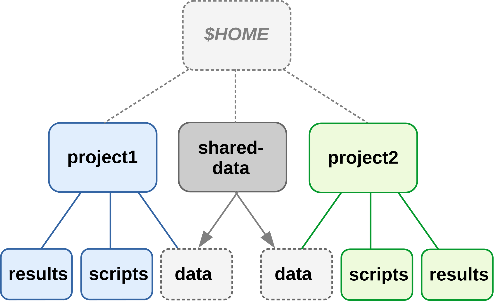
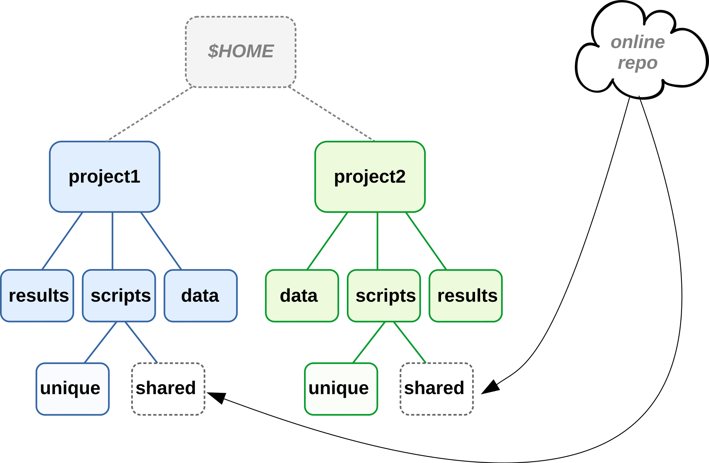
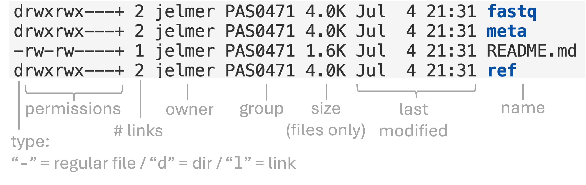
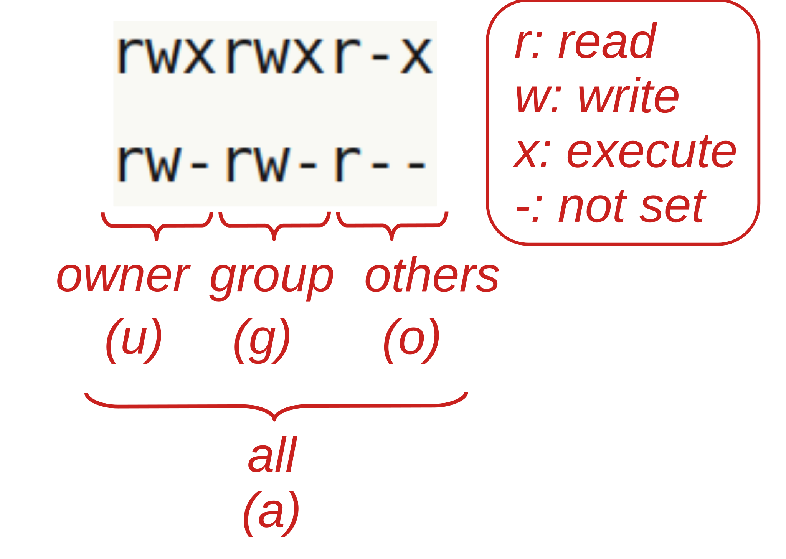

------

<hr style="height:10pt; visibility:hidden;" />

## Introduction

This page contains additional notes on project and data management:
sharing data and code across projects, symbolic links,
checking file integrity with checksums, file permissions,
and more about file compression.
(For transferring files to and from OSC, see the
[SSH and file transfer](ssh.qmd) page,
and for downloading genomes and reads from NCBI, see the
[Finding and downloading data from NCBI](../ref/ncbi.qmd) reference page.)

Run the commands on this page from your personal dir, `/fs/ess/PAS3493/people/$USER`,
and follow the sections in order, since some of them change your working dir.

## When projects share data and/or code

We've talked about organizing your work into projects,
and keeping each project self-contained.
But what if you have related projects that share data and/or code?

From @wilson2017:

> *As a rule of thumb, divide work into projects based on the overlap in data and code files:*
>
> - *If 2 research efforts share no data or code,*
>   *they will probably be easiest to manage independently.*
>
> - *If they share more than half of their data and code, they are probably best*
>   *managed together.*
>
> - *If you are building tools that are used in several projects,*
>   *the common code should probably be in a project of its own.*

::: {.columns}
::: {.column width="40%"}

To access files that are outside of the project, because they are shared across projects,
one solution is to create **links** (i.e. shortcuts/aliases) to these files
(see [below](#symbolic-links) for how to do this):

:::
::: {.column width="60%"}

{fig-align="center" width="90%" .no-border fig-alt="A diagram showing two research project folder hierarchies, with the data folder from one project being linked to the other project." .lightbox}

:::
:::

::: {.columns}
::: {.column width="40%"}

But in many cases,
it may be better to store shared data and/or scripts in separate folders altogether,
and link to them in each project that uses them:

:::
::: {.column width="60%"}

{fig-align="center" width="90%" .no-border fig-alt="A diagram showing two research project folder hierarchies, with a separate shared-data folder that is linked to both projects." .lightbox}

:::
:::

Both of the above strategies do decrease the portability of your project,
and moving the shared files even within your own computer will cause links/shortcuts
to break.
A more portable method is to **keep shared (multi-project) files online** ---
this is especially feasible for **scripts** under version control:

{fig-align="center" width="70%" .no-border fig-alt="A diagram showing two research project folder hierarchies, both of which have a connection to an online script repository." .lightbox}

For **data**, this is also possible but often not practical due to file sizes.
It's easier after data has been deposited in a public repository.

## Symbolic links

As shown above, a convenient way to use files that are stored outside of a project
is with **symbolic links** ("symlinks"):
small files that merely point to another file or dir,
much like a shortcut (Windows) or alias (Mac).

```bash
mkdir -p sandbox
cd sandbox
```

### Symlinks to files

You can create a symlink with `ln -s`:

- When you only provide the source file or dir,
  it creates a link of the same name in your working dir:

  ```bash
  ln -s /fs/ess/PAS3493/data/garrigos/fastq/S64_R1.fastq.gz
  ```

  ```bash
  ls -l
  ```
  <pre class="bash-out"><code>lrwxrwxrwx 1 jelmer PAS0471 51 Nov  5 10:12 <span class="ls-cyan">S64_R1.fastq.gz</span> -> <span class="ls-red">/fs/ess/PAS3493/data/garrigos/fastq/S64_R1.fastq.gz</span></code></pre>

- You can also give a path to the link, such as simply a different name:

  ```bash
  ln -s /fs/ess/PAS3493/data/garrigos/fastq/S64_R1.fastq.gz shared.fastq.gz
  ```

  ```bash
  # Both the first link and the new link are now in your working dir:
  ls -l
  ```
  <pre class="bash-out"><code>lrwxrwxrwx 1 jelmer PAS0471 51 Nov  5 10:12 <span class="ls-cyan">S64_R1.fastq.gz</span> -> <span class="ls-red">/fs/ess/PAS3493/data/garrigos/fastq/S64_R1.fastq.gz</span>
lrwxrwxrwx 1 jelmer PAS0471 51 Nov  5 10:12 <span class="ls-cyan">shared.fastq.gz</span> -> <span class="ls-red">/fs/ess/PAS3493/data/garrigos/fastq/S64_R1.fastq.gz</span></code></pre>

Above, you could see that in the long-format `ls` output,
symlinks start with an `l` and show their target after the `->`.

Once you have a symlink, you can **use it** like the original file.
For example:

```bash
zcat shared.fastq.gz | head -n 2
```
```bash-out
@ERR10802864.1 1 length=71
GATCAACCATGCAGCTGCCAGGTGGTGGCCACTTCCGGCTGCACCACACCGACCAGATTTGTTGCCCGGGC
```

::: {.callout-warning collapse="true"}
#### Absolute or relative paths for the source? _(Click to expand)_

Above, you may have noticed that we used the **absolute path** to the source file.
This is not strictly necessary, but it is safer than using a relative path.
If you use a relative path for the source,
it is interpreted relative to the location of the link, not to your working dir.
For example, running the following from your personal dir creates a **broken link**,
because it points to `sandbox/garrigos/README.md`, which doesn't exist:

```{.bash .norun}
ln -s garrigos/README.md sandbox/
```

The easiest way to avoid this is to use absolute paths for the source,
e.g. with the `$PWD` variable, which contains your working dir:

```{.bash .norun}
# Also run from your personal dir:
ln -s "$PWD"/garrigos/README.md sandbox/
```

That said, relative links have the advantage of relative paths that you learned about in
[w11a](../week11/w11a_data.qmd#relative-paths-and-data-management):
a relative link between two files in the same project
keeps working when you move or share the whole project.
For example, this would create a working relative link (also run from your personal dir):

```{.bash .norun}
ln -s ../garrigos/README.md sandbox/
```

So, use absolute paths for links to files outside of your project (like shared data),
and consider relative ones for links within a project.

<hr style="height:1pt; visibility:hidden;" />

:::

### Symlinks to dirs

You can link to a **dir** in the same way.
For example, create a link to the dir with the Garrigos et al. FASTQ files:

```bash
ln -s /fs/ess/PAS3493/data/garrigos/fastq fastq-link
```

A **symlink to a dir** is a **point of entry to the original dir**:
anything you do _through_ the link affects the original files.
For example, listing the link's contents shows the files in the original dir:

```bash
ls fastq-link | head -n 2
```
<pre class="bash-out"><code><span class="ls-red">S63_R1.fastq.gz</span>
<span class="ls-red">S63_R2.fastq.gz</span></code></pre>

So, `rm fastq-link/*.fastq.gz` would remove the original FASTQ files!

Alternatively, you can link to **each of the files in a dir** at once with a wildcard.
This creates separate links to the files instead of a single link to the dir:

```{.bash .norun}
# Link to a dir: creates a link 'project1/scripts/shared_scripts':
ln -s /fs/ess/PAS3493/shared_scripts project1/scripts/

# Link to each of the files in a dir:
ln -s /fs/ess/PAS3493/shared_scripts/* project1/scripts/
```

### Removing symlinks

To remove a symlink, use `rm` or `unlink`.
This only removes the link itself, not the file or dir it points to.
For example, remove the two file links you created above:

```bash
rm shared.fastq.gz
unlink S64_R1.fastq.gz
```

Removing these symlinks did not affect the original file, which is still there:

```bash
ls /fs/ess/PAS3493/data/garrigos/fastq/S64_R1.fastq.gz
```
<pre class="bash-out"><code><span class="ls-red">/fs/ess/PAS3493/data/garrigos/fastq/S64_R1.fastq.gz</span></code></pre>

To remove a link to a dir, also use `rm` without `-r`
(the link is a file, even when it points to a dir):

```bash
rm fastq-link
```

<!---- TODO: Verify at OSC (GNU rm) that `rm -r my-link/` deletes the contents of the
original dir (and then fails to remove the link itself with "Not a directory"),
while `rm -r my-link` only removes the link. Also check the matching exercise answers below.
Test:
mkdir -p /fs/scratch/PAS3493/$USER/lntest/target && touch /fs/scratch/PAS3493/$USER/lntest/target/{a,b}
cd /fs/scratch/PAS3493/$USER/lntest && ln -s target mylink
rm -r mylink/; ls target    # expected: error about 'mylink/', and 'target' is now empty ---->

::: callout-warning
#### Watch out for trailing slashes
`rm -r fastq-link` only removes the link,
but `rm -r fastq-link/` (with a trailing slash, which tab completion may add)
follows the link and removes the _contents_ of the original dir!
:::

::: exercise
####  Exercise: Symbolic links

1. Create a symlink called `pp5006` in your Home dir that points to your personal dir
   in the project dir (`/fs/ess/PAS3493/people/$USER`).
   What would the link have been called if you had run `ln -s /fs/ess/PAS3493/people/$USER ~` instead?

   <details><summary> &nbsp; _Click to see the solution_</summary>

   ```bash
   ln -s /fs/ess/PAS3493/people/$USER ~/pp5006
   ```

   `~/<your-username>`: when the second argument is an existing dir,
   the link is created inside it, with the name of the last part of the source path.

   </details>

2. Predict what each of the following commands would remove (_don't run them!_):

   a. `rm ~/pp5006`
   b. `rm -r ~/pp5006/garrigos`
   c. `rm -r ~/pp5006/`

   <details><summary> &nbsp; _Click to see the solution_</summary>

   a. Only the link.
   b. Your _original_ `garrigos` dir in the project dir.
   c. Everything inside your personal dir in the project dir (the link itself remains)!

   </details>
:::

## Checking file integrity with checksums

<!--- TODO? Include example with garrigos FASTQ files ---->

When you receive FASTQ files from a sequencing facility,
or download files from a public repository,
they are often accompanied by a small text file with a name like
`md5.txt`, `md5checksums.txt`, or `sha256sums.txt`.

Such a file contains so-called **checksums**,
a sort of digital fingerprint for files,
which you can use to **check whether your copy of these files is completely intact**
(e.g., that a transfer didn't get cut short).

A checksum is a short string computed from a file's contents,
in such a way that if even one character in the file changes,
the checksum will be completely different.
For example, you can compute an md5 checksum with the `md5sum` command ---
here, for a string of text rather than a file:

```bash
echo "bioinformatics is fun" | md5sum
```
```{.bash-out}
010b5ebf7e207330de0e3fb0ff17a85a  -
```
```bash
echo "bioinformatic is fun" | md5sum
```
```{.bash-out}
45cc2b76c02b973494954fd664fc0456  -
```

Note that the two strings differ by only one character,
but their checksums are completely different.

(The `-` above means that `md5sum` read its input from standard in rather than from a file.)

### Checking a downloaded file

Downloads, especially of large files, can occasionally be cut short or end up incomplete,
for example when the network connection drops.
This won't always produce a clear error,
and an incomplete file can look perfectly normal at first glance:
its name is the same, and the first lines look fine.
Checking the checksum is the way to be sure that you got the whole file.

The NCBI FTP dir with the _Culex pipiens_ genome files that you
[downloaded from in week 11](../week11/w11a_data.qmd#wget)
also contains a checksum file, `md5checksums.txt`.
Download it into your `week11/sandbox` dir,
where you downloaded the protein FASTA file in the w11a exercise[^protein]:

```bash
# Move back from 'sandbox' to your personal dir
cd ..
wget -P week11/sandbox https://ftp.ncbi.nlm.nih.gov/genomes/all/GCF/016/801/865/GCF_016801865.2_TS_CPP_V2/md5checksums.txt
```

The file has one line per file in the FTP dir,
with the checksum in the first column and the file name in the second.
Let's look up the line for the protein FASTA file:

[^protein]: If you didn't do that exercise, first run:
            `wget -P week11/sandbox https://ftp.ncbi.nlm.nih.gov/genomes/all/GCF/016/801/865/GCF_016801865.2_TS_CPP_V2/GCF_016801865.2_TS_CPP_V2_protein.faa.gz`

```bash
cd week11/sandbox
grep "V2_protein.faa.gz" md5checksums.txt
```
```{.bash-out}
d593406dc180606713164a17c1a05d0a  ./GCF_016801865.2_TS_CPP_V2_protein.faa.gz
```

Now, compute the checksum for your copy of the file:

```bash
md5sum GCF_016801865.2_TS_CPP_V2_protein.faa.gz
```
```{.bash-out}
d593406dc180606713164a17c1a05d0a  GCF_016801865.2_TS_CPP_V2_protein.faa.gz
```

The two are identical, so your download is intact.
Rather than comparing checksums by eye,
you can let `md5sum` do the comparison with its `-c` (check) option.
This option takes lines in the format above (from a file or from standard in),
computes the checksum for each listed file, and compares it to the listed one:

```bash
grep "V2_protein.faa.gz" md5checksums.txt | md5sum -c
```
```{.bash-out}
./GCF_016801865.2_TS_CPP_V2_protein.faa.gz: OK
```

- We only passed the line for the protein file,
  because `md5checksums.txt` lists ~190 files and we only have a few of them.
  When a sequencing facility sends you a checksum file for exactly your FASTQ files,
  you can simply run `md5sum -c md5.txt`.
- Run the check from inside the dir with the files,
  because the file names in a checksum file are usually relative paths
  (here, `./<file-name>`).

If a file doesn't match, `md5sum` clearly says so,
and you should download or transfer that file again:

```{.bash-out-solo}
./GCF_016801865.2_TS_CPP_V2_protein.faa.gz: FAILED
md5sum: WARNING: 1 computed checksum did NOT match
```

When you're done, move back to your personal dir:

```bash
cd ../..
```

::: {.callout-note collapse="true"}
#### SHA checksums _(Click to expand)_
MD5 is still very common for checking data integrity,
since it reliably catches accidental corruption.
However, it is no longer considered secure against deliberate tampering.
Newer tools and software distributions therefore often provide SHA-256 checksums instead,
which work the same way, with the `sha256sum` command (e.g. `sha256sum -c sha256sums.txt`).
:::

::: exercise
####  Exercise: Checksums of an unzipped file

Say that you unzipped the genome FASTA file,
so you now have `GCF_016801865.2_TS_CPP_V2_genomic.fna` rather than `...fna.gz`.

1. If you computed the md5 checksum of your unzipped FASTA file,
   would it match the one listed in `md5checksums.txt` for `..._genomic.fna.gz`? Why (not)?

   <details><summary> &nbsp; _Click to see the solution_</summary>

   No: the checksum is computed from the exact contents of a file,
   and the unzipped file has completely different contents (bytes) than the zipped file,
   even though it represents the same sequences.

   </details>

2. What does this imply about _when_ you should check checksums of downloaded files?

   <details><summary> &nbsp; _Click to see the solution_</summary>

   Check checksums right after downloading or transferring,
   _before_ you modify, unzip, or rename the files.

   </details>
:::

## File permissions

### Introduction to file permissions

File "permissions" are what different categories of users are permitted to do
with files and dirs.
Being able to view and modify file permissions is useful when you:

- Get a "Permission denied" error and want to understand why
- Want to make your data read-only to prevent accidental modification or deletion
- Need to share files with other users at OSC

There are three different permissions that can be independently controlled,
and their meaning differs between files and dirs:

| Permission        | For a file                               | For a dir                                    |
|-------------------|------------------------------------------|----------------------------------------------|
| **Read** (`r`)    | View and copy its contents               | List the names of the files in it            |
| **Write** (`w`)   | Modify or overwrite its contents         | Add, remove, or rename files in it           |
| **Execute** (`x`) | Run it as a program (see the box below)  | Enter it (`cd`) and access the files in it   |

: {.striped .hover}

You can think of a dir as a room with a list of its contents on the door:
`r` lets you read the list, `x` lets you walk in,
and `w` lets you put things in or take them out.
Two consequences of this often surprise people:

- Whether you can remove or rename a file depends on the permissions of its _dir_:
  a file's own write permissions only control whether its _contents_ can be changed.
- To access a file, you need execute permissions for its dir ---
  and for _every_ dir along the path to it.

While it is possible to set permissions for individual users,
they are most easily and commonly set for three different user categories:

- **Owner (or "user")** (`u`) ---
  By default, this is the person who created the file or dir.
  This includes cases where this person merely copied or downloaded files:
  e.g., after you have copied someone else's FASTQ files,
  you are the owner of these copies.
- **Group** (`g`) ---
  At OSC, groups correspond to OSC projects, like PAS3493.
  By default, a new file's group is your own default project,
  even when you create the file in another project's dir.
- **Other** (`o`) --- Any other user.

You can also refer to all three of these categories at once with `a` (_all_).

::: {.callout-note collapse="true"}
#### Executing a file? _(Click to expand)_
Executing a file means running it as a program/command.
For example, when we run the FastQC program with the command `fastqc`,
we are really executing a binary (executable) file somewhere on the system.
Similarly, self-written shell scripts can be executed if they have execute permissions set.

In this course, we have been running shell scripts like so:

```{.bash .norun}
bash scripts/fastqc.sh
```

Here, the program that is being executed is `bash`,
which then reads and runs the script.
The script itself therefore doesn't need execute permissions.
If you give it execute permissions (e.g. with `chmod u+x scripts/fastqc.sh`, see below),
you can also run the script directly, by typing its path ---
the shell then uses the script's shebang line (`#!/bin/bash`) to determine which program should run it:

```{.bash .norun}
scripts/fastqc.sh
```

For a script in your current working dir,
you need to precede its name with `./` (e.g., `./fastqc.sh`),
since just typing `fastqc.sh` would make the shell look for a command with that name.
:::

### Viewing file permissions

To show file permissions,
use `ls` with the `-l` (*long* format) option that we've seen before,
which should show you something like this:

```bash
ls -lh garrigos
```
<pre class="bash-out"><code>total 2.5K
drwxrwx---+ 2 jelmer PAS0471 4.0K Sep  9 13:46 <span class="ls-blue">fastq</span>
drwxrwx---+ 2 jelmer PAS0471 4.0K Sep  9 13:46 <span class="ls-blue">meta</span>
-rw-rw----+ 1 jelmer PAS0471 2.3K Sep  9 13:46 README.md
drwxrwx---+ 2 jelmer PAS0471 4.0K Sep  9 13:46 <span class="ls-blue">ref</span>
drwxrwx---+ 2 jelmer PAS0471 4.0K Sep 16 13:26 <span class="ls-blue">sandbox</span></code></pre>

With annotations:

{fig-align="center" width="80%" .no-border fig-alt="A screenshot of the long-format ls output that includes info about file permissions." .lightbox}

Here is an overview of the file permission notation in `ls -l` output:

{fig-align="center" width="40%" .no-border fig-alt="A diagram showing the different file permissions that can be set." .lightbox}

For example:

- `rwxrwxr-x` means: read, write, and execute permissions are set for the owner
  (first `rwx`) and the group (second `rwx`),
  and read and execute _but not_ write permissions for others (`r-x` at the end).

- `rw-rw-r--` means: read and write _but not_ execute permissions are set
  for both the owner (first `rw-`) and the group (second `rw-`),
  and only read permissions for others (`r--` at the end).

### Default permissions at OSC

Most commonly, files and dirs that you create at OSC will by default have:

- Read permissions for owner (you) and group
- Write permissions only for owner (you)

More generally, by default:

- OSC users that are not members of a specific project can't access that project's
  files in `/fs/ess/` and `/fs/scratch` at all.
- Other OSC users cannot access your personal Home dir files ---
  so it's never a good idea to keep files there that should be accessible to collaborators.

Finally, other members of PAS3493 can always _read_ files created in the project dir,
but they can only _edit_ them if the file's group is PAS3493.

Here, the `ls -l` output can be misleading.
For example, my files on this page show `rw-rw----`,
but their group is `PAS0471` (my own default group),
so those group permissions apply to members of PAS0471, not PAS3493.
PAS3493 members get read access through an "access control list" (ACL),
an extra layer of permissions that is indicated by the `+` at the end of the permission string.
To see a file's ACL, use `getfacl <file>`:
for one of my files, it includes the line `group:PAS3493:r-x  #effective:r--`,
meaning that PAS3493 members can only read it.

::: exercise
####  Exercise: Viewing file permissions

1. Could your classmates (members of the PAS3493 group) edit the `README.md` file
   in your `garrigos` dir? Check with `ls -l`.

   <details><summary> &nbsp; _Click to see the solution_</summary>

   Check the group column as well as the permissions.
   If the group is `PAS3493` and the permissions are `rw-rw----`, yes.
   If the group is another one (like `PAS0471` in my output),
   no: through the ACL, your classmates can only read the file.

   </details>

2. The `-d` option makes `ls` show info about a dir itself, rather than its contents.
   Run `ls -ld ~` to see your Home dir's permissions:
   what do these mean for your classmates' access to any of the files in your Home dir?

   <details><summary> &nbsp; _Click to see the solution_</summary>

   You'll most likely see `drwx------`: only you have any permissions,
   so nobody else can even get into your Home dir,
   no matter what the permissions of the files inside it are.

   </details>
:::

### Changing file permissions

Let's create a file to play around with file permissions:

```bash
# Create a test file
mkdir -p sandbox
cd sandbox
touch testfile.txt

# Check the default permissions
ls -l testfile.txt
```
```bash-out
-rw-rw----+ 1 jelmer PAS0471 0 Mar  7 13:36 testfile.txt
```

To change a file's permissions, you can use the **`chmod` command**.
There are two main ways to use this command, one of which uses symbols as follows:

- `+` : add a permission
- `-` : remove a permission
- `=` : set permissions to exactly this

These are used with both the kind of permission (`r` / `w` / `x`)
and the user category (`a` / `u` / `g` / `o`).
For example, `a+r` means that for `a`ll, you add (`+`) `r`ead permissions.
Let's see some commands:

- To add read (`r`) permissions for all (`a`):

  ```bash
  chmod a+r testfile.txt

  ls -l testfile.txt
  ```
  ```bash-out
  -rw-rw-r--+ 1 jelmer PAS0471 0 Mar  7 13:36 testfile.txt
  ```

- To set read + write + execute (`rwx`) permissions for all (`a`):

  ```bash
  chmod a=rwx testfile.txt

  ls -l testfile.txt
  ```
  <pre class="bash-out"><code>-rwxrwxrwx+ 1 jelmer PAS0471 0 Mar  7 13:36 <span class="ls-green">testfile.txt</span></code></pre>

  ::: {.callout-tip appearance="simple"}
  Because the file is now "executable",
  its name should display in **[green]{style="color:green"}** in your terminal.
  :::

- To remove write (`w`) permissions for others (`o`):

  ```bash
  # chmod <who>-<permission-to-remove>:
  chmod o-w testfile.txt

  ls -l testfile.txt
  ```
  <pre class="bash-out"><code>-rwxrwxr-x+ 1 jelmer PAS0471 0 Mar  7 13:36 <span class="ls-green">testfile.txt</span></code></pre>

<hr style="height:1pt; visibility:hidden;" />

::: {.callout-note collapse="true"}
#### An alternative method: changing file permissions with numbers _(Click to expand)_

`chmod` alternatively accepts a series of 3 numbers
(for user, group, and others, respectively) to set permissions,
where each permission is "worth" the following number of points:

:::: columns
::: {.column width="5%"}
:::
::: {.column width="40%"}
| Nr | Permission     |
|:----:|:-----------:|
| 0  | none           |
| 1  | x              |
| 2  | w              |
| 4  | r              |

: {.striped .hover}
:::
::: {.column width="10%"}
:::
::: {.column width="40%"}
| Nr | Permission |
|:----:|:-----------:|
| 3  | w + x          |
| 5  | r + x          |
| 6  | r + w          |
| 7  | r + w + x      |

: {.striped .hover}
:::
::: {.column width="5%"}
:::
::::

For example, to set read + write permissions for yourself,
only read permissions for the group, and no permissions for others:

```bash
chmod 640 testfile.txt
```

To set read + write + execute permissions for yourself, and only read permission
for the group and others:

```bash
chmod 744 testfile.txt
```
:::

### Changing permissions for directories

`chmod` is not recursive by default:
you need the `-R` option to change permissions throughout a dir hierarchy.
For example:

```{.bash .norun}
chmod -R g+r my-dir
```

Recall that **to access anything inside a dir, you need _execute_ permissions for it**,
which is something to keep in mind when you want to give others access to your files.

For example, if the group doesn't already have execute permissions for `my-dir`,
the `g+r` command above would let group members
list the names of files in `my-dir`, but not open them.
To also set execute permissions throughout a dir hierarchy,
but only for dirs (and files that already have execute permissions for someone),
use an `X` (**uppercase x**):

```{.bash .norun}
chmod -R g+rX my-dir
```

### Making your data read-only

Now, let's see how you can make your data read-only.
Here, we'll work with the files in the `garrigos/fastq/` dir,
so let's check the initial permissions first:

```bash
cd ..
ls -l garrigos/fastq/ | head -n 3
```
<pre class="bash-out"><code>total 963552
-rw-rw----+ 1 jelmer PAS0471 21266097 Sep  9 13:46 <span class="ls-red">S63_R1.fastq.gz</span>
-rw-rw----+ 1 jelmer PAS0471 22700521 Sep  9 13:46 <span class="ls-red">S63_R2.fastq.gz</span></code></pre>

To make this data read-only,
remove write permissions for both the files and the dir that contains them,
which the `-R` option does in one go:

```bash
chmod -R a-w garrigos/fastq
```

After running this command, let's check the permissions again:

```bash
ls -l garrigos/fastq/ | head -n 3
```
<pre class="bash-out"><code>total 963552
-r--r-----+ 1 jelmer PAS0471 21266097 Sep  9 13:46 <span class="ls-red">S63_R1.fastq.gz</span>
-r--r-----+ 1 jelmer PAS0471 22700521 Sep  9 13:46 <span class="ls-red">S63_R2.fastq.gz</span></code></pre>

This protects your data in two ways:

- Without write permissions for the **files**,
  they can't be _modified_ (e.g., accidentally overwritten with `>`).
- Without write permissions for the **dir**,
  files in it can't be _removed_ or _renamed_.
  For example, `rm` (even `rm -f`) will now fail with a "Permission denied" error
  for any file in `garrigos/fastq`.

For example, try to create a new file in the dir:

```bash
touch garrigos/fastq/test.txt
```
```bash-out
touch: cannot touch 'garrigos/fastq/test.txt': Permission denied
```

If you later do need to add or remove files,
temporarily give yourself write permissions for the dir again:

```{.bash .norun}
chmod u+w garrigos/fastq
# [Add or remove files]
chmod u-w garrigos/fastq
```

::: {.callout-note collapse="true"}
#### Why protecting only the files isn't enough _(Click to expand)_

As mentioned above, removing a file is controlled by the permissions of its dir.
If only a file itself is write-protected,
`rm` merely asks for confirmation:

```{.bash .norun}
rm read-only.txt
```
```bash-out
rm: remove write-protected regular file ‘read-only.txt’?
```

Answering `y` (yes) removes the file,
and the `-f` (force) option of `rm` skips such prompts altogether.

You'll likely run into these prompts when removing a dir with a Git repo,
since Git makes the files in its `.git/objects` dir read-only.
Using `rm -rf` avoids having to confirm the removal of each of those files,
but **be careful with the `-f` option**, since it removes files without asking.
:::

## More about file compression

This section builds on the
[w11a section on file compression](../week11/w11a_data.qmd#file-compression),
which covers the basics of `gzip` and `gunzip`.

### Compressing program output

Often, a program will *output unzipped data to standard out*,
which we can immediately pipe to `gzip`,
so that we never write the large uncompressed file to disk,
saving both disk space and time:

```{.bash .norun}
trimmer in.fastq.gz | gzip > out.fastq.gz
```

*(Note that because the input to `gzip` comes from standard in, the output
will by default be to standard out!)*

::: {.callout-note collapse="true"}
#### Concatenating compressed data _(Click to expand)_

Concatenating files means you combine them into a single file,
simply printing them back-to-back.
When it is okay to concatenate files^[
This does mean you'll lose information about the origin of the original files.],
this can be done very easily.

To add a second FASTQ file to an existing gzipped file,
we can simply use `>>`:

```{.bash .norun}
ls
```
<pre class="bash-out"><code><span class="ls-red">in.fastq.gz</span> in2.fastq</code></pre>

```{.bash .norun}
gzip -c in2.fastq >> in.fastq.gz
```

Even more conveniently, if we have two gzipped FASTQ files for the same sample
but from different Illumina lanes:

```{.bash .norun}
cat smpA_L001_R1.fastq.gz smpA_L002_R1.fastq.gz > smpA_R1.fastq.gz
```

<hr style="height:1pt; visibility:hidden;" />

:::

### Archives with `tar`

Software, databases, and sometimes data sets are often distributed as a single
`.tar.gz` (or `.tgz`) file, a so-called "**tarball**".
This is an "archive" file that contains multiple files and dirs,
which were combined into a single file with the `tar` command and then gzip-compressed.
Since `gzip` itself can only compress individual files,
`tar` is also what you would use to pack up a dir, e.g. to share it or to back it up.

```{.bash .norun}
# Create (-c) a gzip-compressed (-z) archive file (-f) from the dir 'results':
tar -czvf results.tar.gz results/

# List (-t) the contents of an archive without extracting it:
tar -tzvf results.tar.gz

# Extract (-x) the contents of an archive into your working dir:
tar -xzvf results.tar.gz
```

- The `-v` (verbose) option makes `tar` print the names of the files it processes.
- The `-f` option should come last, because it must be directly followed by the name of the archive file.
- When extracting, `tar` recreates the dirs stored in the archive,
  and overwrites existing files with the same names without asking ---
  so when in doubt, list the contents first.

::: exercise
####  Exercise: Compression

You have a dir with three FASTQ files: `A.fastq`, `B.fastq`, and `C.fastq`.
Predict which files you would end up with after running each of the following commands
(each starting from the same three files):

1. `gzip *.fastq`

   <details><summary> &nbsp; _Click to see the solution_</summary>

   `A.fastq.gz`, `B.fastq.gz`, and `C.fastq.gz`:
   `gzip` compresses each file separately, and removes the originals.

   </details>

2. `gzip -c *.fastq > all.fastq.gz`

   <details><summary> &nbsp; _Click to see the solution_</summary>

   The three original files, plus `all.fastq.gz`,
   which contains the reads of all three files back-to-back
   (see the box on concatenating compressed data above) ---
   so you can no longer tell which reads came from which file!

   </details>

3. `tar -czf all.tar.gz *.fastq`

   <details><summary> &nbsp; _Click to see the solution_</summary>

   The three original files, plus `all.tar.gz`,
   from which you can extract the three separate files again.

   </details>
:::

<hr style="height:1pt; visibility:hidden;" />
