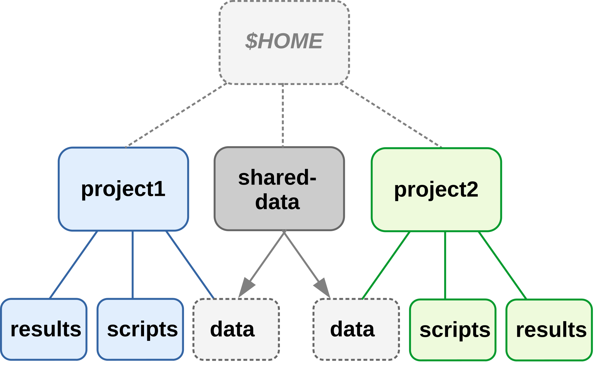
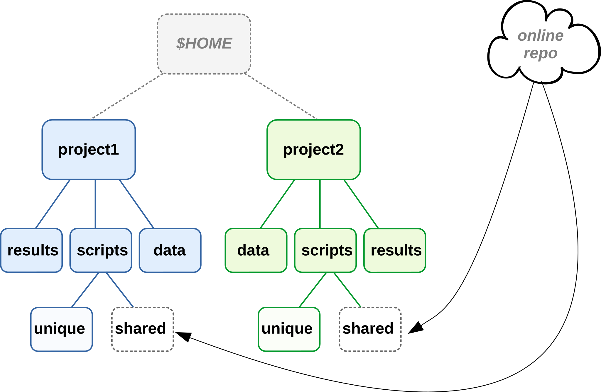
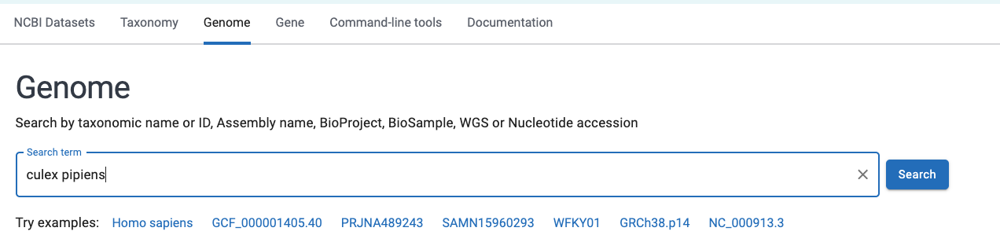
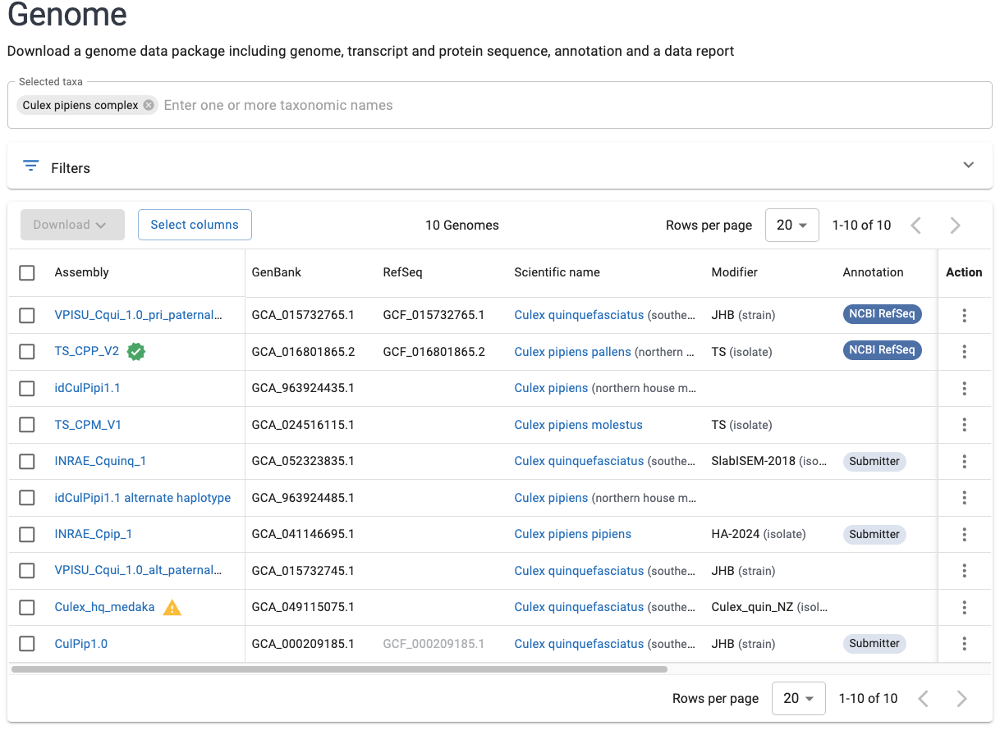
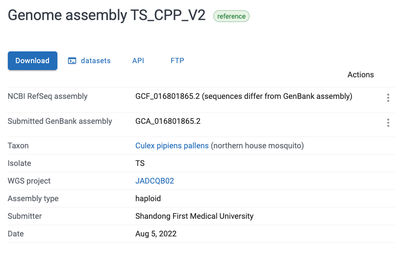
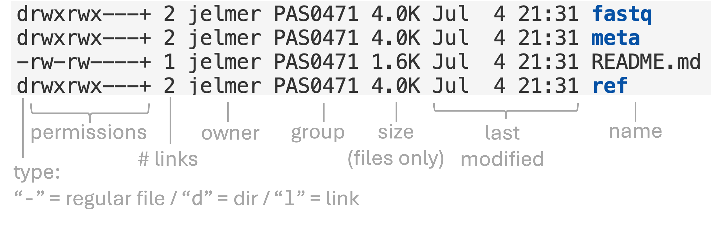
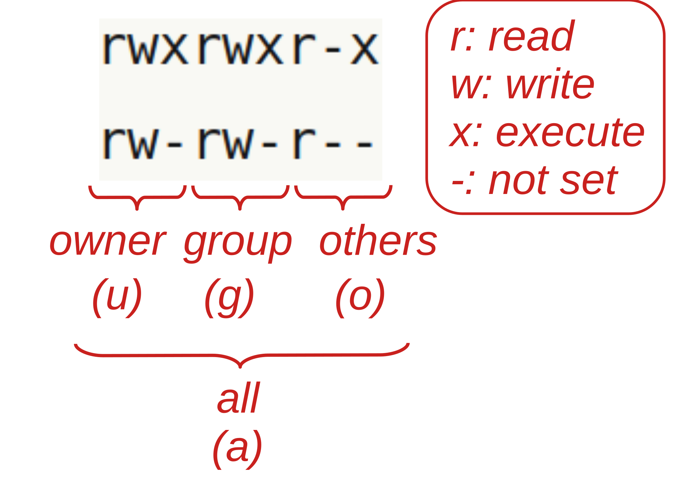

------

<br>

## Introduction

This page contains additional notes on project and data management:
sharing data and code across projects, symbolic links,
NCBI's databases and downloading genomes and reads from NCBI,
checking file integrity with checksums, file permissions,
and more about file compression.
(For transferring files to and from OSC, see the
[SSH and command-line file transfer](ssh.qmd) page.)

Run the commands on this page from your personal dir, `/fs/ess/PAS3493/people/$USER`,
and follow the sections in order, since some of them change your working dir.

## When projects share data and/or code

From @wilson2017:

> *As a rule of thumb, divide work into projects based on the overlap in data and code files:*
>
> - *If 2 research efforts share no data or code,*
>   *they will probably be easiest to manage independently.*
>
> - *If they share more than half of their data and code, they are probably best*
>   *managed together.*
>
> - *If you are building tools that are used in several projects,*
>   *the common code should probably be in a project of its own.*

To access files outside of the project (e.g., shared across projects),
it is easiest to create **links** (i.e. shortcuts/aliases) to these files
(see [below](#symbolic-links) for how to do this):

{fig-align="center" width="50%" fig-alt="A diagram showing two research project folder hierarchies, with the data folder from one project being linked to the other project." .lightbox}

But shared data or scripts are generally better stored in separate folders,
and then linked to by each project using them:

{fig-align="center" width="50%"  fig-alt="A diagram showing two research project folder hierarchies, with a separate shared-data folder that is linked to both projects." .lightbox}

These strategies do decrease the portability of your project,
and moving the shared files even within your own computer will cause links/shortcuts to break.
A more portable method is to **keep shared (multi-project) files online** ---
this is especially feasible for **scripts** under version control:

{fig-align="center" width="70%" fig-alt="A diagram showing two research project folder hierarchies, both of which have a connection to an online script repository." .lightbox}

For **data**, this is also possible but often not practical due to file sizes.
It's easier after data has been deposited in a public repository.

## Symbolic links

As shown above, a convenient way to use files that are stored outside of a project
is with **symbolic links** ("symlinks"):
small files that merely point to another file or dir,
much like a shortcut (Windows) or alias (Mac).

```bash
cd sandbox
```

### Creating symlinks

You can create a symlink with `ln -s`:

- When you only provide the source file or or dir,
  it creates a link of the same name in your working dir:

  ```bash
  ln -s /fs/ess/PAS3493/share/garrigos/data/fastq/S64_R1.fastq.gz
  ```

  ```bash
  ls -l
  ```
  ```bash-out
  lrwxrwxrwx 1 jelmer PAS0471 57 Nov  5 10:12 S64_R1.fastq.gz -> /fs/ess/PAS3493/share/garrigos/data/fastq/S64_R1.fastq.gz
  ```

- You can also give a path to the link, such as simply a different name:

  ```bash
  ln -s /fs/ess/PAS3493/share/garrigos/data/fastq/S64_R1.fastq.gz shared.fastq.gz
  ```

  ```bash
  # Both the original link and the new link are now in your working dir:
  ls -l
  ```
  ```bash-out
  lrwxrwxrwx 1 jelmer PAS0471 57 Nov  5 10:12 S64_R1.fastq.gz -> /fs/ess/PAS3493/share/garrigos/data/fastq/S64_R1.fastq.gz
  lrwxrwxrwx 1 jelmer PAS0471 57 Nov  5 10:12 shared.fastq.gz -> /fs/ess/PAS3493/share/garrigos/data/fastq/S64_R1.fastq.gz
  ```

Above, you could see that in the long-format `ls` output,
symlinks start with an `l` and show their target after the `->`.

Once you have a symlink, you can **use it** like the original file or dir.
For example:

```bash
zcat shared.fastq.gz | head -n 4
```
```bash-out
TODO
```

You can link to a **dir** in the same way,
or link to **all files in a dir** at once with a wildcard:

```{.bash .norun}
# Fictional examples
# Link to a dir: creates a link 'project1/scripts/shared_scripts':
ln -s /fs/ess/PAS3493/shared_scripts project1/scripts/

# Link to each of the files in a dir:
ln -s /fs/ess/PAS3493/shared_scripts/* project1/scripts/
```

::: callout-warning
#### Use absolute paths for the source to be safe

Above, you may have noticed that we used the **absolute path** to the source file.
This is not strictly necessary, but it is safer than using a relative path.
If you use a relative path for the source,
it is interpreted relative to the location of the link, not to your working dir.
For example, running the following from your personal dir creates a **broken link**,
because it points to `sandbox/garrigos/README.md`, which doesn't exist:

```{.bash .norun}
ln -s garrigos/README.md sandbox/
```

The easiest way to avoid this is to use absolute paths for the source,
e.g. with the `$PWD` variable, which contains your working dir:

```bash
ln -s "$PWD"/garrigos/README.md sandbox/
```
:::

### Removing symlinks

To remove a symlink, use `rm` or `unlink`.
This only removes the link itself, not the file or dir it points to.
For example, remove the two links you created above:

```bash
rm shared.fastq.gz
unlink S64_R1.fastq.gz
```

The original file is still there:

```bash
ls /fs/ess/PAS3493/share/garrigos/data/fastq/S64_R1.fastq.gz
```
```bash-out
/fs/ess/PAS3493/share/garrigos/data/fastq/S64_R1.fastq.gz
```

A symlink to a dir is a **point of entry to the original dir**:
anything you do _through_ the link affects the original files.
To see this, create a link to your `garrigos/fastq` dir
(the relative source path works here,
because it is relative to the location of the link, `sandbox`):

```bash
ln -s ../garrigos/fastq fastq-link
```

Listing the link's contents shows the files in the original dir:

```bash
ls fastq-link | head -n 2
```
```bash-out
S63_R1.fastq.gz
S63_R2.fastq.gz
```

So, `rm fastq-link/*.fastq.gz` would remove your original FASTQ files!
To remove only the link itself, use `rm` without `-r`
(the link is a file, even when it points to a dir):

```bash
rm fastq-link
```

<!---- TODO: Verify at OSC (GNU rm) that `rm -r my-link/` deletes the contents of the
original dir (and then fails to remove the link itself with "Not a directory"),
while `rm -r my-link` only removes the link. Also check the matching exercise answers below.
Test:
mkdir -p /fs/scratch/PAS3493/$USER/lntest/target && touch /fs/scratch/PAS3493/$USER/lntest/target/{a,b}
cd /fs/scratch/PAS3493/$USER/lntest && ln -s target mylink
rm -r mylink/; ls target    # expected: error about 'mylink/', and 'target' is now empty ---->

::: callout-warning
#### Watch out for trailing slashes
`rm -r fastq-link` only removes the link,
but **`rm -r fastq-link/`** (with a trailing slash, which tab completion may add)
follows the link and removes the _contents_ of the original dir!
:::

::: exercise
####  Exercise: Symbolic links

1. Create a symlink called `pp5006` in your Home dir that points to your personal dir
   in the project dir (`/fs/ess/PAS3493/people/$USER`).
   What would the link have been called if you hadn't given it a name?

2. Predict what each of the following commands would remove (_don't run them!_):
   a. `rm ~/pp5006`
   b. `rm -r ~/pp5006/garrigos`
   c. `rm -r ~/pp5006/`

<details><summary> &nbsp; _Click to see the solution_</summary>

1. Without a link name, the link gets the name of the last part of the source path,
   which is your username:

   ```bash
   ln -s /fs/ess/PAS3493/people/$USER ~/pp5006
   ```

2. a. Only the link.
   b. Your _original_ `garrigos` dir in the project dir.
   c. Everything inside your personal dir in the project dir (the link itself remains)!

</details>
:::

## Downloading data from NCBI

In week 11, you [downloaded files with `wget`](../week11/w11a_data.qmd#wget)
from an NCBI FTP dir.
This section introduces NCBI's databases more broadly,
and shows two more convenient ways to download genomes and sequencing reads.

### NCBI's databases

The [National Center for Biotechnology Information (NCBI)](https://www.ncbi.nlm.nih.gov),
part of the US National Institutes of Health (NIH),
hosts dozens of databases, all of which you can search from its homepage.
Those you are most likely to use for omics work are:

- **GenBank** ---
  The archive of all publicly available DNA sequences,
  from single genes to entire genome assemblies.
  Records are submitted by researchers, and NCBI doesn't curate them,
  so GenBank can contain many (near-)identical sequences and quality varies.
  GenBank exchanges data daily with its European (ENA) and Japanese (DDBJ) counterparts,
  so all three contain the same sequences.
- **RefSeq** ("Reference Sequence") ---
  A curated, non-redundant set of genomes, transcripts, and proteins,
  derived from GenBank records and annotated by NCBI.
  You can recognize RefSeq records by their accession number prefixes:
  for example, genome assemblies start with `GCF_` in RefSeq and with `GCA_` in GenBank.
  The _Culex pipiens_ genome you've worked with (`GCF_016801865.2`) is a RefSeq assembly.
- **Sequence Read Archive (SRA)** ---
  Raw reads from high-throughput sequencing.
  Each sequencing run has an accession number starting with `SRR`
  (or `ERR` or `DRR` when it was submitted to ENA or DDBJ, respectively),
  and runs are grouped into BioSamples (`SAMN...`) and BioProjects (`PRJNA...`).
  For example, the reads in your `garrigos/fastq/S63_R1.fastq.gz` file
  have headers starting with `@ERR10802863`,
  the accession number of that sample's sequencing run.
- **Gene Expression Omnibus (GEO)** ---
  Processed gene expression data like count tables, with links to the raw reads in the SRA.
- **BLAST databases** ---
  BLAST is a tool to find sequences that are similar to a query sequence.
  It searches databases that NCBI builds from the above,
  such as `core_nt` (nucleotide sequences) and `nr` (non-redundant protein sequences).
  You can run BLAST searches on the [BLAST website](https://blast.ncbi.nlm.nih.gov),
  or for many sequences, with the command-line version (BLAST+)
  and pre-built databases that you can download from
  [NCBI's FTP site](https://ftp.ncbi.nlm.nih.gov/blast/db/)
  (note that these databases are very large).

### Finding a reference genome for any species

1. Go to the genome part of NCBI's datasets portal <https://www.ncbi.nlm.nih.gov/datasets/genome/>.
2. Type in the name of a species (or other taxonomic level).

{fig-align="center" width="95%" .no-border fig-alt="A screenshot of the NCBI datasets website" .lightbox}

3. Select an appropriate taxonomic match within the search box, and press Enter.
   You will get a list of available genomes:

{fig-align="center" width="95%" .no-border fig-alt="A screenshot of the NCBI datasets website" .lightbox}

4. All else being equal (e.g. if it's the right subspecies), it is generally a good
   idea to pick the "Reference" genome which is highlighted with a green checkmark,
   i.e. `TS_CPP_V2` in the screenshot above.
   Click on the name of the desired genome, and you will see a page like this:

{fig-align="center" width="85%" .no-border fig-alt="A screenshot of the NCBI datasets website" .lightbox}

5. There are multiple ways of downloading.
   The FTP dir that you downloaded from in week 11
   can be accessed by clicking the "FTP" button shown in the screenshot above.
   But you can also use the genome's accession number (here, `GCF_016801865.2`)
   to download its files with the `datasets` tool, as shown next.

### Downloading genomes with `datasets`

NCBI's [`datasets` command-line tool](https://www.ncbi.nlm.nih.gov/datasets/docs/v2/command-line-tools/download-and-install/)
downloads genomes (and other data) by accession number or taxon name,
and is especially useful when you need multiple or many genomes.
It is not available as a module at OSC,
so we'll run it with a [container](../week06/w6b_software.qmd).
Run the commands in this section from your `sandbox` dir,
where the previous section left you:

```bash
DATASETS_CONTAINER=oras://community.wave.seqera.io/library/ncbi-datasets-cli:18.39.0--018edd56cfbf78e2
apptainer exec "$DATASETS_CONTAINER" datasets --version
```

<!---- TODO: Run all commands in this section at OSC and add outputs ---->

To download the _Culex pipiens_ genome sequence, annotation (GFF), and protein sequences:

```bash
apptainer exec "$DATASETS_CONTAINER" datasets download genome accession GCF_016801865.2 \
    --include genome,gff3,protein --filename culex.zip
```

The download is a single ZIP file,
which you can extract with `unzip`:

```bash
unzip culex.zip -d culex

# List all files (but not dirs) inside the 'culex' dir:
find culex -type f
```

The files are in `culex/ncbi_dataset/data/GCF_016801865.2/`,
and unlike the files in the FTP dir, they are not gzipped.

`datasets` really shines when you need many genomes ---
for example, you can download all RefSeq reference genomes for a genus.
Use `datasets summary` first to see how many genomes there are,
since this can be a lot of data:

```{.bash .norun}
# [Example commands - no need to run these]
# Print info about the reference genomes for the genus Culex (in JSON format):
apptainer exec "$DATASETS_CONTAINER" datasets summary genome taxon culex --reference

# Download their genome sequences:
apptainer exec "$DATASETS_CONTAINER" datasets download genome taxon culex \
    --reference --include genome --filename culex_all.zip
```

::: {.callout-tip collapse="true"}
#### Downloading large numbers of genomes _(Click to expand)_

For large downloads, use the `--dehydrated` option:
`datasets download` will then only download a small ZIP file with metadata
and the locations of the files.
After unzipping it, `datasets rehydrate --directory <dir>` downloads the actual files,
and you can rerun that command to resume if the download gets interrupted.
:::

### Downloading reads from the SRA

There are several ways to download FASTQ files from the SRA:

- [**SRA explorer**](https://sra-explorer.info) is a simple website
  where you can enter an accession number (e.g. of a BioProject)
  to get download links and `curl` commands for the FASTQ files.
- The [**SRA Toolkit**](https://github.com/ncbi/sra-tools/wiki) is NCBI's official set of
  command-line tools, which includes `prefetch` and `fasterq-dump`.

Like `datasets`, the SRA Toolkit is not available as a module at OSC,
so we'll again use a container.
With the SRA Toolkit, downloading the full set of reads for sample S63 of the
Garrigós et al. dataset (the files in `garrigos/fastq` only contain a subset)
takes two steps:
`prefetch` downloads the data in NCBI's own compressed format,
and `fasterq-dump` converts that to FASTQ files:

```{.bash .norun}
# [Example commands - no need to run these]
SRATOOLS_CONTAINER=oras://community.wave.seqera.io/library/sra-tools:3.4.1--c9eb93771eedd04e

apptainer exec "$SRATOOLS_CONTAINER" prefetch ERR10802863
apptainer exec "$SRATOOLS_CONTAINER" fasterq-dump \
    --split-files --threads 4 --outdir fastq ERR10802863
gzip fastq/*.fastq
```

- For paired-end data, `--split-files` produces separate files for forward and reverse reads:
  `ERR10802863_1.fastq` and `ERR10802863_2.fastq`.
- `fasterq-dump` writes uncompressed FASTQ files, which you'll want to gzip.

::: {.callout-tip}
#### Downloads in batch jobs
Downloading reads for many samples can take a long time,
so this is best done in a [Slurm batch job](../week10/w10a_slurm1.qmd).
:::

::: {.callout-note collapse="true"}
#### Alternative: installing these tools with Conda _(Click to expand)_

Instead of using containers,
you can also install `datasets` and the SRA Toolkit in [Conda](conda.qmd) environments.
This can be especially useful for `datasets`,
since you may want to run several commands interactively,
e.g. to explore which genomes are available before deciding what to download.
After activating a Conda environment,
you can simply type the commands without the `apptainer exec <container-URI>` prefix.

```{.bash .norun}
# [Example commands - no need to run these]
# Create the environments (only needed once):
module load miniconda3/25.11.1-py312
conda create -y -n ncbi-datasets conda-forge::ncbi-datasets-cli
conda create -y -n sra-tools bioconda::sra-tools

# Activate an environment and run its commands:
conda activate ncbi-datasets
datasets summary genome taxon culex --reference
```
:::

## Checking file integrity with checksums

When you receive FASTQ files from a sequencing facility,
or download files from a public repository,
they are often accompanied by a small text file with a name like
`md5.txt`, `md5checksums.txt`, or `sha256sums.txt`.

Such a file contains so-called **checksums**,
a sort of digital fingerprint for files,
which you can use to **check whether your copy of these files is completely intact**
(e.g., that a transfer didn't get cut short).
A checksum is a short string computed from a file's contents,
in such a way that if even one character in the file changes,
the checksum will be completely different.
For example, you can compute an md5 checksum with the `md5sum` command ---
here, for a string of text rather than a file:

```bash
echo "bioinformatics is fun" | md5sum
```
```{.bash-out}
010b5ebf7e207330de0e3fb0ff17a85a  -
```
```bash
echo "bioinformatic is fun" | md5sum
```
```{.bash-out}
45cc2b76c02b973494954fd664fc0456  -
```

(The `-` means that `md5sum` read its input from standard in rather than from a file.)

### Checking a downloaded file

The NCBI FTP dir with the _Culex pipiens_ genome files that you
[downloaded from in week 11](../week11/w11a_data.qmd#wget)
also contains a checksum file, `md5checksums.txt`.
Download it into your `garrigos/ref` dir:

```bash
# Move back from 'sandbox' to your personal dir
cd ..
wget -P garrigos/ref https://ftp.ncbi.nlm.nih.gov/genomes/all/GCF/016/801/865/GCF_016801865.2_TS_CPP_V2/md5checksums.txt
```

The file has one line per file in the FTP dir,
with the checksum in the first column and the file name in the second.
Let's look up the line for the protein FASTA file that you downloaded in the w11a exercise[^protein]:

[^protein]: If you didn't do that exercise, first run:
            `wget -P garrigos/ref https://ftp.ncbi.nlm.nih.gov/genomes/all/GCF/016/801/865/GCF_016801865.2_TS_CPP_V2/GCF_016801865.2_TS_CPP_V2_protein.faa.gz`

```bash
cd garrigos/ref
grep "V2_protein.faa.gz" md5checksums.txt
```
```{.bash-out}
d593406dc180606713164a17c1a05d0a  ./GCF_016801865.2_TS_CPP_V2_protein.faa.gz
```

Now, compute the checksum for your copy of the file:

```bash
md5sum GCF_016801865.2_TS_CPP_V2_protein.faa.gz
```
```{.bash-out}
d593406dc180606713164a17c1a05d0a  GCF_016801865.2_TS_CPP_V2_protein.faa.gz
```

The two are identical, so your download is intact.
Rather than comparing checksums by eye,
you can let `md5sum` do the comparison with its `-c` (check) option.
This option takes lines in the format above (from a file or from standard in),
computes the checksum for each listed file, and compares it to the listed one:

```bash
grep "V2_protein.faa.gz" md5checksums.txt | md5sum -c
```
```{.bash-out}
./GCF_016801865.2_TS_CPP_V2_protein.faa.gz: OK
```

- We only passed the line for the protein file,
  because `md5checksums.txt` lists ~190 files and we only have a few of them.
  When a sequencing facility sends you a checksum file for exactly your FASTQ files,
  you can simply run `md5sum -c md5.txt`.
- Run the check from inside the dir with the files,
  because the file names in a checksum file are usually relative paths
  (here, `./<file-name>`).

If a file doesn't match, `md5sum` clearly says so,
and you should download or transfer that file again:

```{.bash-out}
./GCF_016801865.2_TS_CPP_V2_protein.faa.gz: FAILED
md5sum: WARNING: 1 computed checksum did NOT match
```

When you're done, move back to your personal dir:

```bash
cd ../..
```

::: {.callout-note}
#### SHA checksums
Instead of md5 checksums, you may also encounter SHA-256 checksums.
These work the same way, with the `sha256sum` command (e.g. `sha256sum -c sha256sums.txt`).
:::

::: exercise
####  Exercise: Checksums of an unzipped file

Say that you unzipped the genome FASTA file,
so you now have `GCF_016801865.2_TS_CPP_V2_genomic.fna` rather than `...fna.gz`.

1. If you computed the md5 checksum of your unzipped FASTA file,
   would it match the one listed in `md5checksums.txt` for `..._genomic.fna.gz`? Why (not)?
2. What does this imply about _when_ you should check checksums of downloaded files?

<details><summary> &nbsp; _Click to see the solution_</summary>

1. No: the checksum is computed from the exact contents of a file,
   and the unzipped file has completely different contents (bytes) than the zipped file,
   even though it represents the same sequences.
2. Check checksums right after downloading or transferring,
   _before_ you modify, unzip, or rename the files.

</details>
:::

## File permissions

### Introduction to file permissions

File "permissions" are what different categories of users are permitted to do
with files and dirs.
Being able to view and modify file permissions is useful when you:

- Want to make your data read-only to prevent accidental modification or deletion
- Need to share files with other users at OSC

There are three different file permissions that can be independently controlled:

1. **Read** (`r`) permissions allow you to read and copy files.
2. **Write** (`w`) permissions allow you to modify or overwrite files.
3. **Execute** (`x`) permissions allow you to directly execute a file (see the box below).

For dirs, write permissions determine whether files can be added, removed, or renamed
inside them.
So, whether you can move or delete a file depends on the permissions of its _dir_,
not of the file itself.

While it is possible to set permissions for individual users,
they are most easily and commonly set for three different user categories:

- **Owner (or "user")** (`u`) ---
  By default, this is the person who created the file or dir.
  This includes cases where this person merely copied or downloaded files:
  e.g., after you have copied someone else's FASTQ files,
  you are the owner of these copies.
- **Group** (`g`) ---
  At OSC, the group category is at the OSC Project level.
- **Other** (`o`) --- Any other user.

You can also refer to all three of these categories at once with `a` (_all_).

::: callout-note
#### Executing a file?
Executing a file means running it as a program/command.
For example, when we run the FastQC program with the command `fastqc`,
we are really executing a binary (executable) file somewhere on the system.
Similarly, self-written shell scripts can be executed if they have execute permissions set.
:::

### Viewing file permissions

To show file permissions,
use **`ls`** with the **`-l`** (*long* format) option that we've seen before,
which should show you something like this:

```bash
ls -lh garrigos
```
<pre class="bash-out"><code>total 2.5K
drwxrwx---+ 2 jelmer PAS0471 4.0K Sep  9 13:46 <span class="ls-blue">fastq</span>
drwxrwx---+ 2 jelmer PAS0471 4.0K Sep  9 13:46 <span class="ls-blue">meta</span>
-rw-rw----+ 1 jelmer PAS0471 2.3K Sep  9 13:46 README.md
drwxrwx---+ 2 jelmer PAS0471 4.0K Sep  9 13:46 <span class="ls-blue">ref</span>
drwxrwx---+ 2 jelmer PAS0471 4.0K Sep 16 13:26 <span class="ls-blue">sandbox</span></code></pre>

With annotations:

{fig-align="center" width="80%" fig-alt="A screenshot of the long-format ls output that includes info about file permissions." .lightbox}

::: {.callout-important}
#### "Groups" at OSC

When you create a file in the PAS3493 project dir,
all members of the OSC project PAS3493 get the "**group**" permissions for it.
That is true even if the group displayed in the `ls -l` output shown above
is a different one, e.g. `PAS0471` for me (my personal default group at OSC).
This works through so-called "access control lists" (ACLs),
which is what the `+` at the end of the permission string indicates
(to see the ACL of a file, run `getfacl <file>`).
:::

Here is an overview of the file permission notation in `ls -l` output:

{fig-align="center" width="40%" fig-alt="A diagram showing the different file permissions that can be set." .lightbox}

For example:

- `rwxrwxr-x` means: read, write, and execute permissions are set for the owner
  (first `rwx`) and the group (second `rwx`),
  and read and execute _but not_ write permissions for others (`r-x` at the end).

- `rw-rw-r--` means: read and write _but not_ execute permissions are set
  for both the owner (first `rw-`) and the group (second `rw-`),
  and only read permissions for others (`r--` at the end).

::: {.callout-warning}
#### Default permissions at OSC

Most commonly, files and dirs that you create at OSC will by default have:

- Read permissions for owner (you) and group
- Write permissions only for owner (you)

However, this is not always the case,
and I am personally sometimes vexed by file permissions at OSC.
For instance, in our `PAS3493` project, the default permissions appear to include
write permissions for the group.
I'm not certain why, but it may be because this is an "Educational" project.

More generally, by default:

- OSC users that are not members of a specific project can't access that project's
  files in `/fs/ess/` and `/fs/scratch` at all.
- Other OSC users cannot access your personal Home dir files --
  so it's never a good idea to keep files there that should be accessible to collaborators.
:::

::: exercise
####  Exercise: Viewing file permissions

1. Could your classmates (members of the PAS3493 group) edit the `README.md` file
   in your `garrigos` dir? Check with `ls -l`.
2. The `-d` option makes `ls` show info about a dir itself, rather than its contents.
   Run `ls -ld ~` to see your Home dir's permissions:
   what do these mean for your classmates' access to any of the files in your Home dir?

<details><summary> &nbsp; _Click to see the solution_</summary>

1. Most likely yes: if the permissions are `rw-rw----`, the group has write permissions.
2. You'll most likely see `drwx------`: only you have any permissions,
   so nobody else can even get into your Home dir,
   no matter what the permissions of the files inside it are.

</details>
:::

### Changing file permissions

Let's create a file to play around with file permissions:

```bash
# Create a test file
mkdir -p sandbox
cd sandbox
touch testfile.txt

# Check the default permissions
ls -l testfile.txt
```
```bash-out
-rw-rw----+ 1 jelmer PAS0471 0 Mar  7 13:36 testfile.txt
```

To change a file's permissions, you can use the **`chmod` command**.
There are two main ways to use this command, one of which uses symbols as follows:

- `+` : add a permission
- `-` : remove a permission
- `=` : set permissions to exactly this

These are used with both the kind of permission (`r` / `w` / `x`)
and the user category (`a` / `u` / `g` / `o`).
For example, `a+r` means that for `a`ll, you add (`+`) `r`ead permissions.
Let's see some commands:

- To add read (`r`) permissions for all (`a`):

  ```bash
  chmod a+r testfile.txt

  ls -l testfile.txt
  ```
  ```bash-out
  -rw-rw-r--+ 1 jelmer PAS0471 0 Mar  7 13:40 testfile.txt
  ```

- To set read + write + execute (`rwx`) permissions for all (`a`):

  ```bash
  chmod a=rwx testfile.txt

  ls -l testfile.txt
  ```
  ```bash-out
  -rwxrwxrwx+ 1 jelmer PAS0471 0 Mar  7 13:36 testfile.txt
  ```

  ::: {.callout-tip appearance="simple"}
  Because the file is now "executable",
  its name should display in **[green]{style="color:green"}** in your terminal.
  :::

- To remove write (`w`) permissions for others (`o`):

  ```bash
  # chmod <who>-<permission-to-remove>:
  chmod o-w testfile.txt

  ls -l testfile.txt
  ```
  ```bash-out
  -rwxrwxr-x+ 1 jelmer PAS0471 0 Mar  7 13:36 testfile.txt
  ```

<hr style="height:1pt; visibility:hidden;" />

::: {.callout-note collapse="true"}
#### An alternative method: changing file permissions with numbers _(Click to expand)_

`chmod` alternatively accepts a series of 3 numbers
(for user, group, and others, respectively) to set permissions,
where each permission is "worth" the following number of points:

:::: columns
::: {.column width="5%"}
:::
::: {.column width="40%"}
| Nr | Permission     |
|:----:|:-----------:|
| 1  | x              |
| 2  | w              |
| 4  | r              |

: {.striped .hover}
:::
::: {.column width="10%"}
:::
::: {.column width="40%"}
| Nr | Permission |
|:----:|:-----------:|
| 5  | r + x          |
| 6  | r + w          |
| 7  | r + w + x      |

: {.striped .hover}
:::
::: {.column width="5%"}
:::
::::

For example, to set read + write + execute permissions for all:

```bash
chmod 777 testfile.txt
```

To set read + write + execute permissions for yourself, and only read permission
for the group and others:

```bash
chmod 744 testfile.txt
```
:::

::: {.callout-warning collapse="true"}
#### Read/execute permissions for directories _(Click to expand)_

`chmod` is not recursive by default:
you need the `-R` option to change permissions throughout a dir hierarchy.
For example:

```{.bash .norun}
chmod -R g+r my-dir
```

One tricky and confusing aspect of file permissions is that
**to access anything inside a dir (e.g. `cd` into it or open its files),**
**you need _execute_ permissions for the dir!**
Read permissions for a dir only allow you to list the names of the files in it.
This is something to take into account when you want to grant others
access to your project e.g. at OSC.

To set execute permissions for everyone throughout a dir hierarchy,
but only for dirs (and files that were already executable),
use an `X` (**uppercase x**):

```{.bash .norun}
chmod -R a+X my-dir
```
:::

### Making your data read-only

Now, let's see how you can make your data read-only.
Here, we'll work with the files in the `garrigos/fastq/` dir,
so let's check the initial permissions first:

```bash
cd ..
ls -l garrigos/fastq/ | head -n 3
```
<pre class="bash-out"><code>total 963552
-rw-rw----+ 1 jelmer PAS0471 21266097 Sep  9 13:46 <span class="ls-red">S63_R1.fastq.gz</span>
-rw-rw----+ 1 jelmer PAS0471 22700521 Sep  9 13:46 <span class="ls-red">S63_R2.fastq.gz</span></code></pre>

To make this data read-only, you can for example run:

```bash
# Remove write permissions for all users
chmod a-w garrigos/fastq/*
```

After running this command, let's check the permissions:

```sh
ls -l garrigos/fastq/ | head -n 3
```
<pre class="bash-out"><code>total 963552
-r--r-----+ 1 jelmer PAS0471 21266097 Sep  9 13:46 <span class="ls-red">S63_R1.fastq.gz</span>
-r--r-----+ 1 jelmer PAS0471 22700521 Sep  9 13:46 <span class="ls-red">S63_R2.fastq.gz</span></code></pre>

What happens when you try to remove a write-protected file?
Let's test this on a copy of one of the files in `sandbox/`,
rather than on your real data, so there's no risk of accidentally losing anything:

```sh
cp garrigos/fastq/S63_R1.fastq.gz sandbox/
chmod a-w sandbox/S63_R1.fastq.gz

rm sandbox/S63_R1.fastq.gz
```
```bash-out
rm: remove write-protected regular file ‘sandbox/S63_R1.fastq.gz’?
```

You'll be prompted like this for every write-protected file you try to remove.
**Answer `n` (no) to keep the file for now.**
If you answer `y` (yes), the file is in fact removed:
as mentioned above, removing a file is controlled by the permissions of its dir.
So, read-only file permissions protect against accidentally _modifying_ a file,
but only add a confirmation prompt when removing it.

::: callout-tip
#### Force-remove with `rm -f`

Instead of interactively approving the removal of each write-protected file,
you can also use the `-f` (force) option with `rm`.

For example, Git makes the files in its `.git/objects` dir read-only.
So, if you would try to remove a dir with a Git repo, like `garrigos`,
you would have to confirm the removal of many write-protected files:

```{.bash .norun}
rm -r garrigos/
```
```bash-out
rm: remove write-protected regular file 'garrigos/.git/objects/pack/pack-b1b2783f93b7c1f77f508f07e971dee5c0d39958.rev'? y
rm: remove write-protected regular file 'garrigos/.git/objects/pack/pack-b1b2783f93b7c1f77f508f07e971dee5c0d39958.idx'? y
rm: remove write-protected regular file 'garrigos/.git/objects/pack/pack-b1b2783f93b7c1f77f508f07e971dee5c0d39958.pack'?
```

Adding the `-f` flag will skip these prompts and remove the files directly:

```{.bash .norun}
rm -rf garrigos/
```

However, **you must be careful when using the `-f` option** to prevent accidental
removal of files.
:::

To also protect your raw data against removal,
remove write permissions for the dir itself:

```bash
chmod a-w garrigos/fastq
```

Now, `rm` (even `rm -f`) will fail with a "Permission denied" error
for any file in `garrigos/fastq` ---
unless you first add write permissions back.

::: exercise
####  Exercise: Changing file permissions

For this exercise, you need a partner,
such as a classmate who is also a member of the PAS3493 project.
One person (the Owner) first creates a test file and manipulates its permissions,
and the other (the Collaborator) tries to access and modify that file.
After the first round, switch roles.

In each round:

1. The Owner creates a file in their `sandbox/` dir,
   e.g. with `echo "Hello from <your-name>" > sandbox/shared.txt`,
   and tells the Collaborator its full path.
2. The Collaborator tries to read the file with `cat`,
   and to add a line to it with `echo "Hi back" >> <path>`.
3. The Owner removes write permissions for the group: `chmod g-w sandbox/shared.txt`.
4. The Collaborator first **predicts** what will happen when repeating step 2,
   and then tries it.
5. The Collaborator predicts whether they can _remove_ the file with `rm`
   (answer `y` if prompted), and then tries it.
   Run `ls -ld` on the Owner's `sandbox` dir to explain the result.

<details><summary> &nbsp; _Click to see the solution_</summary>

- In step 2, both commands should work,
  since files in our project dir are by default readable and writable for the group.
- In step 4, `cat` still works, but adding a line fails with a "Permission denied" error.
- In step 5, the removal works as long as the Owner's `sandbox` dir is group-writable
  (`drwxrwx---`), because removing a file depends on the permissions of its dir,
  not of the file itself.

</details>
:::

## More about file compression

This section builds on the
[w11a section on file compression](../week11/w11a_data.qmd#file-compression),
which covers the basics of `gzip` and `gunzip`.
You'll use a FASTA file with human chromosome 22 ---
download it into your `sandbox` dir from your personal dir:

```bash
wget -P sandbox https://hgdownload.soe.ucsc.edu/goldenPath/hg19/chromosomes/chr22.fa.gz
```

::: {.callout-tip collapse="true"}
#### Use the `du` command to see the total size of a dir _(Click to expand)_

Given that the `ls` size output is not informative for dirs,
how can you find out the total size of a dir and all its contents?
Use the `du` (**d**isk **u**sage) command -- for example:

- Get the total size for a single dir:

  ```bash
  # -h: human-readable file sizes / -s: summarize, i.e. only show the total
  du -hs garrigos/fastq
  ```
  ```bash-out
  941M    garrigos/fastq
  ```

  <!---- TODO: Check both `du` outputs at OSC: the numbers in the second one
  are from an old project (e.g. `garrigos/ref` now also holds the genome files). ---->

- Get the total size of each dir directly inside a dir, plus that of the dir itself:

  ```bash
  # -d 1: show sizes down to a depth of 1 (= the dirs directly inside 'garrigos')
  du -h -d 1 garrigos
  ```
  ```bash-out
  1.0K    garrigos/meta
  5.1M    garrigos/ref
  941M    garrigos/fastq
  946M    garrigos/.git
  1.9G    garrigos
  ```
:::

Run the commands in the box above from your personal dir,
and then move into your `sandbox` dir:

```bash
cd sandbox
```

### Compressing program output

Often, a program will *output unzipped data to standard out*,
which we can immediately pipe to `gzip` so we only need to write the compressed
file to disk (beneficial because reading/writing to files is time-consuming):

```{.bash .norun}
trimmer in.fastq.gz | gzip > out.fastq.gz
```

*(Note that because the input to `gzip` comes from standard in, the output
will by default be to standard out!)*

### Working with compressed data directly

Several familiar shell commands have `z` counterparts that work with gzipped files directly.
You've been using `zcat`, the counterpart of `cat`, since week 4:

```bash
zcat chr22.fa.gz | head -n 4
```
```{.bash-out}
>chr22
NNNNNNNNNNNNNNNNNNNNNNNNNNNNNNNNNNNNNNNNNNNNNNNNNN
NNNNNNNNNNNNNNNNNNNNNNNNNNNNNNNNNNNNNNNNNNNNNNNNNN
NNNNNNNNNNNNNNNNNNNNNNNNNNNNNNNNNNNNNNNNNNNNNNNNNN
```

Similarly, `zgrep` is `grep` for gzipped files:

```bash
zgrep -i -n --color "AGATAGATATAT" chr22.fa.gz
```
```{.bash-out}
589810:TATTGCAGGTAAGATGGGGCCACTCAGTACTTTAAAAAGATAGATATATA
596134:tctatctatatatagatagatatattgtagatatatctatctatatatat
966248:tatagatagatatataaaggggagtttattaagtattaactcacatgatc
```

::: {.callout-note collapse="true"}
#### Concatenating compressed data

Concatenating files means you combine them into a single file,
simply printing them back-to-back.
When it is okay to concatenate files^[
This does mean you'll lose information about the origin of the original files.],
this can be done very easily.

To add a second FASTQ file to an existing gzipped file,
we can simply use `>>`:

```bash
ls
```
```{.bash-out}
in.fastq.gz in2.fastq
```
```bash
gzip -c in2.fastq >> in.fastq.gz
```

Even more conveniently, if we have two gzipped FASTQ files for the same sample
but from different Illumina lanes:

```{.bash .norun}
cat smpA_L001_R1.fastq.gz smpA_L002_R1.fastq.gz > smpA_R1.fastq.gz
```
:::

### Archives with `tar`

Software, databases, and sometimes data sets are often distributed as a single
`.tar.gz` (or `.tgz`) file, a so-called "**tarball**".
This is an "archive" file that contains multiple files and dirs,
which were combined into a single file with the `tar` command and then gzip-compressed.
Since `gzip` itself can only compress individual files,
`tar` is also what you would use to pack up a dir, e.g. to share it or to back it up.

```{.bash .norun}
# Create (-c) a gzip-compressed (-z) archive file (-f) from the dir 'results':
tar -czvf results.tar.gz results/

# List (-t) the contents of an archive without extracting it:
tar -tzvf results.tar.gz

# Extract (-x) the contents of an archive into your working dir:
tar -xzvf results.tar.gz
```

- The `-v` (verbose) option makes `tar` print the names of the files it processes.
- The `-f` option should come last, because it must be directly followed by the name of the archive file.
- When extracting, `tar` recreates the dirs stored in the archive,
  and overwrites existing files with the same names without asking ---
  so when in doubt, list the contents first.

::: exercise
####  Exercise: Compression

You have a dir with three FASTQ files: `A.fastq`, `B.fastq`, and `C.fastq`.
Predict which files you would end up with after running each of the following commands
(each starting from the same three files):

1. `gzip *.fastq`
2. `gzip -c *.fastq > all.fastq.gz`
3. `tar -czf all.tar.gz *.fastq`

<details><summary> &nbsp; _Click to see the solution_</summary>

1. `A.fastq.gz`, `B.fastq.gz`, and `C.fastq.gz`:
   `gzip` compresses each file separately, and removes the originals.
2. The three original files, plus `all.fastq.gz`,
   which contains the reads of all three files back-to-back
   (see the box on concatenating compressed data above) ---
   so you can no longer tell which reads came from which file!
3. The three original files, plus `all.tar.gz`,
   from which you can extract the three separate files again.

</details>
:::
