--------------------------------------------------------------------------------

<hr style="height:1pt; visibility:hidden;" />

<!---- TODO: Preliminary location (moved from w12a); decide on final placement ---->

## Introduction

Posit Assistant is Positron's built-in AI coding assistant,
designed specifically for data analysis.
Similar to Claude Code, it can run code for you,
but unlike Claude Code, it can directly see your R session,
including the objects in your environment.

You can use it with the same OSU LiteLLM API key that you used for
Claude Code in [week 9](../week09/w9a_claude.qmd),
and/or with GitHub Copilot.

This page assumes that you have Positron connected to OSC,
with R working, as set up in [week 12](../week12/w12a_positron-setup.qmd).

## Install the Posit Assistant extension

::: {.columns}

::: {.column width="45%"}

1. Open the **Extensions** view by clicking the Extensions icon in
   the Activity Bar (the narrow, leftmost sidebar).

2. In the search box, start typing "**posit assistant**".

3. Click **Install** (when connected to OSC: **Install in SSH: osc-pitzer-compute**)
   on the "**Posit Assistant**" extension by Posit.

:::

::: {.column width="54%"}

{fig-align="center" width="20%" .lightbox fig-alt="The Extensions icon."}

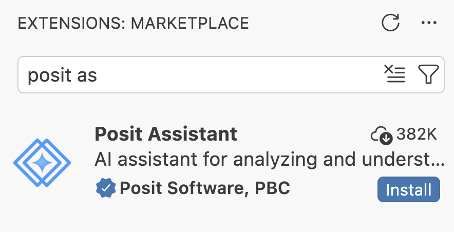{fig-align="center" width="90%" .lightbox fig-alt="Screenshot of the Positron Extensions view showing the Posit Assistant extension."}

:::

:::

## Authentication via the OSU LiteLLM API

::: {.columns}
::: {.column width="70%"}

1. Click on the newly added **Posit Assistant icon** in the Activity Bar.

2. It should show the following:
   click "Help me set it up" and then "Configure LLM providers".

:::
::: {.column width="30%"}

{fig-align="center" width="30%" .lightbox fig-alt="Posit Assistant icon in the Activity Bar"}

:::
:::

::: {.columns}
::: {.column width="45%"}
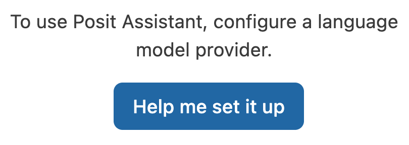{fig-align="center" width="90%" .lightbox fig-alt="Screenshot of the Posit Assistant panel with the Help me set it up button."}
:::
::: {.column width="45%"}
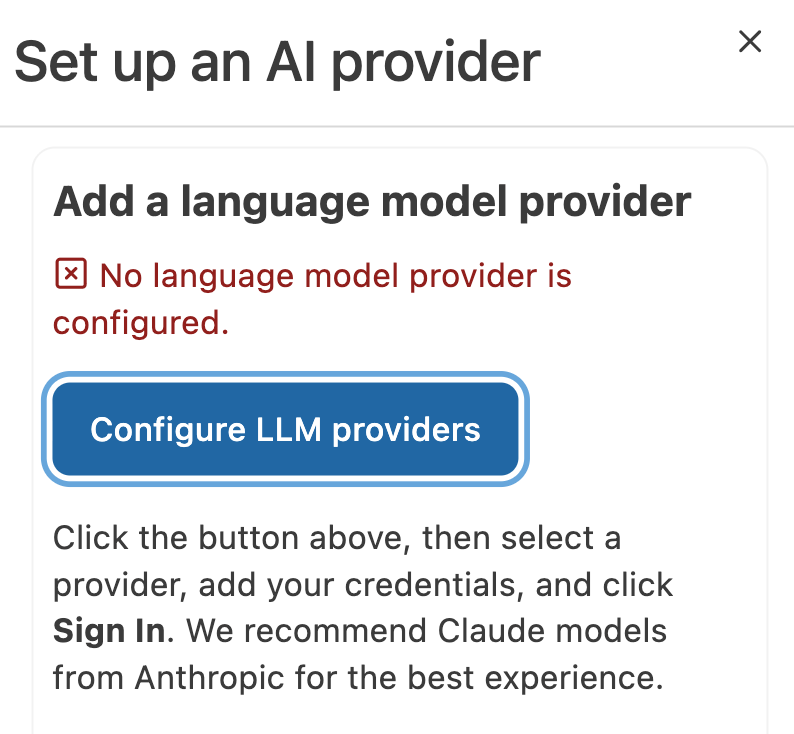{fig-align="center" width="90%" .lightbox fig-alt="Screenshot of the Posit Assistant panel with the Configure LLM providers button."}
:::
:::

3. At the top, select **Custom Provider** from the list of providers, and enter:

   - **API Key**: Use the API key from your `~/.claude/settings.json` file at OSC
     (you can open it in Positron with `File` > `Open File`).
   - **Base URL**: `https://litellm.cloud.osu.edu`
   - Then, click **Sign in**.

   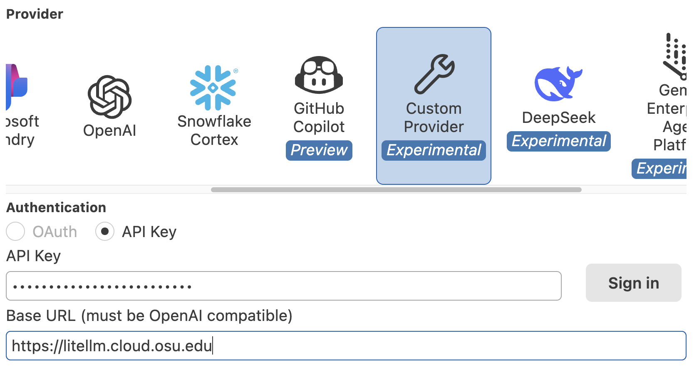{fig-align="center" width="60%" .lightbox fig-alt="Screenshot of the Custom Provider configuration form."}

4. If it worked, the assistant panel should now show:

   {fig-align="center" width="40%" .lightbox fig-alt="Screenshot of the Posit Assistant panel after a successful sign-in."}

5. In the bottom-right of the prompt box, click Select Model:

   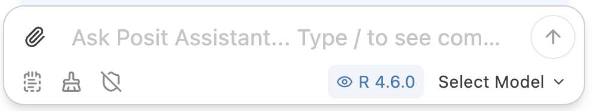{fig-align="center" width="70%" .lightbox fig-alt="Screenshot of the Posit Assistant prompt box with the Select Model button."}

6. The models you can access via the API key are available under
   "**OpenAI Compatible**" (the first option in the list):
   click "More models".

   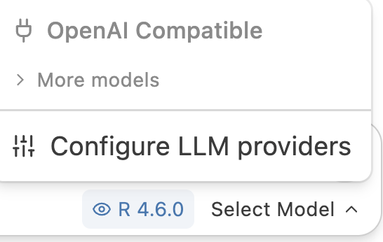{fig-align="center" width="35%" .lightbox fig-alt="Screenshot of the model selection menu."}

7. In the (long!) dropdown list, select a Claude model like `claude-opus-4-6`.
   Then, the prompt should look something like this:

   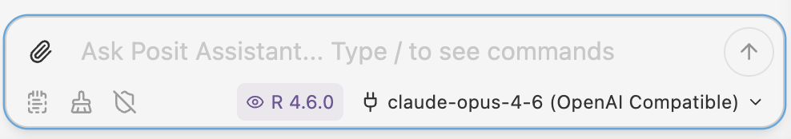{fig-align="center" width="75%" .lightbox fig-alt="Screenshot of the Posit Assistant prompt box with a model selected."}

::: {.callout-warning}
#### Model compatibility
Not all models available through the OSU LiteLLM service may work with
Posit Assistant's Custom Provider.
If you get an "**internal error**" when trying to use the Posit Assistant,
switch to a different model and try again.
:::

## Authentication via GitHub

This is not required if you set up the API key above.
However, like in VS Code, GitHub Copilot will provide inline code completions^[
In Positron, it does so via Posit Assistant rather than via its own extension.],
which access via the API key does not.

1. Click the cog wheel  icon at the top of the Posit Assistant
   panel and select **Configure LLM providers**^[
   This window can also be opened via the Command Palette by typing "_**Configure**_":
   it's listed as "**Configure Language Model providers**".].

2. Select the provider "GitHub Copilot" and click "**Sign in**"
   (keep the default selection of `OAuth` for **Authentication**):

   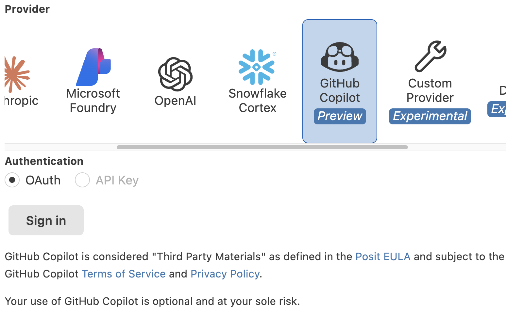{fig-align="center" width="55%" .lightbox fig-alt="Screenshot of the GitHub Copilot provider configuration."}

3. A browser window will open, asking you to authorize Posit Assistant to access your GitHub account.
   Log in and authorize as requested.

4. Done! Now, when clicking on the model selection indicator in the Posit Assistant prompt,
   you should see models listed under a GitHub Copilot section header:

   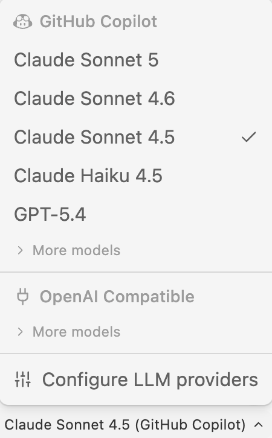{fig-align="center" width="27%" .lightbox fig-alt="Screenshot of the model selection menu with GitHub Copilot models."}

## Testing Posit Assistant

1. In the R console, create a simple data frame:

   ```r
   df <- data.frame(x = 1:10, y = rnorm(10))
   ```

2. In the Posit Assistant panel, try asking:

   > Create a scatter plot of x vs y from df

3. Posit Assistant should generate code for a plot and ask for permission to run it:
   click **Allow**.

   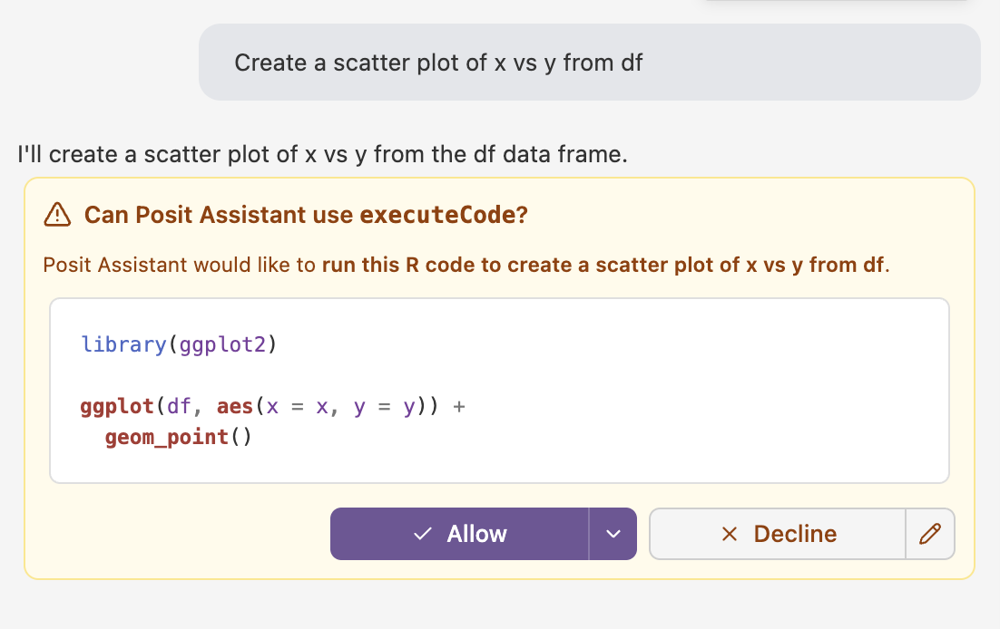{fig-align="center" width="70%" .lightbox fig-alt="Screenshot of the Posit Assistant panel showing a prompt and generated code for a scatter plot."}

4. It produces the plot and shows it in its own panel,
   along with suggestions for next steps.
   The plot should also appear in Positron's Plots pane,
   since it was generated with R code in your R session.

   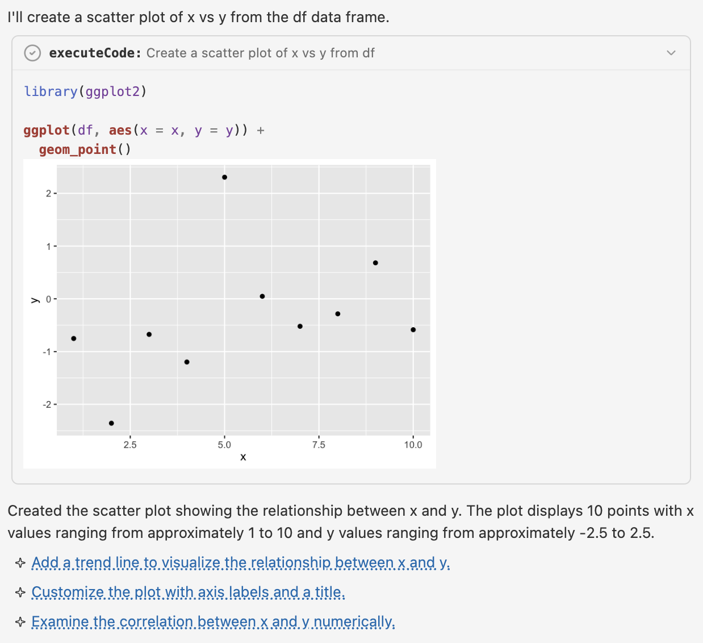{fig-align="center" width="80%" .lightbox fig-alt="Screenshot of the Posit Assistant panel showing the resulting scatter plot."}

::: {.callout-note collapse="true"}
#### Claude Code in Positron _(Click to expand)_
The Claude Code extension works in Positron just like in VS Code.
Install the "**Claude Code for VS Code**"^[
Yes, "for VS Code", not "for Positron".]
extension by Anthropic in the Extensions view,
and it will use the `~/.claude/settings.json` file at OSC
that you created in [week 9](../week09/w9a_claude.qmd).

Unlike Posit Assistant, however, Claude Code can't see your R session by default.
:::
