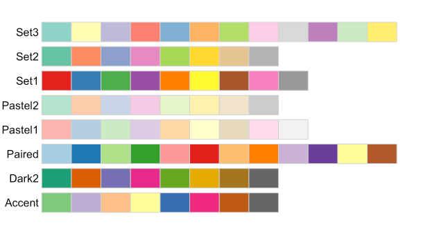

--------------------------------------------------------------------------------

<hr style="height:10pt; visibility:hidden;" />

## Introduction

### Overview

This page contains additional plotting material that builds on
the [week 13 data visualization lecture](../week13/w13b_data-viz.qmd).
The page covers the following topics:

- **[Setting a default theme](#setting-a-default-theme-with-theme_set)** ---
  Using `theme_set()` to give all plots the same look
- **[Color palettes](#color-palettes)** and **[customizing themes](#customizing-themes)**
- **[Gene length and expression](#gene-length-and-expression)** --- Building a plot from scratch
- **[Bar graphs with `geom_bar()`](#bar-graphs-with-geom_bar)**,
  **[histograms](#histograms)**, and **[box plots of gene counts](#box-plots-of-gene-counts)**
- **[Faceting](#faceting)** --- Splitting a plot into multiple panels
- **[Combining plots into one figure](#combining-plots-into-one-figure)** --- Using the _patchwork_ package

### Setting up

1. Open Positron and connect to OSC with your personal dir open,
   like in the [w12b lecture](/week12/w12b_r-basics.qmd#setup-starting-positron-and-connecting-to-osc).
2. Open your `week13` folder in Positron,
   and create a new Quarto document `bonus_plotting.qmd` in it, with a YAML header.
3. Run the examples and exercises in code chunks in this document.

### Packages and data

This page uses the same package and data as in week 13.
Load the _tidyverse_, which includes _ggplot2_:

```{r}
#| message: false
library(tidyverse)
```

Read the count table, the metadata, and the gene annotation table:

```{r eval=FALSE}
counts <- read_tsv(
  "/fs/ess/PAS3493/share/week13/salmon.merged.gene_counts_length_scaled.tsv"
)
meta <- read_tsv("../garrigos/meta/metadata.tsv")
genes <- read_tsv("/fs/ess/PAS3493/share/week13/genes.tsv")
```

```{r echo=FALSE}
#| message: false
counts <- read_tsv(
  "../assets/week13/salmon.merged.gene_counts_length_scaled.tsv"
)
meta <- read_tsv("../assets/week13/metadata.tsv")
genes <- read_tsv("../assets/week13/genes.tsv")
```

Make a long-format count table with the metadata added,
with the time points as a factor so that 24 hpi comes first,
and compute the per-sample summaries from the week 13 lecture:

```{r}
counts_long <- counts |>
  select(!gene_name) |>
  pivot_longer(cols = !gene_id, names_to = "sample_id", values_to = "count") |>
  left_join(meta, by = "sample_id") |>
  mutate(time = factor(time, levels = c("24hpi", "10dpi")))

sample_stats <- counts_long |>
  summarize(
    lib_size_M = sum(count) / 1e6,
    n_detected = sum(count > 0),
    .by = c(sample_id, treatment, time)
  )
```

## Setting a default theme with `theme_set()`

In the [week 13 lecture](../week13/w13b_data-viz.qmd#adjusting-themes),
you added a theme like `theme_bw()` to individual plots.
When you want all your plots to have the same look,
you can instead set a **default theme** with `theme_set()`.
For example, to use `theme_bw()` with a few changes:

```{r}
theme_set(
  # base_size sets the size of all text (default: 11)
  theme_bw(base_size = 13) +
    theme(
      # Remove the minor grid lines (those between the axis ticks)
      panel.grid.minor = element_blank(),
      # Center the title (default: left-aligned)
      plot.title = element_text(hjust = 0.5)
    )
)
```

All plots that you make after running this code will use this theme,
including all plots in the rest of this page.
Things to keep in mind:

- The default theme only lasts for the current R session.
  So, in a Quarto document, put `theme_set()` in a chunk near the top,
  right after loading your packages.
- You can still change the theme for individual plots,
  by adding `theme()` or another theme to them
  (see the [section on customizing themes](#customizing-themes) below).
- To go back to _ggplot2_'s default theme, run `theme_set(theme_gray())`.

## Color palettes

What if you have 10 treatments that you want to color?
Picking all colors manually with `scale_color_manual()` requires a lot of typing.
Instead, you can use ready-made **color palettes**, such as those from the _RColorBrewer_ package
that you [installed in week 12](../week12/w12b_r-basics.qmd#r-packages):

{width="50%" fig-align="center"}

To use one of these palettes, use _ggplot2_'s `scale_color_brewer()` function
(you don't need to load _RColorBrewer_ for this).
For example, to use the `Dark2` palette for a scatter plot:

```{r}
sample_stats |>
  ggplot(aes(x = lib_size_M, y = n_detected)) +
  geom_point(aes(color = treatment)) +
  scale_color_brewer(palette = "Dark2") +
  geom_smooth(method = "lm")
```

## Customizing themes

When you add `theme()` to a plot,
it changes only the elements you specify,
and keeps everything else from the default theme that you set with `theme_set()`.
In the week 13 lecture, you used `theme()` to move the legend and remove grid lines.
Text elements like titles and axis labels are changed with `element_text()`.
For example, to change the text size of the plot title and axes,
and to center the title:

```{r}
sample_stats |>
  ggplot(aes(x = lib_size_M, y = n_detected)) +
  geom_point(aes(color = treatment)) +
  geom_smooth(method = "lm") +
  labs(
    title = "Detected genes vs. library size",
    x = "Library size (millions of reads)",
    y = "Number of detected genes"
  ) +
  theme(
    # hjust is the horizontal justification: 0 = left, 0.5 = center, 1 = right
    plot.title = element_text(size = 18, face = "bold", hjust = 0.5),
    axis.title = element_text(size = 15),
    axis.text = element_text(size = 13)
  )
```

For all theme elements that you can change, see the
[`theme()` documentation ](https://ggplot2.tidyverse.org/reference/theme.html){target="_blank"}.

## Gene length and expression

Are longer genes more highly expressed?
To find out, first compute the mean count of each gene,
and add the information from the gene annotation table
from the [data wrangling lecture](../week13/w13a_data-wrangling.qmd):

```{r}
gene_stats <- counts_long |>
  summarize(mean_count = mean(count), .by = gene_id) |>
  left_join(genes, by = "gene_id") |>
  # Only keep expressed protein-coding and lncRNA genes:
  filter(biotype %in% c("protein_coding", "lncRNA"), mean_count > 0)
```

(If you did Exercise 4 of the [week 13 exercises](../week13/w13_exercises.qmd#exercise-4-violin-plots),
this is the same as the `gene_means` data frame you made there.)

::: exercise
####  Exercise: Build a plot from scratch

Create a scatter plot of transcript length (x-axis) versus mean count (y-axis), with:

- Both axes on a log scale, by adding `scale_x_log10()` and `scale_y_log10()` layers
- Points colored by biotype
- A separate linear trend line for each biotype

Do longer genes have higher counts?
And which of the two biotypes tends to be more highly expressed?

<details><summary>*Click to see the solution*</summary>

```{r}
gene_stats |>
  ggplot(aes(x = transcript_length, y = mean_count, color = biotype)) +
  geom_point() +
  geom_smooth(method = "lm") +
  scale_x_log10() +
  scale_y_log10()
```

To get a separate trend line for each biotype,
`color = biotype` has to be a global mapping inside `ggplot()`.

Longer genes tend to have somewhat higher counts,
because each RNA molecule of a longer transcript produces more sequenced fragments.
lncRNA genes tend to have much lower counts than protein-coding genes.

</details>
:::

## Bar graphs with `geom_bar()`

In the lecture, you made bar graphs with `geom_col()`,
where the bar heights are values that are already in your data:
you map one variable to `x` and one to `y`,
and each row becomes one bar.

A closely related geom is `geom_bar()`,
which instead _counts the number of rows_ for each category.
You only map a single variable (to `x` or `y`),
and `geom_bar()` computes the bar heights for you.
For example, to plot the number of genes of each biotype,
you can use `geom_bar()` on the annotation table, which has one row per gene:

```{r}
genes |>
  ggplot(aes(y = biotype)) +
  geom_bar()
```

We put `biotype` on the y-axis here, which gives horizontal bars,
so the long category names don't overlap.
To make the same plot with `geom_col()`,
you would first have to compute the counts yourself with `count()`.

So, in short:

- Use `geom_col()` when your data frame already contains the numbers to plot.
- Use `geom_bar()` when you want to plot the number of rows per category.

## Histograms

To see the distribution of a single numeric variable, use a histogram.
Like `geom_bar()`, `geom_histogram()` counts rows,
but it first groups the values of a continuous variable into "bins".
Let's look at the distribution of gene counts in sample `S63`:

```{r}
counts_long |>
  filter(sample_id == "S63") |>
  ggplot(aes(x = count)) +
  geom_histogram()
```

This plot is not very informative:
because a few genes have extremely high counts,
nearly all genes end up in the first bin.
For counts like these, a log scale works much better.
Because `log10(0)` is `-Inf`, a common trick is to add 1 to the counts first,
which you can do right inside `aes()`.

_ggplot2_ uses 30 bins by default, and prints a message suggesting you choose a better value.
You can set the width of the bins with `binwidth`
(here in units of `log10(count + 1)`):

```{r}
counts_long |>
  filter(sample_id == "S63") |>
  ggplot(aes(x = log10(count + 1))) +
  geom_histogram(binwidth = 0.1)
```

The bar at 0 shows the genes without any reads,
and most other genes have between 10 (`1` on the x-axis) and 10,000 (`4` on the x-axis) reads.

::: exercise
####  Exercise: Histograms

1. Try a much smaller and a much larger `binwidth`, like 0.01 and 1.
   What happens to the histogram?

   <details><summary>*Click to see the solution*</summary>

   ```{r}
   counts_long |>
     filter(sample_id == "S63") |>
     ggplot(aes(x = log10(count + 1))) +
     geom_histogram(binwidth = 0.01)

   counts_long |>
     filter(sample_id == "S63") |>
     ggplot(aes(x = log10(count + 1))) +
     geom_histogram(binwidth = 1)
   ```

   With very narrow bins, the histogram gets spiky and noisy,
   while with very wide bins, you lose the shape of the distribution.
   There is no single correct binwidth, so it's worth trying a few.

   </details>

2. Plot the histogram (with `binwidth = 0.1`) for both sample `S63` and sample `S77`,
   which has the smallest library,
   and fill the bars by `sample_id`.
   How are the bars of the two samples arranged?

   <details><summary>*Click to see the solution*</summary>

   ```{r}
   counts_long |>
     # Keep the rows for either of the two samples:
     filter(sample_id %in% c("S63", "S77")) |>
     ggplot(aes(x = log10(count + 1), fill = sample_id)) +
     geom_histogram(binwidth = 0.1)
   ```

   The bars of the two samples are stacked on top of each other,
   so the total height of each bar is the count across both samples.

   </details>

3. Now, add `position = "identity"` and `alpha = 0.5` inside `geom_histogram()`.
   What does each of these two options do?
   And how do the distributions of the two samples differ?

   <details><summary>*Click to see the solution*</summary>

   ```{r}
   counts_long |>
     filter(sample_id %in% c("S63", "S77")) |>
     ggplot(aes(x = log10(count + 1), fill = sample_id)) +
     geom_histogram(binwidth = 0.1, position = "identity", alpha = 0.5)
   ```

   - `position = "identity"` stops the stacking:
     each sample's bars start at zero, so they overlap.
   - `alpha = 0.5` makes the bars semi-transparent
     (`alpha` ranges from 0, fully transparent, to 1, opaque),
     so you can see the overlapping bars.

   The distribution of `S77` is shifted to the left,
   and it has more genes with zero counts:
   with fewer reads in total, each gene tends to get fewer reads.

   </details>
:::

## Box plots of gene counts

Box plots are also a great way to look at the counts of a single gene across sample groups.
For example, the counts of a chymotrypsin gene (a digestive enzyme), `LOC120423767`,
for each treatment and time point:

```{r}
counts_long |>
  filter(gene_id == "LOC120423767") |>
  ggplot(aes(x = treatment, y = count, fill = time)) +
  geom_boxplot()
```

With only 3 or 4 samples per box, it's useful to also show the individual data points.
In a self-study exercise in the [week 13 lecture](../week13/w13b_data-viz.qmd#box-plots),
you did this with `geom_jitter()`.
Here, that wouldn't work well:
because of the `fill` mapping, the boxes for the two time points are placed side by side
(they are "dodged"), but `geom_jitter()` would put all points of a treatment in the middle.
Instead, use `geom_point()` with `position_jitterdodge()`,
which dodges the points in the same way as the boxes, and then jitters them:

```{r}
counts_long |>
  filter(gene_id == "LOC120423767") |>
  ggplot(aes(x = treatment, y = count, fill = time)) +
  geom_boxplot(outlier.shape = NA) +
  geom_point(position = position_jitterdodge(jitter.width = 0.2))
```

(`outlier.shape = NA` prevents outliers from being shown twice:
by `geom_boxplot()` and by `geom_point()`.
The `jitter.width` argument sets how far the points are spread out horizontally.)

This gene is highly expressed at 24 hpi,
except in the _relictum_ samples,
and expression is low in all treatments at 10 dpi.

## Faceting

When you map many variables in a single plot, it can get cluttered.
An alternative is **faceting**: creating multiple panels ("facets"),
one for each value of a categorical variable.
There are two faceting functions:

- `facet_wrap()` --- Facet by a single categorical variable,
  with the panels "wrapped" into a rectangular layout.
- `facet_grid()` --- Facet by one or two categorical variables,
  with the panels laid out in a grid of rows and columns.

For example, to make the count histogram from above for every sample:

```{r}
counts_long |>
  ggplot(aes(x = log10(count + 1))) +
  geom_histogram(binwidth = 0.1) +
  facet_wrap(vars(sample_id))
```

The distributions are similar for all samples,
which is what you would expect.

Facets are also an alternative to the `fill` in the gene box plot above.
Because the boxes are no longer dodged, you can simply use `geom_jitter()` here:

```{r}
counts_long |>
  filter(gene_id == "LOC120423767") |>
  ggplot(aes(x = treatment, y = count)) +
  geom_boxplot(outlier.shape = NA) +
  geom_jitter(width = 0.2) +
  facet_wrap(vars(time))
```

::: exercise
####  Exercise: Faceting

1. Take the scatter plot from the [gene length exercise above](#gene-length-and-expression),
   and facet it by `biotype` instead of coloring the points.
   Do you find this plot or the one with colors easier to read?
   What is a disadvantage of each?

   <details><summary>*Click to see the solution*</summary>

   ```{r}
   gene_stats |>
     ggplot(aes(x = transcript_length, y = mean_count)) +
     geom_point() +
     geom_smooth(method = "lm") +
     scale_x_log10() +
     scale_y_log10() +
     labs(
       x = "Transcript length (bp)",
       y = "Mean count"
     ) +
     facet_wrap(vars(biotype))
   ```

   With facets, points of different biotypes no longer overlap,
   but it's harder to compare the biotypes directly.
   With colors in a single panel, comparing biotypes is easy,
   but the plot can get crowded.

   </details>

2. Make a box plot of the counts of two genes:
   the chymotrypsin gene from above, and the cathepsin gene `LOC120419697`.
   Use `facet_grid()` with the genes in rows and the time points in columns.
   Hint: check the `scales` argument in the help for `facet_grid()`.
   How do the expression patterns of the two genes differ?

   <details><summary>*Click to see the solution*</summary>

   ```{r}
   counts_long |>
     filter(gene_id %in% c("LOC120423767", "LOC120419697")) |>
     ggplot(aes(x = treatment, y = count)) +
     geom_boxplot() +
     facet_grid(rows = vars(gene_id), cols = vars(time), scales = "free_y")
   ```

   `scales = "free_y"` lets each row of panels have its own y-axis range,
   which is needed here because the cathepsin gene has far higher counts.

   The cathepsin gene is very highly expressed at 24 hpi in all treatments,
   and barely at all at 10 dpi,
   while the chymotrypsin gene is barely expressed in the _relictum_ samples at 24 hpi.

   </details>
:::

## Combining plots into one figure

Figures in papers often combine different plots as panels A, B, and so on.
Faceting can't do this, because all facets show the same type of plot and variables.
Instead, you can use the [_patchwork_ ](https://patchwork.data-imaginist.com/){target="_blank"} package,
which is not part of the _tidyverse_:

```{r}
library(patchwork)
```

First, save each plot as an object:

```{r}
scatter_plot <- sample_stats |>
  ggplot(aes(x = lib_size_M, y = n_detected, color = treatment)) +
  geom_point()

box_plot <- counts_long |>
  filter(gene_id == "LOC120423767") |>
  ggplot(aes(x = treatment, y = count)) +
  geom_boxplot() +
  facet_wrap(vars(time))
```

Then, combine them with `|` to put plots side by side
(or `/` to put them on top of each other),
and add panel labels with `plot_annotation()`:

```{r}
#| fig-width: 10
#| fig-height: 4
(scatter_plot | box_plot) +
  plot_annotation(tag_levels = "A")
```

The result is a single plot object,
which you can save to a file with `ggsave()` like any other plot.

Getting a multi-panel figure ready for a journal often takes a lot of small tweaks,
which you can ask Claude to help with, for example:

> ***Combine scatter_plot and box_plot into one figure with panels labeled A and B,***
> ***color the boxes by treatment like the points in the scatter plot,***
> ***and save it as a PDF that is 180 mm wide, the full page width in many journals.***

Then, check the `width`, `height`, and `units` arguments in Claude's `ggsave()` call,
and open the PDF to check that all text is still readable at that size.

