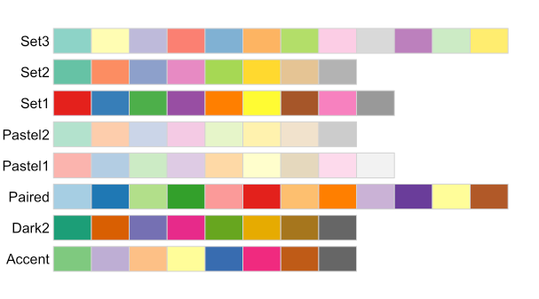

--------------------------------------------------------------------------------

<br>

## Introduction

This page contains additional R material that builds on
the [week 13 lectures](../week13/w13_overview.qmd)
on vectors and data types, data wrangling, and visualization.

## Vectors

### Sequences of numbers with `seq()`

The `:` operator makes series of whole numbers with steps of 1.
For finer control, use the `seq()` function and its arguments `from` (start value),
`to` (end value), and `by` (step size):

```{r}
stepwise_vec <- seq(from = 6, to = 8, by = 0.2)
stepwise_vec
```

### Exploring vectors

R has many functions that provide information about vectors and other
types of objects, such as:

- Get the **number of elements** with `length()`:

  ```{r}
  length(stepwise_vec)
  ```

- See the **first and last few elements**, respectively, with `head()` and `tail()`:

  ```{r}
  # Print the first 6 elements:
  head(stepwise_vec)

  # Print the last 6 elements:
  tail(stepwise_vec)

  # Both head and tail have argument `n` to specify the number of elements:
  tail(stepwise_vec, n = 2)
  ```

- Get **arithmetic summaries** like `mean()` for vectors with numbers:

  ```{r}
  # mean() will compute the mean (average) across all elements
  mean(stepwise_vec)
  ```

### Changing vector elements: more examples

You can use functions inside the brackets and on the right side of the assignment arrow:

- Change the last element to `0`:

  ```{r}
  stepwise_vec[length(stepwise_vec)] <- 0
  stepwise_vec
  ```

- Change the second element to the mean value of the vector:

  ```{r}
  stepwise_vec[2] <- mean(stepwise_vec)
  stepwise_vec
  ```

::: exercise
####  Exercise: Vectors

Make a vector `x` with the whole numbers 1 through 26.
Then, subtract 0.5 from each element in `x` and save the result in vector `y`.
Check your results by printing both vectors.

<details><summary>*Click to see the solution*</summary>

```{r}
x <- 1:26
x

y <- x - 0.5
y
```

</details>
:::

## Factors

### Oddly, factors are technically not a data type

In [week 13](../week13/w13a_data-wrangling.qmd#setting-a-custom-order-with-factors),
you saw how to use factors to store categorical data with a custom order.
For most intents and purposes, it makes sense to think of factors as another data type,
even though technically, they are a kind of data structure built on the `integer` data type:

```{r}
diet_fct <- factor(c("high", "medium", "low"), levels = c("low", "medium", "high"))
typeof(diet_fct)
```

## Data wrangling

These sections build on the [week 13 data wrangling lecture](../week13/w13a_data-wrangling.qmd),
and use the same package and data set:

```{r}
#| message: false
library(tidyverse)
penguins <- as_tibble(penguins)
```

### Reshaping from long to wide with `pivot_wider()`

In the [week 13 data visualization lecture](../week13/w13b_data-viz.qmd#reshaping-data-for-plotting),
you used `pivot_longer()` to reshape data from a wide to a long format.
The `pivot_wider()` function does the opposite,
which is useful to make compact summary tables.
For example, say you computed the mean body mass for each species on each island:

```{r}
mass_summary <- penguins |>
  summarize(mean_mass = mean(body_mass, na.rm = TRUE), .by = c(species, island))
mass_summary
```

To give each island its own column:

```{r}
mass_summary |>
  pivot_wider(
    names_from = island, # column whose values become the new column names
    values_from = mean_mass # column whose values fill the new columns
  )
```

Species that don't occur on an island get an `NA`.
For more about pivoting, see
[chapter 5 of R for Data Science](https://r4ds.hadley.nz/data-tidy.html#sec-pivoting).

### Combining data frames with `left_join()`

Related information is often spread across multiple data frames
that share one or more columns ---
for example, a gene count table and a sample metadata table that both have a sample ID column.
To combine these, use one of _dplyr_'s `*_join()` functions.

For example, here is a small data frame with the scientific name of each penguin species:

```{r}
species_info <- tibble(
  species = c("Adelie", "Chinstrap", "Gentoo"),
  scientific_name = c("Pygoscelis adeliae", "Pygoscelis antarcticus", "Pygoscelis papua")
)
```

`left_join()` keeps all rows of the first ("left") data frame,
and adds the columns of the second data frame,
matching rows by the column(s) you specify with `by`:

```{r}
penguins |>
  left_join(species_info, by = join_by(species)) |>
  select(species, scientific_name, body_mass)
```

Other join functions differ in which rows they keep:
`inner_join()` keeps only rows with a match in both data frames,
and `full_join()` keeps all rows of both.
For more, see [chapter 19 of R for Data Science](https://r4ds.hadley.nz/joins.html).

## Plotting with _ggplot2_

These sections build on the [week 13 data visualization lecture](../week13/w13b_data-viz.qmd),
and use the same _tidyverse_ package and `penguins` data set loaded above.

### Color palettes

What if you have 10 treatments that you want to color?
Picking all colors manually with `scale_color_manual()` requires a lot of typing.
Instead, you can use ready-made **color palettes**, such as those from the _RColorBrewer_ package,
which is installed along with _ggplot2_:

{width="50%" fig-align="center"}

For example, to use the `Pastel1` palette for a scatter plot,
use the function `scale_color_brewer()`:

```{r}
penguins |>
  ggplot(aes(x = bill_len, y = bill_dep)) +
  geom_point(aes(color = species)) +
  scale_color_brewer(palette = "Pastel1") +
  geom_smooth(method = "lm")
```

### Customizing themes

Besides applying a pre-defined theme like `theme_bw()`,
you can change individual theme elements with the `theme()` function.
For example, to change the text size of the plot title and axes,
and the position of the legend:

```{r}
penguins |>
  ggplot(aes(x = bill_len, y = bill_dep)) +
  geom_point(aes(color = species)) +
  geom_smooth(method = "lm") +
  labs(
    title = "Scatter plot of bill length vs bill depth",
    x = "Bill length (mm)",
    y = "Bill depth (mm)"
  ) +
  theme_bw() +
  theme(
    plot.title = element_text(size = 16, face = "bold"),
    axis.title = element_text(size = 14),
    axis.text = element_text(size = 12),
    legend.position = "top"
  )
```

### Combining plots into one figure

Figures in papers often combine different plots as panels A, B, and so on.
Faceting can't do this, because all facets show the same type of plot and variables.
Instead, you can use the [_patchwork_](https://patchwork.data-imaginist.com/) package,
which is not part of the _tidyverse_:

```{r}
library(patchwork)
```

First, save each plot as an object:

```{r}
scatter_plot <- penguins |>
  ggplot(aes(x = bill_len, y = bill_dep, color = species)) +
  geom_point()

box_plot <- penguins |>
  ggplot(aes(x = island, y = body_mass)) +
  geom_boxplot()
```

Then, combine them with `|` to put plots side by side
(or `/` to put them on top of each other),
and add panel labels with `plot_annotation()`:

```{r}
#| fig-width: 10
#| fig-height: 4
(scatter_plot | box_plot) +
  plot_annotation(tag_levels = "A")
```

The result is a single plot object,
which you can save to a file with `ggsave()` like any other plot.

## Formatting code with Air

Positron comes with [Air](https://posit-dev.github.io/air/),
a "formatter" that tidies up R code for you.
For example, it adds spaces around operators like `<-` and `==`
and after commas, and fixes indentation.

To format the code in a Quarto code chunk,
put your cursor in the chunk and run _Quarto: Format Cell_ from the Command Palette.
(In an R script, use _Format Document_ instead.)

To format your code automatically every time you save a file,
open your settings file with _Preferences: Open User Settings (JSON)_
and add the following:

```json
"[r]": {
  "editor.formatOnSave": true,
  "editor.defaultFormatter": "Posit.air-vscode"
},
"[quarto]": {
  "editor.formatOnSave": true,
  "editor.defaultFormatter": "quarto.quarto"
}
```
