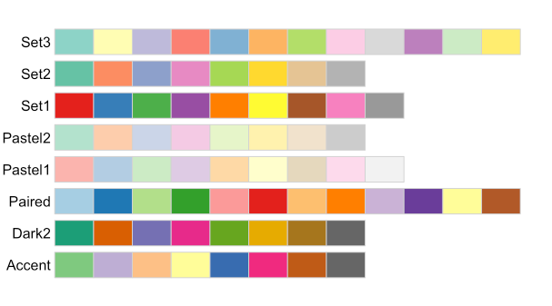

--------------------------------------------------------------------------------

<br>

## Introduction

This page contains additional R material that builds on
the [week 12 self-study section on vectors and data types](../week12/w12a_r-basics.qmd#self-study-vectors-and-data-types)
and the [week 13 lectures](../week13/w13_overview.qmd)
on data wrangling and visualization.

## Vectors

### Sequences of numbers with `seq()`

The `:` operator makes series of whole numbers with steps of 1.
For finer control, use the `seq()` function and its arguments `from` (start value),
`to` (end value), and `by` (step size):

```{r}
stepwise_vec <- seq(from = 6, to = 8, by = 0.2)
stepwise_vec
```

### Exploring vectors

R has many functions that provide information about vectors and other
types of objects, such as:

- Get the **number of elements** with `length()`:

  ```{r}
  length(stepwise_vec)
  ```

- See the **first and last few elements**, respectively, with `head()` and `tail()`:

  ```{r}
  # Print the first 6 elements:
  head(stepwise_vec)

  # Print the last 6 elements:
  tail(stepwise_vec)

  # Both head and tail have argument `n` to specify the number of elements:
  tail(stepwise_vec, n = 2)
  ```

- Get **arithmetic summaries** like `mean()` for vectors with numbers:

  ```{r}
  # mean() will compute the mean (average) across all elements
  mean(stepwise_vec)
  ```

### Changing vector elements: more examples

You can use functions inside the brackets and on the right side of the assignment arrow:

- Change the last element to `0`:

  ```{r}
  stepwise_vec[length(stepwise_vec)] <- 0
  stepwise_vec
  ```

- Change the second element to the mean value of the vector:

  ```{r}
  stepwise_vec[2] <- mean(stepwise_vec)
  stepwise_vec
  ```

::: exercise
####  Exercise: Vectors

Make a vector `x` with the whole numbers 1 through 26.
Then, subtract 0.5 from each element in `x` and save the result in vector `y`.
Check your results by printing both vectors.

<details><summary>*Click to see the solution*</summary>

```{r}
x <- 1:26
x

y <- x - 0.5
y
```

</details>
:::

## Factors

### Oddly, factors are technically not a data type

In [week 13](../week13/w13a_data-wrangling.qmd#arrange-to-sort-data-frames),
you saw how to use factors to store categorical data with a custom order.
For most intents and purposes, it makes sense to think of factors as another data type,
even though technically, they are a kind of data structure built on the `integer` data type:

```{r}
diet_fct <- factor(c("high", "medium", "low"), levels = c("low", "medium", "high"))
typeof(diet_fct)
```

## Plotting with _ggplot2_

These sections build on the [week 13 data visualization lecture](../week13/w13b_data-viz.qmd),
and use the same packages:

```{r}
#| message: false
library(tidyverse)
library(palmerpenguins)
```

### Color palettes

What if you have 10 treatments that you want to color?
Picking all colors manually with `scale_color_manual()` requires a lot of typing.
Instead, you can use ready-made **color palettes**, such as those from the _RColorBrewer_ package,
which is installed along with _ggplot2_:

{width="50%" fig-align="center"}

For example, to use the `Pastel1` palette for a scatter plot,
use the function `scale_color_brewer()`:

```{r}
penguins |>
  ggplot(aes(x = bill_length_mm, y = bill_depth_mm)) +
  geom_point(aes(color = species)) +
  scale_color_brewer(palette = "Pastel1") +
  geom_smooth(method = "lm")
```

### Customizing themes

Besides applying a pre-defined theme like `theme_bw()`,
you can change individual theme elements with the `theme()` function.
For example, to change the text size of the plot title and axes,
and the position of the legend:

```{r}
penguins |>
  ggplot(aes(x = bill_length_mm, y = bill_depth_mm)) +
  geom_point(aes(color = species)) +
  geom_smooth(method = "lm") +
  labs(
    title = "Scatter plot of bill length vs bill depth",
    x = "Bill length (mm)",
    y = "Bill depth (mm)"
  ) +
  theme_bw() +
  theme(
    plot.title = element_text(size = 16, face = "bold"),
    axis.title = element_text(size = 14),
    axis.text = element_text(size = 12),
    legend.position = "top"
  )
```
