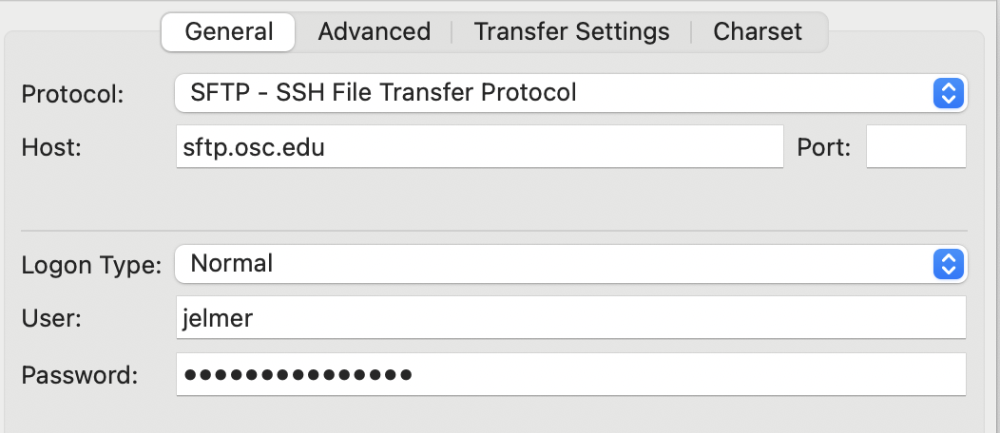
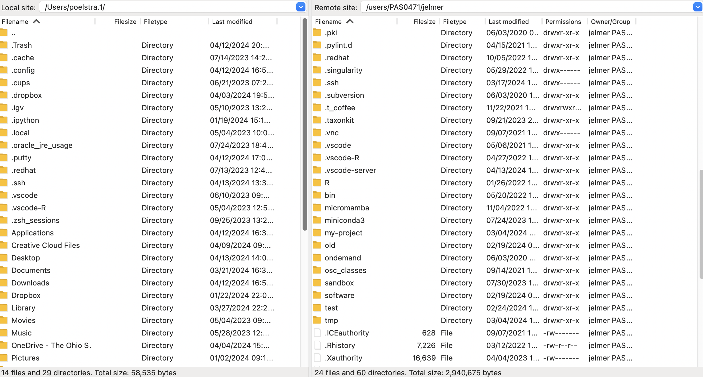
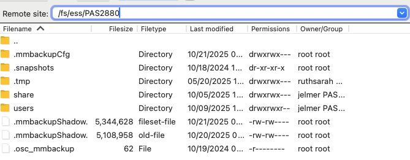

------

<hr style="height:10pt; visibility:hidden;" />

## Introduction

This page shows you how to connect to OSC with the `ssh` command
in a terminal on your own computer, rather than through the OnDemand web portal.
It also covers transferring files between your computer and OSC
with commands like `scp` and `rsync`, which use the same kind of SSH connection,
and with the FileZilla program and Globus.

Why would you use SSH when OnDemand works fine?

- It's quick: there are no forms or waiting,
  which is handy to e.g. check on running jobs or have a quick look at a file.
- SSH is also what commands like `scp` and `rsync` use to transfer files
  ([see below](#remote-transfer-commands)).
- Many other remote computers, like other supercomputers or lab servers,
  don't have a web portal like OnDemand,
  but nearly all of them accept SSH connections.

::: {.callout-tip appearance="simple"}
If you've followed the page on
[connecting a local VS Code installation to OSC](vscode-local.qmd),
you've already done part of the setup on this page:
the sections that you can skip or shorten are marked.
:::

## Basic SSH connection in a terminal

You can connect to OSC (and other remote computers) with the **`ssh` command**,
which works in Windows and Unix-based (Mac/Linux) terminals alike.

1. On your own computer, open a terminal application.
   - On a Mac, you should have an app called "**Terminal**"^[
     And potentially other options like "iTerm": any of these will work.].
   - On Windows, use the "**Windows Terminal**" app (the default on Windows 11)
     or "PowerShell".

2. Type the command `ssh <user>@<host>`, replacing:

   - `<user>` with your OSC username
   - `<host>` with the name of the computer/cluster you want to connect to:
     - `pitzer.osc.edu` to connect to the Pitzer cluster
     - `cardinal.osc.edu` to connect to the Cardinal cluster

   For example, if I (username `jelmer`) wanted to log in to the Pitzer cluster,
   I would use:

   ```bash
   ssh jelmer@pitzer.osc.edu
   ```
   ``` {.bash-out}
   The authenticity of host 'pitzer.osc.edu' can't be established.
   ED25519 key fingerprint is SHA256:zUgn1K3+FK+25JtG6oFI9hVZjVxty1xEqw/K7DEwZdc.
   This key is not known by any other names.
   Are you sure you want to continue connecting (yes/no/[fingerprint])?
   ```

3. If this is the first time you are connecting to Pitzer via SSH,
   you'll encounter a message similar to the one above.
   While the phrase _"The authenticity of host 'pitzer.osc.edu' can't be established."_
   sounds ominous, you will always get this warning when you attempt to connect to a
   remote computer for the first time, and you should type `yes` to proceed
   (you then won't see this message again).

   ::: {.callout-note collapse="true"}
   #### You may run into "WARNING: REMOTE HOST IDENTIFICATION HAS CHANGED!" _(Click to expand)_

   Your computer remembers the "key" of each remote computer you have connected to
   (in the file `~/.ssh/known_hosts`),
   and if that key ever changes, `ssh` refuses to connect and shows a big warning.
   This is meant to protect you against someone impersonating the remote computer,
   but at OSC, it usually just means that a cluster was upgraded.
   If you get this message, check OSC's announcements or ask OSC Help if in doubt,
   and then remove the old key for that host from your computer:

   ```bash
   ssh-keygen -R pitzer.osc.edu
   ```

   The next time you connect, you'll get the first-connection message shown above again.
   :::

4. You'll then be prompted for your OSC password:
   type it followed by <kbd>Enter</kbd>,
   and keep in mind that when you do so,
   _no characters or even \*s will appear on the screen_!
   (If you have already set up an SSH key, you won't be prompted ---
   see [below](#avoid-typing-your-osc-password) for how to do that.)

5. Your shell will now connect to OSC,
   and you should see some welcome messages and file quota listings ---
   and your prompt should indicate that you're at OSC, e.g.:

   ```bash-out-solo
   [jelmer@pitzer-login04 ~]$
   ```

To disconnect and return to your own computer's shell,
type `exit` or press <kbd>Ctrl</kbd>+<kbd>D</kbd>.

::: callout-warning
#### You're on a login node
With `ssh`, you always end up on a login node,
just like when you use the `Clusters` menu in OnDemand.
That's fine for light work like managing and viewing files,
and submitting and monitoring Slurm batch jobs,
but run anything heavier as a batch job.
:::

## Avoid typing your OSC password

::: {.callout-tip appearance="simple"}
**Skip this section** if you've followed the
["Avoid being prompted for your OSC password"](vscode-local.qmd#avoid-being-prompted-for-your-osc-password)
section of the local VS Code page.
:::

To avoid having to type your OSC password every time you connect,
you can set up an "**SSH key pair**":
a private key that stays on your computer,
and a matching public key that you copy to OSC.
OSC will then recognize your computer and let you in without a password.

Run the following commands in a terminal on your own computer
(_not_ in a shell that is connected to OSC):

1. Generate an SSH key pair:

   ```bash
   ssh-keygen -t ed25519
   ```

   You'll get some output and will then be asked several questions,
   but in each case, you can just press <kbd>Enter</kbd> to select the default answer.

2. Copy the public key to OSC, **replacing `<user>` with your OSC username**.
   You'll be prompted for your OSC password one last time.

   ::: {.panel-tabset}
   ### Mac
   ```bash
   # Replace <user> by your username, e.g. "ssh-copy-id jelmer@pitzer.osc.edu"
   ssh-copy-id <user>@pitzer.osc.edu
   ```

   ### Windows

   ```bash
   # Replace <user> by your username, e.g. "jelmer@pitzer.osc.edu"
   cat ~/.ssh/id_ed25519.pub | ssh <user>@pitzer.osc.edu 'mkdir -p .ssh && cat >> .ssh/authorized_keys'
   ```
   :::

3. Test it: the following should print the name of a Pitzer login node,
   _without_ asking for your password:

   ```bash
   # Replace <user> by your username, e.g. "ssh jelmer@pitzer.osc.edu hostname"
   ssh <user>@pitzer.osc.edu hostname
   ```

Because your Home dir is the same on all OSC clusters,
this works for any OSC address,
including the file transfer server `sftp.osc.edu` used [below](#remote-transfer-commands).

## Custom names for your SSH connections

### Set up custom names

You can set up short alternative names ("aliases") for your SSH connections,
such as `pitzer` for `jelmer@pitzer.osc.edu`.
These are especially convenient with the file transfer commands
[below](#remote-transfer-commands).

You define aliases in an SSH configuration file on your own computer, `~/.ssh/config`.

::: {.callout-tip appearance="simple"}
**Shortcut** if you've followed the [local VS Code page](vscode-local.qmd):
you already have this file, with an alias `osc-pitzer-login`
(so `ssh osc-pitzer-login` already works!).
Open the file as you did there,
and add the `osc-sftp` entry shown below to it.
:::

To create (if needed) and open the file,
run the following in a terminal on your own computer:

::: {.panel-tabset}
### Mac

```bash
# Create the file if it doesn't exist, then open it in TextEdit:
touch ~/.ssh/config
open -e ~/.ssh/config
```

### Windows

```powershell
# Create the file if it doesn't exist, then open it in Notepad:
Add-Content -Path $HOME\.ssh\config -Value ""
notepad $HOME\.ssh\config
```
:::

Add aliases to the file in the following format:

```{.norun .syntax}
Host <alias>
   HostName <remote-address>
   User <user>
```

For instance, my file contains the following,
so I can connect to Pitzer with `pitzer`,
and to OSC's file transfer server with `osc-sftp`:

```{.file filename="~/.ssh/config (excerpt)" code-line-numbers="false"}
Host pitzer
   HostName pitzer.osc.edu
   User jelmer

Host osc-sftp
   HostName sftp.osc.edu
   User jelmer
```

Copy these entries into your file, replace `jelmer` with your OSC username,
and save the file.

### Connecting from now on

From now on, you just need to use your alias to log in:

```bash
ssh pitzer
```

And aliases also work with the remote transfer commands [below](#remote-transfer-commands).
For example, to copy a `scripts` dir on your computer to your personal dir at OSC:

```{.bash .norun}
rsync -av ~/scripts osc-sftp:/fs/ess/PAS3493/people/jelmer/
```

## File transfer to and from OSC

### Remote transfer commands

Besides the OnDemand Files menu,
you can transfer files with **remote transfer commands** like `scp` and `rsync`,
which you run in a terminal on your own computer.
These are especially convenient when you repeatedly transfer the same files,
or want to keep certain dirs in sync between OSC and your computer.

::: callout-tip
#### Use `sftp.osc.edu` as the address for file transfers
If you use `pitzer.osc.edu` or `cardinal.osc.edu` as the remote address,
your transfer runs on a login node,
where any process is killed after 20 minutes of CPU time ---
which large transfers can exceed.
OSC's dedicated file transfer server, `sftp.osc.edu`, has no such limit,
so use that address in transfer commands, as in the examples below.
(All OSC addresses give you access to the same files.)
:::

#### `scp`

One option is `scp` (secure copy), which works much like the regular `cp` command,
including the need for the `-r` option for recursive transfers.
(We used `scp` in class in [w11a](../week11/w11a_data.qmd#transfer-with-scp).)
The key difference is that we have to somehow refer to a path on a remote computer,
and we do so by starting with the remote computer's address,
followed by `:`, and then the path:

```{.bash .norun .syntax}
# Copy from remote (OSC) to local (your computer):
scp <user>@sftp.osc.edu:<remote-path> <local-path>

# Copy from local (your computer) to remote (OSC):
scp <local-path> <user>@sftp.osc.edu:<remote-path>
```

Here are two examples of copying from OSC to your local computer:

```{.bash .norun}
# Copy a file from OSC to a local computer - namely, to your current working dir ('.'):
scp jelmer@sftp.osc.edu:/fs/ess/PAS3493/people/jelmer/garrigos/README.md .

# Copy a directory from OSC to a local computer - namely, to your home dir ('~'):
scp -r jelmer@sftp.osc.edu:/fs/ess/PAS3493/people/jelmer/garrigos/meta ~
```

And two examples of copying from your local computer to OSC:

```{.bash .norun}
# Copy a file from your computer to OSC --
# namely, a file in your current working dir to your home dir at OSC:
scp fastqc.sh jelmer@sftp.osc.edu:~

# Copy a file from my local computer's Desktop to my personal dir in the PAS3493 project dir:
scp /Users/poelstra.1/Desktop/fastqc.sh jelmer@sftp.osc.edu:/fs/ess/PAS3493/people/jelmer
```

Some nuances for remote copying:

- For both transfer directions (remote-to-local and local-to-remote),
  you **issue the copying commands from your local computer.**
- A relative path on the remote computer (OSC) is interpreted relative to your Home dir there,
  so you'll usually want to use absolute paths for OSC.

::: exercise
####  Exercise: Where am I?

You've logged in to Pitzer with `ssh` in your computer's terminal.
In that same terminal, you then run:

1. `ls ~/Desktop`, hoping to see the files on your computer's Desktop
2. `scp jelmer@sftp.osc.edu:/fs/ess/PAS3493/people/jelmer/garrigos/README.md .`,
   hoping to download this file to your computer

What happens in each case, and why?

<details><summary> &nbsp; _Click to see the solution_</summary>

Neither does what you hoped,
because after logging in with `ssh`, your terminal is running a shell _at OSC_:

1. `~` now refers to your Home dir at OSC, which has no `Desktop` dir,
   so you'll get a "No such file or directory" error.
2. The file is copied from OSC to your working dir... at OSC!
   To download it to your computer, first log out with `exit`,
   and then run the `scp` command.

</details>
:::

::: {.callout-note collapse="true"}
#### Transferring directly to and from OneDrive _(Click to expand)_

If your OneDrive is mounted on or synced to your local computer
(i.e., if you can see it in your computer's file browser),
you can also transfer directly between OSC and OneDrive.
For example, the path to my OneDrive files on my laptop is:
`/Users/poelstra.1/Library/CloudStorage/OneDrive-TheOhioStateUniversity`.
So if I had a file called `fastqc.sh` in my top-level OneDrive dir,
I could transfer it to my Home dir at OSC as follows:

```{.bash .norun}
scp /Users/poelstra.1/Library/CloudStorage/OneDrive-TheOhioStateUniversity/fastqc.sh jelmer@sftp.osc.edu:~
```

<hr style="height:1pt; visibility:hidden;" />
:::

#### `rsync` {#rsync}

Another option, which I recommend, is the `rsync` command,
especially when you have directories that you repeatedly want to sync:
`rsync` won't copy any files that are identical in source and destination.
`rsync` comes with Mac and Linux computers, but not with Windows.

A useful combination of options is `-avz --progress`:

- `-a` enables archive mode (among other things, this makes it work recursively).
- `-v` increases verbosity &mdash; tells you what is being copied.
- `-z` enables compressed file transfer
  (this can speed up transfers over slow connections, but not for already-compressed files like `.fastq.gz`).
- `--progress` shows transfer progress for individual files.

The way to refer to remote paths is the same as with `scp`.
For example, I could copy a `dir_with_results` in my local Home dir to my
OSC Home dir as follows:

```{.bash .norun}
rsync -avz --progress ~/dir_with_results jelmer@sftp.osc.edu:~
```

<hr style="height:1pt; visibility:hidden;" />

::: {.callout-warning collapse="true"}
#### Trailing slashes in `rsync` _(Click to expand)_

One tricky aspect of using `rsync` is that the presence/absence of a
**trailing slash for source directories** makes a difference for its behavior.
The following commands work as intended &mdash;
to create a backup copy of a `scripts` dir inside a dir called `backup`[^2]:

[^2]: For simplicity, these commands are copying between local dirs,
      which is also possible with `rsync`.

```{.bash .norun}
# With trailing slash: copy the *contents* of source "scripts" into target "scripts":
rsync -avz scripts/ backup/scripts

# Without trailing slash: copy the source dir "scripts" into target dir "backup"
rsync -avz scripts backup
```

But these commands don't:

```{.bash .norun}
# This would result in a dir 'backup/scripts/scripts':
rsync -avz scripts backup/scripts

# This would copy the files in "scripts" straight into "backup":
rsync -avz scripts/ backup
```
:::

### FileZilla {#filezilla}

If you prefer a graphical interface,
you can transfer files with an "SFTP client" program,
which lets you drag and drop files between your computer and OSC.
Like the transfer commands above,
these programs connect to `sftp.osc.edu`, and work for transfers of any size.
There are several such programs, but I can recommend **FileZilla**^[
E.g. because it works on all operating systems and has a more intuitive user
interface than Cyberduck,
another very commonly used program that works both on Mac and Windows.].

1. **Install FileZilla**\
   - For *OSU-managed computers*:
     Open the "Software Center" (Windows) or "Ohio State Application Self Service"
     (Mac), search for "FileZilla", and click the install button.

   - For *personal computers*:
     Go to the
     [FileZilla download page](https://filezilla-project.org/download.php?type=client)
     --- it should automatically display a big green download button for your
     operating system: click on that, then install the program, and open it.
     On Windows, the installer may offer to install additional software:
     decline these offers.

2. **Connect to OSC**\
   Open FileZilla.
   To connect it to OSC, find the **Site Manager**:
   click `File` in the top menu bar and then `Site Manager`^[
   There is also an icon in the far top-left to access this menu.
   Additionally, there is a "Quickconnect" bar,
   but I've not managed to connect to OSC with that.].
   In the Site Manager, click **New site**, name it e.g. `OSC`,
   and then enter/select the following:
   - _Protocol_: "SFTP - SSH File Transfer Protocol"
   - _Host_: `sftp.osc.edu` (leave the Port box empty)
   - _Logon Type_: Make sure "Normal" is selected
   - _User_: Type your OSC username
   - _Password_: Enter your OSC password
   - Click the "**Connect**" button at the bottom to connect to OSC
   - The first time you connect, FileZilla shows an "Unknown host key" dialog,
     the equivalent of the first-connection message in the terminal [above](#basic-ssh-connection-in-a-terminal):
     check "Always trust this host" and click "OK".

{fig-align="center" width="60%" fig-alt="A screenshot of the connection setup dialog box on FileZilla" .lightbox}

3. **The connection interface**\
   Once connected, your main screen is split with a local file explorer
   on the left, and a remote file explorer on the right:

{fig-align="center" width="90%" fig-alt="A screenshot of the split screen view showing local and remote on FileZilla" .lightbox}

4. **Changing directories**\
   You can change directories in either file explorer.
   At OSC, your default location is your Home dir,
   but you can type a partial path in the top bar (e.g. `/fs/ess/PAS3493`)
   and then click your way to your personal dir.

{fig-align="center" width="70%" fig-alt="A screenshot of FileZilla showing how to change the remote dir." .lightbox}

5. **Transferring files**\
   Transferring dirs and files in either direction is as simple as
   **dragging and dropping** them to the other side!

### Globus

For very large transfers, another good option is **Globus**,
which has a browser-based GUI. Some advantages of using Globus are that:

- It checks whether all files were transferred correctly and completely.
- It can pause and resume automatically when you e.g. turn off your computer for a while.
- It can be used to share files from OSC directly with collaborators even at
  different institutions.

To transfer files to or from your own computer,
Globus needs some setup,
including the installation of a piece of software ("Globus Connect Personal")
that will run in the background on your computer.
(This is not needed to transfer files between OSC and other institutions
that use Globus.)

- Globus installation and configuration instructions:
  [Windows](https://docs.globus.org/how-to/globus-connect-personal-windows) /
  [Mac](https://docs.globus.org/how-to/globus-connect-personal-mac) /
  [Linux](https://docs.globus.org/how-to/globus-connect-personal-linux)
- [Globus transfer instructions](https://docs.globus.org/how-to/get-started/)
- [OSC's page on Globus](https://www.osc.edu/resources/getting_started/howto/howto_use_globus_overview)
