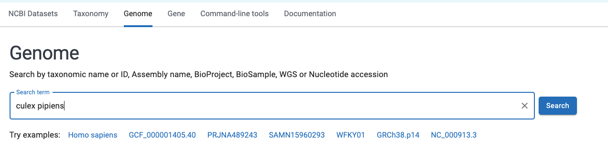
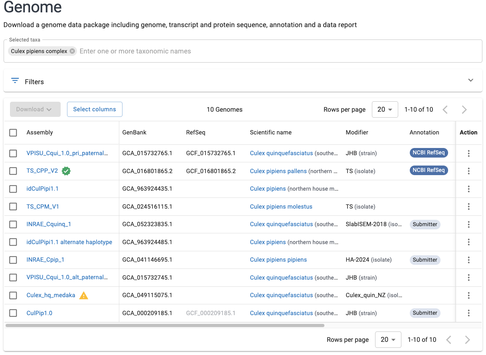
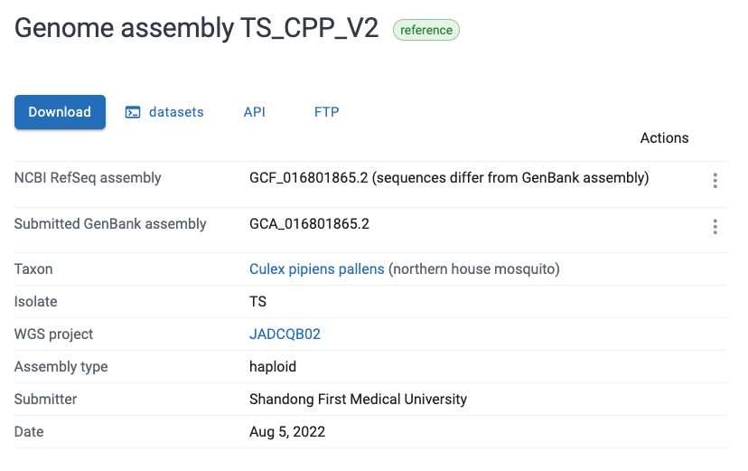

------

<br>

## Introduction

In week 11, you [downloaded files with `wget`](../week11/w11a_data.qmd#wget)
from an NCBI FTP dir.
This page introduces NCBI's databases more broadly,
shows how to find a reference genome for any species,
and shows two more convenient ways to download genomes and sequencing reads.
This may be especially useful if you are working with public data
for your [Final Project](../FP/FP-info.qmd).

If you want to run the commands on this page,
do so from the `sandbox` dir in your personal dir:

```bash
cd /fs/ess/PAS3493/people/$USER/sandbox
```

## NCBI's databases

The [National Center for Biotechnology Information (NCBI)](https://www.ncbi.nlm.nih.gov),
part of the US National Institutes of Health (NIH),
hosts dozens of databases, all of which you can search from its homepage.
Those you are most likely to use for omics work are:

- **GenBank** ---
  The archive of all publicly available DNA sequences,
  from single genes to entire genome assemblies.
  Records are submitted by researchers, and NCBI doesn't curate them,
  so GenBank can contain many (near-)identical sequences and quality varies.
  GenBank exchanges data daily with its European (ENA) and Japanese (DDBJ) counterparts,
  so all three contain the same sequences.

- **RefSeq** ("Reference Sequence") ---
  A curated, non-redundant set of genomes, transcripts, and proteins,
  derived from GenBank records and annotated by NCBI.
  You can recognize RefSeq records by their accession number prefixes:
  for example, genome assemblies start with `GCF_` in RefSeq and with `GCA_` in GenBank.
  The _Culex pipiens_ genome you've worked with (`GCF_016801865.2`) is a RefSeq assembly.

- **Sequence Read Archive (SRA)** ---
  Raw reads from high-throughput sequencing.
  Each sequencing run has an accession number starting with `SRR`
  (or `ERR` or `DRR` when it was submitted to ENA or DDBJ, respectively),
  and runs are grouped into BioSamples (`SAMN...`) and BioProjects (`PRJNA...`).
  For example, the reads in your `garrigos/fastq/S63_R1.fastq.gz` file
  have headers starting with `@ERR10802863`,
  the accession number of that sample's sequencing run.

- **Gene Expression Omnibus (GEO)** ---
  Processed gene expression data like count tables, with links to the raw reads in the SRA.

- **BLAST databases** ---
  BLAST is a tool to find sequences that are similar to a query sequence.
  It searches databases that NCBI builds from the above,
  such as `core_nt` (nucleotide sequences) and `nr` (non-redundant protein sequences).
  You can run BLAST searches on the [BLAST website](https://blast.ncbi.nlm.nih.gov),
  or for many sequences, with the command-line version (BLAST+).
  For the latter, you can download pre-built databases from
  [NCBI's FTP site](https://ftp.ncbi.nlm.nih.gov/blast/db/)
  (note that these databases are very large) or use one of OSC's `blast-database`
  modules, though these are updated irregularly
  (as of October 2026, the most recent update was in July 2024).

## Finding a reference genome for any species

1. Go to the genome part of NCBI's datasets portal <https://www.ncbi.nlm.nih.gov/datasets/genome/>.
2. Type in the name of a species (or other taxonomic level).

{fig-align="center" width="95%" .no-border fig-alt="A screenshot of the NCBI datasets website" .lightbox}

3. Select an appropriate taxonomic match within the search box, and press Enter.
   You will get a list of available genomes:

{fig-align="center" width="95%" .no-border fig-alt="A screenshot of the NCBI datasets website" .lightbox}

4. In general, pick the genome marked as "Reference" with a green checkmark
   (`TS_CPP_V2` in the screenshot above).
   An exception is when another genome is a better match for your organism,
   such as one from the subspecies or strain that you work with.
   Click on the name of the desired genome, and you will see a page like this:

{fig-align="center" width="85%" .no-border fig-alt="A screenshot of the NCBI datasets website" .lightbox}

5. There are multiple ways of downloading.
   The FTP dir that you downloaded from in week 11
   can be accessed by clicking the "FTP" button shown in the screenshot above.
   But you can also use the genome's accession number (here, `GCF_016801865.2`)
   to download its files with the `datasets` tool, as shown next.

## Downloading genomes with `datasets`

NCBI's [`datasets` command-line tool](https://www.ncbi.nlm.nih.gov/datasets/docs/v2/command-line-tools/download-and-install/)
downloads genomes (and other data) by accession number or taxon name,
and is especially useful when you need multiple or many genomes.

It is not available as a module at OSC, so we'll run it with a container
(the Conda package name is `ncbi-datasets-cli`):

```bash
DATASETS_CONTAINER=oras://community.wave.seqera.io/library/ncbi-datasets-cli:18.40.0--2188155c2e5693bc
apptainer exec "$DATASETS_CONTAINER" datasets --version
```
```bash-out
INFO:    Downloading oras image
91.5MiB / 91.5MiB [===========================================================================================================================================================================] 100 % 15.2 MiB/s 0s
INFO:    gocryptfs not found, will not be able to use gocryptfs
datasets version: 18.40.0
```

### Downloading a single genome

To download the _Culex pipiens_ genome sequence, annotation (GFF), and protein sequences,
we use the `--include` option.
Without it, `datasets` would only download the genome sequence
(along with some metadata files that are always included).

```bash
apptainer exec "$DATASETS_CONTAINER" datasets download genome accession GCF_016801865.2 \
    --include genome,gff3,protein --filename culex.zip
```
```bash-out
INFO:    Using cached SIF image
INFO:    gocryptfs not found, will not be able to use gocryptfs
- Collecting genome records    1 record
Downloading: culex.zip    185MB valid data package
Validating package files [================================================] 100% 7/7
```

The download is a single ZIP file,
which you can extract with `unzip`:

```bash
unzip culex.zip -d culex
```
```bash-out
Archive:  culex.zip
  inflating: culex/README.md
  inflating: culex/ncbi_dataset/data/assembly_data_report.jsonl
  inflating: culex/ncbi_dataset/data/GCF_016801865.2/GCF_016801865.2_TS_CPP_V2_genomic.fna
  inflating: culex/ncbi_dataset/data/GCF_016801865.2/genomic.gff
  inflating: culex/ncbi_dataset/data/GCF_016801865.2/protein.faa
  inflating: culex/ncbi_dataset/data/dataset_catalog.json
  inflating: culex/md5sum.txt
```

Let's take a look at the contents of the `culex` dir:

```bash
tree culex
```
```bash-out
culex
├── README.md
├── md5sum.txt
└── ncbi_dataset
    └── data
        ├── GCF_016801865.2
        │   ├── GCF_016801865.2_TS_CPP_V2_genomic.fna
        │   ├── genomic.gff
        │   └── protein.faa
        ├── assembly_data_report.jsonl
        └── dataset_catalog.json
```

The files are in `culex/ncbi_dataset/data/GCF_016801865.2/`,
and unlike the files in the FTP dir, they are not gzipped.

### Finding and downloading many genomes

`datasets` is especially useful when you need many genomes ---
for example, you can download all reference genomes for a genus.

Taxon names can be ambiguous, though:
"Culex" is the name of both a genus and a subgenus,
so `datasets` would give an error if we used `taxon culex`.
We therefore use the NCBI Taxonomy ID of the genus, 7174,
which you can look up in the [NCBI Taxonomy browser](https://www.ncbi.nlm.nih.gov/taxonomy):

```{.bash .norun}
# Download all Culex reference genome sequences:
apptainer exec "$DATASETS_CONTAINER" datasets download genome taxon 7174 \
    --reference --include genome --filename culex_all.zip
```

Because this can be a lot of data,
you may want to check which genomes would be downloaded first.
You can do so with `datasets summary`,
which by default prints its output in JSON format,
which is hard to read.
The container also includes NCBI's `dataformat` tool,
which can convert this output to a table in TSV format with only the columns you select.
To do so, we add the `--as-json-lines` option to the `datasets` command
(the format that `dataformat` expects),
and pipe its output to `dataformat tsv genome`,
whose `--fields` option takes a comma-separated list of columns:

```bash
# Print info about the reference genomes for the genus Culex:
apptainer exec "$DATASETS_CONTAINER" \
    datasets summary genome taxon 7174 --reference --as-json-lines |
    apptainer exec "$DATASETS_CONTAINER" dataformat tsv genome \
    --fields accession,organism-name,assminfo-level,assmstats-total-sequence-len
```
```bash-out
Assembly Accession      Organism Name   Assembly Level  Assembly Stats Total Sequence Length
GCA_964187845.1 Culex laticinctus       Chromosome      833812495
GCA_964213205.1 Culex modestus  Chromosome      697666902
GCA_964243045.1 Culex perexiguus        Chromosome      436181468
GCF_016801865.2 Culex pipiens pallens   Chromosome      566339288
GCF_015732765.1 Culex quinquefasciatus  Chromosome      573214445
GCA_964340515.1 Culex theileri  Chromosome      832043836
```

## Downloading reads from the SRA

There are several ways to download FASTQ files from the SRA:

- [**SRA explorer**](https://sra-explorer.info) is a website
  where you can enter an accession number (e.g. of a BioProject)
  to get download links and `curl` commands for the FASTQ files.
- The [**SRA Toolkit**](https://github.com/ncbi/sra-tools/wiki) is NCBI's official set of
  command-line tools, which includes `prefetch` and `fasterq-dump`.

The SRA Toolkit is available as a module at OSC (`module spider sratoolkit`),
but for consistency with `datasets`, we'll use a container here.
With the SRA Toolkit, downloading the full set of reads for sample S63 of the
Garrigós et al. dataset (the files in `garrigos/fastq` only contain a subset)
takes two steps:
`prefetch` downloads the data in NCBI's own compressed format,
and `fasterq-dump` converts that to FASTQ files.
Downloading reads can take a long time, especially for many samples,
so this is best done in a [Slurm batch job](../week10/w10a_slurm1.qmd).
Here is an example script that downloads the reads for one sample:

```{.bash .file filename="scripts/sra_download.sh"}
#!/bin/bash
#SBATCH --account=PAS3493
#SBATCH --cpus-per-task=4
#SBATCH --time=1:00:00
#SBATCH --output=slurm-sra_download-%j.out
#SBATCH --mail-type=FAIL
set -euo pipefail

# Download the FASTQ files for one SRA run (sample)
# Usage: sbatch scripts/sra_download.sh <run accession> <output dir>

# Constants
SRATOOLS_CONTAINER=oras://community.wave.seqera.io/library/sra-tools:3.4.1--c9eb93771eedd04e

# Copy the placeholder variables
accession="$1"
outdir="$2"

# Initial logging
echo "Starting script sra_download.sh"
date
echo "Run accession:            $accession"
echo "Output dir:               $outdir"
echo

# Create the output dir if needed
mkdir -p "$outdir"

# Step 1: Download the data in NCBI's own format
apptainer exec "$SRATOOLS_CONTAINER" prefetch "$accession"

# Step 2: Convert the data to FASTQ files
# (Use --split-files to get separate files for forward and reverse reads)
apptainer exec "$SRATOOLS_CONTAINER" fasterq-dump \
    --split-files --threads 4 --outdir "$outdir" "$accession"

# Compress the FASTQ files
gzip "$outdir"/"$accession"*.fastq

# Final logging
echo
echo "Successfully finished script sra_download.sh"
date
```

To download the reads for sample S63, you would submit the script like so:

```{.bash .norun}
# [Example command - no need to run this]
sbatch scripts/sra_download.sh ERR10802863 fastq_full
```

::: {.callout-note collapse="true"}
#### Alternative: installing these tools with Conda _(Click to expand)_

Instead of using containers,
you can also install `datasets` and the SRA Toolkit in [Conda](../bonus/conda.qmd) environments.
This can be especially useful for `datasets`,
since you may want to run several commands interactively,
e.g. to explore which genomes are available before deciding what to download.
After activating a Conda environment,
you can simply type the commands without the `apptainer exec <container-URI>` prefix.

```{.bash .norun}
# [Example commands - no need to run these]
# Create the environments (only needed once):
module load miniconda3/25.11.1-py312
conda create -y -n ncbi-datasets conda-forge::ncbi-datasets-cli
conda create -y -n sra-tools bioconda::sra-tools

# Activate an environment and run its commands:
conda activate ncbi-datasets
datasets summary genome taxon 7174 --reference
```
:::
