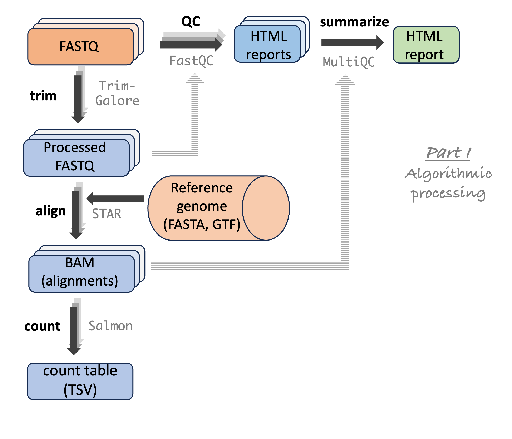

----------------------------------------------------------------------------------------------------

<br>

## Introduction

### Learning goals

Now that you know the basics of submitting and managing Slurm batch jobs,
you will learn:

- The most common Slurm/`sbatch` options, including those used to request:
  - More time, cores, and memory for jobs
  - An email notification when jobs e.g. fail or finish
- How to run Slurm jobs in practice, including how to submit many jobs at the same time
- How to make sure that your jobs succeeded
- How to make Claude write scripts for Slurm batch jobs
- How to structure a multi-step workflow,
  and what workflow management systems and nf-core pipelines are

### Getting ready

1. At <https://ondemand.osc.edu>,
   start a VS Code session in `/fs/ess/PAS3493/people/$USER`.
2. In the terminal, navigate to your `week10` dir.

## Common Slurm/`sbatch` options

In class, we'll go through the most commonly used `sbatch` options
using the slides below
(**[open them in a separate tab](./w10b_slurm-options.qmd){target="_blank"}** for a full-screen view).

<iframe class="slides-embed" src="w10b_slurm-options.html" title="Common Slurm options (slides)"></iframe>

After that, you'll submit a job that exceeds its time limit.
This section also has a reference table of these and some additional options,
and a few more notes on cores, memory, and Slurm log files.

### Exceed the time limit

::: exercise
####  Exercise 3: Exceed the time limit

1. Modify your `scripts/sleep.sh` script from the previous lecture:
   - Reserve only 1 minute for the job
   - Make the script run for longer than that,
     by increasing the `sleep` time to at least 100 seconds

   <!----
   <details><summary> _Click for the solution_</summary>

   ```{.file .bash filename="scripts/sleep.sh"}
   #!/bin/bash
   #SBATCH --account=PAS3493
   #SBATCH --time=1
   set -euo pipefail

   echo "I will sleep for 100 seconds" > sleep.txt

   sleep 100s

   echo "I'm awake! Successfully finished script sleep.sh"
   ```

   </details>
   ---->

When you exceed the time limit, an error message will be printed.
**Before submitting the script**, predict the following:

2. Where will the error message be printed?

   a. To the screen
   b. In the Slurm log file
   c. In `sleep.txt`

   <!----
   <details><summary> _Click for the solution_</summary>

   **(b)** In the Slurm log file, for example:

   ```bash-out-solo
   slurmstepd: error: *** JOB 23641567 ON p0133
   CANCELLED AT 2026-10-28T14:06:24 DUE TO TIME LIMIT ***
   ```

   </details>
   ---->

3. Will `sleep.txt` and the "_I'm awake!_" line still be produced?

   a. Both will be produced
   b. `sleep.txt` will be produced, but the "_I'm awake!_" line will not
   c. The "_I'm awake!_" line will be produced, but `sleep.txt` will not
   d. Neither will be produced

   <!----
   <details><summary> _Click for the solution_</summary>

   **(b)** `sleep.txt` is created before the `sleep` command runs,
   but the job is killed during `sleep`.
   This is why a final "_Successfully finished_" line in your scripts is so useful:
   if it's missing from the Slurm log file, you know the script didn't finish.

   </details>
   ---->

4. Submit the script.
   The job will be killed after a little over a minute.
   Once the job is no longer in the `squeue` output,
   check whether your predictions were correct.
   Then, **remove** the generated files.
:::

### `sbatch` options overview

Here are the main options from the slides:

| Resource/use                                     | long option example                            | short option |    default     |
| ------------------------------------------------ | ---------------------------------------------- | ------------ | :------------: |
| Project to be billed                             | `--account=PAS3493`                            | `-A`         |     *N/A*      |
| Time limit                                       | `--time=4:00:00`                               | `-t`         |    1:00:00     |
| Nr of cores                                      | `--cpus-per-task=1`                            | `-c`         |       1        |
| Memory limit per node                            | `--mem=20G`                                    | &mdash;          |  4G per core   |
| Log output file                                  | `--output=slurm-fastqc-%j.out`                 | `-o`         | `slurm-%j.out` |
| Get email when job fails<br>/ ends or fails      | `--mail-type=FAIL` <br> `--mail-type=END,FAIL` | &mdash;           |                |

: {.striped .hover tbl-colwidths="[25,40,15,20]"}

<hr style="height:1pt; visibility:hidden;" />

And some additional ones:

| Resource/use                                                        | long option example                                 |
| ------------------------------------------------------------------- | --------------------------------------------------- |
| Put error output (*stderr*) into a separate file                    | `--error=slurm-fastqc-%j.err`                       |
| Job name (will e.g. be displayed in `squeue` output)                | `--job-name=fastqc`                                 |
| Partition (=queue type)                                             | `--partition=longserial` <br> `--partition=hugemem` |
| Only allow job to begin after a specific time                       | `--begin=2026-10-29T12:00:00`                       |
| Only allow job to begin after another job has successfully finished | `--dependency=afterok:123456`                       |
| Nr of nodes                                                         | `--nodes=1`                                         |
| Nr of "tasks" (processes)                                           | `--ntasks=1`                                        |
| Nr of tasks per node                                                | `--ntasks-per-node=1`                               |

: {.striped .hover .smaller-table}

For more about `--error`, `--partition`, and email warnings before a job hits its time limit,
see the [optional self-study page on Slurm](../bonus/slurm.qmd#more-sbatch-options).

:::{.callout-note collapse="true"}
##### What about nodes and tasks? _(Click to expand)_

You may wonder why the option is `--cpus-per-task` rather than just `--cpus`.
Slurm can also reserve multiple **nodes** (`--nodes`)
and multiple **tasks**, i.e. independent processes (`--ntasks`).
Both default to 1, which is almost always what you want in bioinformatics:
for example, multiple nodes are only useful for programs parallelized with "MPI", which is rare.
With 1 node and 1 task, `--cpus-per-task` simply sets the number of cores.

You may also see `--ntasks=n` being used for multi-threading, including in OSC's documentation:
in practice, that also gives you `n` cores that a program can use.
(Yes, this is confusing!)
:::

::: {.callout-warning collapse="true"}
#### It is not always clear what happened when your job ran out of memory _(Click to expand)_
Whereas you get a very clear Slurm error message when you hit the time limit
(as seen in Exercise 3), hitting the memory limit can result in a variety of errors.

But look for keywords such as "Killed", "Out of Memory" / "OOM",
and "Core Dumped", as well as actual "dumped cores" in your working dir
(large files with names like `core.<number>`, which can be deleted).

If you see these or otherwise suspect that your job ran out of memory,
resubmit it with an increased requested amount of memory.
:::

## Batch job examples with FastQC

In week 7, we used a `for` loop to run FastQC for every FASTQ file, one after the other.
This ran quickly,
but keep in mind that our practice FASTQ files are only 5% of their original sizes.
Additionally, other bioinformatics programs may take much longer, even for small files.
To speed things up, and not block the terminal while programs are running,
we will **submit a batch job for each sample/file**,
so that many jobs can run simultaneously^[
But keep in mind that batch jobs are sometimes queued/waiting for a while,
especially if you submit large amounts of jobs.].

So, let's practice with submitting a batch job for each FastQC run.
We'll first submit a job for a single file,
and then loop over all files to submit many jobs.
You should have the FastQC script in `scripts/fastqc.sh`.

### Modify the script for usage with Slurm

Here, you'll add Slurm options to the script with `#SBATCH` lines,
and consider whether FastQC should use multiple cores.
When you have multiple cores at your disposal in a batch job,
you should almost always
**explicitly tell the program how many cores it can use**.
Some programs default to using 1 core while others try to auto-detect the number
of cores, but any auto-detection tends to be inappropriate at OSC^[
  The program is most likely to detect the _total_ number of cores on the OSC node,
  rather than the number we reserved.].

::: exercise
####  Exercise 4: Add Slurm options to the FastQC script

1. Add `#SBATCH` lines to the top of `scripts/fastqc.sh`, so that:
   - The OSC project `PAS3493` will be billed
   - You'll get an email only if the job fails
   - The Slurm log file will be named `slurm-fastqc-<job-id>.out`

   <!----
   <details><summary> _Click for the solution_</summary>

   ```{.file .bash filename="scripts/fastqc.sh (excerpt)"}
   #!/bin/bash
   #SBATCH --account=PAS3493
   #SBATCH --mail-type=FAIL
   #SBATCH --output=slurm-fastqc-%j.out
   ```

   </details>
   ---->

2. Should you also reserve multiple cores for these FastQC batch jobs?
   Here is the description of FastQC's option for multi-threading, from its help info:

   ```bash-out-solo
   -t --threads    Specifies the number of files which can be processed
                   simultaneously.  Each thread will be allocated 250MB of
                   memory so you shouldn't run more threads than your
                   available memory will cope with, and not more than
                   6 threads on a 32 bit machine
   ```

   Given that each of our batch jobs will process a single FASTQ file,
   would, say, 4 cores and `--threads 4` make each job faster?

   <!----
   <details><summary> _Click for the solution_</summary>

   No: FastQC uses one thread per _file_,
   so with a single file per job, 3 of the 4 cores would sit idle ---
   while your project would still be billed for all 4.
   So, for this script, we'll stick to the default of 1 core.

   This is quite specific to FastQC:
   most programs, like TrimGalore (which you used in Graded Assignment 4),
   _can_ use multiple cores to process a single (pair of) file(s) faster.
   Always check what a program's "threads" or "cores" option actually does!

   </details>
   ---->
:::

### A single test batch job

#### Submit the batch job

Now, you're ready to submit the script. Let's test it for one sample first:

```bash
sbatch scripts/fastqc.sh ../garrigos/fastq/S63_R1.fastq.gz results/fastqc
```
```bash-out
Submitted batch job 37615710
```

#### Monitor the batch job

Next, monitor your job by checking its status in the Slurm queue:

```bash
squeue -u $USER -l
```
```bash-out
Wed Oct 28 14:31:48 2026
             JOBID PARTITION     NAME     USER    STATE       TIME TIME_LIMI  NODES NODELIST(REASON)
          37615710   cpu-exp fastqc.s   jelmer  RUNNING       0:01   1:00:00      1 p0510
```

After a while:

- You will know that your job has stopped running
  (either due to failure or because it finished successfully)
  when it is no longer listed in the `squeue` output.
- If you additionally didn't receive an email from Slurm,
  this suggests the job succeeded ---
  job failure should have triggered an email due to the
  `#SBATCH --mail-type=FAIL` line.

#### Check the output files

Even if you've inferred that your job succeeded from the abovementioned clues,
don't forget to look at the output files to confirm this:

- **Slurm log file**:
  The combination of having strict bash `set` settings and the "_Successfully finished_"
  `echo` line at the end of the script
  means that if you see that line printed, the script encountered no errors.
  Nevertheless, you should also look at the rest of this file,
  because a program's "logging statements" may have useful information,
  including output summaries but also warnings.

- **The program's main output files**:
  As discussed, most bioinformatics tools don't just print "logging" information
  that ends up in the Slurm log file, but will also have output files
  (in the case of FastQC, an HTML and a Zip file).
  Therefore, always check the output dir for the presence of such output files.

Check that the Slurm log file ends with the "marker" line that indicates a successful run:

```bash
# (You can also Tab-complete your filename instead)
tail slurm-fastqc*.out
```
```bash-out
Approx 90% complete for S63_R1.fastq.gz
Approx 95% complete for S63_R1.fastq.gz
Approx 100% complete for S63_R1.fastq.gz
Analysis complete for S63_R1.fastq.gz

Used FastQC version:
INFO:    Using cached SIF image
INFO:    gocryptfs not found, will not be able to use gocryptfs
FastQC v0.12.1

Successfully finished script fastqc.sh
Wed Oct 28 02:31:51 PM EDT 2026
```

(With a real analysis, you'd also want to read through the whole file, e.g. with `less`.)

::: {.callout-tip collapse="true"}
#### Optional: hide Apptainer's `INFO` messages in your Slurm log files _(Click to expand)_

When you run a program with `apptainer exec`,
Apptainer prints some messages of its own, like
"_INFO: gocryptfs not found, will not be able to use gocryptfs_".
These are harmless, but clutter your Slurm log files.
To hide them, add the `--quiet` option right after `apptainer`
(warnings and errors will still be shown):

```{.file .bash filename="scripts/fastqc.sh (excerpt)"}
apptainer --quiet exec "$CONTAINER" fastqc --outdir "$outdir" "$fastq"
```

<hr style="height:1pt; visibility:hidden;" />

:::

Finally, check for the presence of the main FastQC output files:

```bash
ls -lh results/fastqc
```
```bash-out
total 1.1M
-rw-rw----+ 1 jelmer PAS0471 718K Oct 28 14:31 S63_R1_fastqc.html
-rw-rw----+ 1 jelmer PAS0471 364K Oct 28 14:31 S63_R1_fastqc.zip
```

It can also be a good idea to pay attention to the sizes of output files,
as shown by `ls -lh`.
Especially if you're not going to open the output files right away,
this can be yet another clue as to whether the program succeeded.
When they fail, some programs produce empty or extremely small output
files --- their presence should always be a red flag.

#### Clean up

Because this was a test-run, and you will now run a loop to analyze each sample,
let's remove the outputs:

```bash
rm -r results/fastqc slurm-fastqc*
```

::: exercise
####  Self-study exercise 1: Trigger a job failure email

1. Before trying it, predict what will happen if you submit `scripts/fastqc.sh`
   as a batch job **without any arguments**:
   - Will the `sbatch` command itself give you an error?
   - What error message will end up in the Slurm log file?
   - Will a `results/fastqc` dir be created?

   <details><summary> _Click for the solution_</summary>

   - No: `sbatch` doesn't look at your script's arguments, so it will simply print
     `Submitted batch job <job-id>`.
     The error only happens later, when the script runs inside the job.

   - Because of `set -u`, the script will stop at the line `fastq="$1"`,
     and the Slurm log file will contain an error like
     `/var/spool/slurmd/job37615711/slurm_script: line 14: $1: unbound variable`.
     (Slurm runs a copy of your script, which explains that odd path,
     and the line number depends on how many `#SBATCH` lines your script has.)

   - No: the script exits before it gets to the `mkdir -p` line.

   </details>

2. Submit the script without arguments, and check your predictions.
   Then, wait for the failure email to arrive.
   (If it doesn't arrive within a few minutes,
   check the queue to make sure your job isn't still pending.)

3. Optional: if you prefer, set a "Rule" in Outlook so the Slurm emails will not
   go to your Inbox but to a specific folder for such emails.

:::

### Submit a job for each file

Next, we'll loop over all FASTQ files to submit a job for each file.
Though before you do so, let's do a "mock-run",
just like you did in [GA4](/GA/GA4.qmd) --- if you preface the command with `echo`,
the command will just be printed instead of executed.
That can be really helpful with loops,
e.g. to make sure you are looping over the files you want:

```bash
for fastq_file in ../garrigos/fastq/*fastq.gz; do
    echo sbatch scripts/fastqc.sh "$fastq_file" results/fastqc
done
```
```bash-out
sbatch scripts/fastqc.sh ../garrigos/fastq/S63_R1.fastq.gz results/fastqc
sbatch scripts/fastqc.sh ../garrigos/fastq/S63_R2.fastq.gz results/fastqc
sbatch scripts/fastqc.sh ../garrigos/fastq/S64_R1.fastq.gz results/fastqc
sbatch scripts/fastqc.sh ../garrigos/fastq/S64_R2.fastq.gz results/fastqc
sbatch scripts/fastqc.sh ../garrigos/fastq/S65_R1.fastq.gz results/fastqc
sbatch scripts/fastqc.sh ../garrigos/fastq/S65_R2.fastq.gz results/fastqc
# [...output truncated...]
```

That looked as expected, so now you can actually submit the batch jobs:

```bash
for fastq_file in ../garrigos/fastq/*fastq.gz; do
    sbatch scripts/fastqc.sh "$fastq_file" results/fastqc
done
```
```bash-out
Submitted batch job 37615718
Submitted batch job 37615719
Submitted batch job 37615720
Submitted batch job 37615721
Submitted batch job 37615722
Submitted batch job 37615723
# [...output truncated...]
```

All these jobs were submitted in very quick succession, and we got our prompt back.
Check the queue:

```bash
squeue -u $USER -l
```
```bash-out
Wed Oct 28 14:42:01 2026
             JOBID PARTITION     NAME     USER    STATE       TIME TIME_LIMI  NODES NODELIST(REASON)
          37615718   cpu-exp fastqc.s   jelmer  RUNNING       0:03   1:00:00      1 p0840
          37615719   cpu-exp fastqc.s   jelmer  RUNNING       0:03   1:00:00      1 p0840
          37615720   cpu-exp fastqc.s   jelmer  RUNNING       0:03   1:00:00      1 p0840
          37615721   cpu-exp fastqc.s   jelmer  RUNNING       0:03   1:00:00      1 p0840
          37615722   cpu-exp fastqc.s   jelmer  RUNNING       0:03   1:00:00      1 p0840
          37615723   cpu-exp fastqc.s   jelmer  RUNNING       0:03   1:00:00      1 p0840
          37615724   cpu-exp fastqc.s   jelmer  RUNNING       0:03   1:00:00      1 p0840
          37615725   cpu-exp fastqc.s   jelmer  RUNNING       0:03   1:00:00      1 p0840
# [...output truncated...]
```

Nice! At least in this case, all jobs started running simultaneously right away!
Once all jobs have finished (are no longer listed in `squeue` output),
you should have many Slurm log files:

```bash
ls
```
<pre class="bash-out"><code><span class="ls-blue">results</span>                    slurm-fastqc-37615724.out  slurm-fastqc-37615732.out  slurm-fastqc-37615740.out  slurm-fastqc-37615748.out  slurm-fastqc-37615756.out
<span class="ls-blue">scripts</span>                    slurm-fastqc-37615725.out  slurm-fastqc-37615733.out  slurm-fastqc-37615741.out  slurm-fastqc-37615749.out  slurm-fastqc-37615757.out
slurm-fastqc-37615718.out  slurm-fastqc-37615726.out  slurm-fastqc-37615734.out  slurm-fastqc-37615742.out  slurm-fastqc-37615750.out  slurm-fastqc-37615758.out
slurm-fastqc-37615719.out  slurm-fastqc-37615727.out  slurm-fastqc-37615735.out  slurm-fastqc-37615743.out  slurm-fastqc-37615751.out  slurm-fastqc-37615759.out
slurm-fastqc-37615720.out  slurm-fastqc-37615728.out  slurm-fastqc-37615736.out  slurm-fastqc-37615744.out  slurm-fastqc-37615752.out  slurm-fastqc-37615760.out
slurm-fastqc-37615721.out  slurm-fastqc-37615729.out  slurm-fastqc-37615737.out  slurm-fastqc-37615745.out  slurm-fastqc-37615753.out  slurm-fastqc-37615761.out
slurm-fastqc-37615722.out  slurm-fastqc-37615730.out  slurm-fastqc-37615738.out  slurm-fastqc-37615746.out  slurm-fastqc-37615754.out
slurm-fastqc-37615723.out  slurm-fastqc-37615731.out  slurm-fastqc-37615739.out  slurm-fastqc-37615747.out  slurm-fastqc-37615755.out</code></pre>

You now arguably have too many Slurm log files to go through, so what to do next?
Here's what I would generally recommend:

1. Take a close look at (at least) one Slurm log file:

   ```bash
   less slurm-fastqc-*
   # [output not shown]
   ```

   ::: {.callout-tip}
   #### "Cycle" through files with `less`

   When you pass multiple files to `less`, like in the command above,
   it will only open one file at a time, but you can "cycle" through the files:
   as `less` itself suggests at the bottom of the screen,
   successively press <kbd>:</kbd> then <kbd>n</kbd> to go to the next file.

   :::

2. Check the last few lines of all of them:

   ```bash
   tail slurm-fastqc-*
   ```
   ```bash-out
   ==> slurm-fastqc-37615718.out <==
   Approx 85% complete for S63_R1.fastq.gz
   Approx 90% complete for S63_R1.fastq.gz
   Approx 95% complete for S63_R1.fastq.gz
   Approx 100% complete for S63_R1.fastq.gz
   Analysis complete for S63_R1.fastq.gz
   Used FastQC version:
   INFO:    Using cached SIF image
   INFO:    gocryptfs not found, will not be able to use gocryptfs
   FastQC v0.12.1

   Successfully finished script fastqc.sh
   Wed Oct 28 02:42:05 PM EDT 2026

   ==> slurm-fastqc-37615719.out <==
   Approx 85% complete for S63_R2.fastq.gz
   Approx 90% complete for S63_R2.fastq.gz
   Approx 95% complete for S63_R2.fastq.gz
   Approx 100% complete for S63_R2.fastq.gz
   Analysis complete for S63_R2.fastq.gz
   Used FastQC version:
   INFO:    Using cached SIF image
   INFO:    gocryptfs not found, will not be able to use gocryptfs
   FastQC v0.12.1

   Successfully finished script fastqc.sh
   Wed Oct 28 02:42:13 PM EDT 2026

   # [...output truncated...]
   ```

3. Check for the presence of the FastQC output files:

   ```bash
   ls -lh results/fastqc
   ```
   ```bash-out
   total 48M
   -rw-rw----+ 1 jelmer PAS0471 718K Oct 28 14:42 S63_R1_fastqc.html
   -rw-rw----+ 1 jelmer PAS0471 364K Oct 28 14:42 S63_R1_fastqc.zip
   -rw-rw----+ 1 jelmer PAS0471 712K Oct 28 14:42 S63_R2_fastqc.html
   -rw-rw----+ 1 jelmer PAS0471 359K Oct 28 14:42 S63_R2_fastqc.zip
   -rw-rw----+ 1 jelmer PAS0471 714K Oct 28 14:42 S64_R1_fastqc.html
   -rw-rw----+ 1 jelmer PAS0471 366K Oct 28 14:42 S64_R1_fastqc.zip
   -rw-rw----+ 1 jelmer PAS0471 709K Oct 28 14:42 S64_R2_fastqc.html
   -rw-rw----+ 1 jelmer PAS0471 361K Oct 28 14:42 S64_R2_fastqc.zip
   -rw-rw----+ 1 jelmer PAS0471 713K Oct 28 14:42 S65_R1_fastqc.html
   # [...output truncated...]
   ```

::: exercise
####  Self-study exercise 2: Check all jobs at once

Scrolling through the `tail` output of 44 files is tedious, and it's easy to miss a failed job.
Using a command you learned in week 4, how could you check, in one go:

1. Which Slurm log files have the "_Successfully finished_" line?

   <details><summary> _Click for the solution_</summary>

   `grep -c` prints a count for each file when you give it multiple files,
   so any file with a count of `0` belongs to a job that didn't finish:

   ```bash
   grep -c "Successfully finished" slurm-fastqc-*.out
   ```
   ```bash-out
   slurm-fastqc-37615718.out:1
   slurm-fastqc-37615719.out:1
   # [...output truncated...]
   ```

   </details>

2. Whether FastQC produced an HTML file for each of the 44 FASTQ files?

   <details><summary> _Click for the solution_</summary>

   Count the HTML files, and check that this is 44:

   ```bash
   ls results/fastqc/*html | wc -l
   ```
   ```bash-out
   44
   ```

   </details>

:::

If everything looks good,
and you are convinced that all jobs have finished successfully,
all that is left is to clean up the Slurm log files.
In this case, it is useful to **keep these files** around somewhere,
as they contain information about our runs (when, which files, what version, etc.).
But we want to move them out of our working dir.
It often makes sense to store them in a subdir of the program's outdir, e.g.:

```bash
mkdir results/fastqc/logs
mv slurm-fastqc-* results/fastqc/logs/
```

To avoid moving log files by hand,
you can also make your script put a copy of its Slurm log file in the output dir:
see [this section](../bonus/slurm.qmd#copying-the-slurm-log-file-to-the-output-dir)
of the optional self-study page on Slurm.

### Recap: Making sure your jobs ran successfully

To recap, here is an overview of basic strategies to monitor your batch jobs:

- To see whether your job(s) have started,
  check the queue (with `squeue`) and/or check for Slurm log files (with `ls`).

- Once the jobs are no longer listed in the queue,
  they will have finished: either successfully or because of an error.

- When you've submitted many jobs that run the same script for different samples/files:
  - For at least one of the jobs,
    carefully read the full Slurm log file, and check other output files.
  - Check that no jobs have failed: via email when using `--mail-type=FAIL`,
    and/or by checking the `tail` of each log for messages like
    "Successfully finished script".
  - Check that you have the expected number of output files and that no files
    have size zero (run `ls -lh`).

::: {.callout-tip collapse="true"}
#### Job monitoring tip: See output added to the Slurm log file in real time _(Click to expand)_
Text will be added to the Slurm log file in real time as the running script
(or the program run by the script) outputs it.
However, the output printed by commands like `cat` and `less` is static
and not updated in real-time.

Therefore, if you find yourself opening/printing the contents of the Slurm log
file again and again to keep track of the job's progress,
then instead **use `tail -f`**, which will "follow" the file and _will_ print
new text as it's added to the Slurm log file:

```bash
# See the last lines of the file, with new contents added in real time
tail -f slurm-fastqc-37615717.out
```

_To exit the `tail -f` livestream, press <kbd>Ctrl</kbd>+<kbd>C</kbd>._
:::

## Update your `CLAUDE.md`

GenAI can help with Slurm in many ways:
writing `#SBATCH` lines, writing loops to submit many jobs,
and especially figuring out why a job failed from its Slurm log file.

The `CLAUDE.md` you made in week 9 tells Claude that you haven't learned about
batch jobs, and should therefore run programs with a single core.
Copy it into your `week10` dir:

```bash
cp ../week09/CLAUDE.md .
```

<details><summary> Help! I don't have the `CLAUDE.md` file</summary>

Create a new file CLAUDE.md in your `week10` dir, and copy the following into it:

```{.markdown .file filename="CLAUDE.md"}
# Practice RNA-Seq project

Practice project for the course PLNTPTH 5006, using RNA-Seq data from Garrigós et al.
(2025) on Culex pipiens mosquitoes infected with two avian Plasmodium species.

## Data

- FASTQ files are in `../garrigos/fastq`: paired-end, ~75-bp Illumina reads for
  22 samples, subsampled to 500,000 reads per file
- Sample metadata is in `../garrigos/meta/metadata.tsv`
- Never modify, move, or delete anything in `../garrigos`

## Project structure

- `scripts/`: scripts
- `results/`: all output, in a separate subdir for each step (e.g. `results/fastqc`)

## Computing infrastructure

- We work at the Ohio Supercomputer Center (OSC)
- I haven't yet learned how to submit batch jobs, so don't propose to use these
  (and therefore run programs with a single core/thread)

## Shell script conventions

- Start scripts with `#!/bin/bash` and `set -euo pipefail`
- Below that, add a comment block with the script's purpose and a usage line
  (e.g. `# Usage: bash scripts/fastqc.sh <FASTQ file> <output dir>`)
- Copy arguments to descriptively named, lowercase variables (e.g. `fastq="$1"`);
  use uppercase only for constants (e.g. `CONTAINER=...`)
- At the start, report the script name, the date, and the inputs;
  at the end, report the program version, a success message, and the date
- Create output dirs with `mkdir -p` before writing to them
- Strike a balance between script functionality and robustness vs. simplicity and
  readability: I am a shell beginner
- In script comments, briefly explain any non-obvious commands, options, and constructs
- Programs that aren't available in the system path should be run with Apptainer
  containers from Seqera Containers (`oras://` URLs),
  not with `module load` or by installing them

## AI diary

- After completing a task, add an entry at the bottom of `doc/ai/ai-diary.md`
  with the date, what I asked for, which files you created or changed,
  and any key findings and decisions (including alternatives that were rejected)
- Keep entries short
```

</details>

Then, adjust the "Computing infrastructure" section to make Claude write scripts
that follow this week's conventions, so it now reads:

```{.markdown .file filename="CLAUDE.md (excerpt)"}
## Computing infrastructure

- We work at the Ohio Supercomputer Center (OSC)
- We submit shell scripts as Slurm batch jobs with `sbatch`
- Put `#SBATCH` lines directly below the shebang line, with at least:
  `--account=PAS3493`, `--output=slurm-<program>-%j.out`, and `--mail-type=FAIL`
- If a program can use multiple cores, request them with `--cpus-per-task`,
  and set the program's cores/threads option to the same number
- In the usage line of a script, use `sbatch` instead of `bash`
- Don't submit jobs yourself: show me the `sbatch` command instead
```

## Zooming out: workflows

### Multi-step workflows

In a typical omics project (and likely in your final project for this course),
you need to run multiple consecutive steps to process and analyze your data:
you have a "**workflow**".
So far, we have focused on running individual steps, like FastQC.
How do you organize and run your workflow as a whole?

Recall this RNA-seq workflow, going from raw reads to gene counts:

{fig-align="center" width="60%" fig-alt="A diagram showing the steps in an RNA-seq analysis pipeline." .lightbox}

As [discussed in week 2](../week02/w2a_project-org.qmd#three-types-of-documentation-files),
it is a good idea to keep separate Markdown files for:

- A "lab notebook" with **chronological entries** of everything you did,
  including mishaps and dead ends.
- A "protocol" with the **final code in order of execution**,
  needed to rerun your project's entire computational work.

### A protocol example

Here is a (hypothetical) protocol for the workflow above^[
  The STAR and Salmon steps are simplified.
  For example, STAR also uses the reference genome's annotation (GTF) file,
  and has to output alignments to transcripts, which is what Salmon needs.].
Each step runs a single-step script that takes in- and output files as arguments,
and is submitted as one or more batch jobs:

````{.markdown .file filename="protocol.md"}
# RNA-seq analysis of _Culex pipiens_

- Author: Jane Doe
- Date: 2026-10-28
- This was run at the Ohio Supercomputer Center (OSC)

## Set up: Set the input file paths

```bash
fastq_dir=data/fastq
ref_assembly=results/01_refseqs/assembly.fna
ref_transcripts=results/01_refseqs/transcripts.fna
```

## Step 1: Read QC with FastQC

`fastqc.sh` runs FastQC on 1 FASTQ file,
and takes 2 arguments: the FASTQ file and the output dir.

```bash
for fastq in "$fastq_dir"/*fastq.gz; do
    sbatch scripts/fastqc.sh "$fastq" results/fastqc
done
```

## Step 2: FastQC summary with MultiQC

`multiqc.sh` runs MultiQC once for all FastQC outputs,
and takes 2 arguments: the input dir (the FastQC output dir) and the output dir.

```bash
sbatch scripts/multiqc.sh results/fastqc results/multiqc
```

## Step 3: Read trimming with TrimGalore

`trimgalore.sh` runs TrimGalore on the paired-end FASTQ files of 1 sample,
and gives the output files the same names as the input files.
It takes 3 arguments: the R1 FASTQ file, the R2 FASTQ file, and the output dir.

```bash
for fastq_r1 in "$fastq_dir"/*_R1.fastq.gz; do
    fastq_r2=${fastq_r1/_R1/_R2}
    sbatch scripts/trimgalore.sh "$fastq_r1" "$fastq_r2" results/trimgalore
done
```

## Step 4: Alignment to a reference genome with STAR

`star.sh` aligns the trimmed reads of 1 sample to the reference genome,
and takes 4 arguments: the trimmed R1 and R2 FASTQ files,
the reference genome FASTA file, and the output dir.

```bash
for fastq_r1 in results/trimgalore/*_R1.fastq.gz; do
    fastq_r2=${fastq_r1/_R1/_R2}
    sbatch scripts/star.sh "$fastq_r1" "$fastq_r2" "$ref_assembly" results/star
done
```

## Step 5: Gene-level counting with Salmon

`salmon.sh` counts the reads per gene for 1 sample,
and takes 3 arguments: the BAM file from STAR, the reference transcript FASTA file,
and the output dir.

```bash
for bam in results/star/*bam; do
    sbatch scripts/salmon.sh "$bam" "$ref_transcripts" results/salmon
done
```
````

Structuring your workflow like this makes it relatively straightforward
to rerun everything (e.g. with different samples or settings),
or to reuse it in another project.
And the protocol documents all steps that were taken.

However, you **cannot** run all of this code at once:

<details class="details-quiz">
<summary>Why can't all the code be run at once?</summary>

_The answer will be added after class._

<!----
Most steps need files produced by an earlier step as their input.
If you run all code at once, all batch jobs will be submitted at the same time,
so later steps will start running before their input files are available,
and will fail.
---->

</details>

<details class="details-quiz">
<summary>Which steps _can_ be run simultaneously?</summary>

_The answer will be added after class._

<!----
Steps 1 (FastQC) and 3 (TrimGalore), because both use the _raw_ FASTQ files as input
and therefore don't depend on each other.
Every other step needs the output of a preceding step.
---->

</details>

### How about automation?

There are two main ways to automate such a workflow further:

1. **With more advanced Bash and Slurm code**,
   e.g. by combining multiple steps into one script,
   or by using Slurm "job dependencies" so that jobs only start once
   the jobs they depend on have finished successfully^[
     `--dependency=afterok:<job-id>`, see the `sbatch` options table above.].
   However, the added complexity of such scripts often doesn't pay off
   in the time you save
   (see [the optional Slurm self-study page](../bonus/slurm.qmd#automating-multi-step-workflows)
   for some examples).

2. **With a "workflow management system"**,
   which provides a way to formally describe and execute pipelines.
   The two most commonly used ones in bioinformatics are
   **[Nextflow ](https://www.nextflow.io/){target="_blank"}** [@ditommaso2017]
   and **[Snakemake ](https://snakemake.github.io/){target="_blank"}** [@molder_sustainable_2025].
   These can e.g. automatically submit Slurm jobs,
   rerun only the steps affected by changes or failures,
   and run the same pipeline on different computers and datasets.
   Their main disadvantage is a somewhat steep learning curve.

My recommendation is therefore to either:

- Accept that your workflow isn't fully automated
  and use a Markdown protocol like the one above
- Go all-in and use a workflow management system (specifically, Nextflow).
  This has become a lot more accessible with genAI,
  and is an **excellent use case for genAI**, because you can check its work:
  if you already have a working protocol, you can run the genAI-written pipeline
  and compare its outputs to those of your protocol.

### Pre-existing pipelines

Also keep in mind that you don't always have to build your own pipeline.
Many publicly available pipelines exist,
and Nextflow has by far the best ecosystem of these:
the ["nf-core" initiative ](https://nf-co.re){target="_blank"} [@ewels2020]
curates over 150 best-practice, flexible, and well-documented Nextflow pipelines,
developed over years by many experts in the field.
This saves you from having to figure out which of the many available tools
and settings to use.

Next week, we'll run the most widely used nf-core pipeline,
the [rnaseq pipeline ](https://nf-co.re/rnaseq){target="_blank"}.

## Recap and what's next

In this lecture, you've learned:

- The most common `sbatch` options, to request time, cores, and memory,
  to name your Slurm log files, and to get emails when jobs fail
- How to submit a batch job for each file with a loop
- How to check that your batch jobs ran successfully
- How to make Claude write scripts for Slurm batch jobs
- How to structure a multi-step workflow with a Markdown protocol,
  and what workflow management systems and nf-core pipelines are

In [this week's exercises](w10_exercises.qmd),
you will put all of this into practice with your TrimGalore script from GA4.
Next week, you'll run an nf-core pipeline.
