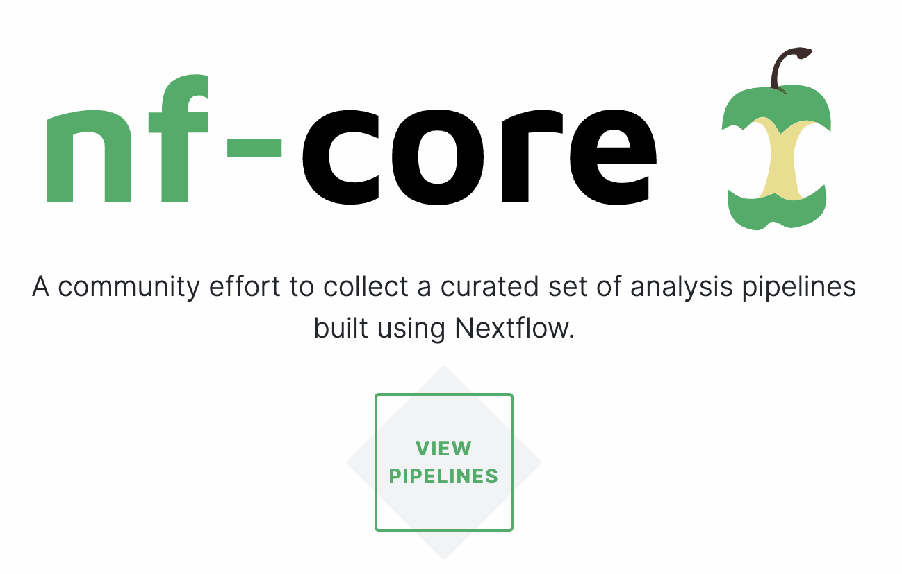

--------------------------------------------------------------------------------

## Overview

This week, we will mainly cover how you can run a bioinformatics pipeline
written in the Nextflow language and developed as part of the
["nf-core" initiative ](https://nf-co.re){target="_blank"}:

{fig-align="center" width="50%" .lightbox fig-alt="Screenshot of the nf-core homepage, showing the nf-core logo (an apple core), the tagline 'A community effort to collect a curated set of analysis pipelines built using Nextflow', and a 'View pipelines' button."}

Next, we'll switch gears and talk about how you should manage and share your data
and other files.

## Learning goals

Specifically, you will learn:

#### Lecture A: [Running nf-core pipelines -- part I](./w11a_nfcore1.qmd)

- Why you may want to use pipelines like those made by the nf-core initiative
- What the nf-core _rnaseq_ pipeline does, and when you would want to use it
- How to do a test run of a pipeline
- The difference between general Nextflow options and pipeline-specific options
- How to change Nextflow settings with a configuration file
- How to interpret the progress log and output files of a pipeline run,
  including the distinction between a final output dir and a "work dir"
- How to restart a pipeline run using the `-resume` option

#### Lecture B: [Running nf-core pipelines -- part II](./w11b_nfcore2.qmd)

- How to prepare the inputs for an nf-core pipeline run,
  including a sample sheet and reference genome files
- How these pipelines can be run with a single command,
  while they submit jobs to the Slurm scheduler at OSC
- How to monitor pipeline progress
- How to find and interpret the output files produced by the pipeline

#### Lecture C: [Data management and transfer](./w11c_data.qmd) _(with [slides](./w11c_data-mgmt.qmd) for relative paths and data management)_

- Why you should prefer relative paths over absolute paths
- How you can manage your data and share it after publication
- How to organize sample metadata in spreadsheets
- How to transfer files between OSC and other computers like your own
- How to download files at the command line
- How to compress and decompress files

## Exercises & assignments

- **Graded Assignment 5**: [Running a longer workflow](/GA/GA5.qmd)

## Readings

- @grünwald2024: "*Open access and reproducibility in plant pathology research: Guidelines and best practices*"

## Optional self-study material

Optional self-study pages on the course website:

- [Additional project and data management notes](/bonus/data.qmd)

- [SSH and command-line file transfer](/bonus/ssh.qmd)

And a page for your reference,
if you want to use VS Code on your own computer to connect to OSC:

- [Using a local VS Code installation at OSC](/bonus/vscode-local.qmd) ---
  connect VS Code on your own computer to OSC, without OnDemand.

Other optional readings:

- @ewels2020: "*The nf-core framework for community-curated bioinformatics pipelines*"

- @buffalo2015 ([OSU library link](https://search.library.osu.edu/permalink/01OHIOLINK_OSU/1oqfg3i/alma991085518416808507))
  -- Chapter 4: "_Working with Remote Machines_"
