----------------------------------------------------------------------------------------------------

<hr style="height:1pt; visibility:hidden;" />
<hr style="height:1pt; visibility:hidden;" />

## Introduction

### Learning goals

- How you can manage your data and share it after publication
- How to organize sample metadata in spreadsheets
- Why you should prefer relative paths over absolute paths
- How to transfer files between OSC and other computers like your own
- How to download files at the command line
- How to compress and decompress files
- How to check how much disk space your dirs take up

## Slides on data management

In class, we'll go through how to manage and share your data,
and why you should prefer relative paths, using the slides below
(**[open them in a separate tab](./w11a_data-mgmt.qmd){target="_blank"}** for a full-screen view).

<iframe class="slides-embed" data-external="1" src="w11a_data-mgmt.html" title="Data management (slides)"></iframe>

## File transfer to and from OSC

### Overview of transfer options

In week 2, you learned that you can upload and download files from OSC
in the OnDemand Files menu^[
  You've also seen that you can download files in VS Code
  (and you can upload via drag-and-drop).].
However, this method is only suitable for relatively **small transfers**.
Here is a table with the main methods to transfer files between your computer and OSC,
including ones that you can use for **larger transfers**:

| Method                                                                                                   | Transfer size         | CLI or GUI        | Ease of use   | Flexibility/options   |
|----------------------------------------------------------------------------------------------------------|-----------------------|-------------------|---------------|-----------------------|
| OnDemand Files menu                                                                                  | smaller (<1GB)        | GUI               | Easy          | Limited               |
| Remote transfer commands (e.g. [`scp`](#transfer-with-scp), [`rsync`](../bonus/ssh.qmd#rsync))       | any                   | CLI               | Moderate      | Extensive             |
| SFTP clients (e.g. [FileZilla](../bonus/ssh.qmd#filezilla))                                          | any                   | GUI               | Easy          | Moderate              |
| [Globus](../bonus/ssh.qmd#globus)                                                                    | larger (>1GB)         | GUI               | Moderate      | Extensive             |

: {.striped .hover}

<hr style="height:1pt; visibility:hidden;" />

Below, we'll practice with `scp`.
The other options are covered on the [SSH and file transfer](../bonus/ssh.qmd) reference page,
which also shows how to
[avoid typing your OSC password](../bonus/ssh.qmd#avoid-typing-your-osc-password)
for every transfer.

### Transfer with `scp` {#transfer-with-scp}

We'll try the `scp` (**s**ecure **c**o**p**y) command,
which works much like `cp`, but can copy files between computers.
It works for transfers of any size, and because it's a command,
you can keep a record of your transfers, e.g. in a README file.

So far in this course, you've always used a terminal in VS Code at OSC.
To transfer files between your computer and OSC,
you instead run `scp` in a terminal on **your own computer** ---
and that goes for **both directions**: downloads and uploads.

#### `scp` syntax

`scp` has the same basic syntax as `cp`, but you need a prefix to refer to a remote path.
To refer to a path at OSC, you start with your username, `@`,
and OSC's address for file transfers, `sftp.osc.edu`,
followed by `:` and then the path:

-  **Download** --- copy from OSC to your computer:

   ```{.bash .norun .syntax}
   scp <user>@sftp.osc.edu:<remote-path> <local-path>
   ```

   For example, to download a file to your current working dir (`.`) on your computer:

   ```{.bash .norun}
   scp jelmer@sftp.osc.edu:/fs/ess/PAS3493/data.txt .
   ```

- **Upload** --- copy from your computer to OSC:

  ```{.bash .norun .syntax}
  scp <local-path> <user>@sftp.osc.edu:<remote-path>
  ```

  For example:

  ```{.bash .norun}
  scp data.txt jelmer@sftp.osc.edu:/fs/ess/PAS3493/
  ```

For paths at OSC, use absolute paths:
`scp` doesn't know your working dir in VS Code at OSC,
so relative paths there are interpreted relative to your Home dir.
And like with `cp`, use the `-r` option to **copy dirs**.

#### Trying `scp`

We'll practice with small files, but keep in mind that you can use the same
approach for much larger files that you can't up/download
via the OnDemand file browser, such as your raw FASTQ files.

1. **Open a terminal on your own computer**
   - On a Mac, open the "**Terminal**" app
     (e.g. search for it with <kbd>Cmd</kbd>+<kbd>Space</kbd>).
   - On Windows, open the "**Windows Terminal**" app (the default on Windows 11)
     or "**PowerShell**".
     These run the PowerShell shell rather than Bash,
     but the commands in this section work the same in it.

2. **Navigate to the Downloads dir on your own computer**\
   This dir is in the same place on Mac and Windows computers:

   ```bash
   cd ~/Downloads
   ```

3. **Download a file**\
   Let's download a FastQC report (replace `jelmer` with your username):

   ```bash
   scp jelmer@sftp.osc.edu:/fs/ess/PAS3493/share/week07/results/fastqc/S63_R1_fastqc.html .
   ```

   - The first time you connect, you'll get a message that
     _"The authenticity of host 'sftp.osc.edu' can't be established"_,
     and a question if you want to continue connecting:
     type `yes` and press <kbd>Enter</kbd> ^[
     You will always get this message the first time you connect to a remote computer.].
   - Next, you'll be prompted for your **OSC password**.
     Note that when you type it, _no characters or even \*s will appear on the screen_!
     You'll have to enter your password for every `scp` command,
     until you do
     [these steps to avoid typing your OSC password](../bonus/ssh.qmd#avoid-typing-your-osc-password).

4. **Check the downloaded file**\
   Find the file in your Downloads folder in Finder (Mac) or File Explorer (Windows),
   and open it.

::: exercise
####  Exercise: File transfer with `scp`

1. **Download** your entire `week07/results/fastqc` dir from OSC into your Downloads
   dir with a single command.

<!----
   <details><summary> &nbsp; _Click to see the solution_</summary>

   Use the `-r` option to copy a dir, and run the command in a terminal on your own computer
   (replace both instances of `jelmer` with your username):

   ```bash
   scp -r jelmer@sftp.osc.edu:/fs/ess/PAS3493/people/jelmer/week07/results/fastqc .
   ```

   </details>
---->

2. **Upload** the `S63_R1_fastqc.html` file that you just downloaded
   to your `week11/sandbox` dir at OSC,
   and check that it's there with `ls` in your VS Code terminal.

<!----
   <details><summary> &nbsp; _Click to see the solution_</summary>

   In a terminal on your own computer
   (replace both instances of `jelmer` with your username):

   ```bash
   scp S63_R1_fastqc.html jelmer@sftp.osc.edu:/fs/ess/PAS3493/people/jelmer/week11/sandbox
   ```

   Then, in your VS Code terminal at OSC, where your working dir is `week11`:

   ```bash
   ls sandbox
   ```

   </details>
---->

3. A classmate tries to upload the same file with
   `scp S63_R1_fastqc.html jelmer@sftp.osc.edu`,
   forgetting the `:` at the end.
   They don't get an error, and aren't even asked for their password.
   What do you think happened?

   A) The file was uploaded to their Home dir at OSC,
      since that is the default destination when no path is given.
   B) The file was copied to a new file called `jelmer@sftp.osc.edu`
      on their own computer.
   C) Nothing happened,
      since `scp` silently skips transfers without a destination dir.

<!----
   <details><summary> &nbsp; _Click to see the solution_</summary>

   The correct answer is B.
   Without a `:`, `scp` doesn't see a remote computer,
   so it treats `jelmer@sftp.osc.edu` as a local file name
   and makes a regular local copy, just like `cp` would:
   there is now a file called `jelmer@sftp.osc.edu` in their Downloads dir.

   </details>
---->

:::

## Downloading files at the command line {#wget}

When you need to get large files from public repositories like NCBI
(e.g. reference genome files, raw reads from the SRA),
I recommend **downloading them directly to OSC using commands**
(instead of downloading to your own computer and then transferring to OSC).
Not only is this quicker once you know how to,
it is also much more reproducible:
in your Markdown documentation files,
you can store the exact commands used to obtain the data.

### Getting ready

1. At <https://ondemand.osc.edu>,
   start a VS Code session in `/fs/ess/PAS3493/people/$USER` as per usual.

2. In your terminal, create a working dir for this week
   with a `sandbox` dir inside it, and navigate into the week dir:

   ```bash
   mkdir -p week11/sandbox
   cd week11
   ```

### The `wget` command

You can download files from a URL using the `wget` command.
It has _many_ options, but basic usage is quite simple:

```{.bash .norun .syntax}
# This will download the file at the URL to your current working dir
wget <URL>
```

For the nf-core pipeline run in [Lecture C](w11c_nfcore2.qmd),
you will need the reference genome FASTA file for _Culex pipiens_,
the focal species of the @garrigós2025 RNA-seq dataset we've been working with.
The files for that genome can be found at this
[NCBI FTP webpage ](https://ftp.ncbi.nlm.nih.gov/genomes/all/GCF/016/801/865/GCF_016801865.2_TS_CPP_V2/){target="_blank"}:

<hr style="height:1pt; visibility:hidden;" />

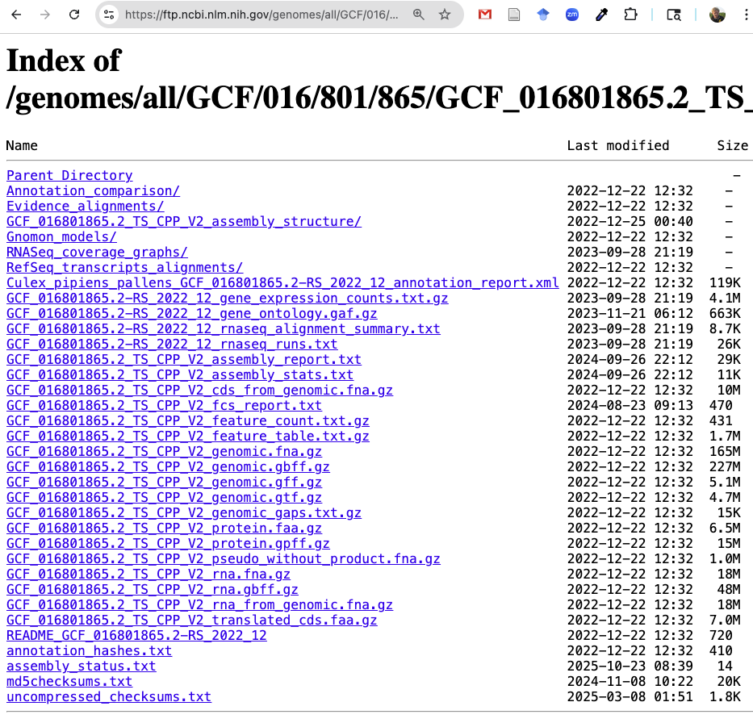{fig-align="center" width="75%" .no-border fig-alt="A browser screenshot of the NCBI FTP dir for the Culex pipiens genome" .lightbox}

You can right-click on any of the files there and then click "Copy Link Address"
(or similar, depending on your browser).
Do that to get the URL to the assembly FASTA (`.fna.gz`) file.

Then, let's download that file into your `sandbox` dir,
so we can practice with it below:

```bash
URL=https://ftp.ncbi.nlm.nih.gov/genomes/all/GCF/016/801/865/GCF_016801865.2_TS_CPP_V2/GCF_016801865.2_TS_CPP_V2_genomic.fna.gz
wget -P sandbox "$URL"
```
```bash-out
--2026-10-23 10:19:04--  https://ftp.ncbi.nlm.nih.gov/genomes/all/GCF/016/801/865/GCF_016801865.2_TS_CPP_V2/GCF_016801865.2_TS_CPP_V2_genomic.fna.gz
Resolving ftp.ncbi.nlm.nih.gov (ftp.ncbi.nlm.nih.gov)... 130.14.250.13, 130.14.250.10, 130.14.250.7, ...
Connecting to ftp.ncbi.nlm.nih.gov (ftp.ncbi.nlm.nih.gov)|130.14.250.13|:443... connected.
HTTP request sent, awaiting response... 200 OK
Length: 172904433 (165M) [application/x-gzip]
Saving to: ‘sandbox/GCF_016801865.2_TS_CPP_V2_genomic.fna.gz’

GCF_016801865.2_TS_CPP_V2_genomic.fna.gz           100%[===============================================================================================================>] 164.89M  28.5MB/s    in 7.2s

2026-10-23 10:19:12 (23.0 MB/s) - ‘sandbox/GCF_016801865.2_TS_CPP_V2_genomic.fna.gz’ saved [172904433/172904433]
```

- `wget` downloads files to your working dir by default,
  but we used its `-P` option to download into the `sandbox` dir.
- As you can see, `wget` is quite chatty
  and prints a bunch of logging and progress info to the screen.

Let's check the downloaded file:

```bash
# Make sure to use Tab-completion here!
ls -lh sandbox/GCF_016801865.2_TS_CPP_V2_genomic.fna.gz
```
<pre class="bash-out"><code>-rw-rw----+ 1 jelmer PAS0471 165M Dec 22  2022 <span class="ls-red">sandbox/GCF_016801865.2_TS_CPP_V2_genomic.fna.gz</span></code></pre>

Note that the date shown, `Dec 22 2022`, is when NCBI last modified the file,
not when you downloaded it.

In Lecture C, you'll paste the download command into a `README.md` file,
so that anyone (including future you) can see exactly where the file came from,
and download it again.

<hr style="height:1pt; visibility:hidden;" />

::: exercise
####  Exercise: Download the protein sequences

On the same NCBI page, there is a FASTA file with the sequences of all predicted proteins
(`GCF_016801865.2_TS_CPP_V2_protein.faa.gz`).

1. Download it into your `sandbox` dir with a single command.

<!----
   <details><summary> &nbsp; _Click to see the solution_</summary>

   Copy the link to the file, and then run:

   ```bash
   wget -P sandbox https://ftp.ncbi.nlm.nih.gov/genomes/all/GCF/016/801/865/GCF_016801865.2_TS_CPP_V2/GCF_016801865.2_TS_CPP_V2_protein.faa.gz
   ```

   </details>
---->

2. How many proteins are in the file?
   (Hint: each sequence has a header line starting with `>`,
   and you don't need to unzip the file first.)

<!----
   <details><summary> &nbsp; _Click to see the solution_</summary>

   Use `zcat` to print the unzipped contents, and count the header lines with `grep -c`:

   ```bash
   zcat sandbox/GCF_016801865.2_TS_CPP_V2_protein.faa.gz | grep -c ">"
   ```

   </details>
---->

3. The _Culex pipiens_ annotation contains fewer genes than there are proteins in this file.
   Why might that be?

<!----
   <details><summary> &nbsp; _Click to see the solution_</summary>

   Many genes have multiple transcripts ("isoforms") due to alternative splicing,
   and each of these can code for a different protein.
   (Conversely, non-coding genes don't code for any protein.)

   </details>
---->

:::

<hr style="height:1pt; visibility:hidden;" />

::: callout-note
#### Another download command: `curl`

Another commonly used download command is `curl`.
The two have similar functionality, so you don't necessarily need to learn both,
but you're likely to see examples with `curl` elsewhere,
and genAI tools may suggest it to you.
One key difference is that by default, `curl` prints the downloaded contents to the screen
instead of saving them to a file:
use its `-O` option to save the file under its original name.
:::

::: callout-tip
#### More about downloading genomics data from NCBI

The [reference page on NCBI data](../ref/ncbi.qmd)
introduces NCBI's databases (like GenBank, RefSeq, and the SRA),
and shows how to find a reference genome for any species,
download genomes with NCBI's `datasets` tool,
and download reads from the SRA.
:::

## File compression

Large data files, like the genome FASTA file you just downloaded,
are usually distributed in compressed form to save storage space and download time.
In genomics, the most common compression format is **gzip**,
recognizable by the `.gz` extension.

Many bioinformatics programs can read gzipped files directly ---
for example, you've never had to decompress your FASTQ files ---
and to view gzipped files, you've been using `zcat` instead of `cat` since week 4.
But some programs can't read gzipped files,
so sometimes you do need to decompress ("unzip") a file.
Let's practice with the genome FASTA file in your `sandbox` dir.

### Decompressing files with `gunzip`

To decompress a gzipped file, use the `gunzip` command:

```bash
gunzip sandbox/GCF_016801865.2_TS_CPP_V2_genomic.fna.gz
ls -lh sandbox/GCF*
```
```bash-out
-rw-rw----+ 1 jelmer PAS0471 547M Dec 22  2022 sandbox/GCF_016801865.2_TS_CPP_V2_genomic.fna
```

Files are decompressed **in place**,
i.e. *replaced* by an uncompressed file with the same name minus the `.gz`.

::: {.callout-note collapse="true"}
#### Decompressing multiple files at once _(Click to expand)_

You can pass `gunzip` multiple files at once, for example with a wildcard.
Say you have a dir `data` with three gzipped files:

```bash
ls data
```
```bash-out
sampleA.fastq.gz  sampleB.fastq.gz  sampleC.fastq.gz
```

The following would decompress all three,
with the `-v` (verbose) option making `gunzip` report on each file:

```bash
gunzip -v data/*.gz
```
```bash-out
data/sampleA.fastq.gz:   74.1% -- replaced with data/sampleA.fastq
data/sampleB.fastq.gz:   73.8% -- replaced with data/sampleB.fastq
data/sampleC.fastq.gz:   74.3% -- replaced with data/sampleC.fastq
```

<hr style="height:1pt; visibility:hidden;" />
:::

### Compressing files with `gzip`

Conversely, to compress a file, use `gzip`, which also works in place:

```bash
gzip sandbox/GCF_016801865.2_TS_CPP_V2_genomic.fna
ls -lh sandbox/GCF*
```
<pre class="bash-out"><code>-rw-rw----+ 1 jelmer PAS0471 165M Dec 22  2022 <span class="ls-red">sandbox/GCF_016801865.2_TS_CPP_V2_genomic.fna.gz</span></code></pre>

The compressed file is less than a third of the size of the uncompressed one.
So, only decompress files when needed,
and consider compressing large plain-text files that you don't use often.

<details class="details-quiz">
<summary>Self-study question:
Say you need an uncompressed version of a gzipped file, but also want to keep the gzipped file. How could you do this with commands you already knew before this week?</summary>

Use `zcat` and redirect its output to a new file, e.g.:

```{.bash .norun}
zcat sandbox/genome.fna.gz > sandbox/genome.fna
```

`zcat` only reads the gzipped file, so that file won't be changed.

</details>

::: {.callout-note collapse="true"}
#### Ways to keep the original file with `gzip`/`gunzip` _(Click to expand)_

Because `gzip` and `gunzip` replace the input file,
you only have one version of the file afterwards.
To keep the original, use the `-k` (keep) option:

```bash
gunzip -k sandbox/GCF_016801865.2_TS_CPP_V2_genomic.fna.gz
ls sandbox/GCF*
```
```bash-out
sandbox/GCF_016801865.2_TS_CPP_V2_genomic.fna  sandbox/GCF_016801865.2_TS_CPP_V2_genomic.fna.gz
```

You may also see the following method,
which additionally lets you choose the name of the output file:
the `-c` option makes `gzip`/`gunzip` print the output to standard out,
which you can then redirect to a file:

```bash
gzip -c sandbox/GCF_016801865.2_TS_CPP_V2_genomic.fna > sandbox/genome_copy.fna.gz
```
:::

## Checking dir sizes with `du`

It's often useful to know how much space your dirs take up.
But as you saw in week 4, the sizes that `ls -l` shows for dirs
don't correspond to the total size of the dir and its contents.
Instead, you can use the `du` (**d**isk **u**sage) command for this purpose.

- Get the **total size for a single dir** with options `-s`
  (summarize, i.e. only show the total) and `-h` (human-readable):

  ```bash
  du -sh ../garrigos/fastq
  ```
  ```bash-out
  941M    ../garrigos/fastq
  ```

- Get the total size of **each dir** directly inside a dir, plus that of the dir itself,
  with `-d 1` (depth of 1):

  ```bash
  du -h -d 1 ../garrigos
  ```
  ```bash-out
  1.0K    ../garrigos/meta
  5.1M    ../garrigos/ref
  941M    ../garrigos/fastq
  946M    ../garrigos/.git
  1.9G    ../garrigos
  ```

Note that unlike `ls`, `du` includes hidden dirs like `.git` by default.
When you're looking for what takes up the most space,
that's useful, because hidden dirs can be surprisingly large ---
as you can see in the output above.

::: {.callout-tip collapse="true"}
#### Why is the `.git` dir about as large as the `fastq` dir? _(Click to expand)_

The FASTQ files were committed to the `garrigos` repo,
so Git stores its own copy of each of them in `.git`.
And because FASTQ files are already compressed,
Git can't make these copies any smaller.
This is one reason not to commit large data files to a Git repo.

I made an exception for the `garrigos` repo because it's a practice dataset:
the FASTQ files were subset to keep them fairly small,
they will never change (so Git won't accumulate multiple versions of them),
and a single `git clone` was an easy way to give you all the files at once in week 4.

:::

## Recap

In this lecture,
you have learned about best practices for managing and sharing your data,
including why to prefer relative paths and how to organize metadata in spreadsheets
([slides](./w11a_data-mgmt.qmd)),
and the following practical applications:

- File transfer to and from OSC with `scp` (and what other options exist)
- Downloading files at the command line with `wget`
- Compressing and decompressing files with `gzip` and `gunzip`,
  and checking dir sizes with `du`

The [optional data management self-study page](../bonus/data.qmd) covers:

- Sharing data and code across projects,
  and linking to files and dirs elsewhere with symbolic links (`ln -s`)
- Checking whether downloaded or transferred files are intact with checksums (`md5sum`)
- Viewing and changing file permissions (`ls -l`, `chmod`),
  e.g. to make your raw data read-only
- More about file compression, including packing up entire dirs with `tar`

<hr style="height:1pt; visibility:hidden;" />

::: {.callout-note}
#### This week's reading: Reproducibility in plant pathology

In 2024, the journal _Phytopathology_ published a special issue on
"Key Challenges in Plant Pathology in the Next Decade",
and reproducibility was one of these challenges [@wang2024].
In that issue, @grünwald2024 provide guidelines for publishing in
the American Phytopathological Society (APS) journals,
including on data sharing and code deposition.
:::

## Self-study: Get a DOI for a GitHub repo

In [GA5](../GA/GA5.qmd), you'll get a (test) DOI for your GA5 repo,
as discussed in the [slides](w11a_data-mgmt.qmd#a-doi-for-your-github-repo-with-zenodo).

To practice beforehand, try it with your `evo` repo from week 5.
(This needs to be a public repo:
if yours is private, change this in its `Settings` on GitHub, at the bottom of the page.)
Real Zenodo DOIs are permanent, so you'll use the Zenodo Sandbox,
a test copy of Zenodo whose DOIs aren't registered.

1. Go to [Zenodo Sandbox](https://sandbox.zenodo.org/){target="_blank"},
   click "**Log in**" (not "Create Account"), choose "Sign in with GitHub",
   and authorize the Sandbox to access your GitHub account.

2. In the Sandbox account dropdown menu (far top right), go to "**GitHub**":

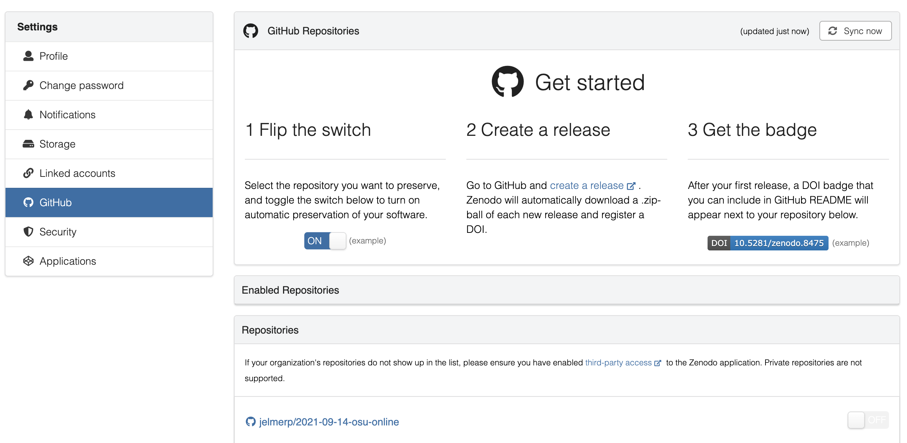{fig-align="center" width="95%" .no-border fig-alt="A screenshot of the Zenodo Sandbox front page" .lightbox}

::: {.columns}
::: {.column width="35%"}

3. Find your `evo` repo in the list of your repos, and flip the switch next to it
   to "ON". Then, click the repo link, and on the next page,
   click the green repo button (screenshot on the right).

   You will be sent to the GitHub page to create a new release
   for your repo (screenshot below).

:::
::: {.column width="65%"}

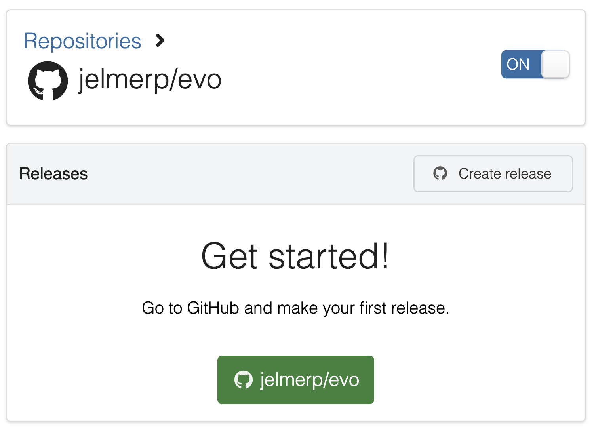{fig-align="center" width="85%" .no-border fig-alt="A screenshot of the Zenodo Sandbox page showing the link to the GitHub repo" .lightbox}

:::
:::

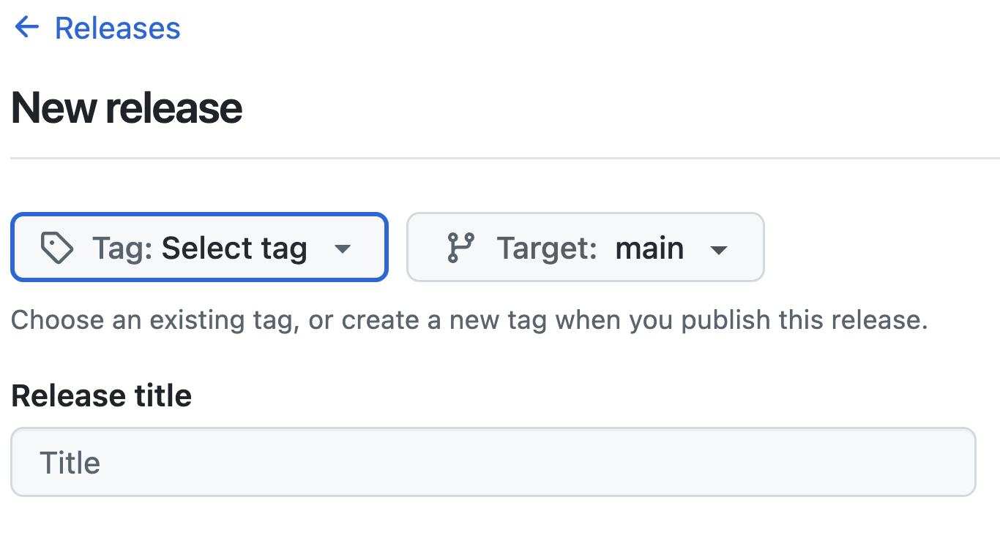{fig-align="center" width="60%" .no-border fig-alt="A screenshot of the GitHub release creation page" .lightbox}

4. You'll need to create a tag along with the release.
   Click "**Tag: Select tag**", then "Create new tag" (left-hand screenshot below),
   type `v1.0` and click "Create" (right-hand screenshot below).

::: {.columns}
::: {.column}

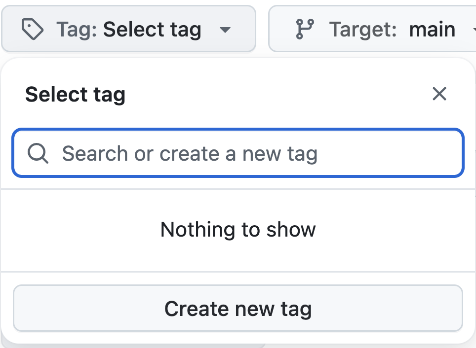{fig-align="center" width="90%" .no-border fig-alt="A screenshot of the GitHub release creation page" .lightbox}

::: legend2
Click "Create new tag"
:::

:::
::: {.column}

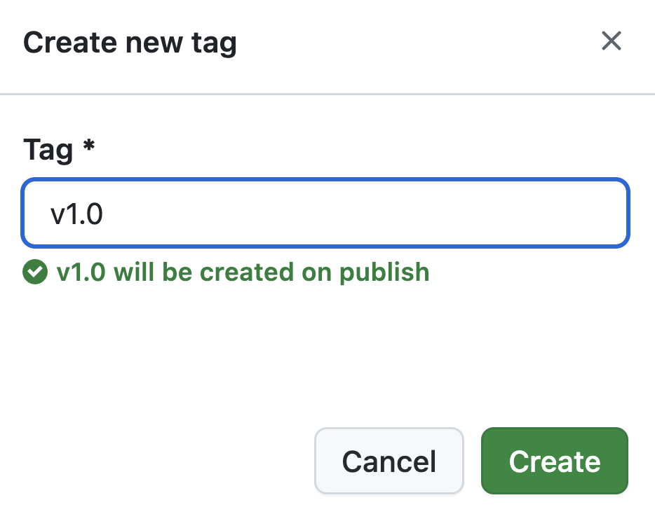{fig-align="center" width="90%" fig-alt="A screenshot of the GitHub release creation page" .lightbox}

:::
:::

5. You don't have to add a release title or description
   (though this would be good practice in a real release), and scrolling down,
   you can keep the "Release label" set to the default, "None".
   Click "**Publish release**".


::: {.columns}
::: {.column width="40%"}

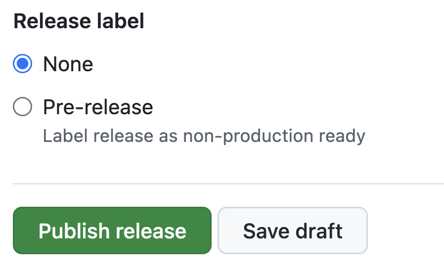{fig-align="center" width="90%" fig-alt="A screenshot of the GitHub release creation page" .lightbox}

::: legend2
Keep the "Release label" set to the default, "None", and click "Publish release"

On the right, the GitHub page you'll see when you've published the release.
:::

:::
::: {.column width="60%"}

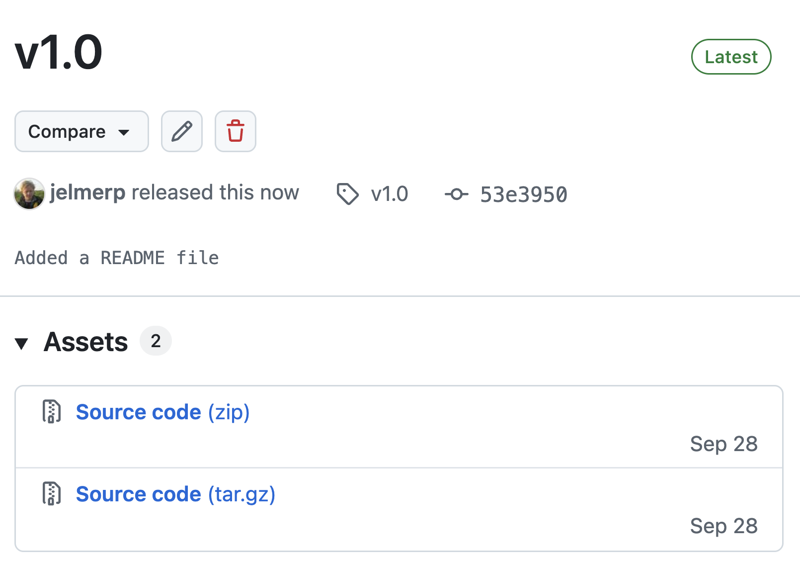{fig-align="center" width="90%" fig-alt="A screenshot of the GitHub release creation page" .lightbox}

:::
:::

6. Back on the Zenodo Sandbox GitHub page, refresh,
   and you should see that your DOI has been created:

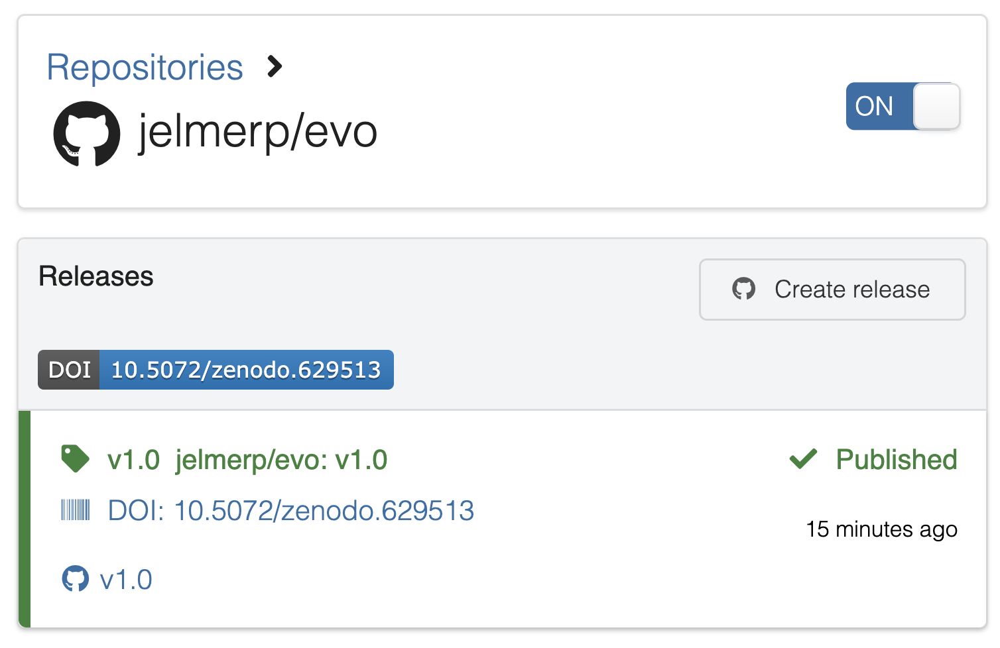{fig-align="center" width="70%" .no-border fig-alt="A screenshot of the Zenodo Sandbox page showing the DOI badge" .lightbox}

::: {.columns}
::: {.column width="60%"}

7. To add the **DOI "badge"** to your repo's README.md file,
   first click the DOI badge button on the Zenodo Sandbox page (screenshot on the right),
   and then copy the Markdown code snippet that appears (screenshot below).

:::
::: {.column width="40%"}

{fig-align="center" width="90%" .no-border fig-alt="A screenshot of the Zenodo Sandbox page showing the DOI badge button" .lightbox}

:::
:::

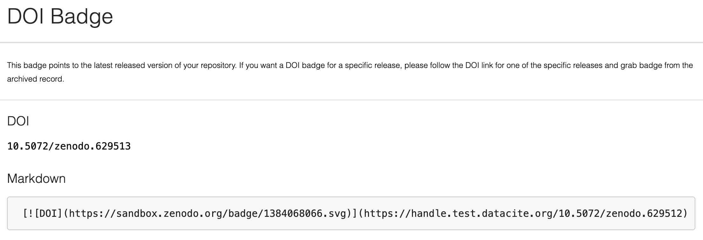{fig-align="center" width="92%" fig-alt="A screenshot of the Zenodo Sandbox page showing the Markdown code snippet for the DOI badge" .lightbox}

8. Finally, edit the `README.md` file in your repo on GitHub,
   paste the snippet at the top, and commit the change^[
     Just note that if this was a repo you were actively working on,
     you would normally do this in VS Code and push the change to GitHub.].
   You should now see the DOI badge at the top of your README on GitHub:

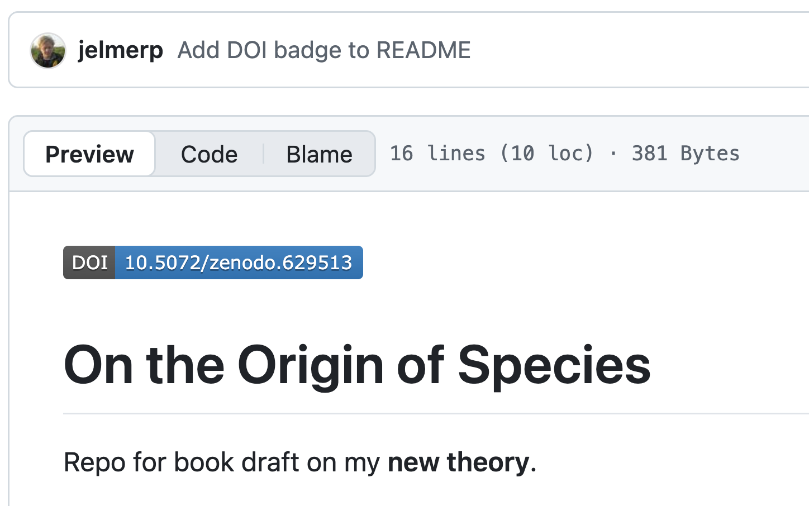{fig-align="center" width="60%" .no-border fig-alt="A screenshot of the GitHub repo page showing the Zenodo DOI badge in the README.md file" .lightbox}

<hr style="height:1pt; visibility:hidden;" />
