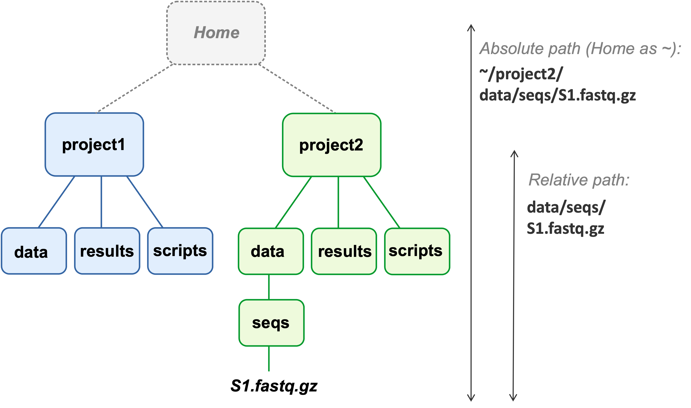
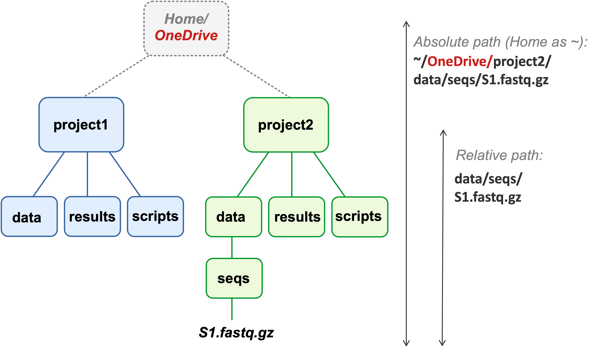

# Why you should prefer relative paths {background-color="#A7B1B7"}

## Absolute paths: a disadvantage?

::: {.callout-note .quiz}
#### Absolute paths don't depend on your working dir --- so what could be a disadvantage of using them?

<hr style="height:1pt; visibility:hidden;" />

<!-----
<details><summary>  &nbsp; &nbsp; _Click for the answer_</summary>

Absolute paths:

- Don't generally work across computers
- Break when you move your entire project dir

</details>

<hr style="height:1pt; visibility:hidden;" />
------>
:::

## Absolute vs. relative paths

{fig-align="center" width="80%" fig-alt="A diagram of two project dir hierarchies."}

::: legend2
Absolute and relative paths to a FASTQ file in two project dirs.\
The relative paths start from the project's top-level dir
(`~` is your Home dir).
:::

## Moving project dirs

{fig-align="center" width="70%" fig-alt="A diagram of two project dir hierarchies."}

::: legend2
After moving both projects into `OneDrive`,
the absolute path has changed, but the relative path has not.
:::

. . .

::: {.callout-tip appearance="simple"}
Relative paths keep working after moving project dirs ---
**as long as you always use the project's top-level dir as your working dir**.
:::

## Relative paths in practice

::: {.callout-note .quiz}
#### Would Monday's relative paths still work after moving dirs?

On Monday, you referred to input files from `week11` with relative paths like
`../garrigos/fastq/S63_R1.fastq.gz`.
Would these still work after moving:

- `week11` into a new dir?
- Your entire personal dir?

<hr style="height:1pt; visibility:hidden;" />

<!-----
<details><summary>  &nbsp; &nbsp; _Click for the answer_</summary>

- Moving only `week11` breaks them:
  `..` would now point to the new dir, which has no `garrigos` dir inside it.
- Moving your entire personal dir keeps them working,
  since `week11` and `garrigos` move together.

This is why it's best to keep all files for a project, including its raw data,
inside the project's top-level dir, so that relative paths never need to leave it.
(When multiple projects use the same data,
you can use symbolic links: see the [bonus material](../bonus/data.qmd#symbolic-links).)

</details>

<hr style="height:1pt; visibility:hidden;" />
------>
:::

# Raw data management {background-color="#A7B1B7"}

## Raw data is precious

Your raw data (for omics, usually FASTQ files) are the results of your experiment,
and often expensive and labor-intensive to produce.

<hr style="height:1pt; visibility:hidden;" />

::: {.columns}
::: {.column width="30%" .box-blue .fragment data-fragment-index="1"}
### Never delete it

- It remains your ground truth, even after you've produced processed files.

- It allows you and others to reproduce your results,
  and to re-analyze the data with new methods.

:::
::: {.column width="3%"}
:::
::: {.column width="30%" .box-amber .fragment data-fragment-index="2"}
### Keep multiple copies

- Ideally in at least two different physical locations.

- At OSC, never store it only in a scratch dir,
  where unused files are automatically deleted.

:::
::: {.column width="3%"}
:::
::: {.column width="30%" .box-teal .fragment data-fragment-index="3"}
### Share it publicly

- After publication.

- Required by most journals and funding agencies,
  and long expected for sequencing data.

:::
:::

## Documenting and protecting raw data

::: {.columns}
::: {.column width="47%"}

### [Document it]{style="display:block; text-align:center;"}

- Keep track of data provenance:
  when and from where did you get the data?

- Keep track of the metadata for each sample.

- Use standard, preferably plain-text file formats.

:::
::: {.column width="6%"}
<div class="fragment" data-fragment-index="1" style="border-left: 1px solid #A7B1B7; height: 100%; margin: 0 auto; width: 0;"></div>
:::
::: {.column width="47%" .fragment data-fragment-index="1"}

### [Protect it]{style="display:block; text-align:center;"}

- Consider making it read-only with file permissions
  _([bonus material](../bonus/data.qmd#making-your-data-read-only))_.

- After downloading or sharing key data,
  consider using "checksums" to check that files were transferred entirely
  _([bonus material](../bonus/data.qmd#checking-file-integrity-with-checksums))_.

:::
:::

# Metadata in spreadsheets {background-color="#A7B1B7"}

## Spreadsheet recommendations

Entering sample metadata in Excel is fine,
as long as code can read the spreadsheet without manual cleanup.
Some recommendations from The Turing Way's
[Data Organisation in Spreadsheets](https://book.the-turing-way.org/reproducible-research/rdm/rdm-spreadsheets){target="_blank"}:

<hr style="height:1pt; visibility:hidden;" />

::: {.columns}
::: {.column width="47%"}

### [Structure]{style="display:block; text-align:center;"}

- One row per sample, one column per variable,
  and a single header row.
- Only one value per cell.
- No merged cells, colors, or formatting to store information
  (add a column instead).
- No calculations in the raw metadata spreadsheet.
- Export the final version as a CSV or TSV file.

:::
::: {.column width="6%"}
<div class="fragment" data-fragment-index="1" style="border-left: 1px solid #A7B1B7; height: 100%; margin: 0 auto; width: 0;"></div>
:::
::: {.column width="47%" .fragment data-fragment-index="1"}

### [Content]{style="display:block; text-align:center;"}

- Consistent sample names, category labels, and units.
- No spaces or special characters in sample and column names
  (`time_point`, not `Time point (days)`).
- Dates as `YYYY-MM-DD` (e.g. `2026-11-04`):
  unambiguous and sorts correctly.
- A single code for missing data (e.g. `NA`),
  rather than some empty cells.

:::
:::

::: footer
:::

## Spreadsheet example and pitfall

::: {.columns}
::: {.column width="40%"}

### [Example]{style="display:block; text-align:center;"}

The `garrigos/meta/metadata.tsv` file you've seen before:

```bash-out
sample_id       time    treatment
S82     10dpi   cathemerium
S75     10dpi   cathemerium
S78     10dpi   control
S84     10dpi   control
S76     10dpi   relictum
```

::: {.callout-tip appearance="simple"}
In week 13, you'll see that this layout is called "tidy data",
which R works with very well.
:::

:::
::: {.column width="6%"}
<div class="fragment" data-fragment-index="1" style="border-left: 1px solid #A7B1B7; height: 100%; margin: 0 auto; width: 0;"></div>
:::
::: {.column width="54%" .fragment data-fragment-index="1"}

### [Excel turns gene names into dates]{style="display:block; text-align:center;"}

- Excel converts text that _looks like_ a date:
  _SEPT2_ and _MARCH1_ become `2-Sep` and `1-Mar`.

- About 20% of papers with gene lists in Excel files
  [contained such errors](https://doi.org/10.1186/s13059-016-1044-7){target="_blank"},
  and several human genes were renamed because of it
  (_SEPT2_ is now _SEPTIN2_).

<hr style="height:1pt; visibility:hidden;" />

::: {.callout-warning appearance="simple"}
To prevent this, set such columns to the "Text" format
before entering or pasting data.
:::

:::
:::

# Sharing data {background-color="#A7B1B7"}

## Sharing is required

<!--- TODO: https://research.osu.edu/transitioning-updated-data-management-and-sharing-dms-plan-format --->

::: {.columns}
::: {.column width="47%"}

### [Public access]{style="display:block; text-align:center;"}

> By the end of 2025, all federally-funded research must make articles and data publicly available immediately upon journal publication with no waiting periods allowed.
>
> --- [Federal Research Policy Guide](https://research.osu.edu/federal-research-policy-guide-public-access-requirements){target="_blank"}
> from OSU's [ERIK](https://erik.osu.edu/){target="_blank"}

:::
::: {.column width="6%"}
<div class="fragment" data-fragment-index="1" style="border-left: 1px solid #A7B1B7; height: 100%; margin: 0 auto; width: 0;"></div>
:::
::: {.column width="47%" .fragment data-fragment-index="1"}

### [Data Management Plans]{style="display:block; text-align:center;"}

DMPs specify how you'll manage and share your data,
and major funders require them (NSF since 2011):

> A DMP is currently required for all competitive grant programs of the United States Department of Agriculture and the National Science Foundation.
>
> --- @grünwald2024

See the guidelines for
[USDA NIFA](https://www.nifa.usda.gov/grants/lifecycle/pre-award/data-management-plans){target="_blank"}
and [NSF](https://www.nsf.gov/funding/data-management-plan){target="_blank"} grants.

:::
:::

## Platforms for sharing data

::: {.columns}
::: {.column width="30%" .box-blue .fragment data-fragment-index="1"}
### NCBI

- **Raw reads** go to the
  [SRA](https://www.ncbi.nlm.nih.gov/sra){target="_blank"}
  (or Europe's [ENA](https://www.ebi.ac.uk/ena/browser/home){target="_blank"}).

- Also for genome assemblies and annotations.

- **Count tables** go to [GEO](https://www.ncbi.nlm.nih.gov/geo/){target="_blank"},
  which also uploads the reads to the SRA.

:::
::: {.column width="3%"}
:::
::: {.column width="30%" .box-amber .fragment data-fragment-index="2"}
### General repositories

- For other results and data.

- E.g. [Dryad](https://datadryad.org/){target="_blank"}
  and [Zenodo](https://zenodo.org/){target="_blank"}.

- Increasingly required by journals.

:::
::: {.column width="3%"}
:::
::: {.column width="30%" .box-teal .fragment data-fragment-index="3"}
### Code

- GitHub (or GitLab, Bitbucket),
  ideally with a DOI via Zenodo (next slide).

- Some journals also require code in a general repository,
  where it may get a manual quality check.

:::
:::

. . .

<hr style="height:1pt; visibility:hidden;" />

::: {.callout-tip appearance="simple"}
[OSU's Research Commons](https://library.osu.edu/researchcommons){target="_blank"}
has [data sharing guides](https://guides.osu.edu/rdm-best-practice/how-to-share){target="_blank"} and
[offers consultations](https://library.osu.edu/research-data){target="_blank"}.
:::

## A DOI for your GitHub repo with Zenodo

::: {.columns}
::: {.column width="40%"}

### [Why?]{style="display:block; text-align:center;"}

- A GitHub repo can be changed or deleted at any time:
  a poor permanent reference in a paper.

- Zenodo, a general repository run by CERN,
  can archive a snapshot of your repo and give it a citable DOI.

:::
::: {.column width="6%"}
<div class="fragment" data-fragment-index="1" style="border-left: 1px solid #A7B1B7; height: 100%; margin: 0 auto; width: 0;"></div>
:::
::: {.column width="54%" .fragment data-fragment-index="1"}

### [How?]{style="display:block; text-align:center;"}

1. Log in to [Zenodo](https://zenodo.org/){target="_blank"} with your GitHub account.
2. In Zenodo's GitHub settings,
   flip the switch next to your (public) repo.
3. On GitHub, create a "release" of your repo
   ("Create a new release" in the repo's right sidebar).

<hr style="height:1pt; visibility:hidden;" />

Zenodo then archives the release and assigns it a DOI.
Each release gets its own DOI,
plus a "concept DOI" always points to the latest version
([more info](https://docs.github.com/en/repositories/archiving-a-github-repository/referencing-and-citing-content){target="_blank"}).

:::
:::

# Syncing OSC and local files {background-color="#A7B1B7"}

## Should I keep my OSC and local dirs synced?

::: {.columns}
::: {.column width="47%"}

### [Syncing strategy]{style="display:block; text-align:center;"}

Fully automatic syncing like with OneDrive or Dropbox isn't possible ---
and with large OSC data, you may not want it. Instead:

- Sync version-controlled files (code, etc.) via Git/GitHub.
- Periodically sync other files with the transfer methods discussed next.

:::
::: {.column width="6%"}
<div class="fragment" data-fragment-index="1" style="border-left: 1px solid #A7B1B7; height: 100%; margin: 0 auto; width: 0;"></div>
:::
::: {.column width="47%" .fragment data-fragment-index="1"}

### [Or: work in one place]{style="display:block; text-align:center;"}

- Running analyses both at OSC and locally makes syncing a hassle.

- So for projects that need OSC, try to do _all_ your analyses there.

- Your local computer (and/or OneDrive/Teams) can then hold
  an entirely separate set of files, like the manuscript.

:::
:::

## References {.unlisted}

::: {#refs}
:::

# Questions? {background-color="#A7B1B7" .unlisted}

<br><br>

[[_Click here to continue on the lecture page_](./w11c_data.qmd#overview-of-transfer-options)]{style="display:block; text-align:center"}
