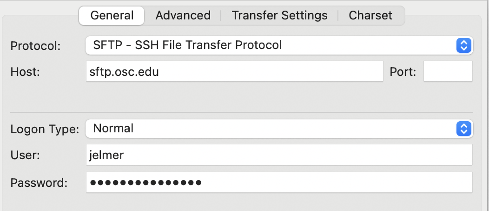
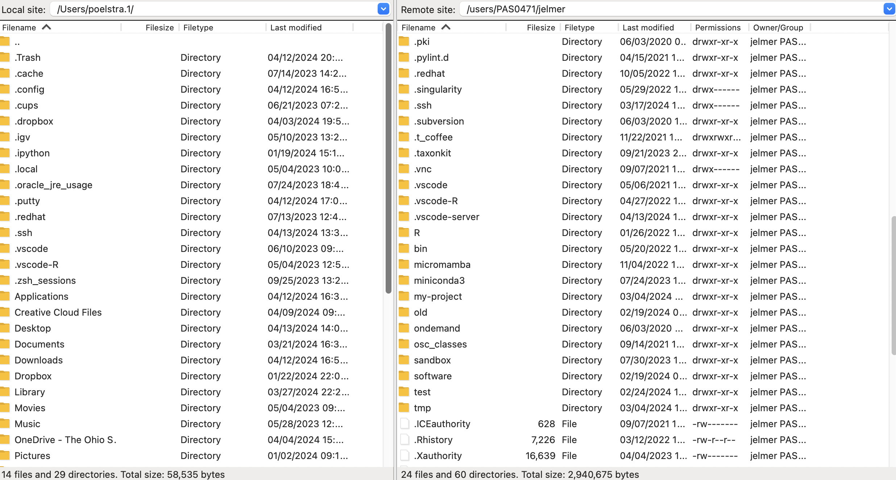
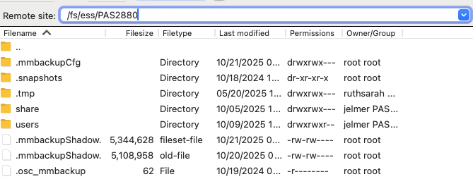
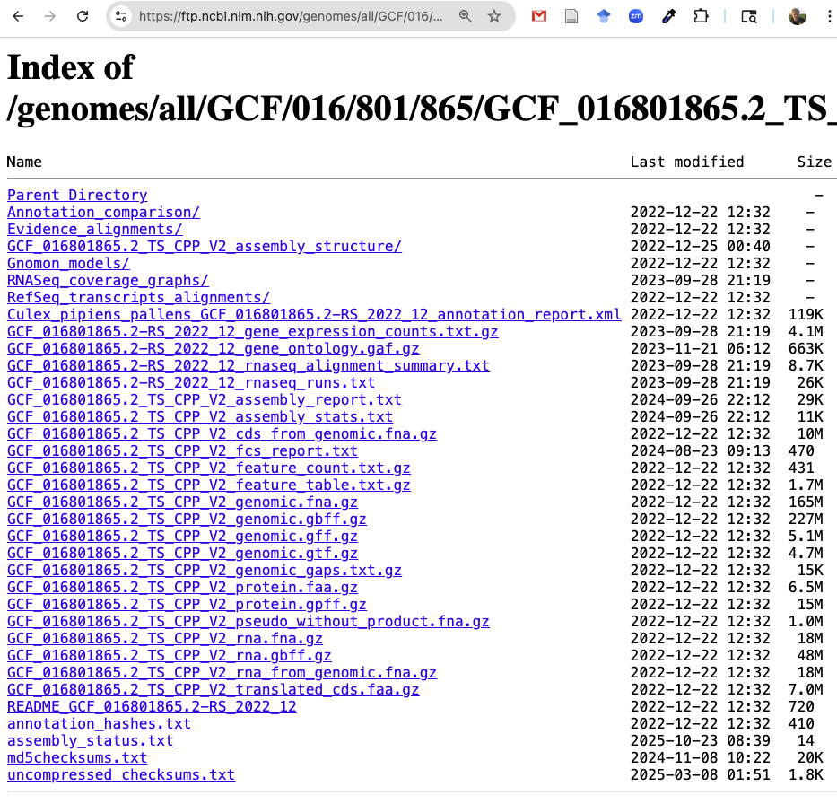

----------------------------------------------------------------------------------------------------

<hr style="height:1pt; visibility:hidden;" />
<hr style="height:1pt; visibility:hidden;" />

## Introduction

### Learning goals

- Why you should prefer relative paths over absolute paths
- How you can manage your data and share it after publication
- How to organize sample metadata in spreadsheets
- How to transfer files between OSC and other computers like your own
- How to download files at the command line
- How to compress and decompress files

### Getting ready

At <https://ondemand.osc.edu>,
start a VS Code session in `/fs/ess/PAS3493/people/$USER`.

## Relative paths and data management

In class, we'll go through why you should prefer relative paths,
and how to manage and share your data, using the slides below
(**[open them in a separate tab](./w11c_data-mgmt.qmd){target="_blank"}** for a full-screen view).

<iframe class="slides-embed" src="w11c_data-mgmt.html" title="Data management (slides)"></iframe>

::: {.callout-note collapse="true"}
#### This week's reading: Reproducibility in plant pathology _(Click to expand)_
In 2024, the journal _Phytopathology_ published a special issue on
"Key Challenges in Plant Pathology in the Next Decade",
and reproducibility was one of these challenges [@wang2024].
In that issue, @grünwald2024 provide guidelines for publishing in
the American Phytopathological Society (APS) journals,
including on data sharing and code deposition.
:::

## File transfer to and from OSC

### Overview of transfer options

In week 2, you learned that you can upload and download files from OSC
in the OnDemand Files menu.
However, that method is only suitable for relatively small transfers.
Here is a table with methods to transfer files between your computer and OSC:

| Method                                                                                          | Transfer size         | CLI or GUI        | Ease of use   | Flexibility/options   |
|-------------------------------------------------------------------------------------------------|-----------------------|-------------------|---------------|-----------------------|
| **OnDemand Files menu**                                                                         | smaller (<1GB)        | GUI               | Easy          | Limited               |
| **Remote transfer commands** (e.g. [`scp`, `rsync`](../bonus/ssh.qmd#remote-transfer-commands))  | any                   | CLI               | Moderate      | Extensive             |
| **SFTP**                                                                                        | any                   | Either            | Moderate      | Extensive             |
| **Globus**                                                                                      | larger (>1GB)         | GUI               | Moderate      | Extensive             |

: {.striped .hover}

### FileZilla: a GUI-based SFTP client

Here, we'll go over what is probably overall the most convenient and versatile
way to transfer files to and from OSC,
since it works for transfers of any size, and is easy and quick:
**file transfer with a GUI-based SFTP client**.
There are several such programs, but I can recommend FileZilla^[
E.g. because it works on all operating systems and has a more intuitive user
interface than Cyberduck,
another very commonly used program that works both on Mac and Windows.].
Let's give that a try!

1. **Install FileZilla**\
   - For OSU-managed computers:\
     Open the "Software Center" (Windows) or "Ohio State Application Self Service"
     (Mac), search for "FileZilla", and click the install button.

   - For personal computers:\
     Go to the
     [FileZilla download page](https://filezilla-project.org/download.php?type=client)
     --- it should automatically display a big green download button for your
     operating system: click on that, then install the program, and open it.
     On Windows, the installer may offer to install additional software:
     decline these offers.

2. **Connect to OSC**\
   Open FileZilla.
   To connect it to OSC, find the **Site Manager**:
   click `File` in the top menu bar and then `Site Manager`^[
   There is also an icon in the far top-left to access this menu.
   Additionally, there is a "Quickconnect" bar,
   but I've not managed to connect to OSC with that.].
   In the Site Manager, enter/select the following:
   - _Protocol_: "SFTP - SSH File Transfer Protocol"
   - _Host_: `sftp.osc.edu` (leave the Port box empty)
   - _Logon Type_: Make sure "Normal" is selected
   - _User_: Type your OSC username
   - _Password_: Enter your OSC password
   - Click the "**Connect**" button at the bottom to connect to OSC

{fig-align="center" width="60%" fig-alt="A screenshot of the connection setup dialog box on FileZilla" .lightbox}

3. **The connection interface**\
   Once connected, your main screen is split with a local file explorer
   on the left, and a remote file explorer on the right:

{fig-align="center" width="90%" fig-alt="A screenshot of the split screen view showing local and remote on FileZilla" .lightbox}

4. **Changing directories**\
   You can change directories in either file explorer.
   At OSC, your default location is your Home dir within `/users/`,
   but you can type a path in the top bar to e.g. go to `/fs/ess/PAS3493` --
   and from there you can further click your way to your personal dir there.

{fig-align="center" width="70%" fig-alt="A screenshot of FileZilla showing how to change the remote dir." .lightbox}

5. **Transferring files**\
   Transferring dirs and files in either direction is as simple as dragging and
   dropping them to the other side!

::: exercise
####  Exercise: File transfer with FileZilla

In FileZilla, go to `/fs/ess/PAS3493/people/<your-username>`
(`$USER` doesn't work here, since FileZilla is not a shell). Then:

1. Download the MultiQC report from Monday's nf-core run
   (`week11/results/nfc-rnaseq/multiqc/star_salmon/multiqc_report.html`)
   to your computer, and open it in your browser.
   (If your run hasn't finished, pick any other HTML file,
   like a FastQC report from week 6.)
2. Upload any small file from your computer to the same dir at OSC,
   and check that it's there with `ls` in your VS Code terminal.
:::

## Downloading files at the command line

When you need to get large files from public repositories like NCBI
(e.g. reference genome files, raw reads from the SRA),
I recommend **downloading them directly to OSC using commands**
(instead of downloading to your own computer and then transferring to OSC).
Not only is this quicker once you know how to,
it is also much more reproducible:
in your Markdown documentation files,
you can store the exact commands used to obtain the data.

### `wget`

You can download files from a URL using the `wget` command.
It has _many_ options, but basic usage is quite simple:

```{.bash .norun .syntax}
# This will download the file at the URL to your current working dir
wget <URL>
```

On Monday, you used `wget` to download the reference genome FASTA file
for _Culex pipiens_,
the focal species of the @garrigós2025 RNA-seq dataset we've been working with.
Where did that URL come from?
The files for that genome can be found at this
[NCBI FTP webpage](https://ftp.ncbi.nlm.nih.gov/genomes/all/GCF/016/801/865/GCF_016801865.2_TS_CPP_V2/):

{fig-align="center" width="85%" fig-alt="A browser screenshot of the NCBI FTP dir for the Culex pipiens genome" .lightbox}

You can right-click on any of the files there and then click "Copy Link Address"
(or similar, depending on your browser).
That's how I got the URL to the assembly FASTA (`.fna.gz`) file
that we used on Monday.
Let's download that file again,
this time into your `sandbox` dir so we can practice with it below
without touching your copy in `garrigos/ref`:

```bash
URL=https://ftp.ncbi.nlm.nih.gov/genomes/all/GCF/016/801/865/GCF_016801865.2_TS_CPP_V2/GCF_016801865.2_TS_CPP_V2_genomic.fna.gz
wget -P sandbox "$URL"
```
```bash-out
--2026-10-23 10:19:04--  https://ftp.ncbi.nlm.nih.gov/genomes/all/GCF/016/801/865/GCF_016801865.2_TS_CPP_V2/GCF_016801865.2_TS_CPP_V2_genomic.fna.gz
Resolving ftp.ncbi.nlm.nih.gov (ftp.ncbi.nlm.nih.gov)... 130.14.250.13, 130.14.250.10, 130.14.250.7, ...
Connecting to ftp.ncbi.nlm.nih.gov (ftp.ncbi.nlm.nih.gov)|130.14.250.13|:443... connected.
HTTP request sent, awaiting response... 200 OK
Length: 172904433 (165M) [application/x-gzip]
Saving to: ‘sandbox/GCF_016801865.2_TS_CPP_V2_genomic.fna.gz’

GCF_016801865.2_TS_CPP_V2_genomic.fna.gz           100%[===============================================================================================================>] 164.89M  28.5MB/s    in 7.2s

2026-10-23 10:19:12 (23.0 MB/s) - ‘sandbox/GCF_016801865.2_TS_CPP_V2_genomic.fna.gz’ saved [172904433/172904433]
```

- `wget` downloads files to your working dir by default,
  but we used its `-P` option to directly download into the `sandbox` dir.
- As you can see, `wget` is quite chatty
  and prints a bunch of logging and progress info to the screen.

Let's check the downloaded file:

```bash
ls -lh sandbox/GCF*
```
<pre class="bash-out"><code>-rw-rw----+ 1 jelmer PAS0471 165M Dec 22  2022 <span class="ls-red">sandbox/GCF_016801865.2_TS_CPP_V2_genomic.fna.gz</span></code></pre>

Note that the date shown, `Dec 22 2022`, is when NCBI last modified the file,
not when you downloaded it.

Because you pasted the download command into your `week11/README.md` on Monday,
anyone (including future you) can see exactly where the file in `garrigos/ref` came from,
and download it again.

<hr style="height:1pt; visibility:hidden;" />

::: exercise
####  Exercise: Download the protein sequences

On the same NCBI page, there is a FASTA file with the sequences of all predicted proteins
(`GCF_016801865.2_TS_CPP_V2_protein.faa.gz`).

1. Download it into `garrigos/ref` with a single command.
2. How many proteins are in the file?
   (Hint: each sequence has a header line starting with `>`,
   and you don't need to unzip the file first.)
:::

<!----
<details><summary> &nbsp; _Click to see the solution_</summary>

1. Copy the link to the file, and then run:

   ```bash
   wget -P garrigos/ref https://ftp.ncbi.nlm.nih.gov/genomes/all/GCF/016/801/865/GCF_016801865.2_TS_CPP_V2/GCF_016801865.2_TS_CPP_V2_protein.faa.gz
   ```

2. Use `zcat` to print the unzipped contents, and count the header lines with `grep -c`:

   ```bash
   zcat garrigos/ref/GCF_016801865.2_TS_CPP_V2_protein.faa.gz | grep -c ">"
   ```

</details>
---->

<hr style="height:1pt; visibility:hidden;" />

::: callout-note
#### Another download command: `curl`

Another commonly used downloading command is `curl`.
Both have similar functionality, so you don't necessarily need to learn both,
but you're likely to see examples with `curl` elsewhere,
and genAI tools may suggest it to you.
:::

::: callout-tip
#### More about downloading genomics data from NCBI

The [optional data management self-study page](../bonus/data.qmd#downloading-data-from-ncbi)
introduces NCBI's databases (like GenBank, RefSeq, and the SRA),
and shows how to find a reference genome for any species,
download genomes with NCBI's `datasets` tool,
and download reads from the SRA.
:::

## File compression

Large data files, like the genome FASTA file you just downloaded,
are usually distributed in compressed form to save storage space and download time.
In genomics, the most common compression format is **gzip**,
recognizable by the `.gz` extension.

Many bioinformatics programs can read gzipped files directly ---
for example, you've never had to decompress your FASTQ files ---
and to view gzipped files, you've been using `zcat` instead of `cat` since week 4.
But some programs can't read gzipped files,
so sometimes you do need to decompress ("unzip") a file.
Let's practice with the genome FASTA file in your `sandbox` dir.

### Decompressing files with `gunzip`

To decompress a gzipped file, use the `gunzip` command:

```bash
gunzip sandbox/GCF_016801865.2_TS_CPP_V2_genomic.fna.gz
ls -lh sandbox/GCF*
```
```bash-out
-rw-rw----+ 1 jelmer PAS0471 547M Dec 22  2022 sandbox/GCF_016801865.2_TS_CPP_V2_genomic.fna
```

- `gunzip` decompresses files **in place**:
  the gzipped file is replaced by a decompressed file with the same name minus the `.gz`.
- You can decompress multiple files at once, e.g. with a wildcard:
  `gunzip -v data/*.gz`
  (the `-v` (verbose) option makes `gunzip` report on each file).

### Compressing files with `gzip`

Conversely, to compress a file, use `gzip`, which also works in place:

```bash
gzip sandbox/GCF_016801865.2_TS_CPP_V2_genomic.fna
ls -lh sandbox/GCF*
```
<pre class="bash-out"><code>-rw-rw----+ 1 jelmer PAS0471 165M Dec 22  2022 <span class="ls-red">sandbox/GCF_016801865.2_TS_CPP_V2_genomic.fna.gz</span></code></pre>

The compressed file is more than 3 times smaller than the decompressed one.
So, only decompress files when needed,
and consider compressing large plain-text files that you don't use often.

::: {.callout-tip collapse="true"}
#### Keeping the original file _(Click to expand)_

Because `gzip` and `gunzip` replace the input file,
you only have one version of the file afterwards.
To keep the original, use the `-k` (keep) option:

```bash
gunzip -k sandbox/GCF_016801865.2_TS_CPP_V2_genomic.fna.gz
ls sandbox/GCF*
```
```bash-out
sandbox/GCF_016801865.2_TS_CPP_V2_genomic.fna  sandbox/GCF_016801865.2_TS_CPP_V2_genomic.fna.gz
```

You may also see the following method,
which additionally lets you choose the name of the output file:
the `-c` option makes `gzip`/`gunzip` print the output to standard out,
which you can then redirect to a file:

```bash
gzip -c sandbox/GCF_016801865.2_TS_CPP_V2_genomic.fna > sandbox/genome_copy.fna.gz
```
:::

## Recap

In this lecture,
you have learned about best practices for managing and sharing your data,
including why to prefer relative paths and how to organize metadata in spreadsheets
([slides](./w11c_data-mgmt.qmd)),
and the following practical applications:

- File transfer to and from OSC with FileZilla (and what other options exist)
- Downloading files at the command line with `wget`
- Compressing and decompressing files with `gzip` and `gunzip`

The [optional data management self-study page](../bonus/data.qmd) covers:

- Sharing data and code across projects,
  and linking to files and dirs elsewhere with symbolic links (`ln -s`)
- NCBI's databases, and downloading genomes (`datasets`) and reads from the SRA
- Checking whether downloaded or transferred files are intact with checksums (`md5sum`)
- Viewing and changing file permissions (`ls -l`, `chmod`),
  e.g. to make your raw data read-only
- More about file compression:
  checking dir sizes with `du`, compressing program output on the fly,
  searching gzipped files with `zgrep`, concatenating gzipped files,
  and packing up entire dirs with `tar`

<hr style="height:1pt; visibility:hidden;" />
