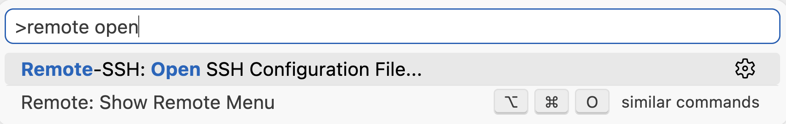
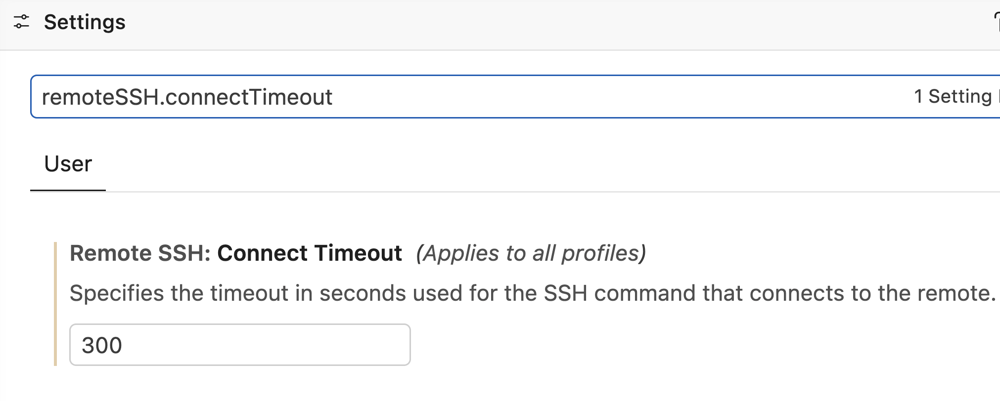
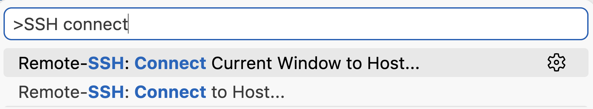
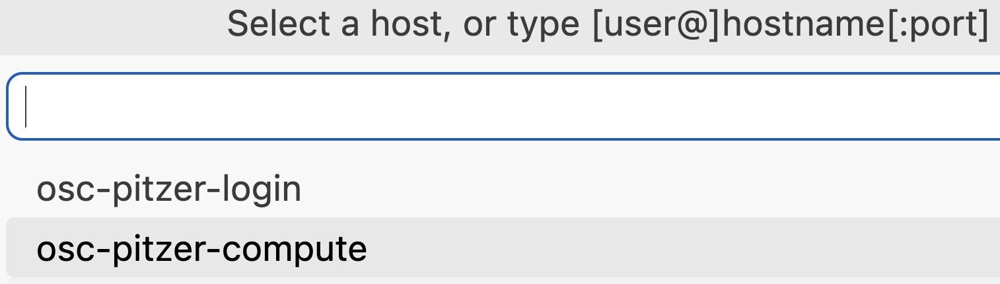
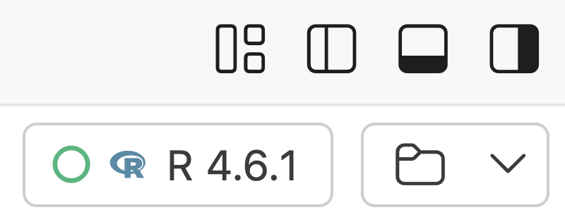
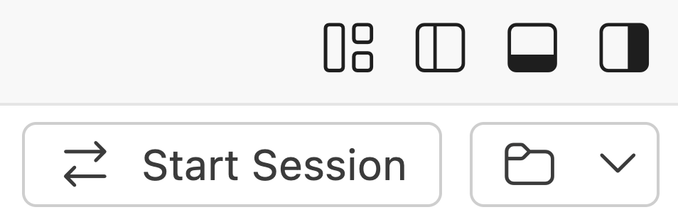
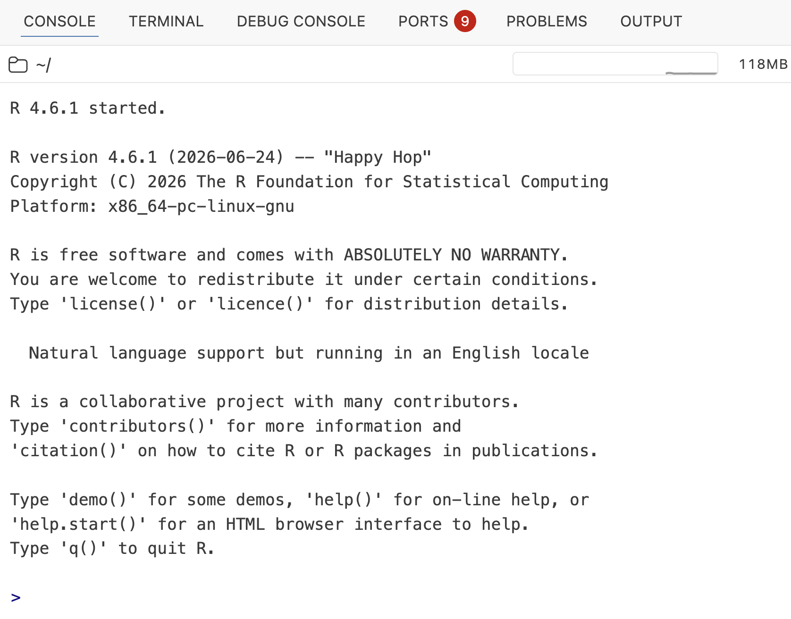
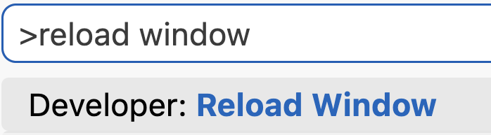
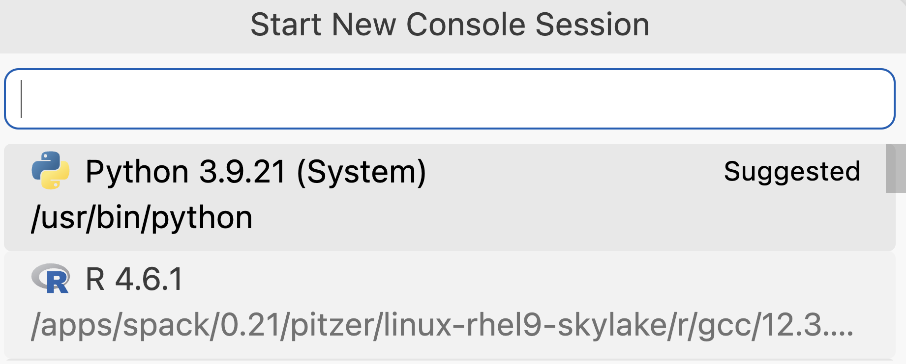
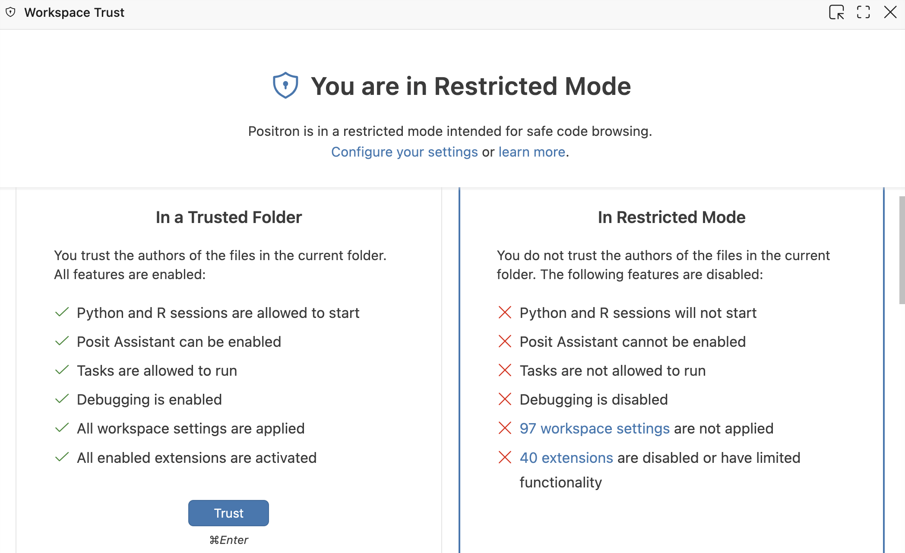

---------

<hr style="height:10pt; visibility:hidden;" />

## Overview

### Why Positron?

In the remaining weeks of the course,
you'll write and run R code in **Positron**,
an IDE created by Posit, the company behind the popular R IDE RStudio.
Positron is a newer alternative to RStudio, and a good fit for this course:

1. It is **built on VS Code**^[
   Specifically, on Code OSS, the open-source base of VS Code.
   Positron is really a variant ("fork") of VS Code.],
   so it will look and feel very familiar (unlike RStudio).
2. It adds **data science features** that VS Code lacks,
   like an R console, and panes for variables, plots, and help.
3. Positron, not RStudio, is the main focus of Posit's development moving forward.
4. It has much better support than RStudio for Python and for AI assistance.

::: {.callout-note collapse="true"}
#### Coming from RStudio? _(Click to expand)_
If you've used RStudio before,
here is where to find its panes in Positron:

| In RStudio             | In Positron                                         |
| ---------------------- | --------------------------------------------------- |
| Source pane            | Editor (center)                                     |
| Console                | Console (bottom)                                    |
| Terminal               | A tab next to the Console                           |
| Environment            | **Variables** pane (right)                          |
| Plots                  | **Plots** pane (right)                              |
| Help                   | **Help** pane (right)                               |
| Viewer                 | **Viewer** pane (right)                             |
| History                | **History** pane (right)                            |
| Files                  | **Explorer** (Activity Bar, far left)               |
| Packages               | **Packages** pane (Activity Bar)                    |
| Git                    | **Source Control** (Activity Bar)                   |
| `View(df)` data viewer | **Data Explorer** (opens as an editor tab)          |

: {.striped .hover}

Many RStudio keyboard shortcuts also work in Positron, but some don't,
because Positron uses VS Code's shortcuts.
If you'd rather keep using RStudio's shortcuts,
turn on the setting `workbench.keybindings.rstudioKeybindings`,
and restart Positron.
:::

### Positron at OSC

Unlike VS Code Server, Positron is not available through OSC OnDemand.
Instead, you will **install Positron on your own computer**,
and **connect it to OSC** using SSH.
That way, only the program's interface runs on your computer:
like with VS Code Server, your files are at OSC, and R and your code run at OSC.

### What we'll do in this session

In this session, you will:

1. Install Positron on your computer
2. Set up the connection to OSC, make sure R is always loaded at OSC,
   and set up fast R package installation
3. Connect Positron to an OSC compute node
4. Check that Positron found R
5. Open your personal folder at OSC

These are all **one-time setup steps**:
there are quite a few of them,
but you won't have to repeat any of them.
Once you're done,
reconnecting to OSC and opening your folder will take just a single click.

<hr style="height:1pt; visibility:hidden;" />

::: {.callout-note collapse="true"}
#### Did you already connect a local VS Code installation to OSC? _(Click to expand)_

If you already connected a
[local VS Code installation to OSC](../bonus/vscode-local.qmd),
you can skip the following steps,
because Positron uses the same files on your computer and at OSC:

- [The SSH configuration file](#the-ssh-configuration-file)
- [Avoid being prompted for your OSC password](#avoid-being-prompted-for-your-osc-password)
  (you can also skip this if you set up an SSH key pair for OSC
  on the [SSH page](../bonus/ssh.qmd#avoid-typing-your-osc-password))
- [The proxy script at OSC](#the-proxy-script-at-osc)

But don't skip the step to
[increase the connection timeout](#increase-the-connection-timeout),
because Positron has its own settings,
or the steps to [make sure R is always loaded](#make-sure-r-is-always-loaded-at-osc)
and to set up [faster R package installation](#faster-r-package-installation-at-osc).
:::

## Install Positron

::: {.panel-tabset group="os"}
### Windows

1. Go to the
   [Positron download page ](https://positron.posit.co/download.html){target="_blank"}.

2. The "**Recommended for you**" box should have selected the correct download
   for your operating system^[
      If not, click the "All platforms" link below the download button to select the right one.].
   Make sure it is the **User install** (the System install requires admin rights).
   Most Windows computers need the x64 version,
   so select that unless you know that yours has an ARM processor.

3. Click the download button,
   and then accept the license agreement to start the download.

4. Run the `.exe` installer and follow the prompts.

### Mac

1. Go to the
   [Positron download page ](https://positron.posit.co/download.html){target="_blank"}.

2. The "**Recommended for you**" box should have selected the correct download
   for your operating system^[
      If not, click the "All platforms" link below the download button to select the right one.].
   However, you need either the **Apple Silicon** or the **Intel** version,
   and the page can't always tell which one you need.
   To check, click the Apple menu () > `About This Mac`:
   if it lists a "Chip" that starts with "Apple" (e.g. "Apple M2"),
   you need Apple Silicon,
   and if it lists a "Processor" with "Intel" in the name, you need Intel.

3. Click the download button,
   and then accept the license agreement to start the download.

4. Open the `.dmg` file and drag Positron to:
   - If this is your **own computer**: Your Applications folder
   - If this is an **OSU-managed computer** without admin rights:
     your _personal_ Applications folder, `/Users/<username>/Applications`
     (this folder is in the same parent folder as your Documents, Downloads,
     and Desktop folders; create it if it doesn't exist yet).

### Linux

1. Go to the
   [Positron download page ](https://positron.posit.co/download.html){target="_blank"}
   and download the `.deb` or `.rpm` file, depending on your distribution.

2. Use your package manager to install the downloaded file,
   e.g. from the folder with the downloaded file:

   - For a `.deb` file (e.g. Ubuntu, Debian):

     ```bash
     sudo apt install ./Positron-*.deb
     ```

   - For an `.rpm` file (e.g. Fedora, RHEL):

     ```bash
     sudo dnf install ./Positron-*.rpm
     ```

:::

Then, open Positron!

## Setting up the connection to OSC

Because Positron is built on VS Code,
it connects to OSC in the same way as a local VS Code installation does
(see the [reference page dedicated to this](../bonus/vscode-local.qmd)),
using the same SSH configuration^[
   The only difference is that you don't need to install any extension,
   because Positron has remote SSH support built in.].

### The SSH configuration file

We will define two remote "**hosts**" at OSC that you can connect to:

- `osc-pitzer-login` connects to a **login node** of OSC's Pitzer cluster.
- `osc-pitzer-compute` connects to a **compute node** of OSC's Pitzer cluster.

Go ahead and:

1. Open the Command Palette
   (<kbd>Ctrl/⌘</kbd>+<kbd>Shift</kbd>+<kbd>P</kbd> or `View` > `Command Palette`)
   and type "_remote open_".
   Then, select "**Remote-SSH: Open SSH Configuration File...**":

{fig-align="center" width="70%" .lightbox fig-alt="Screenshot of the Positron Command Palette with 'remote open' typed in, showing the command 'Remote-SSH: Open SSH Configuration File...' as the top result."}

2. This will open your SSH configuration file, `~/.ssh/config`,
   which is probably empty. Paste the following into it
   (note the separate tabs for Windows and Mac below!
   Linux users: use the Mac version):

   ::: {.panel-tabset group="os"}
   ### Windows

   ```{.file filename="&#126;/.ssh/config" hl-text="osc-username"}
   Host osc-pitzer-login
       User osc-username
       HostName pitzer.osc.edu

   Host osc-pitzer-compute
       User osc-username
       ForwardAgent yes
       StrictHostKeyChecking no
       UserKnownHostsFile=/dev/null
       ConnectTimeout 120
       ProxyCommand C:/Windows/System32/OpenSSH/ssh.exe -o LogLevel=QUIET -o BatchMode=yes osc-pitzer-login ./osc-compute-proxy.sh
   ```

   ### Mac

   ```{.file filename="&#126;/.ssh/config" hl-text="osc-username"}
   Host osc-pitzer-login
       User osc-username
       HostName pitzer.osc.edu

   Host osc-pitzer-compute
       User osc-username
       ForwardAgent yes
       StrictHostKeyChecking no
       UserKnownHostsFile=/dev/null
       ConnectTimeout 120
       ProxyCommand ssh -o LogLevel=QUIET -o BatchMode=yes osc-pitzer-login ./osc-compute-proxy.sh
   ```
   :::

3. Change **both** occurrences of [osc-username]{.hl-text} to your actual
   **OSC username**.

4. Save the file.

::: {.callout-tip collapse="true"}
#### Why is the compute node entry in the config file so complicated? _(Click to expand)_
Because you can't connect _directly_ to a compute node,
this connection first goes to a login node,
and there runs a script (`osc-compute-proxy.sh`, see below) that requests a
compute job and then passes on the connection to the compute node
you've been assigned.
:::

### Avoid being prompted for your OSC password

Next, we'll set up an **SSH key pair**^[
  Does this sound familiar?
  At OSC, we've previously set up an SSH key pair for GitHub authentication.],
so you won't be prompted for your OSC password^[
  This is **required** for the compute node connection,
  and convenient for the login node connection and any other SSH connection to OSC.]:

1. Open a terminal in Positron (`Terminal` > `New Terminal`).

2. Run the following command to generate an SSH key pair^[
    This terminal runs on your own computer,
    and this command works regardless of whether you're using Windows or Mac.].
   You'll be asked several questions, as shown below ---
   in each case, just press <kbd>Enter</kbd> to select the default answer.
   (If you're instead told that the file already exists and asked whether to overwrite it,
   type `n`: you already have a key pair, and can move on to the next step.)

    ``` {.bash}
    ssh-keygen -t ed25519
    ```
    ```bash-out
   Generating public/private ed25519 key pair.
   Enter file in which to save the key (/Users/poelstra.1/.ssh/id_ed25519):
   Enter passphrase for "/Users/poelstra.1/.ssh/id_ed25519" (empty for no passphrase):
   Enter same passphrase again:
   ```

   After the last question, it should print:

   ```bash-out-solo
   Your identification has been saved in /Users/poelstra.1/.ssh/id_ed25519
   Your public key has been saved in /Users/poelstra.1/.ssh/id_ed25519.pub
   The key fingerprint is:
   SHA256:T6LFPl2MpV4c5/8ixJFB96A12+tcCGY8F+1oof7q3b8 poelstra.1@OHQ73DH4TP2V
   The key's randomart image is:
   +--[ED25519 256]--+
   |           .. *. |
   |           ..+.B.|
   |            X+++o|
   |       .   O+Bo.o|
   |        S +o=oo..|
   |       + * o+ o..|
   |      . o +. . o.|
   |         .  ..o..|
   |           .oo.E*|
   +----[SHA256]-----+
   ```

3. Transfer the public key to OSC,
   **replacing `<user>` with your OSC username** in the command below
   (enter your OSC password when prompted):

   - If this is your first SSH connection to OSC from this computer,
     you'll first be asked whether you're sure you want to continue connecting:
     type `yes` and press <kbd>Enter</kbd>.
   - When typing your password, nothing will appear on screen: that's normal.

   ::: {.panel-tabset group="os"}
   ### Windows

   ```bash
   cat ~/.ssh/id_ed25519.pub | ssh <user>@pitzer.osc.edu 'mkdir -p .ssh && cat >> .ssh/authorized_keys'
   ```
   ```bash-out
   <user>@pitzer.osc.edu's password:
   ```

   Other than the password prompt, this command doesn't print anything.

   ### Mac
   ```bash
   ssh-copy-id <user>@pitzer.osc.edu
   ```
   ```bash-out
   /usr/bin/ssh-copy-id: INFO: Source of key(s) to be installed: "/Users/poelstra.1/.ssh/id_ed25519.pub"
   /usr/bin/ssh-copy-id: INFO: attempting to log in with the new key(s), to filter out any that are already installed
   /usr/bin/ssh-copy-id: INFO: 1 key(s) remain to be installed -- if you are prompted now it is to install the new keys
   <user>@pitzer.osc.edu's password:

   Number of key(s) added:        1

   Now try logging into the machine, with:   "ssh '<user>@pitzer.osc.edu'"
   and check to make sure that only the key(s) you wanted were added.
   ```
   :::

4. Test it: the following should print OSC's login message and then the name of a Pitzer
   login node, without asking for your password
   (you may or may not see a warning about "post-quantum key exchange" at the top:
   you can safely ignore it):

   ```bash
   ssh osc-pitzer-login hostname
   ```
   ```bash-out
   ** WARNING: connection is not using a post-quantum key exchange algorithm.
   ** This session may be vulnerable to "store now, decrypt later" attacks.
   ** The server may need to be upgraded. See https://openssh.com/pq.html
   ******************************************************************************

      This system is for the use of authorized users only.  Individuals using
      this computer system without authority, or in excess of their authority,
      are subject to having all of their activities on this system monitored
      and recorded by system personnel.  In the course of monitoring individuals
      improperly using this system, or in the course of system maintenance,
      the activities of authorized users may also be monitored.  Anyone using
      this system expressly consents to such monitoring and is advised that if
      such monitoring reveals possible evidence of criminal activity, system
      personnel may provide the evidence of such monitoring to law enforcement
      officials.

   ******************************************************************************
   pitzer-login03.hpc.osc.edu
   ```

### The proxy script at OSC

The compute node connection runs a short "proxy script" in your Home dir at OSC.
Copy it there by running the following command in your Positron terminal
(this should only print the same OSC login messages as in the previous step):

```bash
ssh osc-pitzer-login 'cp /fs/ess/PAS3493/share/osc-compute-proxy.sh ~/ && chmod +x ~/osc-compute-proxy.sh'
```

::: callout-note
#### More about the proxy script

This script contains the following:

```{.bash .file filename="&#126;/osc-compute-proxy.sh"}
#!/bin/bash
exec salloc --quiet -A PAS3493 -c 2 -t 300 bash -c 'nc $SLURM_NODELIST 22'
```

That is, it requests a compute job (`salloc`) with 2 cores for 300 minutes (5 hours)
with the course's OSC Project `PAS3493`,
and then connects to the compute node you were assigned (`nc ... 22`).
The job ends when you close Positron,
or when its 5 hours are up, in which case Positron will lose its connection
and you'll need to reconnect.

You can adjust these values if you want more time or cores (and memory).
**Once the course is over**, you should no longer use the course's OSC Project.
To change the Project, open `~/osc-compute-proxy.sh` at OSC and edit `PAS3493`.
:::

::: {.callout-note collapse="true"}
#### Alternative: the proxy script on your own computer _(Click to expand)_ {#alternative-proxy-script}

If the compute node connection doesn't work for you
(you'll test this [below](#connecting-to-osc)), try this alternative setup
(if you already did this for a local VS Code installation, you're all set:
both files below are on your computer, where Positron uses them as well):

1. In the SSH configuration file, change the `ProxyCommand` line for `osc-pitzer-compute` to:

   ::: {.panel-tabset group="os"}
   ### Windows

   ```{.file filename="&#126;/.ssh/config (excerpt)" hl-text="<computer-username>"}
       ProxyCommand C:/Users/<computer-username>/.ssh/osc-compute-proxy.cmd %h
   ```

   ### Mac

   ```{.file filename="&#126;/.ssh/config (excerpt)" hl-text="<computer-username>"}
       ProxyCommand /Users/<computer-username>/.ssh/osc-compute-proxy.sh %h
   ```
   :::

   where `<computer-username>` is your username on your computer
   (it's also in the path to the SSH configuration file).

2. Create the proxy script by running the following in the Positron terminal:

   ::: {.panel-tabset group="os"}
   ### Windows

   ::: {.callout-important appearance="simple"}
   This assumes you are using PowerShell, the default Windows shell in Positron
   (you should see "PowerShell" in the top right of the terminal).
   If you are using Git Bash or WSL, use the Mac instructions instead.
   :::

   ```powershell
   @'
   @echo off
   ssh -o LogLevel=QUIET -o BatchMode=yes osc-pitzer-login "/usr/bin/salloc -A PAS3493 -c 2 -t 300 /bin/bash -lc 'nc $SLURM_NODELIST 22'"
   '@ | Out-File -Encoding ascii "$env:USERPROFILE\.ssh\osc-compute-proxy.cmd"
   ```

   ### Mac

   ```bash
   cat > ~/.ssh/osc-compute-proxy.sh << 'EOF'
   #!/bin/bash
   exec ssh -o LogLevel=QUIET -o BatchMode=yes osc-pitzer-login \
     "/usr/bin/salloc -A PAS3493 -c 2 -t 300 /bin/bash -c 'nc \$SLURM_NODELIST 22'" 2>/dev/null
   EOF

   chmod +x ~/.ssh/osc-compute-proxy.sh
   ```
   :::
:::

### Increase the connection timeout

Because it can take a little while to get a compute job,
you also need to increase the time Positron will wait for a connection:
open the Positron **Settings** ( > `Settings`),
search for `remoteSSH.connectTimeout`,
and change its value from 60 to **300** (seconds)^[
Do this even if you already did so in VS Code, because Positron has its own settings
(and note that the name of this setting is slightly different from the one in VS Code).]:

{fig-align="center" width="70%" .lightbox fig-alt="Screenshot of the Positron Settings with 'remoteSSH.connectTimeout' searched for, showing the Remote SSH: Connect Timeout setting with a value of 300."}

### Make sure R is always loaded at OSC

R is installed but not automatically loaded at OSC.
To make sure Positron will find R when it connects to OSC,
we'll always load one of OSC's R modules by adding a `module load` command
to your Bash settings file at OSC, `~/.bashrc`
([learn more about this file here](/bonus/shell-config.qmd)).
Run the following in your Positron terminal
(again, the output should only consist of OSC's login messages):

```bash
ssh osc-pitzer-login "echo 'module load gcc/12.3.0 R/4.6.1' >> ~/.bashrc"
```

::: callout-warning
#### This isn't a completely permanent solution to load R at OSC
Adding this `module load` command to your `~/.bashrc` is not a permanent solution:
over time, the R versions available at OSC will change,
as may the version that you personally want to use.
(On the plus side, this command currently works on all three OSC clusters,
since they have the same R modules.)
If you later need a different R version,
edit the `module load` line in `~/.bashrc`
(you can see the available versions with `module spider R`).
:::

### Faster R package installation at OSC

By default, R packages are installed at OSC by compiling them from their source code,
which can take a long time: over 20 minutes for the _tidyverse_ that we'll use in week 13.
Instead, we'll have R download ready-to-use ("binary") packages from
[Posit Package Manager](https://packagemanager.posit.co),
which takes only a few minutes.

To do so, we'll add a few lines to your R settings file at OSC, `~/.Rprofile`.
Run the following in your Positron terminal
(again, the output should only consist of OSC's login messages):

```bash
ssh osc-pitzer-login 'cat /fs/ess/PAS3493/share/Rprofile >> ~/.Rprofile'
```

::: {.callout-note collapse="true"}
#### What does this add to your `~/.Rprofile`? _(Click to expand)_
R runs the code in `~/.Rprofile` every time it starts.
The lines we added are:

```{.r .file filename="&#126;/.Rprofile"}
# Install R packages as precompiled binaries from Posit Package Manager
local({
  options(
    repos = c(CRAN = "https://packagemanager.posit.co/cran/__linux__/rhel9/latest"),
    BioC_mirror = "https://packagemanager.posit.co/bioconductor/__linux__/rhel9/latest",
    HTTPUserAgent = sprintf(
      "R/%s R (%s)", getRversion(),
      paste(getRversion(), R.version["platform"], R.version["arch"], R.version["os"])
    )
  )
})
```

- `repos` and `BioC_mirror` make R download regular (CRAN) and Bioconductor packages,
  respectively, from Posit Package Manager,
  with binaries for the operating system that OSC uses (Red Hat Enterprise Linux 9, `rhel9`).
- `HTTPUserAgent` tells Package Manager which R version you use,
  so it sends packages that were built for that version.

Posit Package Manager is free to use, so you can keep these settings after the course.
:::

## Connecting to OSC

Now that the SSH configuration is set up, let's try to connect Positron to OSC!

1. Open the Command Palette^[
   <kbd>Ctrl/⌘</kbd>+<kbd>Shift</kbd>+<kbd>P</kbd> or `View` > `Command Palette`]
   and type "_**SSH connect**_".

   {fig-align="center" width="65%" .no-border .lightbox fig-alt="Screenshot of the Command Palette with 'SSH connect' typed in, showing the commands 'Remote-SSH: Connect Current Window to Host...' and 'Remote-SSH: Connect to Host...'."}

2. Select "**Remote-SSH: Connect Current Window to Host...**"^[
     The only difference with the "Connect to Host..." option is that the latter
     will open a whole new Positron window that will be connected.]
   and then choose `osc-pitzer-compute`:

   {fig-align="center" width="65%" .no-border .lightbox fig-alt="Screenshot of the list of SSH hosts to connect to."}

3. Positron will connect to OSC:
   the first time, this may take several minutes,
   because Positron needs to install its "server" component in your Home dir at OSC.
   After that, connecting will be faster,
   but typically still takes 30 seconds or so,
   because a compute job needs to be requested and started.

   {fig-align="center" width="65%" .no-border .lightbox fig-alt="Screenshot of a notification reading 'Setting up SSH Host osc-pitzer-compute'."}

All done! Let's double-check you're on a Pitzer compute node ---
open a **terminal** in Positron (`Terminal` > `New Terminal`), and run `hostname`:

```bash
# Compute node names start with something like `p0133`, not with `pitzer-login`
hostname
```
```bash-out
p0133.ten.osc.edu
```

<hr style="height:1pt; visibility:hidden;" />

::: {.callout-note collapse="true"}
#### If the compute node connection fails or takes more than a few minutes _(Click to expand)_

First, you can try the
[alternative setup with the proxy script on your own computer](#alternative-proxy-script).
If that doesn't help either,
try the `osc-pitzer-login` connection instead,
which is less likely to fail and is faster to connect to.

However, this should be a temporary last-resort solution,
because Positron then runs on a login node rather than on a compute node.
This means that you should avoid running any analyses in the terminal or
the R console.
On top of that, Positron itself takes up resources on the login node,
and OSC prefers that you don't do this.
:::

## Check that Positron found R

::: {.columns}
::: {.column width="60%"}

1. In the top-right corner of the window, you should see `R 4.6.1`,
   as shown in the screenshot on the right.
   _(If instead, you're seeing "Start Session", see the box below.)_

:::
::: {.column width="40%"}

{fig-align="center" width="90%" .no-border fig-alt="Screenshot of the top-right corner of the Positron window, showing an active R 4.6.1 session."}

{fig-align="center" width="90%" .no-border fig-alt="Screenshot of the top-right corner of the Positron window, showing a 'Start Session' button instead of an R version."}

:::
:::

2. Click the **Console** tab (next to the Terminal tab, at the bottom).
   You should see something like the following:

{fig-align="center" width="70%" .no-border .lightbox fig-alt="Screenshot of the Positron Console tab showing the R 4.6.1 startup message and an R prompt."}

<hr style="height:1pt; visibility:hidden;" />

::: {.callout-warning collapse="true"}
#### If R is not loaded, or Python is loaded instead _(Click to expand)_

First, try reloading Positron: open the Command Palette,
type "_Reload Window_", and select "**Developer: Reload Window**":

{fig-align="center" width="50%" .no-border .lightbox fig-alt="Screenshot of the Command Palette with 'reload window' typed in, showing the command 'Developer: Reload Window'."}

If that doesn't help,
click on the "Start Session" button shown in the earlier screenshot
(or on the Python version, if that is shown instead),
and select **New Console Session**:

{fig-align="center" width="70%" .lightbox fig-alt="Screenshot of the interpreter picker menu with the New Console Session option."}

Hopefully, R 4.6.1 is listed, and if so: select it. If not, ask us to troubleshoot!

:::

## Open your personal folder

::: {.columns}
::: {.column width="46%"}

Positron really wants you to **open a folder**,
even more so than VS Code (you'll learn why that is a good idea).

Open your personal dir, `/fs/ess/PAS3493/people/<user>`,
by clicking the "Open Folder" button in the Explorer
(open the Explorer if you need to)^[
   Or you can use `File` > `Open Folder` like you're used to in VS Code.]
shown in the screenshot on the right.

:::
::: {.column width="54%"}

{fig-align="center" width="92%" .lightbox fig-alt="Screenshot of the Positron Explorer view showing the Open Folder button."}

:::
:::

Like in VS Code, you'll have to "Trust" a folder for full access ---
in Positron, this is essential, because R won't start in an untrusted folder:

1. In the banner at the top, shown in the screenshot below, click "Manage".

{fig-align="center" width="92%" .lightbox fig-alt="Screenshot of the Restricted Mode banner, with 'Manage' and 'Learn More' links."}

2. In the dialog that appears, click "Trust" and close the dialog.

{fig-align="center" width="92%" .lightbox fig-alt="Screenshot of the Workspace Trust dialog, comparing features in a trusted folder and in Restricted Mode, with a Trust button."}

::: {.callout-tip}
#### Reconnecting from now on will be _very_ simple!
Like in VS Code, after connecting once,
the folder will appear in Positron's "Recent" list on the Welcome tab.
Therefore, you can reconnect to OSC _and_ open this folder with a single click,
from now on!
:::

::: {.callout-note collapse="true"}
#### Last-resort fallback: RStudio Server at OSC {#fallback-rstudio-server-at-osc}

If you can't get Positron to work,
you can instead use RStudio Server, an Interactive App at OSC OnDemand.
RStudio has the same main components as Positron,
like a code editor, an R console, and panes for your environment, plots, and help,
but they are laid out differently and you'll have to find your own way at times.

1. Log in to OSC's OnDemand portal at <https://ondemand.osc.edu>.
2. In the blue top bar, select `Interactive Apps` and then near the bottom,
   click `RStudio Server`.
3. Fill out the form as follows:
   - Cluster: `pitzer`
   - R version: `4.6.1`
   - Project: `PAS3493`
   - Number of hours: `2`
   - Node type: `any`
   - Number of cores: `2`
4. Click `Launch`.
5. Click the `Connect to RStudio Server` button once it appears.

Instead of opening a folder like in Positron,
use an "RStudio Project" for your personal dir:
`File` > `New Project` > `Existing Directory`,
and then browse to `/fs/ess/PAS3493/people/<user>`.
:::

<hr style="height:1pt; visibility:hidden;" />
