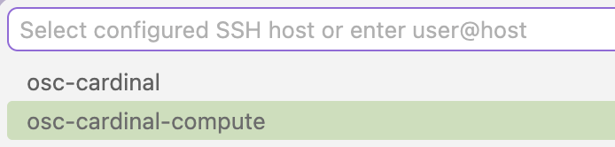
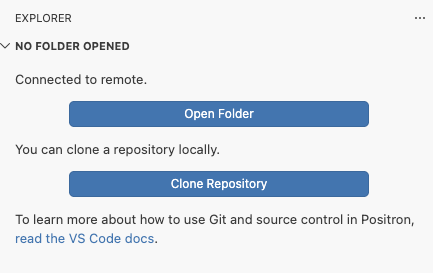
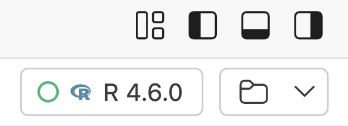
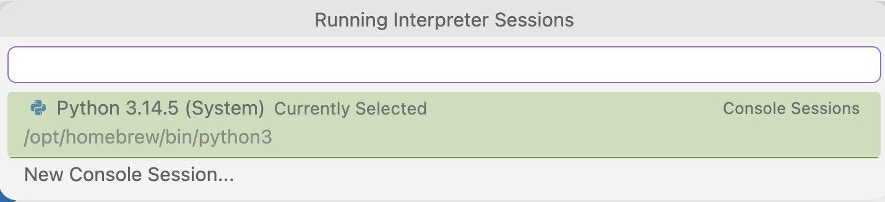
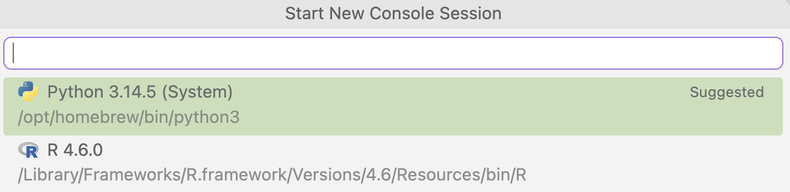

---------

<hr style="height:10pt; visibility:hidden;" />

<!----
TODO before publishing:
- This page depends on the SSH setup in bonus/vscode-local.qmd, which is still a draft
  (incl. the untested proxy script at /fs/ess/PAS3493/share/osc-compute-proxy.sh).
- Test the full setup on Mac and Windows, connecting to osc-pitzer-compute.
- Check the example compute and login node names in the hostname step.
- Test that Quarto preview/render works in Positron when connected to OSC
  (there is no Quarto module at OSC, so this relies on the Quarto CLI bundled with Positron).
- Retake screenshots that show cardinal (vscode-select-connection.png, install-posit-ai-osc.png).
---->

## Overview

### Why Positron?

In the remaining weeks of the course,
you'll write and run R code in **Positron**,
an IDE created by Posit, the company behind the popular R IDE RStudio.
Positron is a newer alternative to RStudio, and a good fit for this course:

1. It is **built on VS Code**^[
   Specifically, on Code OSS, the open-source base of VS Code.
   Positron is really a variant ("fork") of VS Code.],
   so it will look and feel very familiar (unlike RStudio).
2. It adds **data science features** that VS Code lacks,
   like an R console, and panes for variables, plots, and help.
3. Positron, not RStudio, is the main focus of Posit's development moving forward.
4. It has much better support than RStudio for Python and for AI assistance.

### Positron at OSC

Unlike VS Code Server, Positron is not available through OSC OnDemand.
Instead, you will **install Positron on your own computer**,
and **connect it to OSC** using SSH.
Then, only the program's interface runs on your computer.
and like with VS Code Server, your files, R, and your R code will all be at OSC.

## Install Positron

::: {.panel-tabset}
### Windows

1. Go to the [Positron download page ](https://positron.posit.co/download.html){target="_blank"}.

2. The "**Recommended for you**" box should have selected the correct download
   for your operating system^[
      If not, click the "All platforms" link below the download button to select the right one.].
   Make sure it is the **User install**
   (the System install requires admin rights).
   Most Windows computers need the x64 version,
   unless you know that yours has an ARM processor.

2. Click the download button,
   and then accept the license agreement to start the download.

3. Run the `.exe` installer and follow the prompts.

### Mac

1. Go to the
   [Positron download page ](https://positron.posit.co/download.html){target="_blank"}.

2. The "**Recommended for you**" box should have selected the correct download
   for your operating system^[
      If not, click the "All platforms" link below the download button to select the right one.].
   However, you need either the **Apple Silicon** or the **Intel** version,
   and the page can't always tell which one you need.
   To check, click the Apple menu () > `About This Mac`:
   if it lists a "Chip" that starts with "Apple" (e.g. "Apple M2"),
   you need Apple Silicon,
   and if it lists a "Processor" with "Intel" in the name, you need Intel.

3. Click the download button,
   and then accept the license agreement to start the download.

4. Open the `.dmg` file and drag Positron to:
   - If this is your **own computer**: Your Applications folder
   - If this is an **OSU-managed computer** without admin rights:
     your _personal_ Applications folder, `/Users/<username>/Applications`
     (this folder is in the same parent folder as your Documents, Downloads,
     and Desktop folders).

### Linux

1. Go to the [Positron download page ](https://positron.posit.co/download.html){target="_blank"}
   and download the `.deb` or `.rpm` file, depending on your distribution.

2. Use your package manager to install the downloaded file,
   e.g. from the folder with the downloaded file:

   - For a `.deb` file (e.g. Ubuntu, Debian):

     ```bash
     sudo apt install ./Positron-*.deb
     ```

   - For an `.rpm` file (e.g. Fedora, RHEL):

     ```bash
     sudo dnf install ./Positron-*.rpm
     ```

:::

Then, open Positron!

## Setting up the connection to OSC

Because Positron is built on VS Code,
it connects to OSC in the same way as a local VS Code installation does
(see the [reference page dedicated to this](../bonus/vscode-local.qmd)),
using the same SSH configuration^[
   The only difference is that you don't need to install any extension,
   because Positron has remote SSH support built in.].

### The SSH configuration file

_(You can skip this step if you already did it when connecting a_
_[local VS Code installation to OSC](../bonus/vscode-local.qmd#the-ssh-configuration-file).)_

We will define two remote "**hosts**" at OSC that you can connect to:

- `osc-pitzer-login` connects to a **login node** of OSC's Pitzer cluster.

- `osc-pitzer-compute` connects to a **compute node** of OSC's Pitzer cluster.
  Because you can't connect _directly_ to a compute node,
  this connection first goes to a login node,
  and there runs a script (`osc-compute-proxy.sh`, see below) that requests a
  compute job and then passes on the connection to the compute node
  you've been assigned.

1. Open the **Command Palette**
   (<kbd>Ctrl/⌘</kbd>+<kbd>Shift</kbd>+<kbd>P</kbd> or `View` > `Command Palette`)
   and type "_remote open_":

   - Select "**Remote-SSH: Open SSH Configuration File...**"
   - Then, select the top option,
     a file with a path that contains your username and ends in `.ssh/config`

2. Paste the following into the SSH configuration file that opens
   (note the separate tabs for Windows and Mac!):

   ::: {.panel-tabset}
   ### Windows

   ```{.file filename="&#126;/.ssh/config" hl-text="osc-username"}
   Host osc-pitzer-login
       User osc-username
       HostName pitzer.osc.edu

   Host osc-pitzer-compute
       User osc-username
       ForwardAgent yes
       StrictHostKeyChecking no
       UserKnownHostsFile=/dev/null
       ConnectTimeout 120
       ProxyCommand C:/Windows/System32/OpenSSH/ssh.exe -o LogLevel=QUIET -o BatchMode=yes osc-pitzer-login ./osc-compute-proxy.sh
   ```

   ### Mac

   ```{.file filename="&#126;/.ssh/config" hl-text="osc-username"}
   Host osc-pitzer-login
       User osc-username
       HostName pitzer.osc.edu

   Host osc-pitzer-compute
       User osc-username
       ForwardAgent yes
       StrictHostKeyChecking no
       UserKnownHostsFile=/dev/null
       ConnectTimeout 120
       ProxyCommand ssh -o LogLevel=QUIET -o BatchMode=yes osc-pitzer-login ./osc-compute-proxy.sh
   ```
   :::

3. Change **both** occurrences of [osc-username]{.hl-text} to your actual
   **OSC username**. Then, save the file.

### Avoid being prompted for your OSC password

_(You can skip this step if you already set up an SSH key pair for OSC,_
_e.g. when connecting a [local VS Code installation to OSC](../bonus/vscode-local.qmd#avoid-being-prompted-for-your-osc-password)_
_or on the [SSH page](../bonus/ssh.qmd#avoid-typing-your-osc-password).)_

Next, we'll set up an "**SSH key pair**"^[
  Does this sound familiar?
  At OSC, we've previously set up an SSH key pair for GitHub authentication.],
so you won't be prompted for your OSC password^[
  This is **required** for the compute node connection,
  and convenient for the login node connection and any other SSH connection to OSC.]:

1. Open a terminal in Positron (`Terminal` > `New Terminal`).
   Then, generate an SSH key pair using^[
    This terminal runs on your own computer, but this same commands workd
    regardless of whether you're using Windows or Mac]:

    ``` {.bash}
    ssh-keygen -t ed25519
    ```

    You'll be asked several questions:
    in each case, just press <kbd>Enter</kbd> to select the default answer.

2. Transfer the public key to OSC,
   **replacing `<user>` with your OSC username** in the command below
   (enter your OSC password when prompted):

   ::: {.panel-tabset}
   ### Mac
   ```bash
   ssh-copy-id <user>@pitzer.osc.edu
   ```

   ### Windows

   ```bash
   cat ~/.ssh/id_ed25519.pub | ssh <user>@pitzer.osc.edu 'mkdir -p .ssh && cat >> .ssh/authorized_keys'
   ```
   :::

3. Test it: the following should print the name of a Pitzer login node,
   without asking for your password:

   ```bash
   ssh osc-pitzer-login hostname
   ```

### The proxy script at OSC

_(You can skip this step if you already did it when connecting a_
_[local VS Code installation to OSC](../bonus/vscode-local.qmd#the-proxy-script-at-osc).)_

The compute node connection runs a short "proxy script" in your Home dir at OSC.
Copy it there by running the following command in your Positron terminal:

```bash
ssh osc-pitzer-login 'cp /fs/ess/PAS3493/share/osc-compute-proxy.sh ~/ && chmod +x ~/osc-compute-proxy.sh'
```

::: callout-note
#### More about the proxy script

This script contains the following:

```{.bash .file filename="&#126;/osc-compute-proxy.sh"}
#!/bin/bash
exec salloc --quiet -A PAS3493 -c 2 -t 300 bash -c 'nc $SLURM_NODELIST 22'
```

That is, it requests a compute job (`salloc`) with 2 cores for 300 minutes
with the course's OSC Project `PAS3493`,
and then connects to the compute node you were assigned (`nc ... 22`).

You can adjust these values if you want more time or cores (and memory).
**Once the course is over**, you should no longer use the course's OSC Project.
To change the Project, open `~/osc-compute-proxy.sh` at OSC and edit `PAS3493`.
:::

::: {.callout-note collapse="true"}
#### Alternative: the proxy script on your own computer _(Click to expand)_

If the above setup didn't work for you, try this
(if you already did this for a local VS Code installation, you're all set:
both files below are on your computer, where Positron uses them as well):

1. In the SSH configuration file, change the `ProxyCommand` line for `osc-pitzer-compute` to:

   ::: {.panel-tabset}
   ### Mac

   ```{.file filename="&#126;/.ssh/config (excerpt)" hl-text="<computer-username>"}
       ProxyCommand /Users/<computer-username>/.ssh/osc-compute-proxy.sh %h
   ```

   ### Windows

   ```{.file filename="&#126;/.ssh/config (excerpt)" hl-text="<computer-username>"}
       ProxyCommand C:/Users/<computer-username>/.ssh/osc-compute-proxy.cmd %h
   ```
   :::

   where `<computer-username>` is your username on your computer
   (it's also in the path to the SSH configuration file).

2. Create the proxy script by running the following in the Positron terminal:

   ::: {.panel-tabset}
   ### Mac

   ```bash
   cat > ~/.ssh/osc-compute-proxy.sh << 'EOF'
   #!/bin/bash
   exec ssh -o LogLevel=QUIET -o BatchMode=yes osc-pitzer-login \
     "/usr/bin/salloc -A PAS3493 -c 2 -t 300 /bin/bash -c 'nc \$SLURM_NODELIST 22'" 2>/dev/null
   EOF

   chmod +x ~/.ssh/osc-compute-proxy.sh
   ```

   ### Windows

   ::: {.callout-important appearance="simple"}
   This assumes you are using PowerShell, the default Windows shell in Positron
   (you should see "PowerShell" in the top right of the terminal).
   If you are using Git Bash or WSL, use the Mac instructions instead.
   :::

   ```powershell
   @'
   @echo off
   ssh -o LogLevel=QUIET -o BatchMode=yes osc-pitzer-login "/usr/bin/salloc -A PAS3493 -c 2 -t 300 /bin/bash -lc 'nc $SLURM_NODELIST 22'"
   '@ | Out-File -Encoding ascii "$env:USERPROFILE\.ssh\osc-compute-proxy.cmd"
   ```
   :::
:::

### Increase the connection timeout

Because it can take a little while to get a compute job,
you also need to increase the time Positron will wait for a connection:
open the Positron **Settings** ( > `Settings`),
search for `remoteSSH.connectTimeout`,
and change its value from 60 to **300** (seconds)^[
Do this even if you already did so in VS Code, because Positron has its own settings
(and note that the name of this setting is slightly different than in VS Code).].

## Connecting to OSC

Now that the SSH configuration is set up, let's try to connect Positron to OSC!

1. Open the Command Palette
   (<kbd>Ctrl/⌘</kbd>+<kbd>Shift</kbd>+<kbd>P</kbd> or `View` > `Command Palette`)
   and type "_**SSH connect**_".

2. Select `Remote-SSH: Connect to Host...` and then choose `osc-pitzer-compute`:

   {fig-align="center" width="50%" .lightbox fig-alt="Screenshot of the list of SSH hosts to connect to."}

3. A new Positron window will open and connect to OSC.
   This may take 30 seconds or more while a compute node is being allocated.
   (If you're asked whether you "trust the authors", click "Trust and Continue".)

4. Once connected, open a **terminal** in Positron (`Terminal` > `New Terminal`).
   This works just like the VS Code terminal,
   and it's running at OSC.
   Check that you're on a **compute node** by running `hostname`:
   it should print a compute node name like `p0133.ten.osc.edu`,
   not a login node name like `pitzer-login01.hpc.osc.edu`.

::: {.callout-warning collapse="true"}
#### If the compute node connection fails or takes more than a few minutes _(Click to expand)_

Try the `osc-pitzer-login` connection instead,
which is less likely to fail and is faster to connect to.

However, this should be temporary last-resort solution, because
Positron then runs on a login node rather than on a compute node.
This means that you should avoid running any analyses in the terminal or
the R console.
Especially since Positron itself takes up resources on the login node,
and OSC prefers that you don't do this.
:::

## Load and test R at OSC

### Load R

R is installed but not automatically loaded at OSC.
The easiest way to make sure that Positron will find R when it connects to OSC
is by adding the R module to your Bash settings file, `~/.bashrc`
([learn more about this file here](/bonus/shell-config.qmd)):

1. In your Positron terminal,
   add a `module load` command for R to your `~/.bashrc` file:

   ```bash
   echo 'module load gcc/12.3.0 R/4.6.1' >> ~/.bashrc
   ```

2. Reload Positron: open the **Command Palette**,
   type "_Reload Window_", and select "**Developer: Reload Window**".

::: callout-warning
#### This isn't a permanent solution to load R at OSC
Adding this `module load` command to your `~/.bashrc` is not a permanent solution:
over time, the R versions available at OSC will change,
as may the version that you personally want to use.
(On the plus side, this command currently works on all three OSC clusters,
since they have the same R modules.)
:::

### Open your personal folder

Positron really wants you to **open a folder**,
even more so than VS Code (you'll learn why that is a good idea).
Open your personal dir, `/fs/ess/PAS3493/people/<user>`
by clicking the "Open Folder" button in the Explorer^[
   Or you can use `File` > `Open Folder` like you're used to in VS Code.]
shown here:

{fig-align="center" width="50%" .lightbox fig-alt="Screenshot of the Positron Explorer view showing the Open Folder button."}

If you're asked whether you trust the authors of the files in this folder,
click "Yes, I trust the authors".

::: {.callout-tip}
#### Reconnecting from now on will be _very_ simple!
Like in VS Code, after connecting once,
the folder will appear in Positron's "Recent" list on the Welcome tab.
Therefore, you can reconnect to OSC _and_ open this folder with a single click,
from now on!
:::

### Check that R works

At the bottom of the Positron window, there should be a **Console** tab,
which should have started an R session.
The R version is also shown at the top right of the Positron window,
in the so-called interpreter picker:

<!--- TODO replace screenshot with R 4.6.1 ---->

{fig-align="center" width="35%" fig-alt="Screenshot of the Positron interpreter picker"}

::: legend2
The interpreter picker. You should see R 4.6.1 instead of the version shown here.
:::

Click in the Console, type the following, and press <kbd>Enter</kbd>:

```r
R.version.string
```
```r-out
TODO
```

If you get the output shown above, you're all set! 🎉

::: {.callout-warning collapse="true"}
#### If you're seeing a Python console, or no console at all _(Click to expand)_

- If no R or Python version is shown in the top-right corner of the Positron window,
  click on the interpreter picker there.
  If Python is shown instead, it will look like this,
  and you should also click on it:

  {fig-align="center" width="40%" .lightbox fig-alt="Screenshot of the Positron interpreter picker showing a Python interpreter."}

- Then, select **New Console Session**:

  {fig-align="center" width="70%" .lightbox fig-alt="Screenshot of the interpreter picker menu with the New Console Session option."}

- Select R 4.6.1:

  {fig-align="center" width="70%" .lightbox fig-alt="Screenshot of the list of R and Python interpreters to choose from."}

- When done, you should see this in the top-right instead,
  and your console should have switched to R as well:

  {fig-align="center" width="40%" .lightbox fig-alt="Screenshot of the interpreter picker showing an R interpreter."}

If R 4.6.1 isn't listed at all,
check that you completed the [Load R at OSC](#load-r-at-osc) step,
including the window reload.
:::

::: {.callout-note collapse="true"}
#### Last-resort fallback: RStudio Server at OSC {#fallback-rstudio-server-at-osc}

If you can't get Positron to work,
you can instead use RStudio Server, an Interactive App at OSC OnDemand.
RStudio has the same main components as Positron,
like a code editor, an R console, and panes for your environment, plots, and help,
but they are laid out differently and you'll have to find your own way at times.

1. Log in to OSC's OnDemand portal at <https://ondemand.osc.edu>.
2. In the blue top bar, select `Interactive Apps` and then near the bottom,
   click `RStudio Server`.
3. Fill out the form as follows:
   - Cluster: `pitzer`
   - R version: `4.6.1`
   - Project: `PAS3493`
   - Number of hours: `2`
   - Node type: `any`
   - Number of cores: `2`
4. Click `Launch`.
5. Click the `Connect to RStudio Server` button once it appears.

Instead of opening a folder like in Positron,
use an "RStudio Project" for your personal dir:
`File` > `New Project` > `Existing Directory`,
and then browse to `/fs/ess/PAS3493/people/<user>`.
:::

<hr style="height:1pt; visibility:hidden;" />

<!----
::: {.callout-note collapse="true"}
#### Optional: installing R on your own computer _(Click to expand)_
You don't need R on your own computer for this course,
because you'll be using R at OSC.
But if you want to use Positron for R work outside of OSC,
you'll need to install R separately, since Positron does not come with its own R:

- **Windows**: use [this `.exe` file](https://cran.r-project.org/bin/windows/base/release.htm)
- **Mac**: use [this `.pkg` file](https://cran.r-project.org/bin/macosx/R-latest.pkg)
- **OSU-managed computer**: use the Software Center (Windows)
  or Ohio State Application Self Service (Mac)
:::
----->
