---------

<hr style="height:1pt; visibility:hidden;" />

<!----
TODO before publishing:
- This page depends on the SSH setup in bonus/vscode-local.qmd, which is still a draft
  (incl. the untested proxy script at /fs/ess/PAS3493/share/osc-compute-proxy.sh).
- Test the full setup on Mac and Windows, connecting to osc-pitzer-compute.
- Check the example compute and login node names in the hostname step.
- Test that Quarto preview/render works in Positron when connected to OSC
  (there is no Quarto module at OSC, so this relies on the Quarto CLI bundled with Positron).
- Retake screenshots that show cardinal (vscode-select-connection.png, install-posit-ai-osc.png).
- Decide whether to keep the optional Posit Assistant and Claude Code sections.
---->

::: callout-note
#### We'll do this together in class
We'll go through this page together at the start of the week 12 class.
You're welcome to get a head start before class,
but you don't need to.
:::

## Overview

### Why Positron?

In the remaining R weeks of the course,
you'll write and run R code in **Positron**,
an IDE (Integrated Development Environment) created by Posit,
the company behind the popular R IDE RStudio.
Positron is a newer alternative to RStudio,
and a great fit for this course:

1. It is **built on VS Code**^[
   Specifically, on Code OSS, the open-source base of VS Code.
   Positron is really a variant ("fork") of VS Code.],
   so it will look and feel very familiar:
   the Command Palette, the Explorer, the terminal, extensions, and settings
   all work just like in VS Code.
2. On top of that, it adds **data science features** that VS Code lacks,
   like an R console, and panes for your variables, plots, and help.
3. Positron, not RStudio, is the main focus of Posit's development moving forward.
4. It has much better support than RStudio for Python and for AI assistance.

### Positron at OSC

Unlike VS Code Server, Positron is not available through OSC OnDemand.
Instead, you will **install Positron on your own computer**,
and **connect it to OSC** using SSH.
This means that like with VS Code Server,
your files, R, and your R code will all be at OSC:
only the program's interface runs on your computer.

::: callout-note
#### Can't install Positron?
If you can't install Positron, or can't get the connection to OSC to work,
you can instead use RStudio Server at OSC:
see the [last section of this page](#fallback-rstudio-server-at-osc).
:::

## Install Positron

::: {.callout-important collapse="true"}
#### If you have an OSU-managed computer without admin rights _(Click to expand)_

You should still be able to install Positron,
but do so at the **user level rather than system-wide**:

- On a **Mac**, drag the Positron app into your **personal** Applications folder,
  `/Users/<username>/Applications`
  (this folder is in the same parent folder as your Documents, Downloads,
  and Desktop folders).

- On **Windows**, the Positron installer has a **user install** option:
  look for a checkbox or dropdown labeled "Install for me only"
  (vs. "for all users") during setup.
:::

1. Go to the [Positron download page](https://positron.posit.co/download.html){target="_blank"}
   and check the box to accept the license agreement.

2. Download the latest release for your operating system:
   - **Mac**: Look for the `.dmg` file (Intel or Apple Silicon)
   - **Windows**: Look for the `.exe` installer
   - **Linux**: Look for the `.deb` or `.rpm` file, depending on your distribution

3. Install Positron:
   - **Mac**: Open the `.dmg` file and drag Positron to your Applications folder.
   - **Windows**: Run the `.exe` installer and follow the prompts.
   - **Linux**: Use your package manager to install the downloaded file.

4. Open the program!

::: {.callout-note collapse="true"}
#### Installing R on your own computer _(Click to expand)_
You don't need R on your own computer for this course,
because you'll be using R at OSC.
But if you want to use Positron for R work outside of OSC,
you'll need to install R separately, since Positron does not come with its own R:

- **Windows**: use [this `.exe` file](https://cran.r-project.org/bin/windows/base/release.htm)
- **Mac**: use [this `.pkg` file](https://cran.r-project.org/bin/macosx/R-latest.pkg)
- **OSU-managed computer**: use the Software Center (Windows)
  or Ohio State Application Self Service (Mac)
:::

## Connect to OSC

### Set up the SSH connection

Because Positron is built on VS Code,
it connects to OSC in the same way as a local VS Code installation does,
using the same SSH configuration.
That setup is described on the
[page on connecting a local VS Code installation to OSC](../bonus/vscode-local.qmd),
and you can **follow it in Positron** instead of in VS Code:
it is identical, except that you don't need to install any extension,
because Positron has remote SSH support built in.

Specifically, in Positron,
follow these sections of that page:

- [The SSH configuration file](../bonus/vscode-local.qmd#the-ssh-configuration-file)
- [Avoid being prompted for your OSC password](../bonus/vscode-local.qmd#avoid-being-prompted-for-your-osc-password)
- [The proxy script at OSC](../bonus/vscode-local.qmd#the-proxy-script-at-osc)

::: {.callout-tip appearance="simple"}
If you already did this setup for a local VS Code installation,
you can skip the above steps:
the SSH configuration lives in a file on your computer (`~/.ssh/config`),
which Positron will use as well.
:::

Then, **increase the connection timeout**:
because it can take a little while to get a compute job,
open the Positron **Settings** ( > `Settings`),
search for `remoteSSH.connectTimeout`,
and change its value from 15 to **300** (seconds).
(Note that the name of this setting is slightly different than in VS Code.)

### Connecting to OSC from Positron

1. Open the **Command Palette**
   (<kbd>Ctrl/⌘</kbd>+<kbd>Shift</kbd>+<kbd>P</kbd> or `View` > `Command Palette`)
   and type "_**SSH connect**_".

2. Select `Remote-SSH: Connect to Host...` and then choose `osc-pitzer-compute`:

   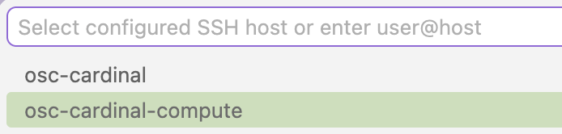{fig-align="center" width="50%" .lightbox fig-alt="Screenshot of the list of SSH hosts to connect to."}

3. A new Positron window will open and connect to OSC.
   This may take 30 seconds or more while a compute node is being allocated.

   - If you're asked about the operating system of the host, select **Linux**.
   - If you're asked whether you "trust the authors", click **Trust and Continue**.

::: {.callout-warning collapse="true"}
#### If the compute node connection fails or takes more than a few minutes _(Click to expand)_
See [this box](../bonus/vscode-local.qmd#connecting) on the local VS Code page.
:::

4. Once connected, open a **terminal** in Positron (`Terminal` > `New Terminal`).
   This works just like the VS Code terminal,
   and it's running at OSC.
   Check that you're on a **compute node** by running `hostname`:
   it should print a compute node name like `p0133.ten.osc.edu`,
   not a login node name like `pitzer-login01.hpc.osc.edu`.

### Load R at OSC

R is installed but not automatically loaded at OSC.
The easiest way to make sure that Positron will find R when it connects to OSC
is by adding the R module to your Bash settings file, `~/.bashrc`
(recall [week 7's shell configuration material](../bonus/shell-config.qmd)):

1. In your Positron terminal,
   add a `module load` command for R to your `~/.bashrc` file:

   ```bash
   echo 'module load gcc/12.3.0 R/4.5.2' >> ~/.bashrc
   ```

2. Reload Positron:
   open the **Command Palette**
   and start typing "_Reload Window_", then select "**Developer: Reload Window**".

::: callout-warning
#### This isn't a permanent solution to load R at OSC
Adding this `module load` command to your `~/.bashrc` is not a permanent solution,
because over time, the R versions available at OSC will change,
as may the version that you personally want to use.
On the plus side, this command currently works on all three OSC clusters,
since they have the same R modules.
:::

### Open your personal folder

Positron really wants you to **open a folder**,
just like VS Code (and in the lecture, you'll learn why that is a good idea).
Open your personal dir, `/fs/ess/PAS3493/people/<user>`
(where `<user>` is your OSC username),
by clicking the "Open Folder" button in the Explorer
or using `File` > `Open Folder`:

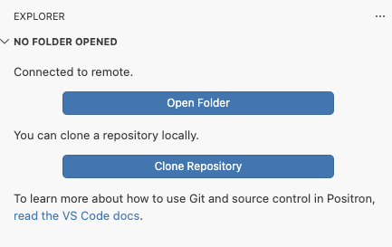{fig-align="center" width="50%" .lightbox fig-alt="Screenshot of the Positron Explorer view showing the Open Folder button."}

If you're asked whether you trust the authors of the files in this folder,
click **Yes, I trust the authors**.

::: {.callout-tip}
#### Reconnecting from now on
Like in VS Code, after connecting once,
the folder will appear in Positron's "Recent" list on the Welcome tab,
so you can reconnect to OSC _and_ open this folder with a single click.
:::

### Check that R works

At the bottom of the Positron window, there should be a **Console** tab,
which should have started an R session.
The R version is also shown at the top right of the Positron window,
in the so-called interpreter picker:

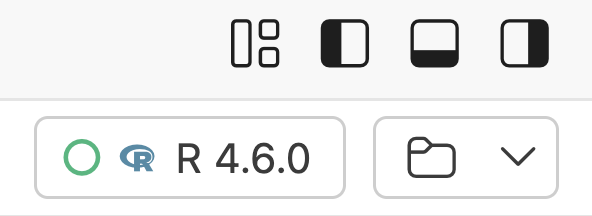{fig-align="center" width="35%" fig-alt="Screenshot of the Positron interpreter picker"}

::: {.callout-warning collapse="true"}
#### If you're seeing a Python console, or no console at all _(Click to expand)_

- If no R or Python version is shown in the top-right corner of the Positron window,
  click on the interpreter picker there.
  If Python is shown instead, it will look like this,
  and you should also click on it:

  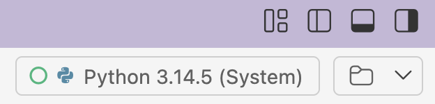{fig-align="center" width="40%" .lightbox fig-alt="Screenshot of the Positron interpreter picker showing a Python interpreter."}

- Then, select **New Console Session**:

  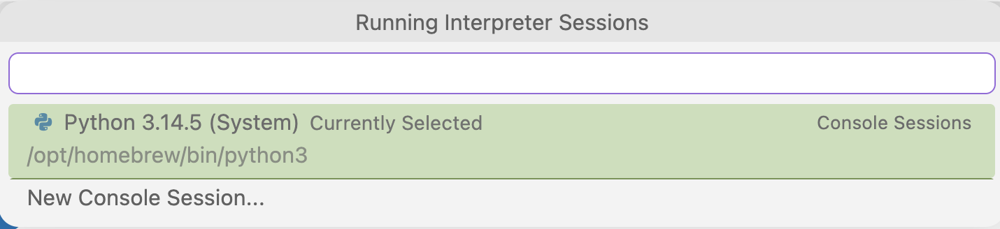{fig-align="center" width="70%" .lightbox fig-alt="Screenshot of the interpreter picker menu with the New Console Session option."}

- Select R 4.5.2:

  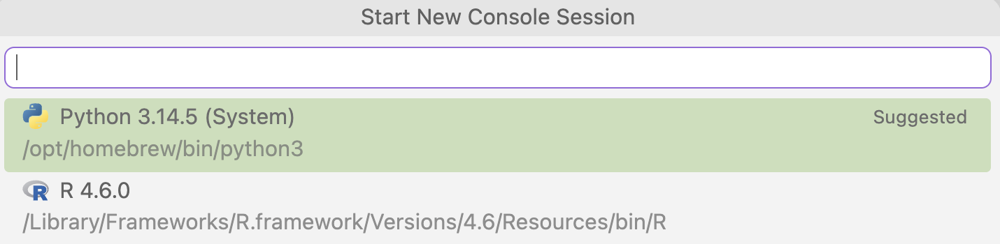{fig-align="center" width="70%" .lightbox fig-alt="Screenshot of the list of R and Python interpreters to choose from."}

- When done, you should see this in the top-right instead,
  and your console should have switched to R as well:

  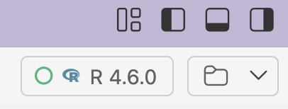{fig-align="center" width="40%" .lightbox fig-alt="Screenshot of the interpreter picker showing an R interpreter."}

If R 4.5.2 isn't listed at all,
check that you completed the [Load R at OSC](#load-r-at-osc) step,
including the window reload.
:::

Click in the Console, type the following, and press <kbd>Enter</kbd>:

```r
R.version.string
```

This should print `"R version 4.5.2 (...)"`.
If so, you're all set! 🎉

## Optional: Posit Assistant {#optional-posit-assistant}

<!---- TODO: Decide whether to keep this section in week 12, or move it later ---->

Posit Assistant is Positron's built-in AI coding assistant,
designed specifically for data analysis.
Similar to Claude Code, it can run code for you,
but unlike Claude Code, it can directly see your R session,
including the objects in your environment.

You can use it with the same OSU LiteLLM API key that you used for
Claude Code in [week 9](../week09/w9a_claude.qmd),
and/or with GitHub Copilot.

### Install the Posit Assistant extension

::: {.columns}

::: {.column width="45%"}

1. Open the **Extensions** view by clicking the Extensions icon in
   the Activity Bar (the narrow, leftmost sidebar).

2. In the search box, start typing "**posit assistant**".

3. Click **Install** (when connected to OSC: **Install in SSH: osc-pitzer-compute**)
   on the "**Posit Assistant**" extension by Posit.

:::

::: {.column width="54%"}

{fig-align="center" width="20%" .lightbox fig-alt="The Extensions icon."}

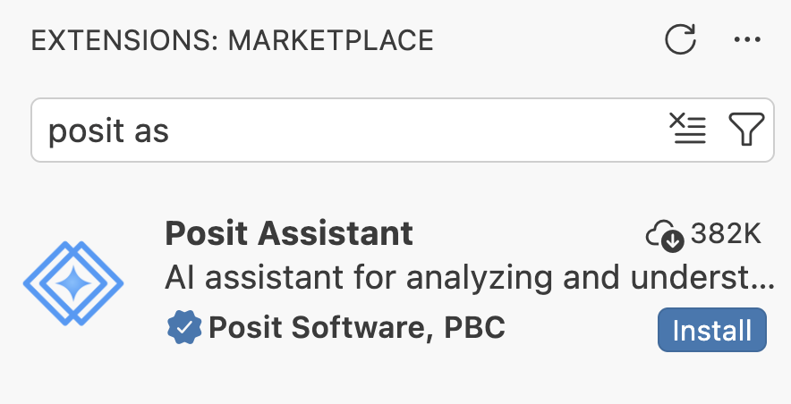{fig-align="center" width="90%" .lightbox fig-alt="Screenshot of the Positron Extensions view showing the Posit Assistant extension."}

:::

:::

### Authentication via the OSU LiteLLM API

::: {.columns}
::: {.column width="70%"}

1. Click on the newly added **Posit Assistant icon** in the Activity Bar.

2. It should show the following:
   click "Help me set it up" and then "Configure LLM providers".

:::
::: {.column width="30%"}

{fig-align="center" width="30%" .lightbox fig-alt="Posit Assistant icon in the Activity Bar"}

:::
:::

::: {.columns}
::: {.column width="45%"}
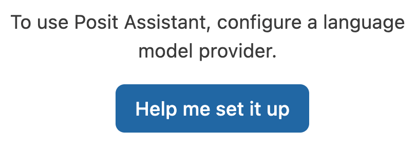{fig-align="center" width="90%" .lightbox fig-alt="Screenshot of the Posit Assistant panel with the Help me set it up button."}
:::
::: {.column width="45%"}
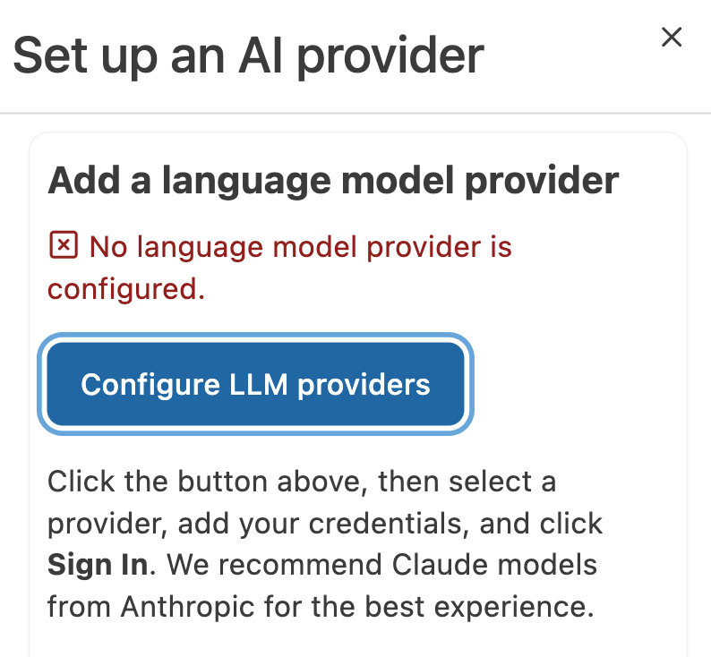{fig-align="center" width="90%" .lightbox fig-alt="Screenshot of the Posit Assistant panel with the Configure LLM providers button."}
:::
:::

3. At the top, select **Custom Provider** from the list of providers, and enter:

   - **API Key**: Use the API key from your `~/.claude/settings.json` file at OSC
     (you can open it in Positron with `File` > `Open File`).
   - **Base URL**: `https://litellm.cloud.osu.edu`
   - Then, click **Sign in**.

   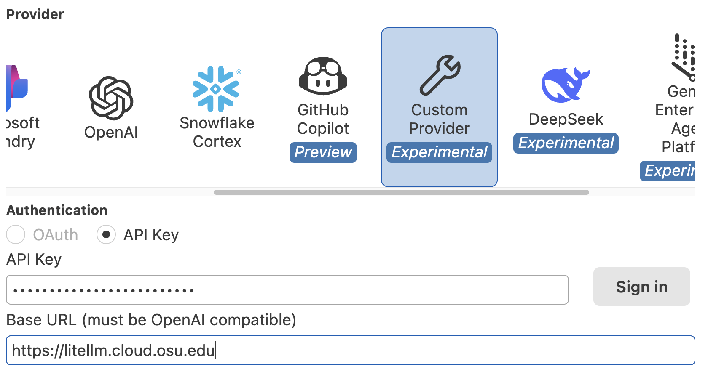{fig-align="center" width="60%" .lightbox fig-alt="Screenshot of the Custom Provider configuration form."}

4. If it worked, the assistant panel should now show:

   {fig-align="center" width="40%" .lightbox fig-alt="Screenshot of the Posit Assistant panel after a successful sign-in."}

5. In the bottom-right of the prompt box, click Select Model:

   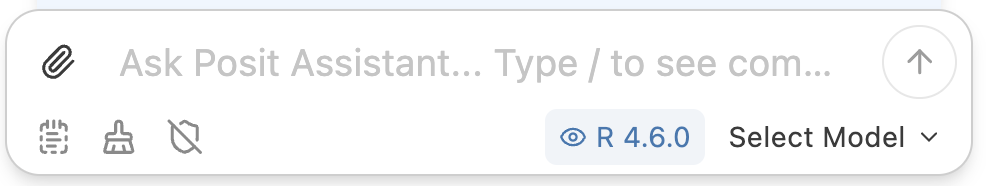{fig-align="center" width="70%" .lightbox fig-alt="Screenshot of the Posit Assistant prompt box with the Select Model button."}

6. The models you can access via the API key are available under
   "**OpenAI Compatible**" (the first option in the list):
   click "More models".

   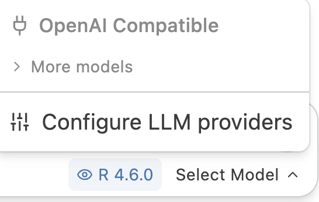{fig-align="center" width="35%" .lightbox fig-alt="Screenshot of the model selection menu."}

7. In the (long!) dropdown list, select a Claude model like `claude-opus-4-6`.
   Then, the prompt should look something like this:

   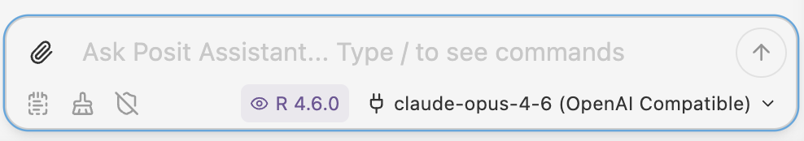{fig-align="center" width="75%" .lightbox fig-alt="Screenshot of the Posit Assistant prompt box with a model selected."}

::: {.callout-warning}
#### Model compatibility
Not all models available through the OSU LiteLLM service may work with
Posit Assistant's Custom Provider.
If you get an "**internal error**" when trying to use the Posit Assistant,
switch to a different model and try again.
:::

### Authentication via GitHub

This is not required if you set up the API key above.
However, like in VS Code, GitHub Copilot will provide inline code completions^[
In Positron, it does so via Posit Assistant rather than via its own extension.],
which access via the API key does not.

1. Click the cog wheel  icon at the top of the Posit Assistant
   panel and select **Configure LLM providers**^[
   This window can also be opened via the Command Palette by typing "_**Configure**_":
   it's listed as "**Configure Language Model providers**".].

2. Select the provider "GitHub Copilot" and click "**Sign in**"
   (keep the default selection of `OAuth` for **Authentication**):

   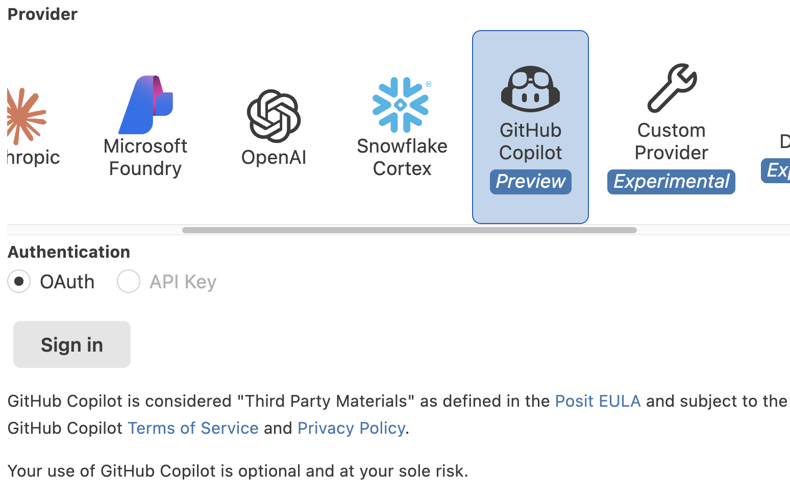{fig-align="center" width="55%" .lightbox fig-alt="Screenshot of the GitHub Copilot provider configuration."}

3. A browser window will open, asking you to authorize Posit Assistant to access your GitHub account.
   Log in and authorize as requested.

4. Done! Now, when clicking on the model selection indicator in the Posit Assistant prompt,
   you should see models listed under a GitHub Copilot section header:

   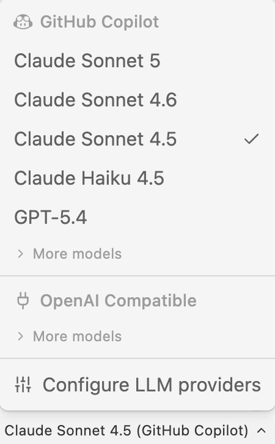{fig-align="center" width="27%" .lightbox fig-alt="Screenshot of the model selection menu with GitHub Copilot models."}

### Testing Posit Assistant

1. In the R console, create a simple data frame:

   ```r
   df <- data.frame(x = 1:10, y = rnorm(10))
   ```

2. In the Posit Assistant panel, try asking:

   > Create a scatter plot of x vs y from df

3. Posit Assistant should generate code for a plot and ask for permission to run it:
   click **Allow**.

   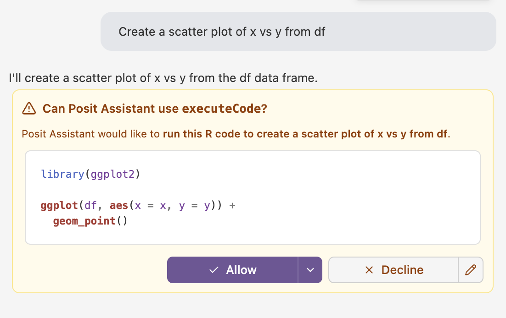{fig-align="center" width="70%" .lightbox fig-alt="Screenshot of the Posit Assistant panel showing a prompt and generated code for a scatter plot."}

4. It produces the plot and shows it in its own panel,
   along with suggestions for next steps.
   The plot should also appear in Positron's Plots pane,
   since it was generated with R code in your R session.

   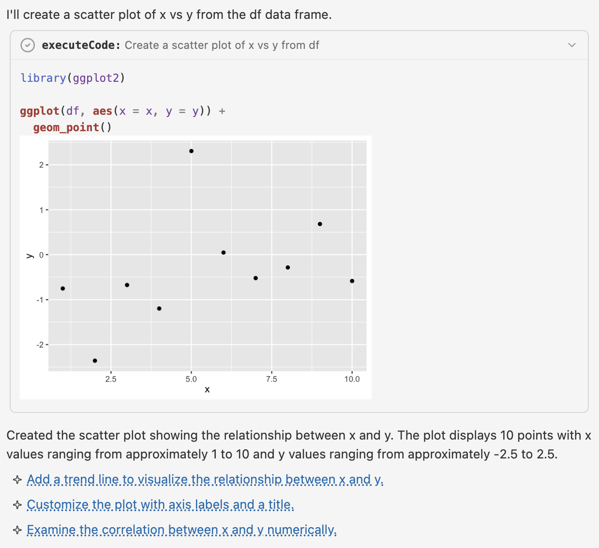{fig-align="center" width="80%" .lightbox fig-alt="Screenshot of the Posit Assistant panel showing the resulting scatter plot."}

::: {.callout-note collapse="true"}
#### Claude Code in Positron _(Click to expand)_
The Claude Code extension works in Positron just like in VS Code.
Install the "**Claude Code for VS Code**"^[
Yes, "for VS Code", not "for Positron".]
extension by Anthropic in the Extensions view,
and it will use the `~/.claude/settings.json` file at OSC
that you created in [week 9](../week09/w9a_claude.qmd).

Unlike Posit Assistant, however, Claude Code can't see your R session by default.
:::

## Fallback: RStudio Server at OSC {#fallback-rstudio-server-at-osc}

If you can't get Positron to work,
you can instead use RStudio Server, an Interactive App at OSC OnDemand.
RStudio has the same main components as Positron,
like a code editor, an R console, and panes for your environment, plots, and help,
but they are laid out differently and you'll have to find your own way at times.

1. Log in to OSC's OnDemand portal at <https://ondemand.osc.edu>.
2. In the blue top bar, select **`Interactive Apps`** and then near the bottom,
   click **`RStudio Server`**.
3. Fill out the form as follows:
   - Cluster: **`pitzer`**
   - R version: **`4.5.2`**
   - Project: **`PAS3493`**
   - Number of hours: **`2`**
   - Node type: **`any`**
   - Number of cores: **`1`**
4. Click **`Launch`**.
5. Click the **`Connect to RStudio Server`** button once it appears.

Instead of opening a folder like in Positron,
use an "RStudio Project" for your personal dir:
`File` > `New Project` > `Existing Directory`,
and then browse to `/fs/ess/PAS3493/people/<user>`.
