--------------------------------------------------------------------------------

## Introduction

### Overview and learning goals of the course's R material

This is the first of a four-week series that will focus on the R language.
Besides being a great all-round tool for data analysis and visualization,
the R language is probably the best environment for the "downstream" analysis
of omics data, with an excellent array of packages for e.g.:

- Metabarcoding analysis
- RNA-seq analysis
- Lipidomics
- Proteomics and metabolomics

Specifically, you will learn:

- The basics of R, and how to write R code in Quarto documents (**this lecture**)
- How data is stored in R, using e.g. vectors and different data types
  (**the self-study section at the end of this page**)
- How to work with tabular data and visualize data with the ggplot2 package (week 13)
- How to use Quarto to produce beautiful, reproducible documents (week 14)
- About the ecosystem of packages for omics data analysis (week 15)
- By means of example, how to analyze the RNA-seq count data you have
  produced using the @garrigós2025 dataset

### Lecture learning goals

In this lecture, you will learn:

- The RStudio layout and the functions of the different panes and tabs
- The basics of interacting with R by using R as a calculator
- Defining variables/objects in R, and assigning values/data to them
- Calling R functions
- Installing and loading R packages
- Getting help in R
- Writing, running, and rendering R code in a Quarto document
- _Self-study_: Vectors, R's main data types, and comparisons

## Starting an RStudio Server session at OSC

You can use R with a "console" that can simply be run inside the terminal
(at OSC, you can do so after loading the R module).
However, we'll use R with a fancy editor (or "IDE", Integrated Development Environment)
called [RStudio](https://www.rstudio.com/products/rstudio/download/#download),
which makes working with it much more pleasant!

Similar to VS Code, we can run a version of RStudio ("RStudio Server") within our
browsers by starting an Interactive App through OSC OnDemand.

1. Log in to OSC’s OnDemand portal at <https://ondemand.osc.edu>.
2. In the blue top bar, select **`Interactive Apps`** at the bottom,
   click **`RStudio Server`**.
3. Fill out the form as follows:
   - Cluster: **`pitzer`**
   - R version: **`4.5.2`**
   - Project: **`PAS3493`**
   - Number of hours: **`2`**
   - Node type: **`any`**
   - Number of cores: **`1`**
4. Click **`Launch`**.
5. Click the **`Connect to RStudio Server`** button once it appears.

::: callout-tip
#### Number of cores
Note that unlike with Code Server,
we can choose how many cores we want when starting an RStudio server job.
Changing the number of cores is also the way to go if you need more than the
default 4 GB of memory (RAM):
recall that each core is associated with 4 GB of memory,
so asking for 4 cores will get you 16 GB RAM.
:::

::: callout-note
#### Installing R on your own computer
While you don't need to do so for this course,
you can also easily install R and RStudio on your computer.
For more information, see [this page](https://osu-codeclub.github.io/carpentries-aug-2025/0_setup.html).
:::

## Orienting to RStudio (basic layout)

When you first open RStudio, you will be greeted by four panes,
each of which have multiple tabs:

- **Top left:** The editor/source pane, where you can open and edit documents like scripts

- **Bottom left:** the default and most useful tab in this pane is your R
  "Console", where you can type and execute R code

- **Top right:** the default and most useful tab in this pane this is your
  "Environment",
  which shows you all the objects that are active in your R environment

- **Bottom right:** the default tab in this pane is "Files",
  which is a file explorer starting in your initial working directory
  (more about that next).
  The additional tabs are also commonly used, such as those to show plots and help.

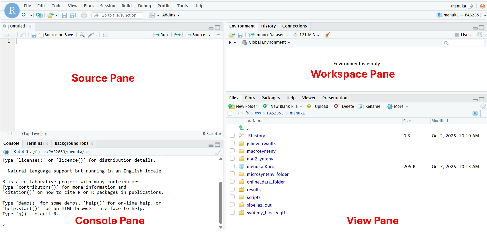{width="100%" fig-align="center"}

::: {.callout-tip appearance="simple"}
[Click here for a useful RStudio cheatsheet](https://rstudio.github.io/cheatsheets/html/rstudio-ide.html)
:::

## R basics
There are many things we can do in R: data manipulation, data visualization,
statistical analysis, machine learning and many more.
Here, to get some familiarity with working in R, we will start by simply using R as a calculator.

### R as calculator

To get used to typing and executing R code,
we will simply use R as a calculator --
type `5 + 5` in the console and press <kbd>Enter</kbd>:

```{r}
5 + 5
```

R will print the result of the calculation, `10`.
The result is prefaced by `[1]`, which is simply an index/count of output,
which can be helpful when multiple numbers and elements are printed.

Some additional calculation examples:

- Multiplication and division:

  ```{r}
  6 * 8
  40 / 5
  ```

- Exponents:

  ```{r}
  3 ^ 4
  ```

- Parentheses can be used to change the default order of operations:

  ```{r}
  (5 + 3) * 2
  ```

  ```{r}
  # Without parentheses, multiplication happens first
  5 + 3 * 2
  ```

This code will work with (as shown above) or without spaces between numbers
and around operators like `+`.
However, in general, it is good practice to leave spaces around operators to
improve the readability of your code.

::: {.callout-tip collapse="true"}
#### Order of operations is as you learned in school _(Click to expand)_
When using R as a calculator,
the order of operations is the same as you would have learned back in school.
From highest to lowest precedence:

-   Parentheses: `(`, `)`
-   Exponents: `^` or `**`
-   Multiplication and division: `*`, `/`
-   Addition and subtraction: `+`, `-`

Operators with the same precedence are evaluated from left to right.
:::


### The R prompt

The `>` sign in your console is the R prompt, indicating that R is ready
for you to type something.
In other words, this is equivalent to the `$` Bash prompt that you are used to.

Also just like in Unix shell, when you are not seeing the `>` prompt,
R is either **busy** (because you asked it to do a longer-running computation)
or **waiting** for you to complete an incomplete command.

If you notice that your prompt turned into a `+`,
you typed an incomplete command -- for example:

```{r, eval=FALSE}
10 /
```
```r-out
+
```

And once again like in the Unix shell,
you can either try to finish the command or abort it.
However, in RStudio's console, you abort with <kbd>Esc</kbd> rather than with
<kbd>Ctrl</kbd>+<kbd>C</kbd> --- let's practice that here.

::: callout-note
#### Adding comments to your code

Comments in R are just like in the Unix shell:
you can use `#` signs to comment your code, both inline and on separate lines:

```{r}
# This line is entirely ignored by R
10 / 5  # This line contains code but everything after the '#' is ignored
```
:::

::: exercise
####  Exercise: R as a calculator

**Predict** the output of each of the following lines, then run them one by one to check:

```r
8 / 2 * 4
-2 ^ 2
10 / 0
(5 + 3 * 2
```

<details><summary>*Click to see the solution*</summary>

```{r}
8 / 2 * 4
```

Multiplication and division have the same precedence, and are evaluated from left to right:
first `8 / 2`, then `* 4`.

```{r}
-2 ^ 2
```

Exponents come before the minus sign, so this is `-(2 ^ 2)`.
To square negative two, use `(-2) ^ 2`.

```{r}
10 / 0
```

Instead of an error, R returns `Inf` (infinity).

```{r, eval=FALSE}
(5 + 3 * 2
```
```r-out
+
```

The parenthesis isn't closed, so R waits for you to complete the command (`+` prompt).
Type `)` and press <kbd>Enter</kbd> to finish it (result: `11`), or press <kbd>Esc</kbd> to cancel.

</details>
:::


## Functions in R

### Basics of functions

To do almost anything in R, you will use "**functions**",
which are the equivalent of shell commands.
You can recognize function calls by the parentheses.
For example:

- The equivalent to the Shell's `pwd` is `getwd()`:

  ```r
  getwd()
  ```
  ```r-out
  [1] "/fs/ess/PAS3493/people"
  ```

- Inside those parentheses, you can provide **arguments** to a function.
  For example, using `setwd()`, the equivalent to the Shell's `cd`:

  ```r
  setwd("/fs/ess/PAS3493/people")
  ```

  Note that unlike in the Shell, we need to quote the path!
  This is because in R, as you'll see in more detail in a bit,
  anything that is not quoted is supposed to be an "object" like a variable.

- One of the equivalents to the Shell's `echo` is `print()`:

  ```{r}
  print("Hello world")
  ```

- The equivalent to the Shell's `mkdir` is `dir.create()`:

  ```r
  dir.create("week12")
  ```

- The equivalent to the Shell's `head` is `head()`,
  although it will by default show 6 lines/rows instead of 10:

  ```{r}
  head(iris)
  ```

  ::: callout-tip
  #### Where did `iris` come from?
  R comes shipped with several built-in datasets, like `iris`.
  We didn't need to (and shouldn't) quote this, because it is a so-called object in R.
  :::

### Function arguments

Consider the example below, where we pass the argument `6.53` to the function `round()`:

```{r}
round(6.53)
```

In most functions, including `round()`, arguments have **names** that can be used.
For example, the argument to round() representing the number to be rounded has
the name `x`, so you can also use:

```{r}
round(x = 6.53)
```

Naming arguments is helpful in particular to avoid confusion when you pass
multiple arguments to a function.
For example, `round()` accepts a second argument,
which is the number of digits to round to:

```{r}
round(x = 6.53, digits = 1)
```

You could choose not to name these arguments, but that is not as easy to understand:

```{r}
round(6.53, 1)
```

Moreover, when you name arguments, you can give them in any order you want:

```{r}
round(digits = 1, x = 6.53)
```

You can usually see which arguments a function takes by pausing after you
type the function and its parentheses, e.g. `round()`:

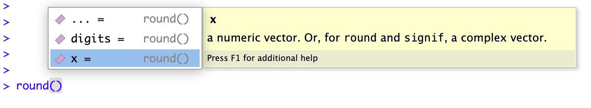{width="75%" fig-align="center"}

Below, we'll also see more extensive options to find out how a function works and
what arguments it takes.

### Functions for everything

R has over 3,000 functions that serve many different purposes,
and tens of thousands of additional functions are available in packages (add-ons).
Below are a couple of examples continuing along the theme of using R as a calculator:

| **Function** | **Description** |
|-----------------|---------------------------------------|
| `abs(x)` | Absolute value: e.g. `abs(-5)` returns 5 |
| `sqrt(x)` | Square root |
| `log(x)` | Natural logarithm |
| `log10(x)` | Common logarithm |
| `round(x, digits = n)` | Round: e.g `round(3.475, digits = 2)` returns 3.48 |

: {.striped .hover}

## R Help: `help()` and `?`

The `help()` function and `?` help operator in R offer access to documentation pages
for R functions, data sets, and other objects.
They provide access to both packages in the standard R distribution and contributed packages.

For example:

```r
?list.files
```

The output should appear in the Help tab of the bottom-right pane in RStudio and should look something like this:

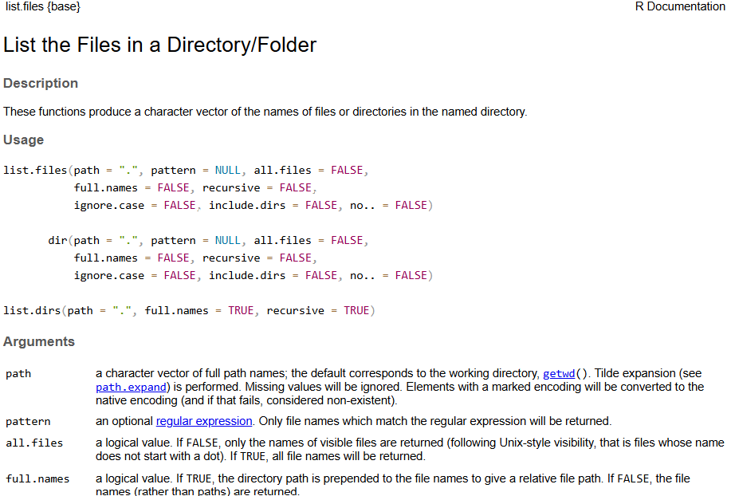{width="75%" fig-align="center"}

## R objects

### Assigning stuff to objects

You can assign one or more values to a so-called "object"
with the **assignment operator** `<-`.
A few examples:

```{r}
# Assign the value 250 to the object 'length_cm'
length_cm <- 250
length_cm
# Assign the value 2.54 to the object 'conversion'
conversion <- 2.54
conversion
```

In the shell, we've been calling these _variables_,
and that terminology is also used for R objects like the above ones.
However, R objects can take on many forms (we will talk about _data structures_ in a bit),
including more complicated things like tables.
That's why the general term object is used here.

To see the contents of an object, you can use the `print()` function as the
equivalent of `echo` in the Unix shell:

```{r}
print(length_cm)
```

However, in R you can also omit `print()` and simply type an object's name:

```{r}
length_cm
```

Importantly, you can use objects as if you had typed their values directly:

```{r}
length_cm / conversion
```

```{r}
length_in <- length_cm / conversion
length_in
```

### Object names

Some pointers on object names:

- Because R is case sensitive, `length_inch` is different from `Length_Inch`!

- An object name cannot contain spaces — so for readability, you should separate words using:

  - Underscores: `length_inch` (this is called “snake case”)
  - Periods: `wingspan.inch`
  - Capitalization: `wingspanInch` or `WingspanInch` (“camel case”)

- You will make things easier for yourself by naming objects in a consistent way,
  for instance, by always sticking to your favorite case style like “snake case.”

- Object names can contain but cannot start with a number: `x2` is valid but `2x` is not.

- Make object names descriptive yet not too long — this is not always easy!

::: exercise
#### Exercise: Assigning objects in R

1. Run `num_1 <- 20` and `num_2 <- 15`.
   Now **predict** what each of the following three lines will print,
   then run them one by one to check:

   - `num_1 - num_2`
   - `difference <- num_1 - num_2`
   - `Num_1 + num_2`

   <details><summary>*Click to see a solution*</summary>

   ```{r}
   num_1 <- 20
   num_2 <- 15
   ```

   ```{r}
   num_1 - num_2
   ```

   ```{r}
   difference <- num_1 - num_2
   ```

   ```{r, error=TRUE}
   Num_1 + num_2
   ```
  </details>

2. One of the three lines above produced no output, and one produced an error.
   Explain both.

   <details><summary>*Click to see a solution*</summary>

   - `difference <- num_1 - num_2` produces no output, because **assignment
     doesn't print**: the result is stored in `difference` instead of being
     printed to the console. (You could check its value by simply typing
     `difference` on the next line.)

   - `Num_1 + num_2` produces an error (_object 'Num_1' not found_), because
     R is **case sensitive**: we only ever defined `num_1` (lowercase), not
     `Num_1`, so R doesn't know what `Num_1` refers to.

  </details>

3. Which of the following is a valid object name in R?

   a) 2nd_value
   b) value_2
   c) total value
   d) TotalValue

   <details><summary>*Click to see a solution*</summary>

   The valid object names are:

   b) value_2

   d) TotalValue

   Object names cannot start with a number and cannot contain spaces (so a and c options are invalid).

  </details>
:::

## R packages

R packages are basically add-ons or extensions to the functionality of the R language.

- The function `install.packages()` **installs** an R package.
  This is a one-time operation, also at OSC (see below).

- The function `library()` will **load** an R package in your current R session.
  Every time you want to use a package in R, you need to load it,
  just like every time you want to use MS Word on your computer, you need to open it.

For example:

```{r eval=FALSE}
install.packages("palmerpenguins")
```

```{r}
library(palmerpenguins)
```

::: callout-important
#### Before week 13: install the tidyverse
Next week, you'll use the _tidyverse_, a collection of packages for data science.
Because installing it can take a while, please do so before next week,
by running the following in the R console:

```{r eval=FALSE}
install.packages("tidyverse")
```

Then, check that it loads without errors with `library(tidyverse)`.
:::

In RStudio server at OSC,
packages will by default be installed into a standard location in your Home directory,
so they can be accessed through time and regardless of what your working directory is,
or what OSC project you are using^[And this works equivalently on your own computer.].

However, package installation is done separately for:

- Different major versions of R
  (e.g. 4.1 versus 4.2, but not R 4.1.1 versus 4.1.5).
  Therefore, when you switch to a different R version, you will start over with
  package installation^[This too, works the same with R on your own computer.].

- Each OSC cluster, like Pitzer versus Cardinal.

## Working directory and RStudio Projects

As shown earlier, you can figure out what your working directory is with `getwd()`,
and change it with `setwd()`.

However, there is a better way of dealing with working directories,
which is to avoid using `setwd()` altogether and to use RStudio Projects instead.
This is similar to the Open Folder functionality of VS Code,
but then a bit more formalized.

RStudio Projects are useful for several reasons:

- **Automatically manage your working directory**: RStudio treats the project folder as
  the working directory, so there is no need to manually set the working directory.

- **Keep your work organized**: organize your project inside self-contained folders,
  which helps to manage, share and reproduce results.

- **Ensure clean R sessions**: switching projects will restart R and remove all objects
  and loaded packages.

- **Easy to collaborate**: all paths in an RStudio Project are relative to the project
  folder, so your code will work without modification.

To create a new RStudio Project inside your personal dir in `/fs/ess/PAS3493`:

1.  Click **`File`** (top bar, below your browser's address bar) \> **`New Project`**.
2.  In the popup window, click **`Existing Directory`**.

<details><summary>*Click to see a screenshot*</summary>
<hr style="height:1pt; visibility:hidden;" />

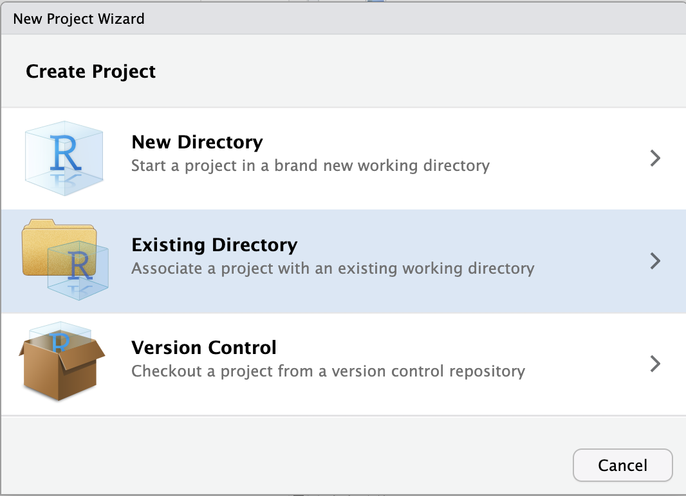{fig-align="center" width="40%"}

</details>

3.  Click **`Browse...`** to select your personal dir.

<details><summary>*Click to see a screenshot*</summary>

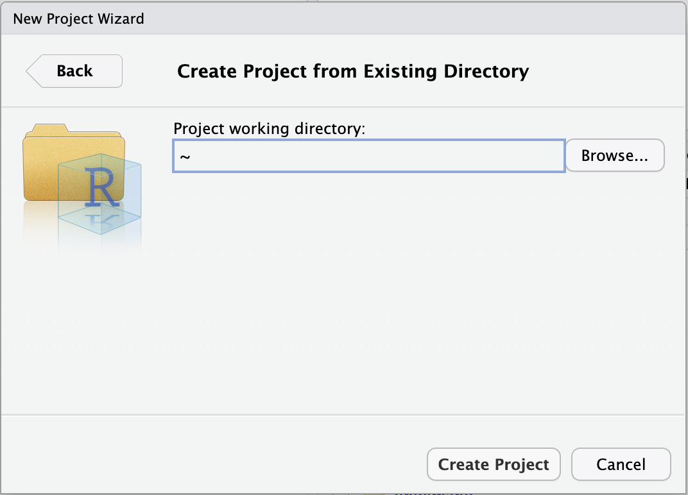{fig-align="center" width="40%"}

</details>

4.  In the next window, you should be in your Home directory (abbreviated as **`~`**),
    from which you can't click your way to `/fs/ess`!
    Instead, you first have to click on the (very small!) **`...`**
    highlighted in the screenshot below:

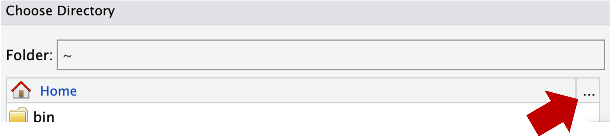{fig-align="center" width="50%"}

5.  Type at least part of the path to your dir in `/fs/ess/PAS3493`,
    e.g. as shown below, and click **`OK`**:

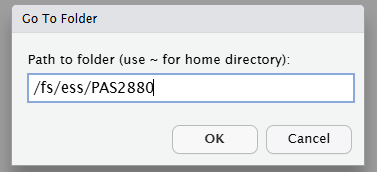{fig-align="center" width="35%"}

6.  Now you should be able to browse/click the rest of the way to your dir
    (`/fs/ess/PAS3493/people/$USER`).
7.  Click **`Choose`** to pick your selected directory.
8.  Click **`Create Project`**.

This will make R restart, which is by design.
When R restarts, all objects are removed from the environment, packages are unloaded,
and so on.
This is a good idea whenever you switch to a different project,
for example to avoid irreproducible carry-over effects.

::: {.callout-tip appearance="simple"}
You'll use this one RStudio Project for all of the course's R material:
each week, you'll create a new folder (`week12`, `week13`, etc.) inside it.
When you start a new RStudio Server session,
RStudio will automatically reopen your project ---
you can check this at the top right of the RStudio window, which shows the project's name.
:::

## Quarto documents

So far, you've typed code directly in the R console.
That is fine for quick checks,
but it's a good idea to write and save most of your code in a file.
This helps you ***keep track of what you've been doing***,
and to rerun your code after changing your input data or some of the code.

You've done this before with shell code:
you've been writing notes and code in Markdown files since week 2,
and in [week 7](../week07/w7b_scripts2.qmd),
some of you used the Quarto extension in VS Code
to send code from `{bash}` code blocks to the terminal.
For R, we'll use a very similar kind of file: a **Quarto document** (`.qmd`).
A Quarto document is a Markdown file with two additions:

- A **YAML header** with settings for the document
- **Code chunks** that are actually _executed_,
  so their output can be included in the document

Quarto can turn ("render") such a document into a nicely formatted HTML file,
or other formats like PDF and Word,
that contains your text, your code, and your code's output:
a fully reproducible record of your analysis.

### Creating a Quarto document

1. In the Files pane (bottom right), click the `New Folder` button
   and create a folder `week12`.

2. Click `File` \> `New File` \> `Quarto Document`:

   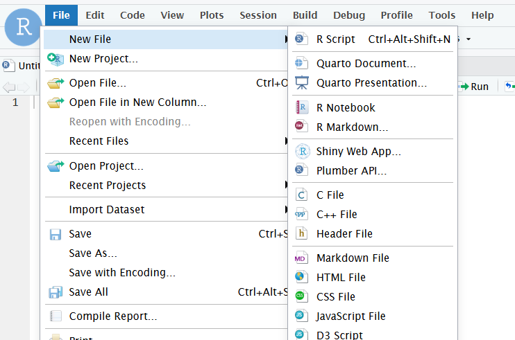{width="70%" fig-align="center"}

3. In the pop-up window, click **`Create Empty Document`** (bottom left).

   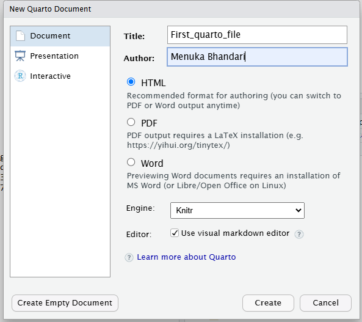{width="50%" fig-align="center"}

4. Save the new file (<kbd>Ctrl</kbd>/<kbd>Cmd</kbd>+<kbd>S</kbd>)
   as `week12a.qmd` inside your `week12` folder.

The file opens in the editor pane in the top left.
_From now on, you'll write your code there instead of directly in the console._

::: callout-important
#### The working directory of a Quarto document
When you run code in a Quarto document, R's working directory is the folder
that contains the document (here, `week12`) --- not your RStudio Project's folder.
Therefore, to refer to files elsewhere in your personal dir,
like the `garrigos` folder, you would use `../garrigos`.
:::

### The YAML header

Type the following at the very top of your `week12a.qmd`:

```yaml
---
title: "Week 12: R basics"
author: "<your name>"
date: 2026-11-09
format:
  html:
    embed-resources: true
---
```

The **YAML header** contains settings for the document,
and is enclosed by two lines with three dashes (`---`):

- Each line contains a `key: value` pair
  (note that there should be a space after the colon).
- Keys can be nested by indenting them with two spaces:
  above, `embed-resources` is an option for the `html` output format.
- `embed-resources: true` will make Quarto put everything,
  including any figures, into a single HTML file,
  so you can download that one file from OSC and open or share it.

::: {.callout-tip appearance="simple"}
Two other useful options are `toc: true` to add a table of contents,
and `theme: <theme-name>` to pick one of
[Quarto's built-in themes](https://quarto.org/docs/output-formats/html-themes.html)
(e.g. `theme: cosmo`).
Like `embed-resources`, these go below `html:`, indented by 4 spaces.
You'll learn more YAML options in [week 14](../week14/w14a_quarto.qmd).
:::

### Code chunks

In Markdown, you've been making code blocks that start with ```` ```bash ````.
In Quarto, you make an executable **code chunk** by adding curly braces
around the language name, as in ```` ```{r} ````:

```{r}
#| echo: fenced
5 + 5
```

You can insert a new chunk with
<kbd>Ctrl</kbd>+<kbd>Alt</kbd>+<kbd>I</kbd>
(Mac: <kbd>Cmd</kbd>+<kbd>Option</kbd>+<kbd>I</kbd>),
or simply type the opening and closing lines.

To **run code** from a chunk:

- Press <kbd>Ctrl</kbd>/<kbd>Cmd</kbd>+<kbd>Enter</kbd>
  to run the line your cursor is on (or the selected lines).
- Click the green "play" button at the top right of the chunk,
  or press <kbd>Ctrl</kbd>/<kbd>Cmd</kbd>+<kbd>Shift</kbd>+<kbd>Enter</kbd>,
  to run the entire chunk.

The code is sent to the console and executed there,
and in RStudio, the output is also shown right below the chunk.

#### Chunk options

You can change how a chunk behaves with **chunk options**:
lines at the top of a chunk that start with `#|`.
For example, this chunk would be shown in the rendered document, but not run:

```{r}
#| echo: fenced
#| eval: false
install.packages("tidyverse")
```

A few useful chunk options:

- `#| eval: false` --- Show the code but don't run it.
- `#| echo: false` --- Run the code and show its output, but hide the code itself.
- `#| warning: false` and `#| message: false` --- Hide warnings and messages,
  such as the ones printed when loading some packages.

::: {.callout-tip appearance="simple"}
Install packages in the console rather than in a chunk.
Otherwise, they will be installed again every time you render the document.
:::

### Markdown text

Everything outside of the YAML header and the code chunks is regular Markdown,
just like in the files you've been writing since
[week 2](../week02/w2d_markdown.qmd).
Use headers to structure your document,
and use text to describe what your code does and why ---
this is where Quarto documents are much more informative than code alone.

### Rendering

To render your document to HTML, click the **`Render`** button
at the top of the editor,
or press <kbd>Ctrl</kbd>/<kbd>Cmd</kbd>+<kbd>Shift</kbd>+<kbd>K</kbd>:

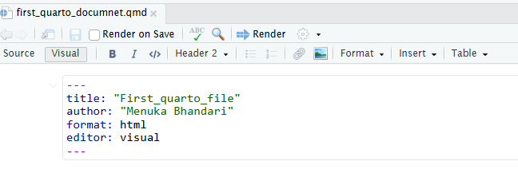{width="50%" fig-align="center"}

This will create a file `week12a.html` next to `week12a.qmd`,
and show a preview of it in the Viewer pane or a new browser tab.

::: callout-important
#### Rendering runs all code in a fresh R session
When you render, Quarto runs all code chunks from top to bottom
in a **new, empty R session**.
This means that:

- Your document only renders if it is self-contained:
  any objects you created only in the console,
  or packages you loaded only in the console, won't exist during rendering.
- If any code produces an error, the document will not render.
  The error message will be shown in the "Background Jobs" tab next to the Console.

This may seem annoying at times,
but it's exactly what makes Quarto documents reproducible.
:::

::: exercise
#### Exercise: Your first Quarto document

1. Make sure your `week12a.qmd` has the YAML header shown above.
2. Add a header `## R basics` and below it, a code chunk with a few lines of code
   from earlier in this lecture,
   and a sentence of Markdown text that explains what the code does.
3. Add a chunk that assigns a value to an object,
   and another chunk below it that uses that object.
4. Render the document and take a look at the HTML output.
5. In the console (_not_ in your document), run `my_number <- 7`.
   Then, add a chunk with `my_number * 2` to your document and render it again.
   What happens, and why?

<!----
   <details><summary>*Click to see a solution*</summary>

   - Steps 1-4: Your document should look something like this:

   ````{.markdown filename="week12a.qmd"}
   ---
   title: "Week 12: R basics"
   author: "Jane Doe"
   date: 2026-11-09
   format:
     html:
       embed-resources: true
   ---

   ## R basics

   R can be used as a calculator:

   ```{{r}}
   5 + 5
   log(20)
   ```

   Assign the value 250 to the object `length_cm`:

   ```{{r}}
   length_cm <- 250
   ```

   Convert this length to inches:

   ```{{r}}
   length_cm / 2.54
   ```
   ````

   - Step 5: The document will not render,
     and the error message will say that the object `my_number` was not found.
     This is because rendering happens in a new R session,
     where only objects created in the document itself exist.
     To fix this, assign `my_number` in a chunk in your document.

  </details>
---->
:::

::: {.callout-note collapse="true"}
#### R scripts _(Click to expand)_

Instead of Quarto documents, you can also write R code in **R scripts** (`.R` files),
which contain only code and comments,
much like the shell scripts you wrote in week 7.
To create one, click `File` \> `New File` \> `R Script`.
Like in Quarto documents,
you can run code from R scripts with <kbd>Ctrl</kbd>/<kbd>Cmd</kbd>+<kbd>Enter</kbd>.

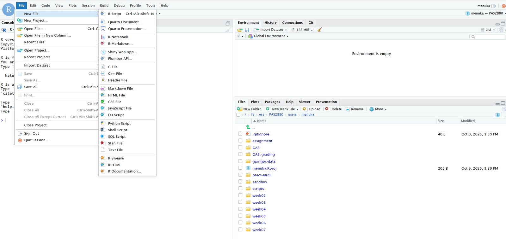{fig-align="center" width="80%"}

R scripts are a good choice for code that you simply want to run
from start to finish, without needing a report with the output:
for example, an R script can be run from the shell with `Rscript my-script.R`,
including in a Slurm batch job.
For your final project, both R scripts and Quarto documents are fine.
:::

## Recap and looking forward

In this lecture, you've learned the basics of working with R and RStudio,
including:

- The RStudio layout and the functions of the different panes and tabs
- How to use R as a calculator, and how to define objects/variables
- How to call R functions and provide arguments to them, by name or by position
- How to install and load R packages
- How to get help in R
- How to use RStudio Projects to keep your work organized and reproducible
- How to write, run, and render R code in Quarto documents

In the self-study section below, you'll learn about vectors and R's main data types.
For that and all later R lectures, you'll write your code in Quarto documents.

## Self-study: Vectors and data types

::: callout-important
#### Self-study
Because there is no class on Wednesday of week 12 (Veteran's Day),
please work through this section, including its exercises, on your own
before the week 13 classes, which build on this material.
Add a header `## Vectors and data types` to your `week12a.qmd`,
and write the code from this section in code chunks below it.
:::

In this section, you'll learn about two of R's nuts and bolts:

- **Data structures** are the kinds of objects that R can store data in.
  Here, you'll learn about the simplest one, the **vector**.
  Next week, you'll learn about the data structure for tabular data, the _data frame_.
- **Data types** are how R distinguishes between different kinds of data,
  like numbers versus character strings.

### Vectors

A vector in R is a collection of one or more items,
which we'll call **elements**.
Vectors can consist of just a single element,
so each of the two lines of code below creates a vector:

```{r}
vector1 <- 8
vector2 <- "panda"
```

In the `"panda"` example, which is a **character string** (_string_ for short):

- `"panda"` constitutes _one element_, not 5 (its number of letters).
- Unlike numbers, strings have to be quoted^[
  Either double quotes (`"..."`) or single quotes (`'...'`) work,
  but the former are more commonly used.].

Recall that anything that is not quoted is interpreted as an object,
like `iris` earlier.
Therefore, the code below doesn't work, because there is no _object_ called `panda`:

```{r, error=TRUE}
vector_fail <- panda
```

A common way to make vectors with **multiple elements** is with the `c()` (combine) function:

```{r}
birds <- c("cardinal", "chickadee", "bald eagle")
birds
```

To make a vector with a **series of whole numbers**, you can use the `:` operator:

```{r}
1:10
```

### Vectorization

Consider the output of this command:

```{r}
numbers <- c(6, 7.5, 9, 10.2)
numbers * 2
```

Above, **every individual element in `numbers` was multiplied by 2**.
This behavior is called "vectorization", and is a key feature of the R language.
(You may have expected this code to _repeat_ `numbers` twice instead,
but that did not happen!)

::: exercise
####  Exercise: Vectorization

What do you think the result of the following operation will be?
We didn't cover this kind of scenario, but go ahead and test your intuition!
After you've decided on your expectation, run the code and check if you were correct.

```{r, eval=FALSE}
1:5 * 1:5
```

<details><summary>*Click to see the solution*</summary>

```{r}
1:5 * 1:5
```

Both vectors are of length 5, which leads to "element-wise matching":
the first element of the first vector is multiplied with the first element of the second vector,
the second element with the second element, and so on.

</details>
:::

### Extracting elements from vectors

Extracting elements from objects like vectors is often called **"indexing"**.
In R, you can do this using square brackets `[ ]` --- for example:

- Get the second element with `[2]`^[
  R starts counting at 1 like humans do, so index 2 is simply the second element.
  Python and several other languages instead start counting at 0.]:

  ```{r}
  numbers[2]
  ```

- Get the second through the fourth elements with `[2:4]`:

  ```{r}
  numbers[2:4]
  ```

- Get the first and third elements with `[c(1, 3)]`:

  ```{r}
  numbers[c(1, 3)]
  ```

In other words, you extract elements from a vector by using _another vector_,
whose values are the positions of the elements in the original vector.

To _change_ an element, put the brackets on the left side of the assignment arrow:

```{r}
numbers[1] <- 30
numbers
```

::: {.callout-tip appearance="simple"}
R has many functions to get information about vectors,
like `length()` to get the number of elements,
and `mean()` to compute the mean of numbers.
For more, see the [optional R self-study page](../bonus/r.qmd#exploring-vectors).
:::

### Data types

R distinguishes between different kinds of data, such as character strings and numbers,
using several pre-defined "data types".
R's behavior depends heavily on the data type --- for example, the below fails:

```{r, error=TRUE}
"panda" * 5
```

You can ask what type of data something is with the `typeof()` function:

```{r}
typeof("panda")
```

R set the data type of `"panda"` to `character`, i.e. a (character) string.
The earlier command failed because R can't perform mathematical operations
("_binary operator_") on vectors of type `character` ("_non-numeric argument_").

Anything that is placed between quotes is a `character` --- even plain numbers:

```{r}
typeof("5")
```

Besides `character`, the three other **common data types** are:

- `double` / `numeric` --- numbers that can have decimal points:

  ```{r}
  typeof(3.14)
  ```

- `integer` --- whole numbers only:

  ```{r}
  typeof(1:3)
  ```

- `logical` --- either `TRUE` or `FALSE` (unquoted!):

  ```{r}
  typeof(TRUE)
  ```

Here is an overview in table format,
including the abbreviations you'll often see in R output:

| Data type            | Abbreviation  | Explanation                          |
|----------------------|---------------|--------------------------------------|
| `double` / `numeric` | `dbl` / `num` | Numbers that can have decimal points |
| `integer`            | `int`         | Whole numbers                        |
| `character`          | `chr`         | Character strings                    |
| `logical`            | `lgl`         | `TRUE` or `FALSE`                    |

: {.striped .hover}

### Comparing things

You'll often get `logical`s by **comparing** things.
For example:

- Greater than and less than:

  ```{r}
  8 > 3
  2 < 1
  ```

- Equal to or not equal to ---
  don't forget to use **two** equals signs `==` for the former:

  ```{r}
  7 == 7
  # The exclamation mark in general is a "negator"
  10 != 5
  ```

Comparisons are vectorized too,
and logicals can be used as if they were numbers,
where `TRUE` represents 1 and `FALSE` represents 0.
Together, this provides an easy way to _count_ how many elements meet a condition:

```{r}
numbers
numbers > 9
sum(numbers > 9)
```

Here are the most common comparison operators in R:

| **Operator** | **Description**          | **Example**              |
|--------------|--------------------------|--------------------------|
| `>`          | Greater than             | 5 \> 6 returns `FALSE`   |
| `<`          | Less than                | 5 \< 6 returns `TRUE`    |
| `==`         | Equal to                 | 10 == 10 returns `TRUE`  |
| `!=`         | Not equal to             | 10 != 10 returns `FALSE` |
| `>=`         | Greater than or equal to | 5 \>= 6 returns `FALSE`  |
| `<=`         | Less than or equal to    | 6 \<= 6 returns `TRUE`   |

: {.striped .hover}

### A vector can only contain one data type

A vector can only be composed of **a single data type**.
As you saw above, R silently picks the "best-fitting" data type when you create a vector.

::: exercise
####  Exercise: Data types

In each line below, what do you think the data type (if any) will be?
Try it out and see if you were right.

```{r, eval=FALSE}
typeof("TRUE")
typeof(banana)
typeof(c(2, 6, "3"))
```

<details><summary>*Click to see the solutions*</summary>

1. `"TRUE"` is `character` (and not `logical`) because of the quotes around it:

   ```{r}
   typeof("TRUE")
   ```

2. This returns an error because the object `banana` does not exist.
   Any unquoted string (that is not a special keyword like `TRUE` and `FALSE`)
   is interpreted as a reference to an object.

   ```{r, error=TRUE}
   typeof(banana)
   ```

3. This produces a `character` vector, and we'll talk about why next:

   ```{r}
   typeof(c(2, 6, "3"))
   ```

</details>
:::

R's behavior of returning a character vector for `c(2, 6, "3")` is called **type coercion**:
when you combine a mix of data types (here, numbers and strings) into a single vector,
R forces them all to be the same type,
because a vector can only contain a single data type.
Type coercion can be the source of many surprises,
and is one reason you need to be aware of R's data types.

You can also convert vectors yourself using the `as.` group of functions:

```{r}
as.integer(c("0", "2"))
as.character(c(0, 2))
```

But not all conversions are possible ---
for example, R can't turn `"kiwi"` into a number,
so it returns a **missing value** (`NA`) instead, with a warning:

```{r}
as.double(c("4", "kiwi"))
```

### Missing values (`NA`)

That `NA` brings us to R's concept of **missing data**,
which is important in statistical computing,
as not all measurements are always available for each sample.
`NA` is not a character string, so like `TRUE` and `FALSE`, it is not quoted:

```{r}
vector_NA <- c(1, 3, NA, 7)
vector_NA
```

Many functions that operate on vectors will return `NA` if **any** element is `NA`:

```{r}
sum(vector_NA)
```

You can get around this by setting `na.rm = TRUE` ("remove `NA`s") in such functions:

```{r}
sum(vector_NA, na.rm = TRUE)
```

### Self-study recap

- A vector is a collection of elements of the same data type,
  which you can create with e.g. `c()` or `:`.
- Operations on vectors are vectorized: they happen for each element.
- You can extract and change elements of vectors with `[ ]`.
- R's four main data types are `character`, `double`, `integer`, and `logical`.
  Mixing types in a vector causes automatic coercion.
- Missing values are coded as `NA`;
  use `na.rm = TRUE` to ignore them in functions like `sum()` and `mean()`.

