--------------------------------------------------------------------------------

<hr style="height:10pt; visibility:hidden;" />

## Introduction

### Overview and learning goals of the course's R material

This is the first of a four-week series that will focus on the R language.
R is a great all-round tool for data analysis and visualization.
On top of that, R is probably the best environment for the "downstream" analysis
of omics data,
with an excellent array of packages for RNA-seq, metabarcoding, proteomics,
metabolomics and many other types of data.

Specifically, you will learn:

- The basics of R, and how to write R code in Quarto documents (**this lecture**)
- How data is stored in R, using e.g. vectors and different data types,
  and how to work with tabular data (week 13)
- How to visualize data with the ggplot2 package (week 13)
- How to use Quarto to produce beautiful, reproducible documents (week 14)
- Examples of omics data analysis in R: RNA-seq count data and metabolomics data (week 15)

### Lecture learning goals

In this lecture, you will learn:

- The Positron layout and the functions of its different regions and panes
- The basics of interacting with R by using R as a calculator
- Defining variables/objects in R, and assigning values/data to them
- Calling R functions
- Installing and loading R packages
- Getting help in R
- Why you should open a folder in Positron rather than changing R's working directory
- Writing, running, and rendering R code in a Quarto document

### Setup: starting Positron and connecting to OSC

While you can use R with a "console" that can simply be run inside the terminal,
we'll use an IDE called
[Positron ](https://positron.posit.co){target="_blank"},
which makes working with it much more pleasant!
You installed Positron and set up a connection to OSC in the
[previous lecture](./w12a_positron-setup.qmd).

1. **Open Positron** on your computer.
2. On the Welcome tab, under "**Recent**", click on your personal folder at OSC:

   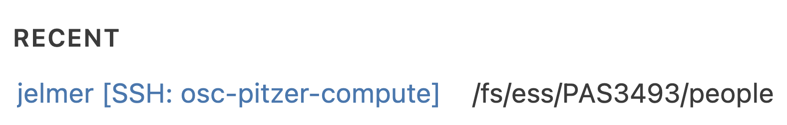{fig-align="center" width="70%" .lightbox fig-alt="Screenshot of the Positron Welcome tab showing the Recent folder."}

   ::: legend2
   The `[SSH: osc-pitzer-compute]` part tells you this folder is a remote rather
   than a local folder.
   :::

3. Positron will **connect** to an OSC compute node, which may take a little while.

4. Once connected, click on the **Console tab** (next to the Terminal tab) and make
   sure there's an active R session (the R version and other messages should be visible).

## Positron's layout

Because Positron is built on VS Code, much of it should look familiar,
but it adds some important components for what we may call **interactive data science**
work: running code line by line in a live R session,
and seeing the resulting objects, plots, and documentation right away.

The Positron window has the same five main regions as VS Code:

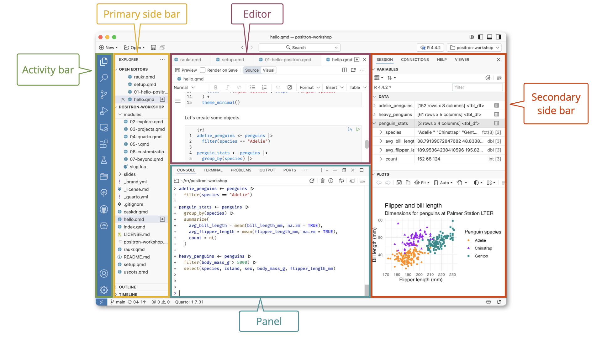{.no-border fig-align="center" width="100%" fig-alt="Diagram of the Positron interface, with the five regions labeled: Editor, Panel, Activity Bar, Primary Side Bar, Secondary Side Bar."}

But some of these regions have panes that aren't in VS Code,
which are highlighted in **bold** in the table below:

| Region                 | Where           | What's in it                                                   |
| ---------------------- | --------------- | -------------------------------------------------------------- |
| Editor             | Center (top)    | Open scripts and other documents, in tabs                      |
| Panel              | Center (bottom) | **R Console** and Terminal                                     |
| Activity Bar       | Far left        | Icons that switch what the Primary Side Bar shows            |
| Primary Side Bar   | Left            | Explorer (files), Search, Source Control, Extensions, **Packages** |
| Secondary Side Bar | Right           | **Variables**, **Plots**, **Help**, **Viewer**, **History**            |

: {.striped tbl-colwidths="[20, 18, 62]"}

<hr style="height:1pt; visibility:hidden;" />

Compared to VS Code, the most important additions are:

- The **Console**, where you can type and execute R code.
  It's a tab next to the Terminal, in the bottom panel.
- The **Variables** pane,
  which shows you all the objects that are active in your R environment.
- The **Plots** and **Help** panes,
  which show the plots you make and R's documentation, respectively.
- The **interpreter picker** at the top right,
  which shows the version of R that your Console is using.

Like in VS Code, you can resize all panes, and drag them to other locations.
(If you make a mess of things,
you can get back to the default layout with the _View: Reset View Locations_
command in the Command Palette.)

## Interacting with R

You can do many things in R:
data manipulation, data visualization, statistical analysis, machine learning and more.
Here, to get some familiarity with working in R, we will start by simply using R as a calculator.

### R as calculator

Type `5 + 5` in the console and press <kbd>Enter</kbd>:

```{r}
5 + 5
```

R will print the result of the calculation, `10`.
The `[1]` before the result is the **position (index)** of the first value on that line.
This is helpful when R prints many values that span multiple lines.

Two more examples, using multiplication and division, respectively:

```{r}
6 * 8
40 / 5
```

This code will work with (as shown above) or without (`5+5`) spaces around
operators like `+`, but it is **good practice to leave spaces** to improve the
readability of your code.

::: {.callout-note collapse="true"}
#### Additional examples and order of operations _(Click to expand)_

- Exponents:

  ```{r}
  3 ^ 4
  ```

- Parentheses can be used to change the default order of operations:

  ```{r}
  (5 + 3) * 2
  ```

  ```{r}
  # Without parentheses, multiplication happens first
  5 + 3 * 2
  ```

When using R as a calculator,
the order of operations is the same as you would have learned back in school.
From highest to lowest precedence:

- Parentheses: `(`, `)`
- Exponents: `^` or `**`
- Multiplication and division: `*`, `/`
- Addition and subtraction: `+`, `-`

Operators with the same precedence are evaluated from left to right.
:::

### The R prompt

The `>` sign in your console is the R prompt,
indicating that R is ready for you to type something
(this is equivalent to the `$` Bash prompt that you are used to).

Also just like in Unix shell, when you are **not seeing** the `>` prompt,
R is either **busy** (because you asked it to do a longer-running computation)
or **waiting** for you to complete an incomplete command.

If your prompt turned into a `+`, you typed an incomplete command. For example:

```{r, eval=FALSE}
10 /
```
```r-out
+
```

And once again like in the Unix shell,
you can either try to finish the command or abort it.
In Positron's console, you can abort with <kbd>Ctrl</kbd>+<kbd>C</kbd>
(also on a Mac) --- let's practice that here.

### Adding comments to your code

Comments are also just like in the Unix shell ---
use `#` signs to comment your code, both inline and on separate lines:

```{r}
# This line is entirely ignored by R
10 / 5 # This line contains code but everything after the '#' is ignored
```

## Functions in R

### Basics of functions

To do almost anything in R, you'll use **functions**,
which are the equivalent of shell _commands_.
R comes with thousands of functions that serve many different purposes,
and many more are available in over 20,000 add-on packages.

You can recognize function calls by the **parentheses** `()`.
For example, the equivalent to the Shell's `pwd` command is the `getwd()` function:

::: {.columns}
::: {.column width="48%"}

```r
# In R
getwd()
```
```r-out
[1] "/fs/ess/PAS3493/people/jelmer"
```

:::
::: {.column width="4%"}

:::
::: {.column width="48%"}

<div style="height: 6px;"></div>

```{.bash .norun}
# In the Unix shell
pwd
```
```bash-out
/fs/ess/PAS3493/people/jelmer
```

:::
:::

Inside those parentheses, you can provide **arguments** to a function.
But just like with shell commands, whether you need to provide arguments,
and what they are, depends on the function.
With `dir.create()`, the equivalent to the Shell's `mkdir`,
the required argument is the directory you want to create:

::: {.columns}
::: {.column width="48%"}

```r
dir.create("week12")
```

:::
::: {.column width="4%"}

:::
::: {.column width="48%"}

<div style="height: 10px;"></div>

```{.bash .norun}
mkdir week12
```

:::
:::

And with `setwd()`, the equivalent to the Shell's `cd`,
the required argument is the directory you want to switch to:

::: {.columns}
::: {.column width="48%"}

```r
setwd("week12")
```

```r
getwd()
```
```r-out
[1] "/fs/ess/PAS3493/people/jelmer/week12"
```

:::
::: {.column width="4%"}

:::
::: {.column width="48%"}

<div style="height: 10px;"></div>

```{.bash .norun}
cd week12
```

:::
:::

Two differences to note between the Shell and R:

1. The argument goes **inside the parentheses** in R,
   instead of after the command in the Shell.
2. Unlike in the Shell, **paths need to be quoted** in R^[
   This is because R interprets anything that isn't quoted as the name of
   an "object", like a variable (more about this later).].

### More on function arguments

The `round()` function rounds numbers, by default to whole numbers.
For example, it rounds `6.53` to `7`:

```{r}
round(6.53)
```

In most functions, including `round()`, arguments have **names** that can be used.
For example, the argument to `round()` that represents the number to be rounded
has the name `x`, so you can also use the code below.

(Like in the shell, pressing the **up arrow** <kbd>↑</kbd> puts the previous
command back in the prompt --- try that, and then edit the command.)

```{r}
round(x = 6.53)
```

#### Using multiple arguments

Naming arguments, like in the example above,
is especially helpful to avoid confusion when you pass multiple arguments to a function.
For example, we can change `round()`'s default behavior of rounding to zero digits
(whole numbers) with the optional argument `digits`:

```{r}
round(x = 6.53, digits = 1)
```

(Note that when you use multiple arguments, they are separated by a comma, `,`.)

You _could_ choose not to name these arguments, but that isn't as easy to understand:

```{r}
round(6.53, 1)
```

Moreover, when you name arguments, you can give them in **any order** you want:

```{r}
round(digits = 1, x = 6.53)
```

#### Another comparison to the Shell

Named arguments in R are similar to options in the Shell.
For example, the equivalent to the Shell's `head` is `head()`,
and like the former has a `-n` option, the latter has an `n` argument:

::: {.columns}
::: {.column width="58%"}

```{r}
head(iris, n = 5)
```

:::
::: {.column width="4%"}

:::
::: {.column width="38%"}

```{.bash .norun}
head -n 5 metadata.tsv
```

:::
:::

_(Where did `iris` come from? It is one of several built-in datasets in R.)_

::: {.callout-note collapse="true"}
#### Terminology: options, arguments, and commands in the shell vs. R _(Click to expand)_

**Options and arguments**

- In the Shell, you learned to distinguish options (like `-n 5`),
  which change _how_ a command operates, from arguments (like `metadata.tsv`),
  which tell it _what_ to operate on.
- R doesn't make this distinction:
  everything you put inside a function's parentheses is an argument.
  So in `head(iris, n = 5)`, both `iris` and `n = 5` are arguments.

**Command**

- In the Shell, the term command can refer either to a program like `head`
  or to a full line of code like `head -n 5 metadata.tsv`.
- In R, something like `head()` is always called a function,
  while "command" refers only to a full line of code like `head(iris, n = 5)`.
:::

### Help information on functions

#### Help pop-ups in the console

When typing the above code, you've probably seen **automatic help pop-ups**
appear several times.

For example, you can usually see which arguments a function takes by pausing after
you type the function and its opening parenthesis, e.g. `round(`:
Positron will show a pop-up with the function's arguments,
and a short description of its first argument:

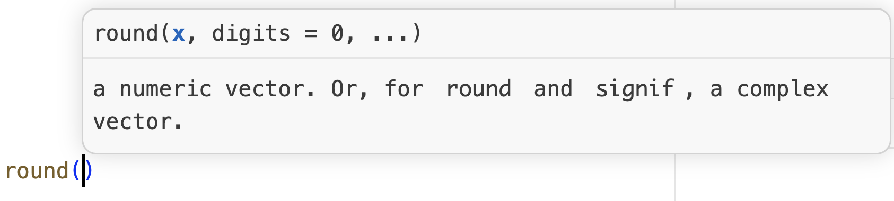{fig-align="center" width="75%" .lightbox fig-alt="Screenshot of the Positron console showing the round() function and its arguments."}

And when you pause at a different argument,
you should see help about _that_ argument:

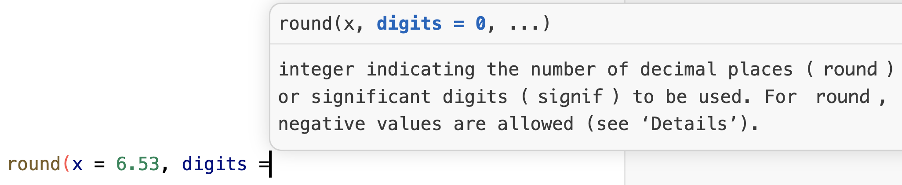{fig-align="center" width="75%" .lightbox fig-alt="Screenshot of the Positron console showing the round() function and its arguments."}

Admittedly, some of the language used in this help information can be hard to
understand, especially as a beginner.

#### Help pages

::: {.columns}
::: {.column width="45%"}

You may want to see more extensive information on how a function works and
what arguments it takes.
The `help()` function and `?` help operator in R offer access to documentation pages
for R functions (as well as datasets and some other objects).
For example:

```r
# Note: no parentheses here (this isn't a function *call*)!
?setwd
```

The output should appear in the **Help** pane in the Secondary (right-hand) Side Bar,
and look something like what's shown in the screenshot on the right.

Note that this help page covers both `setwd()` and `getwd()`
(for more about help pages, see the box below).

:::
::: {.column width="55%"}

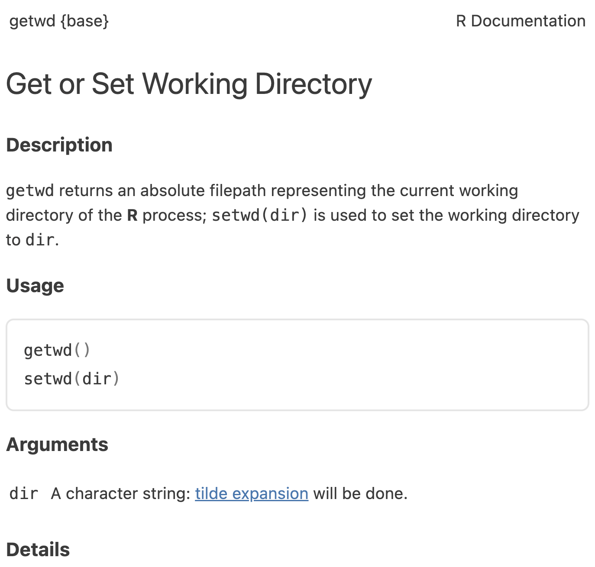{fig-align="center" width="93%" .lightbox fig-alt="Screenshot of the Positron Help pane showing the help page for setwd()."}

:::
:::

::: {.callout-tip appearance="simple"}
When you're writing code in the editor,
you can also open a function's help page by putting your cursor on the function name
and pressing <kbd>F1</kbd>.
:::

::: {.callout-note collapse="true"}
#### Reading a more complicated help page: `?round` _(Click to expand)_
The help page for `setwd()` is about as simple as they get.
Most help pages are more complicated,
as you can see with `round()`:

```r
?round
```

A few things you'll run into:

- **Default values** ---
  `digits = 0` in the Usage section means that `digits` has a default value of `0`,
  which is used when you don't provide this argument.
  That's why `round(6.53)` rounded to a whole number.

- **Multiple functions on one page** ---
  Related functions often share a help page.
  The page for `round()` also covers `ceiling()`, `floor()`, `trunc()`, and `signif()`,
  so look for the line with your function in the Usage section.

- **The `...` argument** ---
  This is described as "arguments to be passed to methods",
  which you can ignore for now.

- **Technical language** ---
  Help pages are written to be precise rather than beginner-friendly.
  Don't worry about understanding everything:
  it's often most useful to look at the *Arguments* section,
  and the *Examples* section at the bottom of the page.

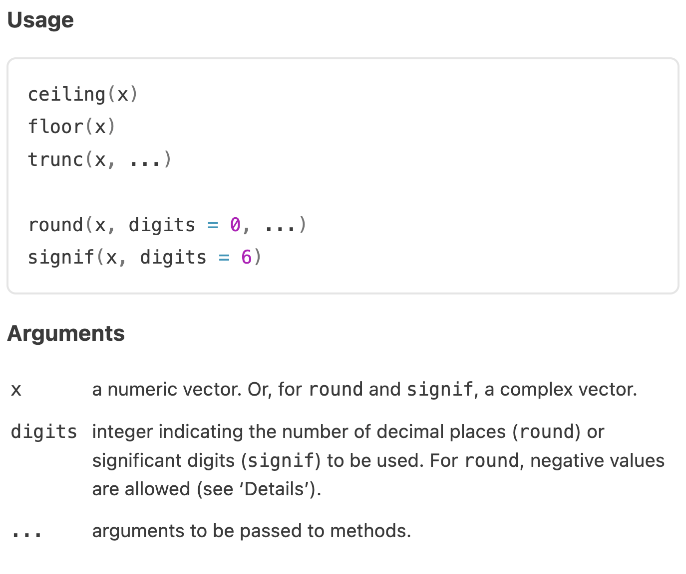{fig-align="center" width="60%" .lightbox fig-alt="Screenshot of the Positron Help pane showing the help page for round()."}

::: legend2
Part of the R help page for `round()`.
:::

:::

## R objects

### Assigning stuff to objects

In the Shell, we've assigned values to variables with `=`, like `x=1`.
While this is possible in R too, the customary and recommended
**"assignment operator"** is `<-` (`x <- 1`):

- This is a smaller-than sign <kbd><</kbd> followed by a hyphen <kbd>-</kbd>.
- You can also use the keyboard shortcut <kbd>Option</kbd>+<kbd>-</kbd> (Mac)
  or <kbd>Alt</kbd>+<kbd>-</kbd> (Windows).

For example:

::: {.columns}
::: {.column width="48%"}

```{r}
# In R
length_cm <- 250
```

:::
::: {.column width="4%"}

:::
::: {.column width="48%"}

<div style="height: 12px;"></div>

```{.bash .norun}
# In the shell
length_cm=250
```

:::
:::

Just like in the shell, `length_cm` can be called a **variable**.
In R, though, you'll more often hear the general term **object**,
because R objects can take on many forms,
including more complicated things like tables.

To see the contents of an object, you can use the `print()` function,
as the equivalent of `echo` in the Unix shell:

::: {.columns}
::: {.column width="48%"}

```{r}
print(length_cm)
```

:::
::: {.column width="4%"}

:::
::: {.column width="48%"}

<div style="height: 15px;"></div>

```{.bash .norun}
echo "$length_cm"
```
```bash-out
250
```

:::
:::

However, in R you can **omit** `print()` and simply type an object's name:

::: {.columns}
::: {.column width="48%"}

```{r}
length_cm
```

:::
::: {.column width="4%"}

:::
::: {.column width="48%"}

:::
:::

Importantly, you can use objects as if you had typed their values directly:

::: {.columns}
::: {.column width="48%"}

```{r}
length_cm / 2.54
```

:::
::: {.column width="4%"}

:::
::: {.column width="48%"}

:::
:::

<hr style="height:1pt; visibility:hidden;" />

In the **Variables** pane
(in the "SESSION" tab of the Secondary Side Bar),
take a look at the "VALUES" section:
`length_cm` should now be listed there, along with its contents (value):

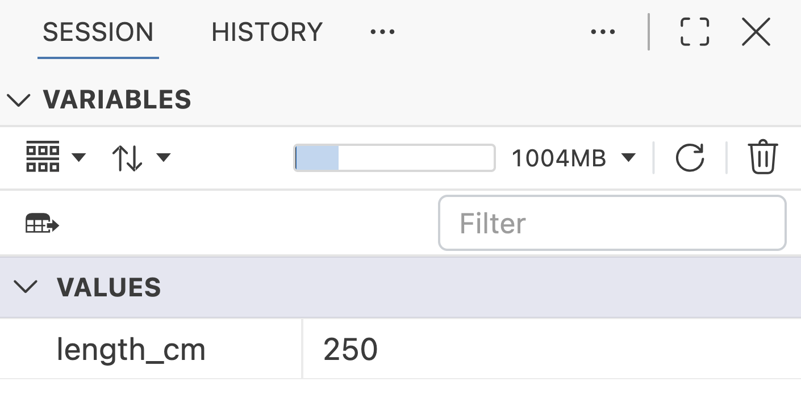{fig-align="center" width="65%" .lightbox fig-alt="Screenshot of the Positron Variables pane showing the length_cm object."}

### Object names

The rules for object names in R are much like those for shell variable names:

- Names are case sensitive: `length_inch` is different from `Length_Inch`.
- Names can contain numbers but can't start with one: `x2` is valid but `2x` is not.
- Names can't contain spaces.
  To separate words, use underscores (`length_inch`, "snake case")
  or capitalization (`lengthInch`, "camel case").
  Unlike in the shell, periods are also allowed (`length.inch`).

As in the shell, aim for names that are descriptive but not too long,
and stick to one style, such as snake case.

::: {.callout-tip appearance="simple"}
As you type an object or function name,
Positron suggests matching names in a pop-up,
and you can press <kbd>Tab</kbd> to accept a suggestion.
Like Tab completion in the shell, this saves typing and avoids typos.
:::

::: exercise
####  Exercise 1: Assigning objects in R

1. Run `num_1 <- 20` and `num_2 <- 15`.
   Now predict what each of the following three lines will print,
   then run them one by one to check:

   - `num_1 - num_2`
   - `difference <- num_1 - num_2`
   - `Num_1 + num_2`

<!----
   <details><summary>*Click to see a solution*</summary>

   ```{r}
   num_1 <- 20
   num_2 <- 15
   ```

   ```{r}
   num_1 - num_2
   ```

   ```{r}
   difference <- num_1 - num_2
   ```

   ```{r, error=TRUE}
   Num_1 + num_2
   ```
  </details>
---->

2. One of the three lines above produced no output, and one produced an error.
   Explain both.

<!----
   <details><summary>*Click to see a solution*</summary>

   - `difference <- num_1 - num_2` produces no output, because **assignment
     doesn't print**: the result is stored in `difference` instead of being
     printed to the console. (You could check its value by simply typing
     `difference` on the next line.)

   - `Num_1 + num_2` produces an error (_object 'Num_1' not found_), because
     R is **case sensitive**: we only ever defined `num_1` (lowercase), not
     `Num_1`, so R doesn't know what `Num_1` refers to.

  </details>
---->

3. Run `length_inch <- length_cm / 2.54`, and then `length_cm <- 100`.
   Do you think the value of `length_inch` changed when you changed `length_cm`?
   Check by printing `length_inch`.

<!----
   <details><summary>*Click to see a solution*</summary>

   ```{r}
   length_inch <- length_cm / 2.54
   length_cm <- 100
   length_inch
   ```

   No, `length_inch` did not change: it is still 250 / 2.54.
   R calculated `length_cm / 2.54` once, when you ran that line,
   and stored only the result in `length_inch`.
   So, unlike a formula in a spreadsheet,
   `length_inch` doesn't change when you change `length_cm`.

   (Also note that `length_cm <- 100` simply overwrote the earlier value of `length_cm`,
   without any warning.)

  </details>
---->
:::

## R packages

R packages are basically add-ons or extensions to the functionality of the R language.

- The function `install.packages()` **installs** an R package.
  This is a one-time operation, also at OSC (see below).

- The function `library()` will **load** an R package in your current R session.
  Every time you want to use a package in R, you need to load it,
  just like every time you want to use an OSC module in the Shell, you need to load it.

For example, for the _RColorBrewer_ package with color palettes for plots:

```{r eval=FALSE}
install.packages("RColorBrewer")
```
```r-out
Installing package into ‘/users/PAS0471/jelmer/R/rhel9/4.6.1’
(as ‘lib’ is unspecified)
trying URL 'https://cran.rstudio.com/src/contrib/RColorBrewer_1.1-3.tar.gz'
Content type 'application/x-gzip' length 11638 bytes (11 KB)
==================================================
downloaded 11 KB

* installing *source* package ‘RColorBrewer’ ...
** this is package ‘RColorBrewer’ version ‘1.1-3’
** package ‘RColorBrewer’ successfully unpacked and MD5 sums checked
** using staged installation
** R
** inst
** byte-compile and prepare package for lazy loading
** help
*** installing help indices
** building package indices
** testing if installed package can be loaded from temporary location
** testing if installed package can be loaded from final location
** testing if installed package keeps a record of temporary installation path
* DONE (RColorBrewer)

The downloaded source packages are in
	‘/tmp/RtmpxMR47K/downloaded_packages’
```

```{r}
# This should not produce any output
library(RColorBrewer)
```

Now, you can use the package's functions,
like `display.brewer.all()`, which plots all of its color palettes
(the plot should appear in the **Plots** pane):

```{r, fig.height=7}
display.brewer.all()
```

At OSC, packages will by default be installed into a standard location in
your **Home directory**,
so they remain available regardless of what your working directory is,
or what OSC project you are using^[This works equivalently on your own computer.].

However, packages are installed **separately** for each R version
that differs in its first two numbers
(e.g. 4.5 versus 4.6, but not 4.6.0 versus 4.6.1)^[
  Therefore, when you switch to such a different R version, you will start over with
  package installation. This, too, works the same with R on your own computer.].

## Working directory and opening a folder

Instead of changing your working directory with `setwd()`,
it is better to **open a folder** in Positron, like you've been doing in VS Code,
and like you did with your personal dir in the previous lecture.
When you open a folder,
Positron makes it R's working directory, and starts a fresh R session.

Earlier, you changed your working dir to `week12` with `setwd()`.
To get back to the folder you opened,
restart R by clicking the restart button at the top of the Console^[
  You can also use the keyboard shortcut <kbd>Shift</kbd>+<kbd>Cmd</kbd>+<kbd>0</kbd> (Mac)
  or <kbd>Shift</kbd>+<kbd>Ctrl</kbd>+<kbd>0</kbd> (Windows).]
--- the circular arrow highlighted in this screenshot:

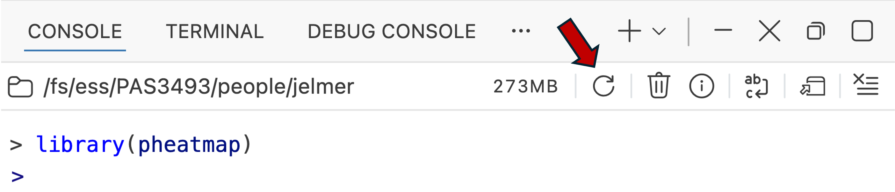{fig-align="center" width="75%" .lightbox fig-alt="Screenshot of the top of the Positron Console, with an arrow pointing to the circular restart button."}

::: legend2
Click the circular arrow to restart R.
:::

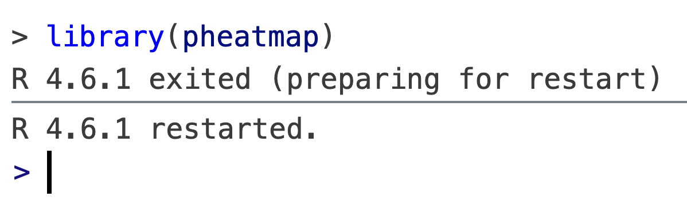{fig-align="center" width="55%" .lightbox fig-alt="Screenshot of the Positron Console showing the messages 'R 4.6.1 exited (preparing for restart)' and 'R 4.6.1 restarted.'"}

Then, run `getwd()` to check that your working directory is your personal dir again:

```r
getwd()
```
```r-out
[1] "/fs/ess/PAS3493/people/jelmer"
```

Working this way builds on earlier course material, and has several advantages:

- **One folder per project**
  ([week 2](../week02/w2a_project-org.qmd)):
  opening a project's folder automatically makes it your working directory.
- **Relative paths**
  ([week 11](../week11/w11a_data-mgmt.qmd)):
  relative paths can start from your project's top-level folder,
  so they keep working when you move or share the project.
- **Clean R sessions**: switching folders, or restarting R, starts a new R session,
  which removes all objects and unloads all packages.
  This helps to avoid irreproducible carry-over effects.

::: {.callout-note collapse="true"}
#### Have you used RStudio before? Compare "Open Folder" with RStudio Projects _(Click to expand)_
In RStudio, the equivalent of opening a folder is using an "RStudio Project",
which creates a `.Rproj` file in the project's folder.
If you open a folder with an `.Rproj` file in Positron,
Positron simply ignores that file,
so a folder can work both as an RStudio Project and in Positron.
:::

## Quarto documents

So far, you've typed code directly in the R console.
Like in the shell, that is fine for quick checks,
but it's a good idea to write and save most of your code in a file.
This helps you **keep track** of what you've been doing,
and to rerun your code after changing your input data or some of the code.

In the shell, we've been combining notes and code in Markdown files.
For R, we'll use a very similar kind of file: a **Quarto** document (`.qmd`).
A Quarto document is **a Markdown file with two additions**:

- A **YAML header** with settings for the document
- **Code chunks** that are actually _executed_,
  so their output can be included in the document

Quarto can turn ("render") such a document into a nicely formatted HTML file,
or other formats like PDF and Word,
that contains your text, your code, and your code's output:
a fully reproducible record of your analysis.

### Creating a Quarto document

We'll create a new document in Positron's terminal:

1. Switch to the **terminal tab** in the bottom panel.

2. In the terminal, create a new Quarto document:

   ```bash
   touch week12/week12a.qmd
   ```

3. Open the file using the Explorer, or with the terminal
   <kbd>Ctrl</kbd>/<kbd>Cmd</kbd>-click method you know from VS Code.


::: {.callout-tip appearance="simple"}
You can also use one of the New file buttons (similar to VS Code),
but I wanted to emphasize that you can (and should) also use a Terminal in Positron!
:::

### The YAML header

Type the following at the very top of your `week12a.qmd`:

```yaml
---
title: "Week 12: R basics"
author: "<your name>"
date: 2026-11-09
---
```

The YAML header contains **settings** for the document, and:

- Is enclosed by two lines with three dashes (`---`)
- Has one `key: value` pair per line
  (with a space after the colon)

There are many more YAML options, some of which you'll learn about in
[week 14](../week14/w14a_quarto.qmd#yaml-header).

::: callout-note
#### Saving your file changes

<div style="height: 3px;"></div>

::: {.columns}
::: {.column width="54%"}

Unlike in (our version of) VS Code,
file changes are **not auto-saved** by default in Positron.
When you have unsaved changes, a large dot appears next to the file name,
and you can press the disk icon ()
or <kbd>Cmd/Ctrl</kbd>+<kbd>S</kbd> to save your changes.

-----

If you want to **change this setting**, go to the Positron settings
( > Settings) and search for "Auto Save":

:::
::: {.column width="46%"}

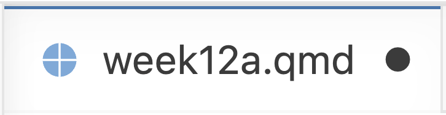{fig-align="center" width="90%" .no-border .lightbox fig-alt="Screenshot of an editor tab for week12a.qmd, with a dot next to the file name indicating unsaved changes."}

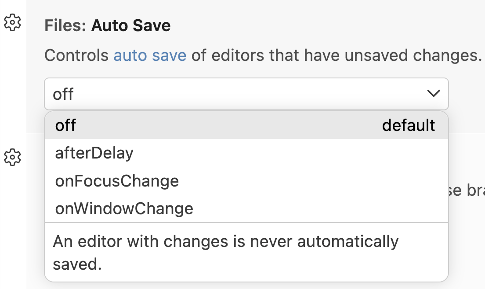{fig-align="center" width="100%" .no-border .lightbox fig-alt="Screenshot of the Files: Auto Save setting, with a dropdown showing the options off (the default), afterDelay, onFocusChange, and onWindowChange."}

:::
:::

:::

### Markdown text

In a Quarto document, everything outside of the YAML header and the code chunks is
**regular Markdown**, just like in the Markdown files you've been writing in this course.

So, you can use headers to structure your document,
and regular text to describe what your code does and why ---
this is how Quarto documents can be much more informative than code alone.

Add a header and a sentence below your YAML header,
so that your entire document now looks like this:

```{.markdown .file filename="week12a.qmd"}
---
title: "Week 12: R basics"
author: "<your name>"
date: 2026-11-09
---

## R as a calculator

R can be used as a calculator, for example to add numbers:
```

### Code chunks

In Markdown, you've been making code blocks that start with ```` ```bash ````.
In Quarto, you make an **executable code chunk** by adding **curly braces**
around the language name, as in ```` ```{r} ````.

You can insert a new chunk with
<kbd>Ctrl</kbd>/<kbd>Cmd</kbd>+<kbd>Shift</kbd>+<kbd>I</kbd>,
or simply type the opening and closing lines.
Add a chunk to your document:

````{.markdown .file filename="week12a.qmd"}
---
title: "Week 12: R basics"
author: "<your name>"
date: 2026-11-09
---

## R as a calculator

R can be used as a calculator, for example to add numbers:

```{{r}}
5 + 5
```
````

::: {.columns}
::: {.column width="50%"}

If you want to run code that's in a code chunk, you have the option to either run the:

- **Line your cursor is on (or the selected lines)**
  by pressing <kbd>Ctrl</kbd>/<kbd>Cmd</kbd>+<kbd>Enter</kbd>

- **Entire chunk** by clicking `Run Cell` just above the chunk^[
  Or pressing <kbd>Ctrl</kbd>/<kbd>Cmd</kbd>+<kbd>Shift</kbd>+<kbd>Enter</kbd>.]

Either way, the code is sent to the Console and executed there,
and its output is shown in the Console too:

:::
::: {.column width="50%"}

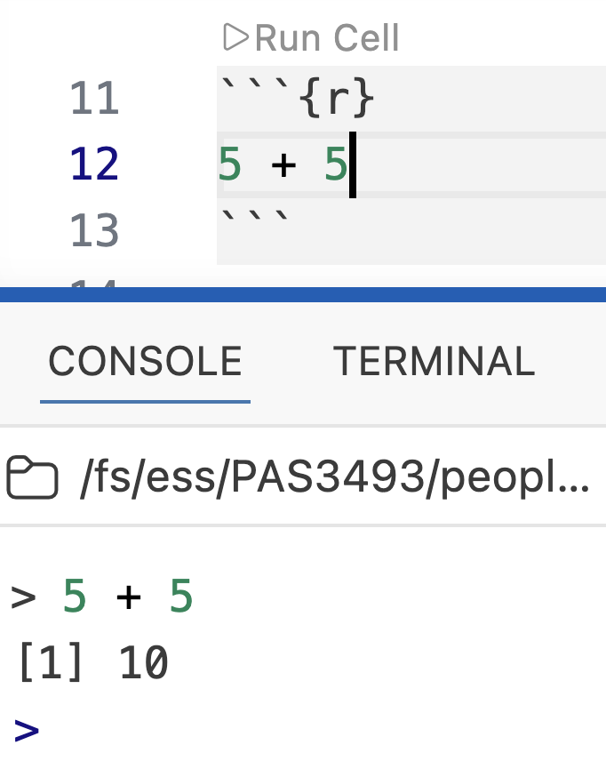{fig-align="center" width="80%" .lightbox fig-alt="Screenshot of a Quarto document in Positron, showing a code chunk with the Run Cell button above it, and the output in the Console."}

:::
:::

### Rendering

To render your **entire document** to HTML,
click the `Preview` button at the top right of the editor^[
  Or press <kbd>Ctrl</kbd>/<kbd>Cmd</kbd>+<kbd>Shift</kbd>+<kbd>K</kbd>.]:

{fig-align="center" width="55%" .lightbox fig-alt="Screenshot of the editor toolbar for week12a.qmd, showing the Preview button and the Render on Save checkbox."}

This will create a file `week12a.html` next to `week12a.qmd`,
and show a preview of it in the **Viewer** pane:

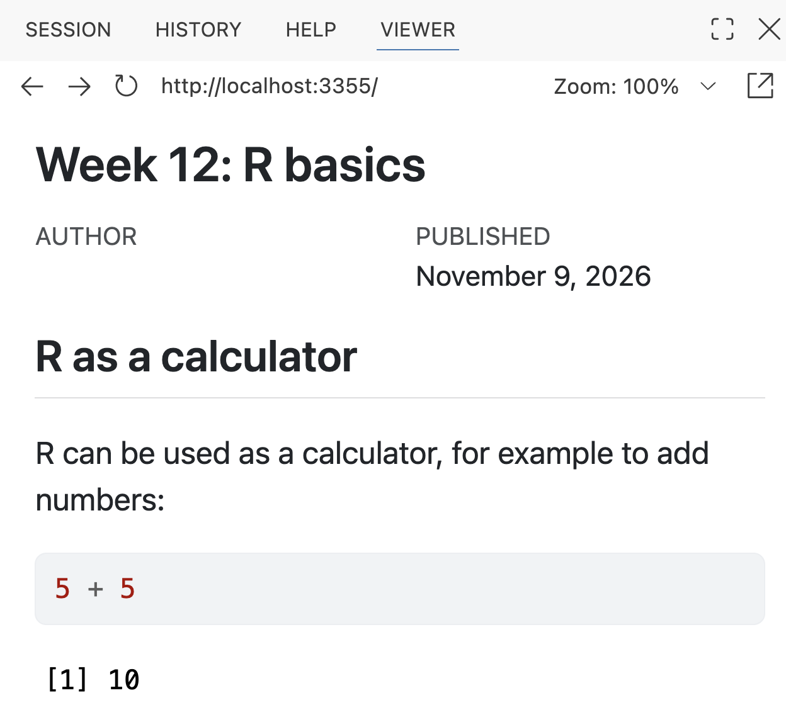{fig-align="center" width="60%" .lightbox fig-alt="Screenshot of a Quarto document in Positron, showing the Preview button at the top right of the editor, and the rendered HTML in the Viewer pane."}

It is likely that the following pop-up will appear ---
if you click "Open in Browser", the preview will also open in a new browser tab:

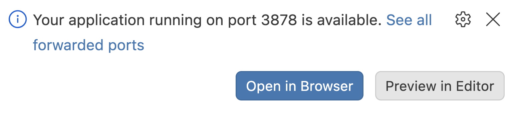{fig-align="center" width="70%" .lightbox fig-alt="Screenshot of a Quarto document in Positron, showing the Preview button at the top right of the editor."}

To **update** the preview after making changes,
click `Preview` again (this is quick, since the preview server keeps running).
Alternatively, check the "Render on Save" box in the editor toolbar,
and the preview will update every time you save the document.

::: {.callout-tip}
#### Rendering behavior

When you render, Quarto runs all code chunks from top to bottom
in a **new, empty R session**. This means that:

- If any code produces an **error**, the document will not render.
  The error message will be shown in a Terminal tab named "Quarto Preview",
  in the bottom panel.
- Your document only renders if it is **self-contained**:
  any objects you created only in the console,
  or packages you loaded only in the console, won't exist during rendering.

This may seem annoying at times, but it helps make Quarto documents reproducible.
:::

::: {.callout-note collapse="true"}
#### You can also use R _scripts_ (`.R`) in certain contexts _(Click to expand)_

Instead of Quarto documents, you can also write R code in **R scripts** (`.R` files),
which contain only code and comments,
much like the shell scripts you wrote in week 7.
To create one, create a new file with the `.R` extension in the Explorer,
or click `File` \> `New File...` \> `R File`.
Like in Quarto documents,
you can run code from R scripts with <kbd>Ctrl</kbd>/<kbd>Cmd</kbd>+<kbd>Enter</kbd>.

R scripts are a good choice for code that you simply want to run
from start to finish, without needing a report with the output:
for example, an R script can be run from the shell with `Rscript my-script.R`,
including in a Slurm batch job.
For your final project, both R scripts and Quarto documents are fine.
:::

::: exercise
####  Self-study exercise: Your first Quarto document

Continue working in your `week12a.qmd`:

1. Add another line of calculator code from earlier in this lecture
   to the existing chunk, and run the chunk.

   <details><summary>*Click to see a solution*</summary>

   For example, your chunk could now look like this:

   ````{.markdown .file filename="week12a.qmd"}
   ```{{r}}
   5 + 5
   6 * 8
   ```
   ````

   When you run the chunk, the output of both lines is shown in the console.

   </details>

2. Add a header `## Objects`.
   Below it, add a chunk that assigns a value to an object,
   and another chunk that uses that object.
   Above each chunk, add a sentence that explains what the code does.

   <details><summary>*Click to see a solution*</summary>

   For example, you could add the following below your first chunk:

   ````{.markdown .file filename="week12a.qmd"}
   ## Objects

   Assign the value 250 to the object `length_cm`:

   ```{{r}}
   length_cm <- 250
   ```

   Convert this length to inches:

   ```{{r}}
   length_cm / 2.54
   ```
   ````

   </details>

3. Update the preview (click `Preview` again,
   or check "Render on Save" and save the document),
   and take a look at it.

   <details><summary>*Click to see a solution*</summary>

   The preview should now show your new `Objects` section,
   with each chunk's code followed by its output.
   The chunk that assigns `length_cm` has no output,
   because assignment doesn't print.

   </details>

4. In the console (_not_ in your document), run `my_number <- 7`.
   Then, add a chunk with `my_number * 2` to your document and update the preview again.
   What happens, and why?

   <details><summary>*Click to see a solution*</summary>

   The document will not render,
   and the error message will say that the object `my_number` was not found.
   This is because rendering happens in a new R session,
   where only objects created in the document itself exist.
   To fix this, assign `my_number` in a chunk in your document.

   </details>

:::

## Recap and looking forward

In this lecture, you've learned the basics of working with R and Positron,
including:

- The Positron layout and the functions of its different regions and panes
- How to use R as a calculator, and how to define objects/variables
- How to call R functions and provide arguments to them, by name or by position
- How to install and load R packages
- How to get help in R
- How opening a folder in Positron keeps your work organized and reproducible
- How to write, run, and render R code in Quarto documents

Next week, you'll learn about vectors, R's main data types, and tabular data.
For that and all later R lectures, you'll write your code in Quarto documents.
