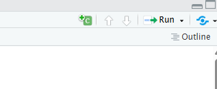
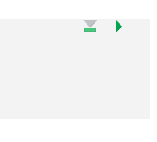

------------------------------------------------------------------------

<br>

## Introduction

### Overview

Since [week 12](../week12/w12a_r-basics.qmd#quarto-documents),
you've been writing your R code in Quarto documents,
using a basic YAML header, code chunks, and Markdown text.
In this session, we'll take a closer look at each of these components,
and at what happens when you render a document.

### Learning goals

In this session, you will learn:

-   What happens when Quarto renders a document
-   More about **YAML** syntax and useful options in the YAML header
-   More **chunk options**, and how to set them for a whole document
-   How to label chunks and include R output in your Markdown text
-   How to use RStudio's visual editor for Quarto documents
-   How to render a document to Markdown that displays well on GitHub

## Setting up

Create a new folder `week14`,
and in it, create a new Quarto document `week14a.qmd`
([Creating a Quarto document](../week12/w12a_r-basics.qmd#creating-a-quarto-document)).

## How rendering works

When you render a Quarto document, two programs do the work:

1. **knitr** runs all code chunks, in a new R session,
   and creates a plain Markdown file with your text, code, and the code's output.
2. **Pandoc** converts that Markdown file to the final output format.

This two-step process means that the same `.qmd` file can be rendered to many output formats,
like HTML, PDF, Word, and even slide decks and websites^[
This website and its slides were made with Quarto, too!],
and that Quarto isn't limited to R:
it can also run code in other languages like Python.
Quarto is the next-generation version of R Markdown, in case you have heard of that.

::: {.callout-tip appearance="simple"}
The gear icon next to the Render button lets you choose where to view the output
(in the Viewer pane or in a separate window).
There is also a "Render on Save" checkbox, which re-renders every time you save:
handy for small documents, but not for documents with slow code.
:::

## Components of Quarto documents

As you saw in week 12, a Quarto document has three main components:
the YAML header, code chunks, and Markdown text.
We'll take a closer look at each of these now.

### YAML header

The YAML header contains settings for the document:
metadata like the title and author,
and options for the output format.
Recall from week 12 that each line contains a `key: value` pair (with a space after the colon),
and that keys can be nested by indenting them with two spaces.
Here is an example with a few more options:

```yaml
---
title: "Week 14: Quarto"
subtitle: "Beyond the basics"
author: "Jane Doe"
date: 2026-11-23
format:
  html:
    embed-resources: true
    toc: true
    theme: cosmo
---
```

- `toc: true` adds a table of contents.
- `theme` picks one of Quarto's
  [25 built-in themes](https://quarto.org/docs/output-formats/html-themes.html),
  which change the fonts, colors, etc.
- There are many more [options for HTML output](https://quarto.org/docs/output-formats/html-basics.html).

::: callout-tip
#### Project-level YAML
You can also set YAML options for all Quarto documents in a project
in a file called `_quarto.yml` in the project's root directory
(see the [Quarto docs on projects](https://quarto.org/docs/projects/project-configuration.html)).
Options in a document's own YAML header override these.
:::

#### YAML lists

Some keys take a list of values, which can be written in two ways:

```yaml
# Block syntax: each item on a new line, preceded by a dash and a space
author:
  - Jane Doe
  - John Smith

# Inline syntax: comma-separated values inside square brackets
keywords: [RNA-seq, mosquito, Plasmodium]
```

#### Quotes and comments

In YAML, strings usually don't need quotes,
but they do when they contain special characters like `:` or `#`.
For example, the title in the example above, `"Week 14: Quarto"`, needs quotes because of the colon.
To be safe, you can always quote strings.

As in R and the shell, a `#` starts a comment.

::: exercise
####  Exercise: YAML header

1. Change the YAML header of your `week14a.qmd` to include a title, a subtitle,
   two authors (you and a classmate) in block syntax, today's date,
   a table of contents, and the `darkly` theme. Render the document.

2. **Predict** what will happen in each of the following cases,
   then try them one by one (and undo each change afterwards):
   - You remove the space after the colon in `toc: true`.
   - You remove the quotes around a title that contains a colon.

<details>

<summary>Click for the solution</summary>

1. For example:

```yaml
---
title: "Week 14: Quarto"
subtitle: "Beyond the basics"
author:
  - Jane Doe
  - John Smith
date: 2026-11-23
format:
  html:
    embed-resources: true
    toc: true
    theme: darkly
---
```

</details>

<!----
2. In both cases, the document won't render,
   and Quarto shows an error message about the YAML header,
   with the line number where the problem is.
---->
:::

### Code chunks

::: {.callout-tip appearance="minimal"}
Besides the keyboard shortcut you learned in week 12,
you can also insert a code chunk by clicking the insert button in the toolbar and selecting R:

{width="50%" fig-align="center"}
:::

#### Chunk options

Several options can be added to your code chunk to customize the output
of code. Chunk options can be either written directly inside the
curly braces (e.g. ```` ```{r, echo=FALSE} ````), or, preferably, with `#|` lines
at the top of the chunk (inside it), where each `#|` line sets one option. Some of the commonly used chunk
options, several of which you've already seen in week 12, are:

-   `echo: false` runs your code chunk, displays output, but does not
    display code in your final doc (this is useful if you want to show a
    figure but not the code used to create it)

-   `eval: false` does not run your code, but does display it in your
    final doc

-   `include: false` runs your code but does not display the code or its
    output in your final doc

**Additional chunk options are shown below:**

-   `warning: false` prevents warnings from showing up in your final doc

-   `fig-cap: "Your figure caption"` will allow you to set a figure
    caption

-   `fig-show: hide` to hide the figures

More chunk options can be found
[here](https://quarto.org/docs/computations/execution-options.html).

```{r eval=TRUE}
#| echo: fenced
# Example code chunk
2 * 2
```

```{r}
#| eval: true
#| echo: fenced
2 * 3
```

#### Global vs. chunk-specific options

If the default code chunk settings don’t fit your needs, you can change
them for the whole document in the YAML section under `execute:`. For
example, if you don’t want to show your R code to your readers, you can
set `echo: false` which hides all code by default. If you later want to
show the code for a specific chunk, you can turn it back on just for
that chunk using `echo: true`.
For example:

```yaml
---
title: "My report"
format:
  html:
    embed-resources: true
execute:
  echo: false
  warning: false
---
```

Note that `execute:` is a top-level key, not nested under `format:`.

#### Chunk labels

You can give a chunk a **label** with `#| label: <label-name>`.
Labels must be unique within a document and cannot contain spaces.
They show up in RStudio's document outline and in messages during rendering,
which makes it easier to find the chunk that caused a problem:

```{r}
#| label: my-first-chunk
#| echo: fenced
2 + 3
```

#### Running all chunks above

Besides the green "play" button that runs the current chunk,
each chunk has a triangle-with-a-line button,
which runs all code chunks _above_ the current chunk.
This is useful when you've restarted R or opened a document in a new session,
and want to get back to where you were:

{width="25%" fig-align="center"}

::: exercise
####  Exercise: Chunk options and self-contained documents

Add code chunks to your document to do the following:

1. Load the _tidyverse_, using a chunk option to hide its messages.
2. Check the number of rows and columns of the `diamonds` data set
   (which comes with _ggplot2_).
   Then, select its first 5 columns, keep only rows with a carat greater than 0.23,
   and rename the `color` variable to `colors`.
3. Create a scatter plot with `carat` on the x-axis and `depth` on the y-axis.
4. Temporarily **remove** `embed-resources: true` from your YAML header and render.
   In the Files pane, what was created besides the HTML file?
   Download only the HTML file and open it on your computer: what's missing, and why?
   Then put `embed-resources: true` back.

<details>

<summary>Click for the solution</summary>

```{r}
#| message: false
library(tidyverse)
```

```{r}
dim(diamonds)

diamonds |>
  select(1:5) |>
  filter(carat > 0.23) |>
  rename(colors = color)

diamonds |>
  ggplot(aes(carat, depth)) +
  geom_point()
```

Without `embed-resources: true`, rendering also creates a folder `week14a_files`,
which contains, among other things, the figure.
The downloaded HTML file on its own therefore doesn't show the figure,
because it refers to an image file in that folder.

</details>
:::

### Markdown text

The "default text" in Quarto documents is Markdown, unlike in R scripts,
where everything is considered code until commented out by `#`.
Quarto text syntax is based on Pandoc Markdown which is similar to
the original Markdown syntax we discussed in
[week 2](../week02/w2d_markdown.qmd).

#### Inline code

You can include the output of R code directly in your Markdown text with **inline code**:
a backtick, the letter `r` and a space, your code, and a closing backtick.
For example, this text:

```markdown
The iris data set contains `r "\x60r nrow(iris)\x60"` flowers.
```

Renders as:

> The iris data set contains `r nrow(iris)` flowers.

This way, numbers in your text are computed when you render the document,
so they always match your data and code --- no more copy-pasting numbers.

::: exercise
####  Exercise: Inline code

1. Add a sentence to your document that reports the number of rows of the `diamonds`
   data set with inline code, and render.
2. **Predict**: what will the rendered document show if you leave out the `r` and the space,
   i.e. `` `nrow(diamonds)` ``? Render to check.

<!----
<details><summary>Click for the solution</summary>

1. For example: The diamonds data set has `r "\x60r nrow(diamonds)\x60"` rows.

2. Without the `r`, it is regular Markdown inline code formatting:
   the text `nrow(diamonds)` is shown in a code font, and the code is not run.

</details>
---->
:::

## Source editor vs. Visual editor

**Source editor**: The source editor in RStudio is the default text
editor for editing Quarto documents (.qmd files). You type everything
yourself - the text, the code chunks, and the YAML settings. It gives
you full control but requires knowing some Markdown and Quarto syntax.
It’s good for users who like to see and control the exact code behind
the document.

**Visual editor**: The Quarto visual editor within RStudio provides a
What You See Is What You Mean (WYSIWYM) interface for authoring Quarto
documents (.qmd files). The visual editor is easier to use for the users
with Microsoft Word or Google Docs background. You can format text, add
images, and see how your document will look as you write. It’s great for
beginners or anyone who prefers a simple, visual writing style.

You can switch between the visual editor and source editor by clicking
on the `Visual` and `Source` buttons at the top right corner of the
RStudio window.


## Output for GitHub

GitHub shows HTML files as raw code, not as web pages.
To share a rendered document in a GitHub repository, like for your final project,
you can _also_ render it to GitHub-Flavored Markdown (`gfm`), which GitHub displays nicely:

```yaml
format:
  html:
    embed-resources: true
  gfm: default
```

With two formats, the Render button renders the first one by default;
use the small dropdown arrow next to it to pick `gfm`.
This creates a `.md` file, plus a `_files` folder with the figures:
commit both to your repository.

## Before next week: install packages for week 15

Installing the R packages for next week's RNA-seq analysis can take 10--20 minutes.
If we have time left in class, start the installation now ---
otherwise, please do so before next week's class
(see the [week 15 overview](../week15/w15_overview.qmd#before-class-install-packages)).

```{r, eval=FALSE}
install.packages("BiocManager")
install.packages("pheatmap")
BiocManager::install(c("DESeq2", "EnhancedVolcano"))
```

<!----
TODO: Proposed new sections for this "beyond the basics" session (not yet written):

- Rendering from the command line: `quarto render week14a.qmd` in the shell at OSC,
  and in a Slurm batch job (ties back to weeks 7 and 10)
- Avoiding slow re-renders: `cache: true` / `freeze`
- Turning an R script into a Quarto document
---->
