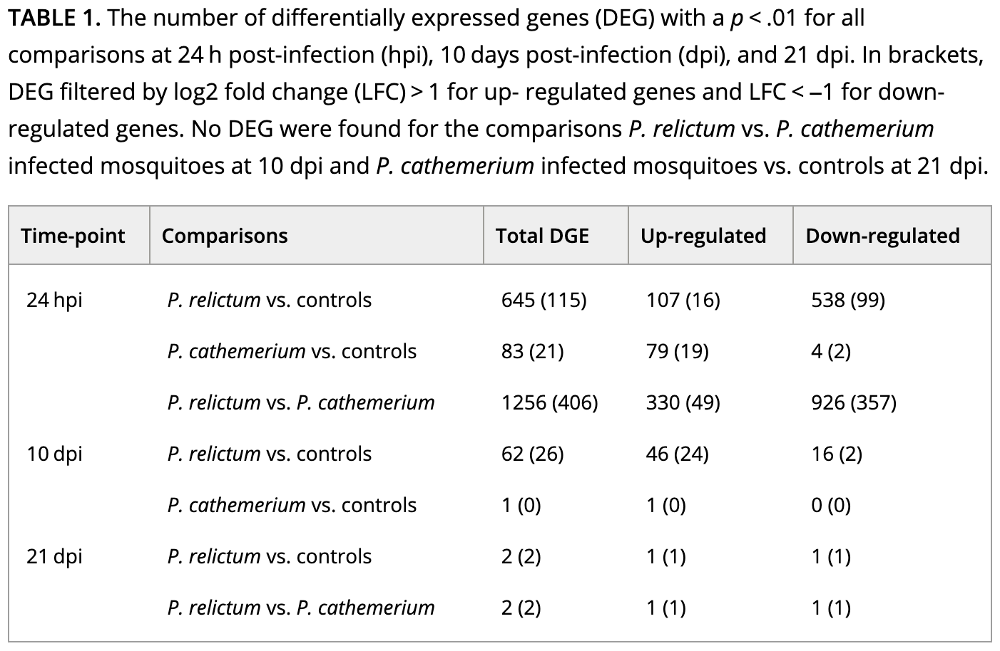
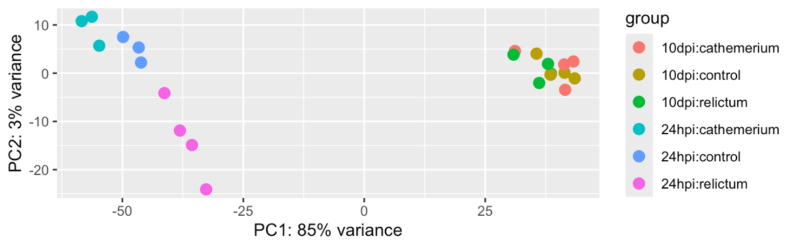
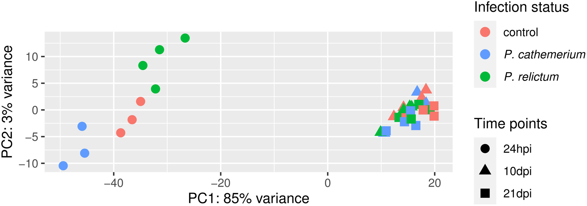

--------------------------------------------------------------------------------

<hr style="height:10pt; visibility:hidden;" />

## Introduction

### Overview & learning goals

After running steps like read pre-processing, alignment, and quantification,
either by running each tool step-by-step, or with the nf-core _rnaseq_ workflow,
you will have a **gene count table**.
Today, you will use such a gene count table to:

- Create an R object that also incorporates the metadata
- Perform exploratory data analysis including a PCA
- Run a Differential Expression (DE) analysis
- Extract and visualize the DE results, including with a volcano plot

### Setting up

1. Open Positron and connect to OSC with your personal dir open,
   [like in week 12](/week12/w12b_r-basics.qmd#setup-starting-positron-and-connecting-to-osc).
2. In the terminal, create a `week15` folder,
   and copy today's Quarto document into it:

   ```bash
   mkdir -p week15
   cp /fs/ess/PAS3493/share/week15/w15a_template.qmd week15/week15a.qmd
   ```

3. Open `week15/week15a.qmd`.
   Its headings match this page's sections,
   and it already has most of today's code,
   but some chunks are empty: you'll write that code yourself as we go.
   Also, you'll write your exercise answers in this document.

::: callout-important
Run the chunks one by one, in order, as we go through the page ---
don't use "Run All".
Each step builds on the previous one,
and running a chunk before we've talked about it means you'll miss what it does.
:::

## Today's R packages

### Bioconductor packages

You learned that `install.packages()` allows you to install R packages.
However, only packages that are available through the R package repository CRAN
can be installed this way --- and some packages aren't.

In particular, many packages for omics data analysis are instead available
via [Bioconductor](https://bioconductor.org/),
a package repository for high-throughput biological data analysis.
That's why the code you ran at the end of
[week 14](/week14/w14a_quarto.qmd#before-next-week-install-packages-for-week-15)
installed DESeq2 with `BiocManager::install()`.

::: {.callout-note collapse="true"}
#### Haven't installed the packages yet? _(Click to expand)_

Then run the following code in the R console now.
This takes a few minutes.

```{r, eval=FALSE}
install.packages("BiocManager")
install.packages("pheatmap")
BiocManager::install("DESeq2")
```
:::

::: {.callout-tip appearance="simple"}
For more about Bioconductor, including how to find packages,
its specialized data structures, and examples of working with DNA sequences,
see the [optional self-study page on Bioconductor](/bonus/r-omics.qmd).
:::

### Load the packages

Now, load the packages we'll use today:

- **here** --- for file referencing
- **DESeq2** --- for differential expression analysis
- **tidyverse** --- for data manipulation and plotting

```{r, eval=FALSE}
library(here)
```
```r-out
here() starts at /fs/ess/PAS3493/people/jelmer
```

```{r, echo=FALSE, message=FALSE}
library(here)
```

```{r, eval=FALSE}
library(DESeq2)
library(tidyverse)
```

Loading these packages prints a lot of output,
most of which is about function name conflicts (see the box below):

<details><summary>Click to see the output of `library(DESeq2)` and `library(tidyverse)`</summary>

```{r, echo=FALSE, warning=FALSE}
library(DESeq2)
library(tidyverse)
```

</details>

::: {.callout-note collapse="true"}
#### Why we load the tidyverse last _(Click to expand)_

As you saw [in week 13](../week13/w13a_data-wrangling.qmd#the-tidyverse),
when two packages have a function with the same name,
the package that was loaded last "masks" the function from the other package.

DESeq2 loads several other packages,
and these have functions with the same names as tidyverse functions,
such as `count()` from the matrixStats package.
If we had loaded the tidyverse first, `count()` would run the matrixStats version.
Because we will use tidyverse functions like `count()`,
and not these other packages' versions, we load the tidyverse last.

Regardless of the loading order, you can always use prefixing to specify which
package's function you want to use: for example,
`dplyr::count()` to explicitly use the dplyr version.
:::

### Set the input file paths

For the differential expression analysis, we have the following input files:

- **Metadata table** --- Metadata for the study, linking sample IDs to treatments
- **Gene count table** --- Produced by the
  [nf-core rnaseq ](https://nf-co.re/rnaseq){target="_blank"}
  workflow [@ewels2020]

```{r, eval=FALSE}
# We'll save the paths to our input files for later use
counts_file <- "/fs/ess/PAS3493/share/week15/salmon.merged.gene_counts_length_scaled.tsv"
metadata_file <- here("garrigos/meta/metadata.tsv")
```

```{r, echo=FALSE}
counts_file <- here::here(
  "assets/week15/salmon.merged.gene_counts_length_scaled.tsv"
)
metadata_file <- here::here("assets/week13/metadata.tsv")
```

## Create a DESeq2 object

As was done in the @garrigós2025 paper,
we will perform a Principal Component Analysis (PCA)
and a Differential Expression (DE) analysis using the popular
[**DESeq2** package](https://bioconductor.org/packages/release/bioc/html/DESeq2.html) [@love2014].

DESeq2 has its own "object type" and we need to start by creating a DESeq2 object
from three components:

1. **Metadata** --- containing the independent variables,
   allowing DESeq2 to compare groups of samples.
2. **Count table** --- A matrix (table) with one row per gene and one column per sample.
3. **A statistical design** --- A formula that tells DESeq2 which groups to compare.

### Planning the DE analysis

We'll first figure out how, exactly, we want to do the DE analysis,
so we can specify the statistical design formula
and prepare the metadata.

::: exercise
####  Exercise 1: Independent variables

1.  How many **independent variables** does the experiment have?

    a) 1: treatment
    b) 2: time and treatment
    c) 3: control, *P. cathemerium*, and *P. relictum*
    d) 6: one for each combination of time and treatment

    <!----
    <details><summary>  _Click for the solution._ </summary>

    **b**: The experiment has two independent variables: time and treatment.
    Option c lists the 3 *levels* of the treatment variable,
    and option d lists the 6 *groups* that you get by combining the levels of both variables.

    </details>
    ---->

2.  Based on your answer to question 1,
    can you think of two alternative ways to analyze the data?

    <!----
    <details><summary>  _Click for the solution._ </summary>

    You could **ignore time** and only compare the treatments,
    or you could **control for time**,
    for example by comparing the treatments separately for each time point.

    </details>
    ---->
:::

The paper says that the authors compared each of the two infection treatments
with the controls, and the two infection treatments with each other.
But it doesn't say how they dealt with the time points.

The paper's Table 1, which reports DEGs separately for each time point,
suggests that they did **pairwise comparisons** between each combination of
**time** and **treatment**.
We'll do that as well, for a total of 6 comparisons:

::: {.columns}
::: {.column width="20%"}

:::
::: {.column width="60%"}

| Comparison                         | 24 hpi | 10 dpi |
|------------------------------------|:------:|:------:|
| *P. relictum* vs. control          | ✓      | ✓      |
| *P. cathemerium* vs. control       | ✓      | ✓      |
| *P. relictum* vs. *P. cathemerium* | ✓      | ✓      |

: {tbl-colwidths="[50,25,25]"}

:::
::: {.column width="20%"}

:::
:::

::: {.callout-note collapse="true"}
#### How we determined how the analysis was done in the paper _(Click to expand)_

First, let's see what they say about the DE analysis in the Methods sections:

> *Then, we used the DESeq2 package [@love2014] to perform the differential gene
> expression analysis comparing: (i) P. relictum-infected mosquitoes vs. controls, (ii) P.
> cathemerium-infected mosquitoes vs. controls, and (iii) P. relictum-infected mosquitoes
> vs. P. cathemerium-infected mosquitoes.*

This is not terribly detailed and could be interpreted in a couple of different ways. For
example, they may have compared infection statuses by *ignoring* time points **or** by
*controlling for* time points (and there are different ways to do the latter).

**Ignoring time** would mean analyzing the full dataset (all time points) while only using the
infection status as an independent variable, i.e. the design `~treatment`.
(We'll check with a PCA below whether that would be a good idea.)

**Controlling for time** can be done in two ways:

- A two-factor analysis: `~ time + treatment`
- Pairwise comparisons between each combination of time and treatment
  (we'll see below *how* we can do that)

If we take a look at Table 1 with the DE results,
it will become clearer how they did their analysis:

{fig-align="center" width="80%"}

<details><summary> How do you interpret this: did they run pairwise comparisons or a two-factor model? _(Click for the answer)_</summary>
It looks like they performed pairwise comparisons between each combination of time
and treatment.
</details>

<hr style="height:1pt; visibility:hidden;" />

That brings us a step closer,
but pairwise comparisons with \>1 independent variable can also be done in two ways:

- After **subsetting** the dataset to each combination of time and treatment
- After creating a single, **combined independent variable** that is a combination of time and treatment

The latter method is the more common one, and is what we will do below[^5].
:::

[^5]: I can't tell from the paper which method they used.

### Metadata

Load the metadata file and take a look at the resulting data frame:

```{r}
meta_raw <- read_tsv(metadata_file, show_col_types = FALSE)
```

```{r}
head(meta_raw)
```

To prepare this for loading into a DESeq2 object,
we'll make sure it is sorted by sample ID,
and put the sample IDs in "row names".
We'll also create the combined time and treatment variable,
which we'll call `group`:

```{r}
meta <- meta_raw |>
  # 1. Sort by the 'sample_id' column
  arrange(sample_id) |>
  # 2. Turn the 'sample_id' column into row names:
  column_to_rownames("sample_id") |>
  mutate(
    # 3. Turn the 'time' and 'treatment' columns into "factors":
    time = factor(time, levels = c("24hpi", "10dpi")),
    treatment = factor(
      treatment,
      levels = c("control", "cathemerium", "relictum")
    ),
    # 4. Create a 'group' column that combines treatment and time:
    group = factor(paste(treatment, time, sep = "_"))
  )
```

```{r}
head(meta)
```

(Above, note the difference between having the sample IDs as
a **separate column versus as row names**.)

Which unique values does `group` have, and how many samples are in each?

```{r}
meta |> count(group)
```

::: {.callout-note collapse="true"}
#### More about `paste()` _(Click to expand)_

`paste()` joins values together into a single piece of text.
You give it the things to join, and with `sep` you choose what goes in between
(the default is a space):

```{r}
paste("control", "24hpi", sep = "_")
```

Like most R functions, it works on whole vectors (such as columns) at once,
combining the first element of each vector, then the second, and so on:

```{r}
treatment <- c("control", "relictum", "cathemerium")
time <- c("24hpi", "10dpi", "24hpi")

paste(treatment, time, sep = "_")
```

That is why, inside `mutate()`, `paste(treatment, time, sep = "_")`
creates one `group` value for each row of the data frame.
:::

### Gene count table

Second, load the gene count table into R:

```{r}
count_df <- read_tsv(counts_file, show_col_types = FALSE)
```

```{r}
head(count_df)
```

Again, we have to make several modifications
before we can include the count table in the DESeq2 object.
DESeq2 expects counts as whole numbers (integers) and gene IDs as row names:

```{r}
count_mat <- count_df |>
  # 1. Turn the 'gene_id' column into row names:
  column_to_rownames("gene_id") |>
  # 2. Remove a remaining non-numeric column (which has gene names):
  select(-gene_name) |>
  # 3. Round everything to whole numbers:
  round() |>
  # 4. Convert it to a formal 'matrix' format:
  as.matrix()

head(count_mat)
```

::: {.callout-note collapse="true"}
#### Why a matrix with row names, and checking that sample IDs match

DESeq2 wants the counts as a **matrix** with gene IDs as **row names**
because this keeps the numbers and their labels separate but permanently attached:

- A matrix holds only numbers, so IDs can't end up in the data itself.
  The IDs are found in the row and column names instead.
- Row and column names stay attached to their rows and columns
  when these are subset or reordered,
  so a count can't get separated from its gene and sample.
- DESeq2 uses **these names to link the tables**:
  it requires the sample IDs in the metadata (its row names)
  and in the count matrix (its column names) to be identical and in the same order,
  and will give an error if they are not.

Let's make sure the sample IDs do match:

```{r}
# Check that sample IDs in the metadata and the count table match
all(row.names(meta) == colnames(count_mat))
```

`row.names()` and `colnames()` get the row and column names,
`==` compares them element by element,
and `all()` checks whether all of these comparisons are `TRUE`.
:::

### Create the DESeq2 object

Now, we can create the DESeq2 object using the function `DESeqDataSetFromMatrix()`,
to which we will pass three arguments corresponding to the components discussed above:

- Argument `colData` for the **metadata**
- Argument `countData` for the **count data**
- Argument `design` for the **statistical design** for the DE analysis with
  We will use `~group` (the symbol before `group` is a tilde, <kbd>~</kbd>),
  to make DESeq2 compare samples between the groups created by the `group` variable.

```{r}
dds <- DESeqDataSetFromMatrix(
  colData = meta,
  countData = count_mat,
  design = ~group
)
```

We used the name `dds` for the DESeq2 object (short for "DESeq Data Set").

Before we run the differential expression analysis,
we'll do some exploratory data analysis using our `dds` object.

## Exploratory Data Analysis

### The count matrix

What are the numbers of rows (= number of genes) and columns (= number of samples)
of our count matrix?

```{r}
dim(count_mat)
```

How many genes have total (= across all samples) counts that are non-zero?
The `rowSums()` function computes the sum of each row (gene) of a matrix:

```{r}
sum(rowSums(count_mat) > 0)
```

How do the "library sizes",
i.e. the summed per-sample gene counts, compare across samples?

```{r}
sort(colSums(count_mat) / 1e6)
```

Most samples have 15--30 million counts, but sample S77 has fewer than 10 million.
Differences like these are why we have to normalize the counts, as we'll do below.
(In this week's exercises, you'll plot these library sizes.)

### Principal Component Analysis (PCA)

We will run a PCA to examine overall patterns of (dis)similarity among samples,
helping us answer questions like:

- Do the samples **cluster** by treatment (infection status) and/or time point?
- Which of these two variables has a greater effect on overall patterns of gene expression?
- Is there an overall *interaction* between these two variables?

First, normalize the count data to account for differences in library size
among samples and "stabilize" the variance among genes[^4]:

[^4]: Specifically, the point is to remove the dependence of the variance in expression
      level on its mean, among genes.

```{r}
dds_vst <- varianceStabilizingTransformation(dds)
```

The authors of the study did this as well, they mention:

> *We carried out a Variance Stabilizing Transformation (VST) of the counts to represent*
> *the samples on a PCA plot.*

Next, run and plot the PCA with a single call to the DESeq2's `plotPCA()` function,
where `intgroup` specifies the variables (columns) to color samples by:

```{r, eval=FALSE}
plotPCA(dds_vst, intgroup = c("time", "treatment"))
```

```bash-out
using ntop=500 top features by variance
```

{fig-align="center" .no-border width="90%" fig-alt="PCA plot of the RNA-seq samples, colored by time and shaped by treatment."}

This plot isn't as clear as it could be,
but it gives us a first impression of the overall patterns in the data.
In the short exercise below, you'll interpret this PCA plot.
In [this week's exercise page](./w15_exercises.qmd),
you'll make an improved plot with ggplot2.

<hr style="height:1pt; visibility:hidden;" />

::: exercise
####  Exercise 2: PCA interpretation

- Based on your PCA plot,
  try to answer the three questions asked at the beginning of this PCA section.
- How does this plot compare to the PCA plot in the paper (Figure 1),
  in terms of the conclusions you just drew?

<details><summary>  Click to see the paper's Figure 1 </summary>



</details>
:::

## Differential Expression (DE) analysis

Recall that we will do pairwise comparisons between each combination of time and treatment,
and that we already set the corresponding design `~group` in the DESeq2 object.
Do our PCA results support this choice?

<details class="details-quiz">
<summary>Given the PCA results, would it have been OK to ignore the `time` variable?</summary>
<!----
No: the time variable clearly has a large effect on overall patterns of gene expression,
in fact more so than the treatment.
---->
</details>

### Running the DE analysis

While we had to do a lot of preparation to get to this stage,
actually running the DE analysis is very simple:

```{r}
dds <- DESeq(dds)
```

Note that we assign the output back to the same `dds` object:
the DE results are added to it.
The `DESeq()` function is a wrapper that performs three steps (functions) consecutively:

- `estimateSizeFactors()` --- "Normalization" by library size and composition
- `estimateDispersions()` --- Estimate gene-wise dispersion (variance in counts)
- `nbinomWaldTest(ddsObj)` --- Fit the negative binomial GLM and calculate test statistics

DESeq2 automatically performed **pairwise** comparisons between
**each of the (6) levels** of the `group` variable.
This means that for any individual gene,
it tested whether the gene is differentially expressed
separately for each of these pairwise comparisons.

## Extracting the DE results

DESeq2 stores the results as a separate table for each pairwise comparison,
and now, we'll extract **one** of these.

### The results table

We can extract the results for one pairwise comparison (which DESeq2 refers to as a
**contrast**) at a time, by specifying it with the `contrast` argument as a vector of
length 3:

1. The focal independent **variable** (here, `group`)
2. The **focal level** of the independent variable
   (in the example below, `relictum_24hpi`)
3. The **reference level** of the independent variable
   (in the example below, `control_24hpi`)

The log~2~-fold changes are computed as focal level over reference level,
so here, a positive log~2~-fold change means that a gene is more highly expressed
in `relictum_24hpi` than in `control_24hpi`.

```{r}
# Extract the DE results for one pairwise comparison
focal_contrast <- c("group", "relictum_24hpi", "control_24hpi")
res_rc24 <- results(dds, contrast = focal_contrast)
```

```{r}
head(res_rc24)
```

What do the columns in this table contain?

- `baseMean`: Mean expression level across all samples
- `log2FoldChange`: The log~2~-fold change of gene counts between the compared levels
- `lfcSE`: The uncertainty in terms of the standard error (SE) of the log~2~-fold
  change estimate
- `stat`: The value for the Wald test's test statistic
- `pvalue`: The *uncorrected* p-value from the Wald test
- `padj`: The multiple-testing corrected p-value (i.e., adjusted p-value)

::: {.callout-note collapse="true"}
### `NA` values in the DESeq2 results table _(Click to expand)_

Some values in the DESeq2 results table can be set to `NA` for one of the following reasons:

- If a gene contains a sample with a count **outlier**,
  both the p-value and adjusted p-value will be set to `NA`.
  (DESeq2 performs outlier detection using Cook's distance.)

- If all samples have **zero counts** for a given gene,
  the `baseMean` column will be zero, and the log~2~-fold change estimates,
  p-value and adjusted p-value will all be set to `NA`.

- DESeq2 also automatically filters genes with a **low mean count** in the sense that it
  does not include them in the multiple testing correction.
  Therefore, in such cases, the p-value will not be `NA`, but the *adjusted* p-value will be.

  Because we have very low power to detect differential expression for such low-count
  genes, it is beneficial to remove them prior to the multiple testing correction: that
  way, the correction becomes less severe for the remaining genes.

Let's see how many genes have `NA` p-values:

```{r}
# Number of genes with NA p-value:
sum(is.na(res_rc24$pvalue))

# As a proportion of the total number of genes in the test:
sum(is.na(res_rc24$pvalue)) / nrow(res_rc24)
```

And `NA` adjusted p-values:

```{r}
# Number of genes with NA adjusted p-value:
sum(is.na(res_rc24$padj))

# As a proportion of the total number of genes in the test:
sum(is.na(res_rc24$padj)) / nrow(res_rc24)
```
:::

::: callout-tip
#### Multiple testing correction
Because we are testing significance for *many* genes, we need to correct for multiple
testing. DESeq2 uses the Benjamini-Hochberg False Discovery Rate (FDR) correction. For
more info, see this
[StatQuest video ](https://www.youtube.com/watch?v=K8LQSvtjcEo){target="_blank"}.
:::

### Log2-fold changes

In RNA-seq, log~2~-fold changes (LFCs) are the standard way of representing the
**magnitude** (*effect size*) of expression level differences
between two groups of interest.
With A and B being the compared sample groups, the LFC is calculated as:

$$
\text{LFC} = \log_2\left(\frac{\text{mean of A}}{\text{mean of B}}\right)
$$

Due to the log-transformation, the LFC increases more slowly than a raw fold-change:

- An LFC of `1` indicates a 2-fold difference
- An LFC of `2` indicates a 4-fold difference
- An LFC of `3` indicates an 8-fold difference

A nice property of LFC is that decreases and increases in expression are expressed
symmetrically:

- An LFC of `1` means that group A has a **two-fold higher** expression level than group B
- An LFC of `-1` means that group A has a **two-fold lower** expression level than group B

<hr style="height:1pt; visibility:hidden;" />

::: exercise
####  Exercise 3: Log-fold changes

Based on the above, or your knowledge of log-transformations,
what do you expect the following to return:

```{r, eval=FALSE}
# In the context of a LFC, these 2 numbers would be mean expression levels in 2 groups
log2(8 / 2)
log2(2 / 8)
```

<!----
<details><summary>*Click to see the solution*</summary>

- A fold-change of 4 (8/2) is a LFC of 2:

```{r}
log2(8 / 2)
```

- A fold-change of 0.25 (2/8) is a LFC of -2:

```{r}
log2(2 / 8)
```

</details>
---->
:::

### Numbers of Differentially Expressed Genes (DEGs)

How many adjusted p-values were less than 0.05 (i.e., significant)?

```{r}
# (We need 'na.rm = TRUE' because some p-values are 'NA')
# (If we don't remove NAs from the calculation, sum() will just return NA)
sum(res_rc24$padj < 0.05, na.rm = TRUE)
```

So, we have `r sum(res_rc24$padj < 0.05, na.rm = TRUE)` Differentially Expressed Genes
(**DEG**s) for this specific pairwise comparison.

<hr style="height:1pt; visibility:hidden;" />

::: exercise
####  Self-study exercise 4: DEGs

The paper's Table 1 ([shown above](#planning-the-de-analysis))
reports the number of DEGs for a variety of comparisons.

How does the number of DEGs we just got compare to what they found in the paper for
this comparison?

<!----
<details><summary>*Click to see the solution*</summary>

We found `r sum(res_rc24$padj < 0.05, na.rm = TRUE)` DEGs,
while the paper reports 645 DEGs for *P. relictum* vs. controls at 24 hpi.
So, we found somewhat more DEGs, but the numbers are in the same ballpark.

Part of the difference is due to the significance threshold:
the paper used a stricter one (p < 0.01) than we did (p < 0.05).
Other differences in the analysis, like software versions and settings,
can also lead to slightly different results.

</details>
---->

:::

## Volcano plot

A "volcano plot" gives a nice overview of the DE results for one comparison.
We'll make one for the `relictum_24hpi` vs. `control_24hpi` comparison
we extracted above.

A volcano plot has one point per gene, with the:

- log~2~-fold change (effect size) along the x-axis
- adjusted p-value (significance) along the y-axis

First, prepare the results table for plotting:

```{r}
res_df <- res_rc24 |>
  # 1. Convert it to a regular data frame:
  as.data.frame() |>
  # 2. Turn the row names (gene IDs) into a column:
  rownames_to_column("gene_id") |>
  # 3. Remove genes with an NA adjusted p-value:
  filter(!is.na(padj)) |>
  # 4. Add a column that indicates whether each gene is a DEG:
  mutate(DEG = padj < 0.05)
```

Now, create the plot.
Along the y-axis, we plot `-log10(padj)` rather than `padj` itself,
which turns small p-values into large numbers:
for example, `-log10(0.05)` is 1.3 and `-log10(1e-10)` is 10.
That way, the most significant genes end up at the top of the plot.

```{r}
res_df |>
  ggplot(aes(x = log2FoldChange, y = -log10(padj), color = DEG)) +
  geom_point() +
  # Add a dashed horizontal line at the significance threshold:
  geom_hline(yintercept = -log10(0.05), linetype = "dashed") +
  # Gray for non-significant genes, red for DEGs:
  scale_color_manual(values = c("grey60", "firebrick")) +
  labs(title = "relictum vs. control at 24 hpi") +
  theme_bw() +
  theme(panel.grid.minor = element_blank())
```

::: callout-warning
#### Outliers!
The volcano plot above shows a gene with a very high log~2~-fold change (\> 20).
In [Exercise 2 in this week's exercises](w15_exercises.qmd#exercise-2-volcano-plots-and-outliers)
you'll see why it's important to plot the expression levels of individual genes.
:::

## Exporting the results

To save the DE results tables, you can for example use the `write_tsv()` function.
You could open the resulting file in Excel for further exploration.

First, we'll create a results directory for the DE results,
if it doesn't already exist:

```{r, eval=FALSE}
dir.create(here("week15/results/DE"), recursive = TRUE, showWarnings = FALSE)
```

Prior to saving the results table, we need to move the gene IDs from the row names
into a column, because `write_tsv()` doesn't save row names:

```{r, eval=FALSE}
res_rc24 |>
  as.data.frame() |>
  rownames_to_column("gene_id") |>
  write_tsv(here("week15/results/DE/res_rc24.tsv"))
```

Finally, because this week's exercises build on this DESeq2 object,
we'll also save that object to a file:

```{r, eval=FALSE}
saveRDS(dds, here("week15/results/DE/dds.rds"))
```

## In Closing

Today, you have performed several steps in the analysis of gene counts that result
from a typical RNA-seq workflow. Specifically, you have:

- Created a DESeq2 object from the gene count data and the experiment's metadata
- Performed exploratory data analysis including a PCA
- Run a Differential Expression (DE) analysis with DESeq2
- Extracted, interpreted, and visualized the DE results with a volcano plot

#### Next steps

Typical next steps in such an analysis include:

- Extracting, comparing, and synthesizing DE results across **all pairwise comparisons**
  (this would for example allow us to make the upset plot in *Figure 2 of the paper*)

- **Functional enrichment analysis** with Gene Ontology (GO) terms,
   as done in the paper,
   and/or with KEGG pathways and other functional gene grouping systems.
