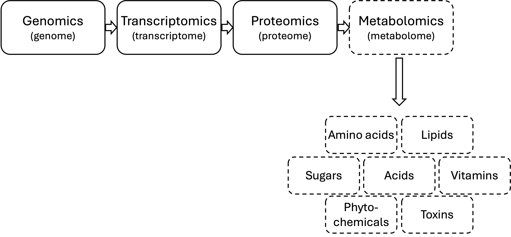
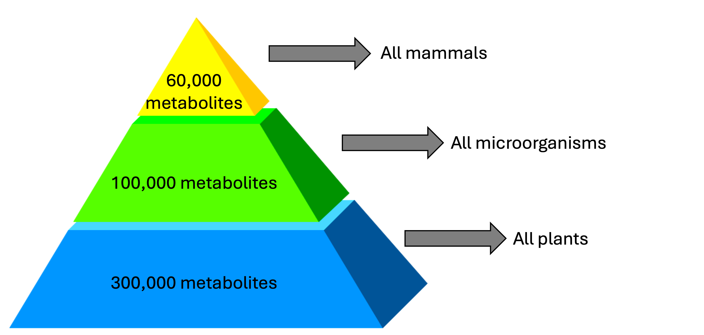
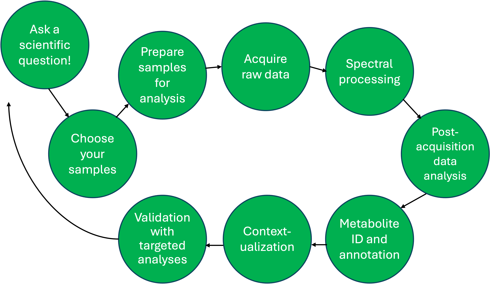
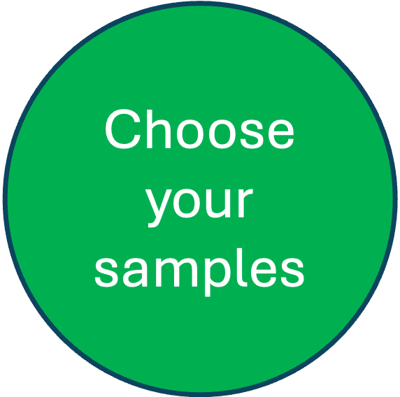
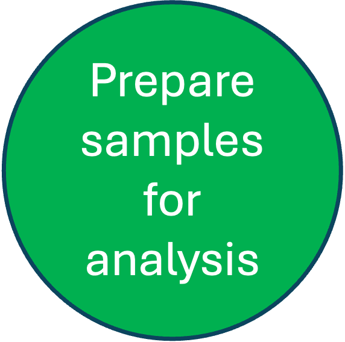
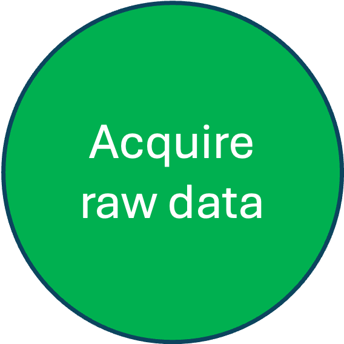
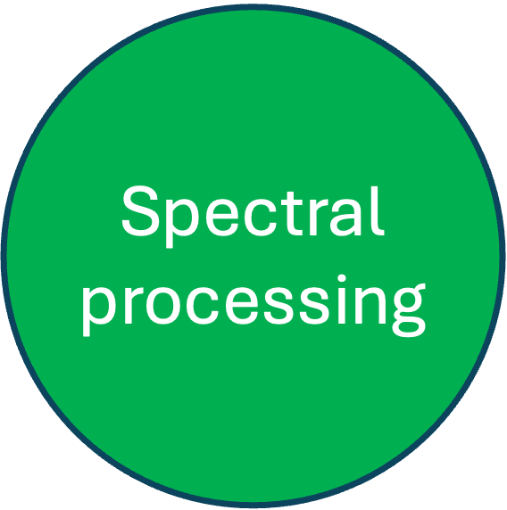
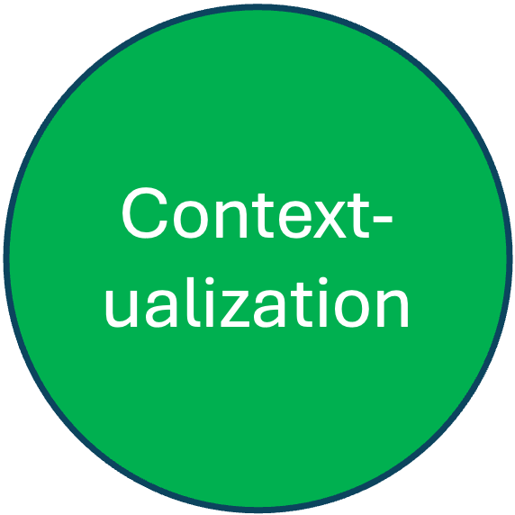
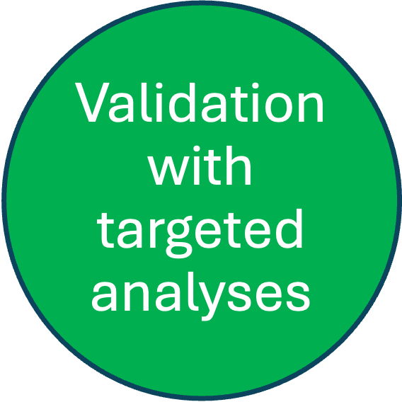

## What is metabolomics?

-   The study of the **totality** of **small molecules** (< 1500 Da) within a given system
-   Metabolomics is a tool that allows us to study global metabolism

## Metabolites are the downstream products of the system biology cascade

## The metabolome is really BIG!

::: aside
Adapted from David Wishart’s [Canadian Bioinformatics Workshop](https://bioinformatics.ca/)
:::

## The metabolome is very chemically diverse {background-image="img/15b/01/biochemical-pathways.png"}
::: aside 
From [Roche, Biochemical Pathways](https://www.roche.com/about/philanthropy/science-education/biochemical-pathways)
:::

## The metabolome is constantly changing
{.center}

## How is metabolomics different from targeted analyses?
::: columns
::: {.column width="50%"}
Metabolomics:

-   100s-1,000s of analytes
-   Work on the back end
-   Comparative (i.e. relative concentration)

:::

::: {.column width="50%"}
Targeted analyses:

-   1-20 analytes
-   Work on the front end
-   Quantitative (i.e. absolute concentration)

:::
:::

## How does metabolomics differ from other omics?

Metabolomics has:

- Increased diversity in analytes
- Lack of a ‘reference’
- Accurate mass match does not mean an identification
- Larger differences due to instrumentation platforms

## How does metabolomics differ from other omics?
::: {style="font-size: 100%;"}
| Aspect | Genomics | Transcriptomics | Proteomics | Metabolomics |
|--------|----------|-----------------|------------|--------------|
| Focus  | DNA       | RNA            | Proteins | Small molecules <1500 Da |
| Scale  | Entire genome | Entire transcriptome | Entire proteome | Entire metabolome |
| Data   | Sequence | Sequence | Peptides (via MS) sequences | Mass spectra, retention times |
:::

## Metabolomics workflow

## Metabolomics is a *comparative* analysis

::: incremental

-   What can food scientists use metabolomics for?
-   If you have specific compounds of interest, develop a targeted method!

:::

{.absolute bottom="0" left="0" width="150"}

## What do we want to compare?

::: incremental

-   It's critical to select comparable samples as our approach is *comparative*.
-   Foods: plants, animal products, raw ingredients, finished product
-   Biological sample: plasma, urine, tissue, other fluids, cells

:::

{.absolute bottom="0" left="0" width="150"}

## Preparation dictates compounds detected

{.absolute bottom="0" left="0" width="150"}

::: incremental

-   You can only detect what you present to an instrument for analysis
-   Sample prep depends on intended method of analysis (e.g., water extraction, polar compounds; non-polar extraction, non-polar compounds) 
-   Dilute, centrifuge/filter, inject (e.g. urine, juice, olive oil)
:::

## Collect comprehensive metabolite data

{.absolute bottom="0" left="0" width="150"}

3 most popular methods for analysis:

-   Liquid-chromatography, mass spectrometry (LC-MS)
-   Gas chromatpgrahy, MS (GC-MS)
-   Nuclear magnetic resonance spectroscopy (NMR)

. . . 

All methods have benefits and drawbacks

## Convert spectral data into feature table

{.absolute bottom="0" left="0" width="150"}

::: incremental

-   From raw spectra, ions are selected, chromatograms drawn, peaks detected, masses and retention times aligned, features dereplicated
-   Result is a data file that includes *m*/*z*, retention time, compound identifier (usually mz_rt), and relative abundance of each feature in each sample
-   With MZmine, samples are columns, features are rows

:::

## Use statistics and chemometrics to understand group differences

{.absolute bottom="0" left="0" width="150"}

-   Significance testing (e.g., t-test, Wilcoxon rank sum test, ANOVA)
-   Unsupervised analyses (e.g., PCA, hierarchical clustering)
-   Supervised analyses (e.g., PLS-DA or PLS-R, random forest)

## What metabolites do we have?

{.absolute bottom="0" left="0" width="150"}

-   Searching publicly available databases (e.g., [HMDB](https://hmdb.ca/), [Mass Bank of North America (MoNA)](https://mona.fiehnlab.ucdavis.edu/), [GNPS](https://gnps.ucsd.edu/)) at the MS1 and MS2 level
-   Conduct MS/MS experiments
-   Comparison with authentic standards

## Putting findings into a broader context

{.absolute bottom="0" left="0" width="150"}

-   Understanding which metabolic pathways are most deregulated
-   Typically for enzymatic pathways
-   Requires compound IDs (a big limitation)

## Ensure findings are real and reproducible

{.absolute bottom="0" left="0" width="150"}

-   Mass spectrometry is not inherently quantitative (i.e., if the intensity of analyte A is higher than analyte B, it doesn't necessarily mean there is more of A than B)
-   Knowing the absolute concentration allows comparison with literature/other data 
-   Validation in a separate sample set ensures robustness

## Metabolomics workflow
