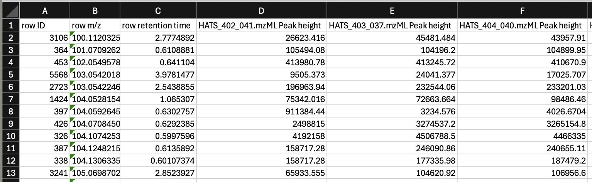

--------------------------------------------------------------------------------

<hr style="height:10pt; visibility:hidden;" />

# Introduction

Today we will be going through a general metabolomic analysis workflow. If you want to refer back to the metabolomics lecture, you can find it [here](w15b_metabolomics-lecture.qmd).

## Overview & learning goals

After collecting raw spectral data from a high resolution mass spectrometer, tools to deconvolute the spectra into peaks and then into a feature table will be conducted. Today, you will use such a feature table to:

- Wrangle the data into formats that are amenable to downstream analysis
- Filter out low quality features
- Handle missing data by imputing it
- Collapse features that come from the same metabolite using `notame`
- Transform and scale the data, and assess its quality
- Perform exploratory data analysis, including a PCA
- Conduct univariate tests, correcting for multiple testing
- Apply several multivariate methods: k-means clustering, hierarchical clustering,
  PLS-DA, and random forest

## Setting up

1. Open Positron and connect to OSC with your personal dir open,
   [like in week 12](/week12/w12b_r-basics.qmd#setup-starting-positron-and-connecting-to-osc).
2. In the terminal, navigate to your `week15` folder,
   and copy today's Quarto document into it:

   ```bash
   cp /fs/ess/PAS3493/share/week15/w15a_template.qmd week15/week15b.qmd
   ```

3. [Open the `week15` folder in Positron](/week12/w12b_r-basics.qmd#working-directory-and-opening-a-folder),
   and then open `week15b.qmd`.
   Its headings match this page's sections,
   and it already has most of today's code,
   but some chunks are empty: you'll write that code yourself as we go.

# Today's R packages

## Bioconductor packages

You learned that `install.packages()` allows you to install R packages.
However, this only works for packages in the R package repository CRAN,
and not all packages are on CRAN.

In particular, many packages for omics data analysis are instead available
via [Bioconductor ](https://bioconductor.org/){target="_blank"},
a package repository for high-throughput biological data analysis.
That's why the code you ran in
[week 14](/week14/w14a_quarto.qmd#install-packages-for-week-15)
installed DESeq2 with `BiocManager::install()`.

::: {.callout-note collapse="true"}
### Haven't installed the packages yet? _(Click to expand)_

Since you installed `BiocManager` previous, you can run the code below to download the package `ropls` which is also from Bioconducter. 

```{r, eval=FALSE}
BiocManager::install("ropls")
```
:::

## Load the packages

Now, load the packages we'll use today:

```{r}
library(factoextra) # visualizing PCA results
library(glue) # for easy pasting
library(plotly) # quick interactive plots
library(proxyC) # more efficient large matrices
library(data.table) # easy transposing
library(janitor) # for cleaning names and checking duplicates
library(notame) # for collapsing ions coming from the same metabolite
library(doParallel) # for parallelizing notame specifically
library(patchwork) # for making multi-panel plots
library(rstatix) # for additional univariate functionality
library(philentropy) # for hierarchical clustering
library(ggdendro) # for hierarchical clustering plotting
library(ropls) # for pls
library(randomForest) # for random forest
library(caret) # for random forest confusion matrices

# this is at the end hoping that the default select will be that from dplyr
library(tidyverse) # for everything
```

::: {.callout-note collapse="true"}
### Why we load the tidyverse last _(Click to expand)_

As you saw [in week 13](/week13/w13a_data-wrangling.qmd#the-tidyverse),
when two packages have a function with the same name,
the package that was loaded last "masks" the function from the other package.

Many of our packages load several other packages,
and these have functions with the same names as tidyverse functions,
such as `count()` from the matrixStats package.
If we had loaded the tidyverse first, `count()` would run the matrixStats version.
Because we will use tidyverse functions like `count()`,
and not these other packages' versions, we load the tidyverse last.

Regardless of the loading order, you can always use prefixing to specify which
package's function you want to use: for example,
`dplyr::count()` to explicitly use the dplyr version.
:::

## Set a plot theme and colors

To keep all of our plots consistent,
we set one theme and one color palette now, and reuse them throughout.

```{r}
theme_set(theme_minimal(base_size = 13))

tomato_cols <- c(OH8243 = "#FFFFCCFF", # light yellow
                 HATS = "#FD8D3CFF", # orangey
                 LA2213 = "#800026FF", # dark red
                 QC = "grey60")

# the columns in our data that describe samples (i.e., provide metadata)
# rather than features
meta_cols <- c("sample_name", "sample_or_qc", "group", "rep_or_plot", "run_order")
```

# Read in the data

## The feature table

For our metabolomic analysis, we have only one input file: our **feature table**.
This table comes directly out of software (in this case, I used the open source software [MZmine ](https://mzio.io/mzmine/){target="_blank"}) that we use to deconvolute raw spectral data into something we can analyze.

Remember, you can think about a feature like it's a metabolite; it isn't exactly, but the sentiment works well enough here.
This file contains data in a non-standard format:

{fig-alt="Screenshot of the feature table in Excel, with columns for row ID, row m/z, row retention time, and then one column per sample."}

- The first column contains `row ID`, a unique row identifier
- The second column contains `row m/z`, the mass-to-charge ratio for that feature
- The third column contains `row retention time`,
  the time in minutes at which the feature elutes into the mass spectrometer
- The remaining columns contain our samples

In this way, rows are features and columns are both metadata and observations.
We are going to make this data tidier later.

This file has 2560 features from MZmine, which is why that number is in the file name.
On OSC, the file is here:

```{r}
feature_table_osc <- "/fs/ess/PAS3493/share/week15/Feature_list_MZmine_2560.csv"
```

We can then read the file in with `read_csv()`.

```{r}
#| eval: false
metabdata <- read_csv(file = feature_table_osc,
                      col_names = TRUE) # has headers
```

```{r}
#| include: false
# using this for reading in on the website which is not generated on OSC
feature_table_local <- "../assets/week15/Feature_list_MZmine_2560.csv"

metabdata <- read_csv(file = feature_table_local,
                      col_names = TRUE) # has headers
```

And take a look at it.

```{r}
# what are the dimensions of the dataframe
# rows are features here
dim(metabdata)

# look at beginning of the dataset
metabdata[1:8, 1:8]

# how many features do we have?
nrow(metabdata)
```

Note there is no metadata included in this file.  Just m/z, retention time, and a column for each sample, where values are peak heights.  We are using peak height instead of peak area because it is less dependent on bad peak shape which you get sometimes with metabolomics.

```{r}
colnames(metabdata)
```

It looks like we have an extra blank column at the end - if we look at our raw data we can see OH9243_811_028 is the last sample, so I am going to remove the last column.

```{r}
metabdata <- metabdata |>
  select(-last_col())

colnames(metabdata)
```


<details class="details-quiz"><summary>How many treatment groups does the experiment have?</summary>

--
There are three different types of tomatoes, OH8243, HATS, and LA2213. We also have our quality control (QC) and process blank (PB) samples. 
--
</details>

<hr style="height:1pt; visibility:hidden;" />

# Clean up the data

## Retention time filter
You might have deconvoluted more data than you plan to use in your analysis.  For example, you may want to exclude the first bit and last bit of your run, since you do not expect to have good reproducibility in those areas. 

In this case, when deconvoluting in MZmine, I set to only include the features that elute during the gradient of our method, which here is between 0.5-7.5 min of this 10 min run. Let's check what we have.

```{r}
range(metabdata$`row retention time`)
```

Our data is already filtered for our desired retention time range, so we don't need to do anything. 

::: {.callout-tip collapse="true"}
### Code to filter by retention time _(Click to expand)_

Here is code you could use if you needed to filter:

```{r}
#| eval: false
metabdata_RTfilt <- metabdata |>
  filter(between(`row retention time`, 0.5, 7.5))

# did it work?
range(metabdata_RTfilt$`row retention time`)

# how many features do we have?
dim(metabdata_RTfilt)
```
:::

## Create a feature identifier

This creates a unique identifier for each feature by combining its mass-to-charge ratio (*m*/*z*) and its retention time (RT). We are also giving our columns easier to use names.
```{r}
MZ_RT <- metabdata |>
  rename(mz = `row m/z`,
         rt = `row retention time`,
         row_ID = `row ID`) |>
  unite(mz_rt, c(mz, rt), remove = FALSE) |> # Combine m/z & rt with _ in between
  select(row_ID, mz, rt, mz_rt, everything()) # reorder and move row_ID to front

# how does our df look?
MZ_RT[1:8, 1:8]
```

## Clean up sample names

We are using [`str_remove()`](https://stringr.tidyverse.org/reference/str_remove.html) to remove some information we do not need in our sample names.  
```{r}
# remove stuff from the end of file names, ".mzML Peak height"
new_col_names <- str_remove(colnames(MZ_RT), fixed(".mzML Peak height"))

# assign our new column names to MZ_RT
colnames(MZ_RT) <- new_col_names
```

What are our column names now?
```{r}
colnames(MZ_RT)
```

## Filter features

Feature tables from deconvolution software usually contain some features that are noise, artifacts, or contamination. Over the next several steps, we will progressively remove them.
```{mermaid, include=FALSE}
flowchart LR
  A[Raw feature table] --> B[Remove duplicates]
  B --> C[Keep features present in all QCs]
  C --> D[Keep features with QC CV <= 30%]
  D --> E[Remove features in process blanks]
  E --> F[Cluster features with notame]
```

To keep track of how many features we lose at each step, we use a small helper function and a running table.

```{r}
tracker <- tibble(step = "Raw feature table",
                  n_features = nrow(MZ_RT))

track <- function(tracker, step, n_features) {
  bind_rows(tracker, tibble(step = step, n_features = n_features))
}
```

## Check for duplicates

Sometimes you end up with duplicate data after deconvolution with MZmine.
Here, we check for complete, perfect duplicates (meaning every column is identical).
The function `get_dupes()` is from the package `janitor`.
We don't want `row_ID` to be considered here, since it is unique per row. 
```{r}
get_dupes(MZ_RT |> select(-row_ID))
```

We have no exact duplicate, this is great!


::: {.callout-tip collapse="true"}
### Code to remove duplicates _(Click to expand)_

If you did have duplicates, you could keep one copy of each like this:

```{r}
#| eval: false
MZ_RT_nodupes <- MZ_RT |>
  distinct(across(-row_ID), .keep_all = TRUE)

# how many rows did we remove?
nrow(MZ_RT) - nrow(MZ_RT_nodupes)
```
:::

```{r}
# set up the tracker
tracker <- track(tracker, "After removing duplicates", nrow(MZ_RT))

# print tracker
tracker |> distinct() 
```


# Filtering using the QC samples

QC samples are a pooled mix of all samples that are run repeatedly throughout the run. Because they are all the same, we expect to measure the same features in every QC. Here, we keep only features that are detected in 100% of QCs. You could change this parameter based on your data.

In this file, a feature that was not detected is coded as zero (not `NA`), so we look for values greater than zero.

```{r}
MZ_RT_QCs <- MZ_RT |>
  select(mz_rt, contains("QC")) |> # select the QCs
  filter(if_all(contains("QC"), ~ .x > 0)) # keep rows where every QC is > 0

# how many features got removed with this filtering?
nrow(MZ_RT) - nrow(MZ_RT_QCs)
```

```{r}
# set up the tracker
tracker <- track(tracker, "Present in all QCs", nrow(MZ_RT_QCs))

# print tracker
tracker |> distinct() 
```

## Filter on QC CV

Here we are removing features that have a CV of more than 30% in the QCs.  The rationale is that if a feature cannot be reproducibly measured in samples that are all the same, it should not be included in our analysis.

### A function for the coefficient of variation

Base R does not have a function to calculate the coefficient of variation (CV), which is the standard deviation divided by the mean, so let's write one.

```{r}
cv <- function(x) {
  sd(x, na.rm = TRUE) / mean(x, na.rm = TRUE)
}
```

```{r}
# calculate CV row-wise for our samples
MZ_RT_QCs_CV <- MZ_RT_QCs |>
  rowwise() |> 
  mutate(
    coeff_var = cv(c_across(-mz_rt))
  )

# filter for keeping features with QC_CV <= 0.30 (or 30%)
MZ_RT_QCs_CVfilt <- MZ_RT_QCs_CV |>
  filter(coeff_var <= 0.30)
```

How many features did I remove with this CV filtering?
```{r}
nrow(MZ_RT_QCs_CV) - nrow(MZ_RT_QCs_CVfilt)
```

## Merge back the rest of the data

`MZ_RT_QCs_CVfilt` only contains the QCs, We want to keep only the rows that are present in this df, and then merge back all of the other samples present in `MZ_RT`.  We will do this by creating a vector that has the mz_rt features we want to keep, and then using `filter()` and `%in%` to keep only features that are a part of this list.
```{r}
MZ_RT_filt <- MZ_RT |>
  filter(mz_rt %in% MZ_RT_QCs_CVfilt$mz_rt)

dim(MZ_RT_filt)

# no feature should appear more than once
get_dupes(MZ_RT_filt |> select(mz_rt))
```

You should have the same number of features in `MZ_RT_QCs_CVfilt` as you do in your new filtered df `MZ_RT_filt`.
```{r}
setequal(MZ_RT_QCs_CVfilt$mz_rt, MZ_RT_filt$mz_rt)
```

```{r}
tracker <- track(tracker, "Present in all QCs, QC CV <= 30%", nrow(MZ_RT_filt))

tracker
```

# Removing features from the process blanks

We want to remove features that are present in our process blanks as they are not coming from compounds present in our samples.  In this dataset, there are three process blanks (a sample that includes all the extraction materials, minus the sample, here the tomato was replaced by mass with water) has "PB" in the sample name.
```{r}
# grab the name of the column/sample that is the process blank
str_subset(colnames(MZ_RT_filt), "PB")
```

We want to remove any features that are:

1. Present in the blanks and absent in the QCs
2. Less than 10x higher in the QCs than in the process blanks (indicating that they are not that abundant)

To do this we will first:

1. Calculate the average height per feature across the QCs (avg_height_QC)
2. Calculate the average height per feature across the process blanks (avg_height_PB)

We calculate the average peak height across the QCs and across the process blanks,
and then keep features that are at least 10x higher in the QCs than in the process blanks.
`rowMeans()` calculates a mean for each row,
and `pick()` selects the columns we want to average.

```{r}
MZ_RT_filt_PB <- MZ_RT_filt |>
  mutate(avg_height_QC = rowMeans(pick(contains("QC", ignore.case = FALSE))),
         avg_height_PB = rowMeans(pick(contains("PB", ignore.case = FALSE))),
         fold_higher_in_QC = avg_height_QC / avg_height_PB)

MZ_RT_filt_PB |>
  select(row_ID, mz_rt, avg_height_QC, avg_height_PB, fold_higher_in_QC) |>
  head()
```

We keep features that are at least 10x higher in QCs than in process blanks.
We also keep features where `fold_higher_in_QC` is `Inf`. An `Inf` means the feature was absent in the process blanks, because we divided by zero.

```{r}
MZ_RT_filt_PBremoved <- MZ_RT_filt_PB |>
  filter(fold_higher_in_QC > 10 | is.infinite(fold_higher_in_QC)) |>
  # remove the process blanks and the columns we added to help with filtering
  select(-contains("PB", ignore.case = FALSE), -avg_height_QC, -fold_higher_in_QC)

# how many features did we remove?
nrow(MZ_RT_filt) - nrow(MZ_RT_filt_PBremoved)
```

That removed some features that are not coming from our samples.
We shouldn't have any duplicates, but let's check:

```{r}
get_dupes(MZ_RT_filt_PBremoved, mz_rt)
```

```{r}
tracker <- track(tracker, "Not in process blanks", nrow(MZ_RT_filt_PBremoved))

tracker
```


# Summary of filtering

```{r}
tracker |>
  mutate(removed = lag(n_features) - n_features) |>
  knitr::kable(col.names = c("Step", "Features remaining", "Features removed"))
```

## Save your file

Now you have a table of the features present in your samples,
after filtering on QC reproducibility and removing process blank features,
along with removing all of the extraneous columns we added to help us do this.
You might save this so you don't have to repeat these steps.

```{r}
#| eval: false
dir.create("data", showWarnings = FALSE)

write_csv(MZ_RT_filt_PBremoved,
          glue("data/post_filtering_{nrow(MZ_RT_filt_PBremoved)}.csv"))
```

# Prepare data for analysis

Take a quick look at our data:

```{r}
# look at first 5 rows, first 10 columns
MZ_RT_filt_PBremoved[1:5, 1:10]
```

In our dataset, missing data is coded as zero, so let's change this so missing values are coded as `NA`.

```{r}
MZ_RT_filt_PBremoved <- MZ_RT_filt_PBremoved |>
  mutate(across(-c(row_ID, mz, rt, mz_rt), ~ na_if(.x, 0)))
```

## Transpose the data

Right now, samples are in columns and features are in rows. For most analyses we want the opposite: samples in rows and features in columns. We transpose the data using `t()`. This only works on a matrix, so we first move `mz_rt` into the row names so that everything left is numeric.

```{r}
# transpose the data
metab_t <- MZ_RT_filt_PBremoved |>
  select(mz_rt, contains(c("HATS", "OH", "LA2213", "QC"))) |>  #mz_rt and samples 
  pivot_longer(cols = -mz_rt,      # samples become rows
               names_to = "sample_name",
               values_to = "intensity") |>
  pivot_wider(names_from = mz_rt,  # features become columns
              values_from = intensity)

metab_t[1:10, 1:10]
```

## Add sample metadata

Our sample names contain the metadata: for example, `OH8243_811_028`. The first part is the tomato type (here, OH8243 is the variety), the second is a plot code (here, 811) for the tomatoes, and a replicate code for hte QCs, and the last is the run orde (here, 028 or ther 28th sample run).

We extract these into their own columns, and add a new column indicating whether a sample is a "sample" or a "QC". (The process blanks were already removed.)
```{r}
metab_plus <- metab_t |>
  mutate(sample_or_qc = if_else(str_detect(sample_name, "QC"), 
                                true = "QC", false = "Sample")) |>
  separate_wider_delim(cols = sample_name, delim = "_",
                       names = c("group", "rep_or_plot", "run_order"),
                       cols_remove = FALSE) |>
  select(all_of(meta_cols), everything()) |>
  mutate(sample_or_qc = as.factor(sample_or_qc),
         group = factor(group, levels = c("OH8243", "HATS", "LA2213", "QC")),
         run_order = as.numeric(run_order))

# how does it look
metab_plus[1:5, 1:8]
```

## Wide to long

Some analyses and plots work best with long (tidy) data. Here we pivot to long format, and then also add separate columns for m/z and RT.

```{r}
metab_plus_long <- metab_plus |>
  pivot_longer(cols = -all_of(meta_cols), # everything that isn't metadata
               names_to = "mz_rt",
               values_to = "rel_abund") |>
  separate_wider_delim(cols = mz_rt,
                       delim = "_",
                       names = c("mz", "rt"),
                       cols_remove = FALSE) |>
  mutate(across(.cols = c(mz, rt), .fns = as.numeric)) # make mz and rt numeric

glimpse(metab_plus_long)
```

We will do this wide-to-long conversion several more times, so let's put it in a function.

```{r}
make_long <- function(wide_df) {
  wide_df |>
    pivot_longer(cols = -all_of(meta_cols),
                 names_to = "mz_rt",
                 values_to = "rel_abund") |>
    separate_wider_delim(cols = mz_rt,
                         delim = "_",
                         names = c("mz", "rt"),
                         cols_remove = FALSE) |>
    mutate(across(.cols = c(mz, rt), .fns = as.numeric))
}
```

# Data summaries

Many of the summaries below describe features, so we first will make a table with one row per feature.

```{r}
features_distinct <- metab_plus_long |>
  distinct(mz_rt, mz, rt)
```

What mass range and retention time range do we have?

```{r}
range(features_distinct$mz)
range(features_distinct$rt)
```

How many samples are in each of our metadata groups?

```{r}
# by sample vs QC
metab_plus |>
  count(sample_or_qc)

# by tomato
metab_plus |>
  count(group)
```

What does our data coverage across m/z and RT look like?

```{r}
features_distinct |>
  ggplot(aes(x = rt, y = mz)) +
  geom_point(alpha = 0.3) +
  labs(x = "Retention time (min)",
       y = "Mass to charge ratio (m/z)",
       title = "m/z by retention time plot (all features)",
       subtitle = "C18 reversed phase, positive ionization mode")
```

Distribution of masses and retention times:

::: {.panel-tabset}

### Masses

```{r}
features_distinct |>
  ggplot(aes(x = mz)) +
  geom_histogram(bins = 100) +
  labs(x = "m/z",
       y = "Number of features",
       title = "Distribution of features by mass")
```

### Retention times

```{r}
features_distinct |>
  ggplot(aes(x = rt)) +
  geom_density() +
  labs(x = "Retention time (min)",
       y = "Density",
       title = "Distribution of features by retention time")
```

:::

# Missing data

## Surveying missingness
How many missing values are there for each feature? In this case, missing values are coded as zero.
```{r fig.width=6, fig.height=3}
#| fig-width: 6
#| fig-height: 3
#| # total number of samples
n_samples <- nrow(metab_plus) # includes QCs

# replace zeroes with NA
metab_plus_long <- metab_plus_long |>
  mutate(rel_abund = na_if(rel_abund, 0))

# calculate the number of missing values
na_by_feature <- metab_plus_long |>
  group_by(mz_rt) |>
  summarize(missing_values = sum(is.na(rel_abund))) 

# plot
na_by_feature |>
  ggplot(aes(x = missing_values)) +
  geom_histogram(binwidth = 1) +
  labs(title = "Number of missing values for each feature",
       x = "Number of missing values",
       y = "How many features have that \nmany missing values")
```

How many features have no missing values?
```{r}
na_by_feature |>
  count(n_missing = missing_values == 0)
```

How many missing values are there for each sample?
```{r fig.width=6, fig.height=3}
#| fig-width: 6
#| fig-height: 3
na_by_sample <- metab_plus_long |>
  group_by(sample_name) |>
  summarize(missing_values = sum(is.na(rel_abund)))

na_by_sample |>
  ggplot(aes(x = missing_values)) +
  geom_histogram(bins = 30) +
  labs(title = "Number of missing values for each sample",
       x = "Number of missing values",
       y = "How many samples have that \nmany missing values")
```

Which features and which samples have the most missing values?

::: {.panel-tabset}

### Features

```{r}
na_by_feature |>
  arrange(desc(missing_values)) |>
  head()
```

### Samples

```{r}
na_by_sample |>
  arrange(desc(missing_values)) |>
  head()
```

:::

Are there any missing values in the QCs? (There shouldn't be because we specified earlier that features need to be detected in all QCs.)
```{r}
metab_plus_long |>
  filter(sample_or_qc == "QC") |>
  summarize(total_missing = sum(is.na(rel_abund)))
```

## Imputing missing values
This is an optional step but some downstream analyses (e.g. PCA) don't allow missing data. Here we are imputing missing data with half the lowest value observed for that feature.

A feature is a column in our wide data, so we apply our function to each feature column and leave the metadata alone.

```{r}
impute_half_min <- function(x) {
  replace(x, is.na(x), min(x, na.rm = TRUE) / 2)
}

metab_wide_meta_imputed <- metab_plus |>
  mutate(across(-all_of(meta_cols), impute_half_min))
```

Did imputing work?

```{r}
metab_wide_meta_imputed |>
  select(-all_of(meta_cols)) |>
  is.na() |>
  sum()
```

Now we create the long version that includes the imputed values.

```{r}
metab_long_meta_imputed <- make_long(metab_wide_meta_imputed)

head(metab_long_meta_imputed)
```


## Feature clustering with `notame`
A single metabolite often shows up as several features in an LC-MS dataset:
for example, different adducts, isotopes, and fragments. MZmine tries to take care of this problem but often it is imperfect. We want to group features that likely come from the same metabolite together, and we can do this with the package `notame`.
You can learn more in the [notame documentation ](https://bioconductor.org/packages/notame){target="_blank"}.

Let's make a table of our features, and an m/z by retention time plot before we start.

```{r}
features <- metab_long_meta_imputed |> 
  distinct(mz_rt, mz, rt) |> 
  as.data.frame()

glimpse(features)
```

```{r}
(before_notame <- features |>
  ggplot(aes(x = rt, y = mz)) +
  geom_point(alpha = 0.3) +
  labs(x = "Retention time (min)",
       y = "Mass to charge ratio (m/z)",
       title = glue("m/z by retention time plot before notame, {nrow(features)} features"),
       subtitle = "C18 reversed phase, positive ionization mode"))
```

### Format the data for notame

`notame` works on a `SummarizedExperiment` object, which bundles together three tables:

- `assay`: the abundances, with one row per feature and one column per sample
- `rowData`: information about the features
- `colData`: information about the samples

`notame` requires these columns in `rowData`:

- `Feature_ID`: the feature name, which must match the row names of the assay
- `mz` and `rt`: the m/z and retention time (`notame` finds them by name)
- `Split`: a grouping used to cluster separately within each group,
  for example by column and ionization mode.
  We only have one mode, so every feature gets the same value
- `Flag`: marks features to ignore, where `NA` means keep

```{r}
library(SummarizedExperiment)

# abundances, with samples as rows and features as columns
data_notame <- metab_wide_meta_imputed |>
  select(-all_of(meta_cols))

# notame wants features as rows and samples as columns
abund_notame <- t(data_notame)
colnames(abund_notame) <- metab_wide_meta_imputed$sample_name

# information about the features
features_notame <- features |> 
  transmute(Feature_ID = mz_rt,
            mz, rt,
            Split = "C18_pos",
            Flag = NA_character_)

features_notame <- DataFrame(features_notame, row.names = features_notame$Feature_ID)

# the feature names should match between the two objects
all(rownames(abund_notame) == rownames(features_notame))
```

```{r}
se_notame <- SummarizedExperiment(
  assays = list(abundance = abund_notame),
  rowData = features_notame,
  colData = DataFrame(metab_wide_meta_imputed[, meta_cols],
                      row.names = metab_wide_meta_imputed$sample_name))

se_notame
```

### Cluster features
`cluster_features()` looks for features that are likely from the same metabolite,
based on these criteria:

- `corr_thresh`: the minimum correlation of abundance across samples
- `rt_window`: how close in retention time the features must be,
  in minutes (`1/60` is one second)
- `mz_col`: the m/z, used to look for known mass differences between adducts and isotopes
- `d_thresh`: how densely connected a group of features must be to count as one cluster

```{r}
clustered <- cluster_features(se_notame,
                              mz_col = "mz",
                              rt_col = "rt",
                              rt_window = 1/60,
                              corr_thresh = 0.9,
                              d_thresh = 0.8)
```

The results are added to the feature information. Each feature gets a `Cluster_ID`, and the feature that represents the cluster is the one with the highest median peak intensity (`MPA`) across the samples..

```{r, eval = FALSE}
head(as.data.frame(rowData(clustered)))
```

Export out a list of your clusters this way you can use this later during metabolite ID. You may need to change this path depending on where you want to write this file out to.

```{r, echo = FALSE}
# export clustered feature list this way you have it
# for the website
as.data.frame(rowData(clustered)) |> 
  select(mz_rt = Feature_ID, mz, rt, MPA,
         Cluster_ID, Cluster_features, Cluster_size) |> 
  write_csv("../assets/week15/features_notame-clusters.csv")
```

```{r, eval = FALSE}
# export clustered feature list this way you have it
as.data.frame(rowData(clustered)) |> 
  select(mz_rt = Feature_ID, mz, rt, MPA,
         Cluster_ID, Cluster_features, Cluster_size) |> 
  write_csv("features_notame-clusters.csv")
```

Let's also save it as an object in R as we are just going to work all the way through. You could also read features_notame-clusters.csv back in if you wanted to start from there.

```{r}
features_clustered <- as.data.frame(rowData(clustered)) |> 
  select(mz_rt = Feature_ID, mz, rt, MPA,
         Cluster_ID, Cluster_features, Cluster_size)
```

### Keep one feature per cluster
`compress_clusters(clustered)` keeps one feature per cluster.
Here we do the same thing on our saved table: we keep the feature that names each cluster, plus every feature that is not part of a cluster.

```{r}
# clusters are named after the feature with the highest median peak height
in_cluster <- str_detect(features_clustered$Cluster_ID, "^Cluster_")

features_to_keep <- c(str_remove(features_clustered$Cluster_ID[in_cluster], "^Cluster_"),
                      features_clustered$Cluster_ID[!in_cluster]) |>
  unique()

retained_features <- features_clustered |>
  filter(mz_rt %in% features_to_keep)

# how many features did we originally have after filtering?
(n_features_before_notame <- ncol(metab_wide_meta_imputed |> select(-all_of(meta_cols))))

# how many features got removed during clustering?
(n_features_removed <- n_features_before_notame - nrow(retained_features))

# what percentage of the original features were removed?
((n_features_before_notame - n_features_removed)/n_features_before_notame) * 100

# how many features do we have now?
nrow(retained_features)
```

Reduce our dataset to include only our new clusters. `cluster_data` contains only the retained features, while `features_clustered` tells you also which features are a part of each cluster.
```{r}
cluster_data <- data_notame |>
  select(all_of(retained_features$mz_rt)) |>
  mutate(sample_name = metab_wide_meta_imputed$sample_name, .before = 1)

# make a wide df
metab_imputed_clustered_wide <- 
  left_join(metab_wide_meta_imputed |> select(all_of(meta_cols)), cluster_data,
            by = "sample_name") 

dim(metab_imputed_clustered_wide) # features plus 5 metadata columns

# make a long/tidy df
metab_imputed_clustered_long <- metab_imputed_clustered_wide |>
  pivot_longer(cols = -all_of(meta_cols), # everything that isn't metadata
               names_to = "mz_rt",
               values_to = "rel_abund") |>
  separate_wider_delim(cols = mz_rt, # make separate columns for mz and rt too
                       delim = "_",
                       names = c("mz", "rt"),
                       cols_remove = FALSE) |>
  mutate(across(.cols = c("mz", "rt"), .fns = as.numeric)) # make mz and rt numeric
```

Let's look at a m/z by retention time plot again after clustering.
```{r}
(after_notame <- metab_imputed_clustered_long |>
  group_by(mz_rt) |> # so we only have one point per feature
  ggplot(aes(x = rt, y = mz)) +
  geom_point(alpha = 0.01) +
  theme_minimal() +
  labs(x = "Retention time (min)",
       y = "Mass to charge ratio (m/z)",
       title = glue("m/z by retention time plot after notame, {nrow(retained_features)} features"),
       subtitle = "C18 reverse phase, positive ionization mode"))
```

Then we can look at the two plots top to bottom to see how the clustering changed our data.
```{r, fig.width = 8, fig.height = 8}
before_notame / after_notame
```

Now that we are complete with filtering and collapsing, let's revisit our tracker.

```{r}
tracker |>
  distinct() |> 
  mutate(removed = lag(n_features) - n_features) |>
  knitr::kable(col.names = c("Step", "Features remaining", "Features removed"))
```

# Assessing data quality
Now that we are done filtering and collapsing our data, let's start investigating it, first with the lens of assessing its quality. 

## Untransformed data
Let's make a boxplot to see how the feature abundances look across samples. Since we will make several of these, we put the plot in a function so we can continue to use it.

```{r}
plot_sample_boxplots <- function(df, subtitle, by_run_order = FALSE) {
  if (by_run_order) {
    df <- df |>
      mutate(sample_name = fct_reorder(sample_name, run_order))
  }

  df |>
    ggplot(aes(x = sample_name, y = rel_abund, fill = group)) +
    geom_boxplot(alpha = 0.6) +
    scale_fill_manual(values = tomato_cols) +
    theme(axis.text.x = element_text(angle = 90, vjust = 0.5, hjust = 1)) +
    labs(title = "LC-MS (+) Feature Abundances by Sample",
         subtitle = subtitle,
         x = NULL,
         y = "Relative abundance",
         fill = "Group")
}
```

```{r}
#| fig-height: 5
plot_sample_boxplots(metab_imputed_clustered_long, subtitle = "Data is unscaled")
```

We can't really see anything, because the data is very right-skewed: a few features have very high abundances and most are lower.

## Log2 transformation

We will log2 transform our data as this makes the data more normally distributed and easier to visualize. We also do this after imputing since the log of zero is undefined. The process would be the same to do a log10 transformation, which would differ only by a constant. Log2 is often used in omics data because it is easy to interpret: a log2 fold change of 1 means a doubling, and a log2 fold change of -1 means halving. It is often used over log10 since a doubling is more common in biology than a 10-fold change. 
```{r}
metab_wide_meta_imputed_log2 <- metab_imputed_clustered_wide |> 
  mutate(across(-all_of(meta_cols), log2))

metab_imputed_clustered_long_log2 <- make_long(metab_wide_meta_imputed_log2)
```

We can look at our data grouped by sample and ordered by run order to see if there are any overall run order effects visible.

::: {.panel-tabset}

### By sample

```{r}
#| fig-height: 5
#| message: false
#| warning: false
plot_sample_boxplots(metab_imputed_clustered_long_log2,
                     subtitle = "Data is log2 transformed")
```

### By run order

No obvious run order effects here.

```{r}
#| fig-height: 5
#| message: false
#| warning: false
plot_sample_boxplots(metab_imputed_clustered_long_log2,
                     subtitle = "Data is log2 transformed, samples in run order",
                     by_run_order = TRUE)
```

:::

## Pareto scaling
Pareto scaling mean-centers each feature and divides it by the square root of its standard deviation. It keeps more of the original differences in absolute measurement value than autoscaling does. Pareto scaling occurs after log transformation because the scaling introduces negative numbers, which are not able to be log transformed. There is not a function in base R that does Pareto scaling, so we will write our own. We will apply this function to each feature column, leaving the metadata alone.

```{r}
pareto_scale <- function(x) {
  (x - mean(x)) / sqrt(sd(x))
}

pareto_scaled <- metab_wide_meta_imputed_log2 |>
  mutate(across(-all_of(meta_cols), pareto_scale))
```

```{r}
#| fig-height: 5
#| message: false
#| warning: false
make_long(pareto_scaled) |> 
  plot_sample_boxplots(subtitle = "Data is log2 transformed and Pareto scaled")
```

I think here it would be fine to use the log2 transformed data or the Pareto scaled data. For simplicity sake, I am going to proceed with log2 transformed data, but you could also use the Pareto scaled data if you wanted to.

```{r}
#| eval: false
n_final_features <- ncol(metab_wide_meta_imputed_log2) - length(meta_cols)

write_csv(x = metab_wide_meta_imputed_log2,
          file = glue("data/filtered_imputed_clustered_log2_{n_final_features}feat.csv"))
```

```{r, echo = FALSE}
# actually save locally
n_final_features <- ncol(metab_wide_meta_imputed_log2) - length(meta_cols)

write_csv(x = metab_wide_meta_imputed_log2,
          file = glue("../assets/week15/filtered_imputed_clustered_log2_{n_final_features}feat.csv"))
```

# Conducting analysis

Now that we have the final feature table we will be using for our analysis, we can see what we can learn from our data.

A reminder about our design: this is the analysis of 3 different tomatoes:

1. OH8243 - a processing, cultivated, commercially-available tomato
2. LA2213 - a wild tomato
3. HATS - a cultivated tomato that is a cross between OH8243 and LA2213. 

We have 12 biological replicates of each tomato, and 6 QC samples that are pools of each of the extracts from the tomatoes. The QCs are used to assess the reproducibility of the LC-MS analysis and to aid in filtering, and are not part of the biological comparison.

## PCA

We will use principal components analysis (PCA) to examine overall patterns of (dis)similarity among samples, helping us answer questions like:

- Do the samples **cluster** by group (each tomato type, and the QCs)?
- Are there any **outliers** that are very different from the other samples?
- Are there any **run order effects** that might indicate a problem with the LC-MS analysis?

First we will run the PCA both with and without the QCs. We will use the analysis with the QCs to identify any potential issues with the data, and then later for biological inperpretation, we will remove them.

`prcomp()` centers the data (`center = TRUE`), and we set `scale. = FALSE` because we don't want to scale each feature to unit variance. Our data has already been log2 transformed.

```{r}
# with QCs
pca_qc <- prcomp(metab_wide_meta_imputed_log2 |> select(-all_of(meta_cols)),
                 center = TRUE,
                 scale = FALSE)

# without QCs
metab_log2_noqc <- metab_wide_meta_imputed_log2 |> 
  filter(sample_or_qc == "Sample") |> 
  droplevels()

pca_noqc <- prcomp(metab_log2_noqc |> select(-all_of(meta_cols)),
                   center = TRUE,
                   scale = FALSE)
```

How much variance is explained by each PC? Here are the first five PCs for each.

```{r}
summary(pca_qc)$importance[, 1:5]
summary(pca_noqc)$importance[, 1:5]
```

### Scores
I'm going to make plotting the scores plot a function since we make it twice. Remember that the scores are the coordinates of each sample in the new PCA space, and the loadings are the coordinates of each feature in the new PCA space.

::: {.callout-note}
tl:dr; In the scores plot, points are samples, in the loadings plot, points are features.
:::

```{r}
pca_scores_plot <- function(pca, meta, title) {
  # percent variance explained by PC1 and PC2
  pct <- round(summary(pca)$importance[2, 1:2] * 100, 1)

  bind_cols(meta, as.data.frame(pca$x)) |> 
    # the text aesthetic is the hover text used by plotly later
    ggplot(aes(x = PC1, y = PC2, fill = group,
               text = glue("Sample: {sample_name}<br>Tomato: {group}"))) +
    geom_hline(yintercept = 0, linetype = "dashed") +
    geom_vline(xintercept = 0, linetype = "dashed") +
    geom_point(shape = 21, color = "black", size = 3) +
    scale_fill_manual(values = tomato_cols) +
    labs(x = glue("PC1: {pct[1]}%"),
         y = glue("PC2: {pct[2]}%"),
         title = title,
         fill = "Group")
}

scores_noqc <- bind_cols(metab_log2_noqc |> select(all_of(meta_cols)),
                         as.data.frame(pca_noqc$x))
```

::: {.panel-tabset}

#### With QCs

A scree plot shows the variance explained by each PC:

```{r}
fviz_eig(pca_qc)
```

The scores plot, made interactive with plotly so you can see who is who:

```{r}
#| warning: false
scores_qc_plot <- pca_scores_plot(pca_qc,
                                  metab_wide_meta_imputed_log2 |> select(all_of(meta_cols)),
                                  title = "PCA scores plot by tomato type, with QCs")

ggplotly(scores_qc_plot, tooltip = "text")
```

#### Without QCs

```{r}
fviz_eig(pca_noqc)
```

```{r}
#| warning: false
scores_noqc_plot <- pca_scores_plot(pca_noqc,
                                    metab_log2_noqc |> select(all_of(meta_cols)),
                                    title = "PCA scores plot by tomato type, without QCs")

ggplotly(scores_noqc_plot, tooltip = "text")
```

:::

::: {.callout-note}
#### What to look for

- QCs are the same pooled sample, so they should cluster tightly. If they are spread out, there may be instrument drift.
- If your groups separate along PC1 or PC2, that variation is associated with your treatment. This is important to remember when interpreting the loadings.
- Check whether any single sample is far from the rest, which could be an outlier.
- Check to see if there are any unexpected trajectories along the run order, which could indicate instrument drift or other issues with the LC-MS analysis.
:::

Here, the QCs look very tightly clustered. The figure with the QCs is good to put in the supplement of your paper to show your readers that your data is of good quality. The figure without the QCs is good to put in the main text of your paper to show that your treatment groups are separating and give your reader an overall sense of metabolic differences across your samples/groups.

### Loadings 

A loadings plot shows features (rather than samples). As we have over a thousand features, labeling all of them is not useful, so I am choosing here to label only the 10 features that contribute most to PC1 and PC2.

```{r}
fviz_pca_var(pca_noqc,
             select.var = list(contrib = 10),
             repel = TRUE)
```

We can also make an interactive version of the loadings plot so all features can be interrogated.

```{r}
#| warning: false
pct_noqc <- round(summary(pca_noqc)$importance[2, 1:2] * 100, 1)

loadings_plot <- pca_noqc$rotation |>
  as.data.frame() |>
  rownames_to_column(var = "feature") |>
  ggplot(aes(x = PC1, y = PC2, text = feature)) +
  geom_hline(yintercept = 0, linetype = "dashed") +
  geom_vline(xintercept = 0, linetype = "dashed") +
  geom_point() +
  labs(x = glue("PC1: {pct_noqc[1]}%"),
       y = glue("PC2: {pct_noqc[2]}%"),
       title = "PCA loadings plot")

ggplotly(loadings_plot, tooltip = "text")
```

## Univariate testing

Here we are running are running univariate tests to compare the relative abundance of each feature across our groups. We run one test for every feature, which is a lot of tests.

::: {.callout-important}
#### Correct for multiple testing

If you run 1,000 tests at a significance level of 0.05, you expect about 50 "significant" results even if there are no real differences.
To control for this multiple testing, we adjust our p-values with the Benjamini-Hochberg (BH) method, which controls the false discovery rate, and we use the **adjusted** p-values (`p.adj`) to to determine significance.
:::

First we set up the data, we are not longer using our QCs.

```{r}
metab_imputed_clustered_long_log2_noQC <- metab_imputed_clustered_long_log2 |> 
  filter(group != "QC") |> 
  droplevels() |> 
  select(sample_name, group, mz_rt, rel_abund)
```

We also make a function to plot a single feature, so we can sanity check our results.

```{r}
plot_feature <- function(feature_id, groups = c("OH8243", "HATS", "LA2213")) {
  metab_imputed_clustered_long_log2_noQC |> 
    filter(mz_rt == feature_id, group %in% groups) |> 
    ggplot(aes(x = group, y = rel_abund, fill = group)) +
    geom_boxplot(outlier.shape = NA, color = "black") +
    geom_jitter(width = 0.1) +
    scale_fill_manual(values = tomato_cols) +
    theme(legend.position = "none") +
    labs(x = "Tomato type",
         y = "Log2 relative abundance",
         title = glue("mz_rt: {feature_id}"))
}
```

Let's try it out, I'm going to pull one of the features that's on the periphery of our loadings plot.

```{r}
plot_feature(feature_id = "631.184148271558_3.3191943",
             groups = c("OH8243", "HATS", "LA2213"))
```


## 3 groups or more, ANOVA 
Here we test for significant differences between our three tomato groups.

```{r}
anova_res <- metab_imputed_clustered_long_log2_noQC |>
  droplevels() |>
  select(sample_name, group, mz_rt, rel_abund) |> 
  group_by(mz_rt) |>
  anova_test(rel_abund ~ group) |>
  adjust_pvalue(method = "BH") |>
  as.data.frame() |>
  arrange(p)

# extract only the significantly different features
anova_sig <- anova_res |>
  filter(p.adj <= 0.05)

# how many features are significantly different between the groups?
nrow(anova_sig)
```

Do we think this is reasonable? Let's make a boxplot of the feature with the smallest p-value.

```{r}
top_anova_feature <- anova_res$mz_rt[1]

plot_feature(top_anova_feature)
```

This looks like a feature that is present in LA2213 but possibly absent in the other two groups (and those values are from imputation). 

## Two groups: OH8243 vs. HATS

We compare two tomato types, here the recurrent parent (OH8243) along with its project (HATS). We can use a test that does not assume normality (Wilcoxon)
and one that does (t-test). With only a handful of samples per group, the non-parametric test has limited power, so don't be surprised if it finds fewer features.

```{r}
oh8243_hats <- metab_imputed_clustered_long_log2 |> 
  filter(group %in% c("OH8243", "HATS")) |> 
  droplevels() |> 
  # a feature that was absent in every one of these samples was imputed to a
  # single constant value, and a t-test can't be run on constant data
  group_by(mz_rt) |> 
  filter(sd(rel_abund) > 0) |> 
  ungroup()
```

::: {.panel-tabset}

#### Non-parametric (Wilcoxon)

```{r}
#| warning: false
oh8243_hats_nonparam <- oh8243_hats |>
  group_by(mz_rt) |>
  # detailed = TRUE adds confidence intervals, but it errors for some
  # features with many tied values, so we leave it off here
  wilcox_test(rel_abund ~ group,
              paired = FALSE) |>
  adjust_pvalue(method = "BH") |> # Benjamini-Hochberg false discovery rate correction
  add_significance(p.col = "p.adj") |>
  arrange(p)

# extract only the significantly different features
oh8243_hats_nonparam_sig <- oh8243_hats_nonparam |>
  filter(p.adj <= 0.05)

# how many features are significantly different between the groups?
nrow(oh8243_hats_nonparam_sig)
```

A boxplot of the feature with the smallest p-value:

```{r}
plot_feature(feature_id = oh8243_hats_nonparam$mz_rt[1],
             groups = c("OH8243", "HATS"))
```

Write out the significantly different features:

```{r}
#| eval: false
write_csv(oh8243_hats_nonparam_sig,
          file = "data/oh8243_hats_nonparam_sig.csv")
```

#### Parametric (t-test)

```{r}
oh8243_hats_param <- oh8243_hats |>
  group_by(mz_rt) |>
  t_test(rel_abund ~ group,
         paired = FALSE,
         detailed = TRUE) |>
  adjust_pvalue(method = "BH") |>
  add_significance(p.col = "p.adj") |>
  arrange(p)

# extract only the significantly different features
oh8243_hats_param_sig <- oh8243_hats_param |>
  filter(p.adj <= 0.05)

# how many features are significantly different between the groups?
nrow(oh8243_hats_param_sig)
```

A boxplot of the feature with the smallest p-value:

```{r}
plot_feature(feature_id = oh8243_hats_param$mz_rt[1], 
             groups = c("OH8243", "HATS"))
```

Write out the significantly different features:

```{r}
#| eval: false
write_csv(oh8243_hats_param_sig,
          file = "data/oh8243_hats_param_sig.csv")
```

:::

## Volcano plots

A volcano plot shows both the size of a difference (fold change) and how statistically significant it is, for every feature between two groups. First we wrangle. Because our data is log2 transformed, the difference in group means is already a log2 fold change.

```{r}
oh8243_hats_FC <- metab_imputed_clustered_long_log2 |>
  filter(group %in% c("OH8243", "HATS")) |>
  group_by(group, mz_rt) |>
  summarize(mean = mean(rel_abund), .groups = "drop") |>
  pivot_wider(names_from = group, values_from = mean) |>
  mutate(log2FC = HATS - OH8243)

volcano_df <- left_join(oh8243_hats_FC, oh8243_hats_param, by = "mz_rt") |>
  mutate(neglog10p = -log10(p.adj),
         direction = case_when(p.adj <= 0.05 & log2FC >= 1 ~ "Higher in HATS",
                               p.adj <= 0.05 & log2FC <= -1 ~ "Higher in OH8243",
                               .default = "Not significant"))

volcano_df |>
  count(direction)
```

We highlight features with at least a 2-fold change (a log2 fold change of 1 or more, in either direction) that are also significantly different (adjusted p < 0.05).

```{r}
#| warning: false
(oh8243_hats_volcano <- volcano_df |>
  ggplot(aes(x = log2FC, y = neglog10p, fill = direction, text = mz_rt)) +
  geom_point(shape = 21, color = "black") +
  scale_fill_manual(values = c("Higher in HATS" = unname(tomato_cols["HATS"]),
                                "Higher in OH8243" = unname(tomato_cols["OH8243"]),
                                "Not significant" = "grey70")) +
  geom_hline(yintercept = -log10(0.05), linetype = "dashed") +
  geom_vline(xintercept = c(-1, 1), linetype = "dashed") +
  labs(x = "log2 fold change (HATS / OH8243)",
       y = "-log10 adjusted p-value",
       fill = NULL,
       title = "OH8243 vs. HATS volcano plot",
       caption = "Dashed lines mark a 2-fold difference between groups and a BH-adjusted p-value of 0.05"))
```

Make the plot interactive:

```{r}
#| warning: false
ggplotly(oh8243_hats_volcano, tooltip = "text")
```

## K-means clustering

K-means clustering groups samples into a number of clusters (k) that you choose, without using the sample labels. This makes it an **unsupervised analysis**. We use it to see whether our data has three natural groups. (We know there are three tomato types, so this is a check that the main variation in the data reflects them.)

First we remove the metadata, and the QCs, and note we need to do this with **wide data**.

```{r}
for_kmeans <- metab_wide_meta_imputed_log2 |> 
  filter(group != "QC") |>
  select(-all_of(meta_cols))
```

Then we calculate the within-cluster sum of squares for 1 to 10 clusters. K-means starts from random positions, so we set a seed to make the results reproducible.

```{r}
set.seed(2026)

wss <- vector()
for (i in 1:10) {
  tomato_kmeans <- kmeans(for_kmeans, centers = i, nstart = 20)
  wss[i] <- tomato_kmeans$tot.withinss
}
```

The "elbow" plot helps us see how many clusters we might have in our data.
We look for the point where adding more clusters stops reducing the within-groups sum of squares much.

```{r}
tibble(k = 1:10, wss = wss) |>
  ggplot(aes(x = k, y = wss)) +
  geom_line() +
  geom_point() +
  scale_x_continuous(breaks = 1:10) +
  labs(x = "Number of clusters",
       y = "Within groups sum of squares",
       title = "Elbow plot for k-means")
```

The elbow is a little subjective, but to me it looks like 3 clusters.
You could try different numbers of clusters and see how that affects your results.

```{r}
k <- 3

kmeans_3 <- kmeans(for_kmeans,
                   centers = k,
                   nstart = 20,
                   iter.max = 200)
```

How do the k-means clusters compare with the tomato types?
The cluster numbers are arbitrary, so what matters is whether each row has one big number.

```{r}
table(kmeans_cluster = kmeans_3$cluster,
      tomato = metab_log2_noqc$group)
```

It looks like k-means clustering has grouped our tomatoes perfectly, which is a good sign that the main differences in our data are between tomato types.

Now we color our PCA by k-means cluster, and use shape for tomato type.

```{r}
scores_noqc_kmeans <- scores_noqc |>
  mutate(kmeans_3 = as.factor(kmeans_3$cluster)) |>
  select(all_of(meta_cols), kmeans_3, everything())

scores_noqc_kmeans |>
  ggplot(aes(x = PC1, y = PC2, fill = group, shape = kmeans_3)) +
  geom_hline(yintercept = 0, linetype = "dashed") +
  geom_vline(xintercept = 0, linetype = "dashed") +
  geom_point(color = "black", size = 3) +
  scale_fill_manual(values = tomato_cols) +
  scale_shape_manual(values = c(21, 22, 24)) +
  guides(fill = guide_legend(override.aes = list(shape = 21))) +
  labs(x = glue("PC1: {pct_noqc[1]}%"),
       y = glue("PC2: {pct_noqc[2]}%"),
       title = "PCA scores plot with shapes indicating k-means cluster",
       fill = "Group",
       shape = "K-means cluster")
```

If the k-means clusters line up with tomato type (each color has only one shape), that tells us that the largest differences between samples are the differences between tomato types.

## Hierarchical clustering

Hierarchical clustering builds a tree (dendrogram) based on how similar the metabolic profile of our samples are, without you choosing the number of clusters up front. This is also an **unsupervised method**. 

We calculate Euclidean distances between samples, and then cluster using Ward's method. Ward's method minimizes the increase in within-cluster variance when merging, and works well for roughly spherical groups. With Euclidean distances, use `"ward.D2"`.

We name the rows with our sample names, so the dendrogram labels itself.

```{r}
for_hca <- as.matrix(for_kmeans)
rownames(for_hca) <- metab_log2_noqc$sample_name

hclust_output <- hclust(d = stats::dist(for_hca), method = "ward.D2")
```

Now we can plot. The base R plot works fine, but a `ggplot2`-based one is easier to customize.

::: {.panel-tabset}

#### Base R

```{r}
plot(hclust_output,
     main = "Hierarchical clustering of samples")
```

#### ggdendro

```{r}
ggdendrogram(hclust_output, rotate = TRUE, theme_dendro = FALSE)
```

:::

We can color the labels by tomato type by extracting the plotting data ourselves.

```{r}
dend_data <- dendro_data(as.dendrogram(hclust_output), type = "rectangle")

# create a new column called group so we can color by it
dend_data$labels <- dend_data$labels |>
  separate_wider_delim(cols = label,
                       delim = "_",
                       names = c("group", "rep", "run_order"),
                       cols_remove = FALSE) |>
  select(x, y, label, group)

ggplot(dend_data$segments) +
  geom_segment(aes(x = x, y = y, xend = xend, yend = yend)) +
  geom_text(data = dend_data$labels,
            aes(x = x, y = y, label = label, color = group),
            hjust = 1, angle = 90, size = 3) +
  scale_color_manual(values = tomato_cols) +
  scale_y_continuous(expand = expansion(mult = c(0.25, 0.05))) +
  theme(axis.text.x = element_blank(),
        axis.title.x = element_blank(),
        panel.grid = element_blank()) +
  labs(y = "Height",
       color = "Group",
       title = "Hierarchical clustering of tomato samples")
```

## PLS-DA
Partial least squares discriminant analysis (PLS-DA) is a method for classifying and predicting group membership from high dimensional data. It is a **supervised method**. In metabolomics it is also commonly used to find the features that most distinguish groups.

PLS-DA is a prediction method,and in a situation where we have a small number of samples and a large number of features, it can be prone to overfitting 
([see this paper ](https://doi.org/10.2174/2213235X11301010092){target="_blank"}), so it matters that the model is checked with cross-validation. It also often doesn't tell you more than a series of univariate tests. Still, it's a common method, so here's how to do it.

```{r}
for_PLS <- metab_log2_noqc |>
  select(-all_of(meta_cols))

set.seed(2026) # opls uses random cross-validation segments

pls <- opls(x = for_PLS,
            y = metab_log2_noqc$group,
            orthoI = 0) # 0 orthogonal components, so this is PLS-DA
```

The summary printed above includes R2Y (how much of the group information the model explains) and Q2 (how well the model predicts held-out samples in cross-validation).
A large gap between R2Y and Q2 is a sign of overfitting.

Next we get the variable importance in projection (VIP) scores. The higher the VIP score, the more a feature contributes to the separation between groups. A common rule of thumb is that features with VIP > 1 are "important". Note this is not a statistical test.

```{r}
getVipVn(pls) |>
  enframe(name = "feature", value = "vip") |>
  slice_max(order_by = vip, n = 25) |> # show the top 25
  knitr::kable(digits = 2)
```


## Random forest

Random forest is a machine learning method that builds many decision trees and combines their votes. We use it to see how well we can classify samples into our three groups, and what are the most informative features for distinguishing them.

First we split the data into a training set (about 70%) and a test set (about 30%).The split is random, so we set a seed for consistent results. We use `clean_names()` because random forest formulas need syntactically valid names, and feature names like `236.2_6.02` are not. That changes our feature names, so we also keep a lookup table to get the original names back.

```{r}
set.seed(43210)

for_RF <- metab_log2_noqc |>
  select(-sample_name, -sample_or_qc, -rep_or_plot, -run_order) |>
  clean_names()

# lookup table between original and cleaned feature names
feature_lookup <- tibble(feature = colnames(for_PLS),
                         feature_clean = colnames(for_RF)[-1]) # -1 is the group column

# randomly assign each sample to training or test
split <- sample(c("train", "test"), nrow(for_RF), replace = TRUE, prob = c(0.7, 0.3))

train <- for_RF[split == "train", ]
test <- for_RF[split == "test", ]

table(split)
```

Run random forest with the training data:

```{r}
rf <- randomForest(group ~ ., data = train)

print(rf)
```

The "OOB (out of bag) estimate of error rate" is an honest estimate of the model's error: each tree is tested on the samples it did not see. We don't evaluate the model by predicting on the training data, because the model has already seen those samples and will look unrealistically good.

Instead we predict on the held-out test data:

```{r}
predicted_test <- predict(rf, test)

confusionMatrix(predicted_test, test$group)
```

This classification is perfect, but the n is small and the groups are really quite different so this is not all together surprising.

```{r}
plot(rf)
```

Finally, we capture the features that contribute most to the model.

::: {.panel-tabset}

#### Plot

```{r}
varImpPlot(rf,
           sort = TRUE,
           n.var = 10,
           main = "Top 10 - Variable Importance")
```

#### Table

```{r}
importance(rf) |>
  as.data.frame() |>
  rownames_to_column(var = "feature_clean") |>
  slice_max(order_by = MeanDecreaseGini, n = 20) |> # top 20 features
  left_join(feature_lookup, by = "feature_clean") |>
  select(feature, MeanDecreaseGini)
```

:::

## In closing

Today, you performed a typical analysis of an untargeted LC-MS metabolomics dataset.
Specifically, you have:

- Filtered a feature table to remove noise, duplicates, and contamination from process blanks
- Wrangled the data between wide and long formats, and added sample metadata
- Surveyed and imputed missing data
- Collapsed features from the same metabolite with `notame`
- Log2 transformed the data and assessed its quality
- Explored the data with PCA
- Tested for differences between groups with ANOVA, t-tests, and Wilcoxon tests,
  with correction for multiple testing, and visualized the results with a volcano plot
- Used both unsupervised (k-means, hierarchical clustering) and supervised (e.g., PLS-DA, and random forest) methods to explore and classify samples into groups.